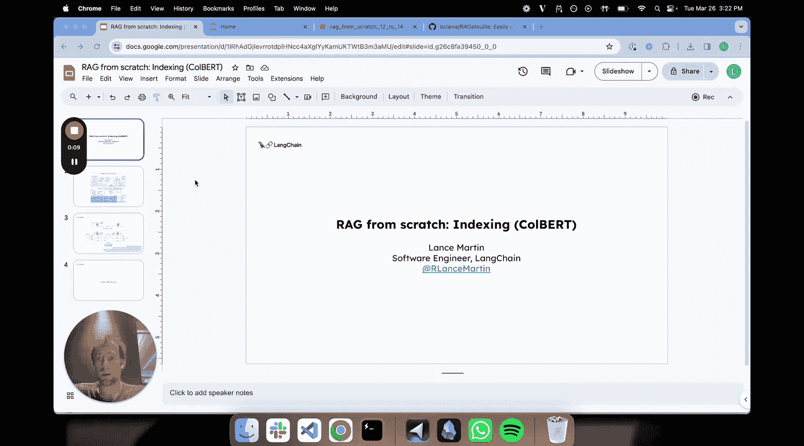
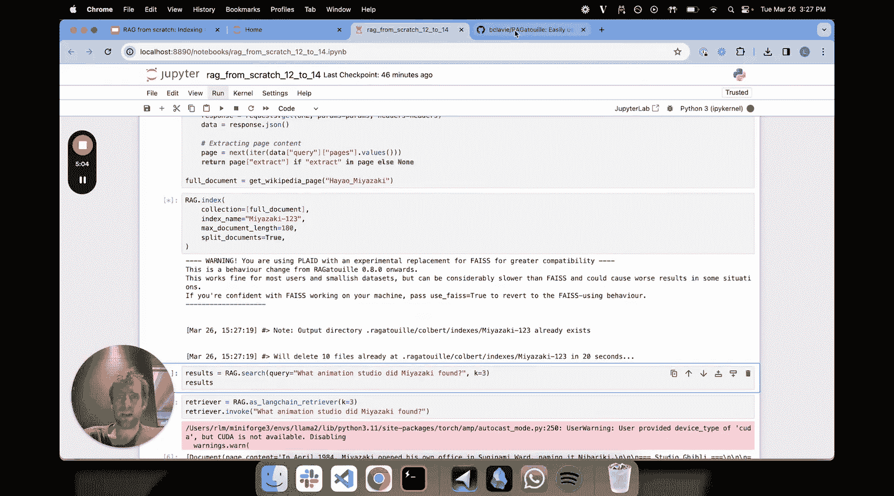
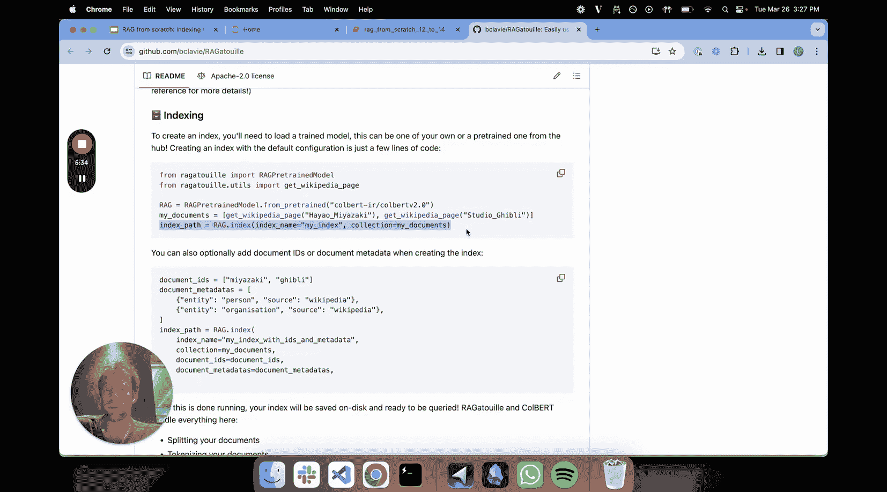
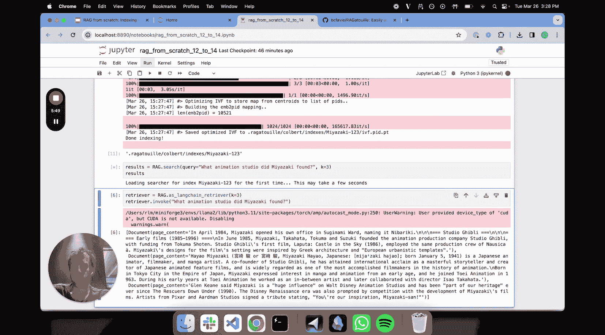
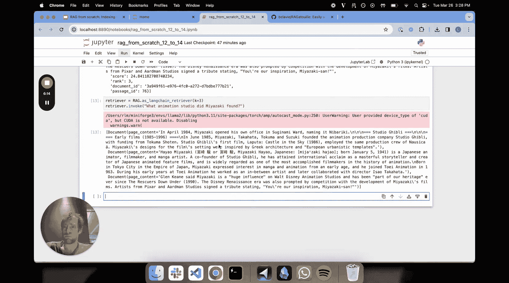
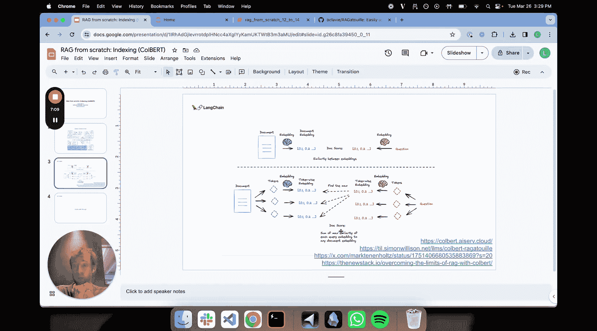

# LangChain【中英⚡使用 LangChain 从零开始构建 RAG 系统｜RAG From Scratch】 p14 P15 From Scratch： Part 14 (ColBERT) -BV1FgfMYLEve_p14-

This is Lance from Langchain。 This is the 14th part of our rag from a scratch series。

 I'm going to be talking about an approach called Colber。

嗯。So。We've talked about a few different approaches for indexing。And just as kind of refresh fresher。

 indexing falls kind of right down here in our flow。We started initially with query translation。

 taking a question， translating it in some way to optimize retrieval。

 We talked about routing it to a particular database。 We then talked about queer construction。

 So going from natural language to the DSL or domain specific language for any of the databases that you want to work with。

 Those are know metadata filters for vector stores or cipher for。

Graph Db or SQL for relational Db So that's kind of flow we talked about the date We talked about some indexing approaches like multi representation indexing。

 we gave a small shout out to Greg Cameron into the series on chunking we talked about hierarchical indexing。

And I want to include one advanced kind of embedding approach。

 so we talked a lot about embeddings are obviously very central to semantic similarity search and retrieval。

So one of the interesting points that's been brought up is that embedding models， of course。

 take a document， you can see here on the top。And embed it， basically compress it to a vector。

So it's kind of a compression process， you're representing all the semantics of that document in a single vector。

You're doing the same to your question， you're doing a similarity search between the question embedding and the document embedding in order to perform retrieval。

 you're typically taking the you know K most similar document embedding is given a question。

And that's really how you're doing it。Now a lot of people said， well， hey。

 compressing a full document with all this nuance to a single vector seems a little bit overly restrictive right。

 and this is a fair question to ask， there's been some interesting approaches to try to address that and one is this approach method called Colbert。

So the intuition is actually pretty straightforward。

 there's a bunch of good articles I linked down here。 this is my little cartoon to explain it。

 which I think is hopefully kind of helpful， but here is the main idea。

Instead of just taking a document and compressing it down to a single vector。

 basically single what we might call embedding vector。We take the document。

 we break it up into tokens， so tokens are just like you know units of。Of content。

 it depends on the tokenaries you use， we talked about this earlier， so you basically tokenize it。

And you produce basically an embedding or vector for every token。

 and there's some kind of positional weighting that occurs when you do this process。

 So you obviously you look to look at the implementation to understand the details。

 but the intuition is that you're producing some kind of representation for every token Okay。

 A doing the same thing for your questions。 you're taking your question。

 you're breaking it into a tokens and you have some representation or vector per token。

And that what you're doing is for every token in the question。

 you're computing the similarity across all the tokens。In the document。And you're finding the max。

 you're taking the max。You're storming that。And you're doing that process for all the tokens in the question。

 So again， token2， you compare it to every token in the document。Compute the max。

And then the final score is in this case， the sum of the max similarities between every question token and any document token。

 so it's an interesting approach， it reports very strong performance。

 latency is definitely a question， so kind of production readiness is something you should look into but it's an approach that's worth mentioning here because it's pretty interesting。

And let's walk through code。

So。There was actually a really nice library called Raattui。

 which makes it very easy to play with Colbert， she's Pippp and Staett here。

I've already done that and we can use one of their pretrain models to media this process。

 so I'm basically following their documentation， this is kind of what they recommended。

 so I'm running this now。Hopefully this runs somewhat quickly。

 I'm not sure I previously have loaded this model so hopefully it won't take too long and F I can see it's pretty quick。

 I'm on a MacM2 with 32 gigs so just as like a context in terms of my system。

 this is from their documentation we're just grabbing a Wikipedia page this is getting a full document on Miyazaki。

That's cool。We're going to grab that Now this is just from their doc。

 this is basically how we create an index， so we provide the you know some index name。

 the collection， the dot max document length， and yeah。

 you should look at their documentation with these flags。

 these are the default so I'm going to create my index。😊，So I get some logging here。

 so it's working under the hood。And by the way， I actually have their documentation open so you can kind of follow along so。

U。Let's see yeah right about here so you can kind of all this indexing process to create an index so you to load a trained model。

 this can be either your own pretrain model or one of ours from the hub and this is kind of the process we're doing right now create index is just a few lines of code and this is exactly what we're doing so this is my documents and this is the indexing step that we we just kind of walk through and it looks like it's done so you get a bunch of logging here that's fine let's actually see if this works so we're gonna to run rag search what an motion studio did me andzaki found that our K parameter and we get some results so it's running and cool we get some documents out so know it seems to work and what's nice is you can run this within line chain is a line chain retriever so that basically wraps this as a line train retriever and then you can use it freely as a retriever within line chain works with all the other different LMs and although their components like rerannks and so forth that we talk through so you can use this directly as a retriever。

Let's try this out and boom nice and fast and we get our documents again this is a super simple test example you should run this maybe on more complex cases but it's pretty easy to spin up it's really interesting alternative indexing approach using again like we talk through a very different algorithm for computing docimity that may work better I think an regime to consider this would be longer documents so if you want like longer yeah if you basically want kind of long context embedding I think you should look into for example the max token limits for this approach because it partitions a document into into each token I would be curious to dig into kind of what the overall context limits are for this approach of Colbert but it's really interesting to consider and it report very strong performance so again I encourage you to play with it and this is just kind of an intro to how to get set up and to start experimenting with it really quickly thanks。

😊。

