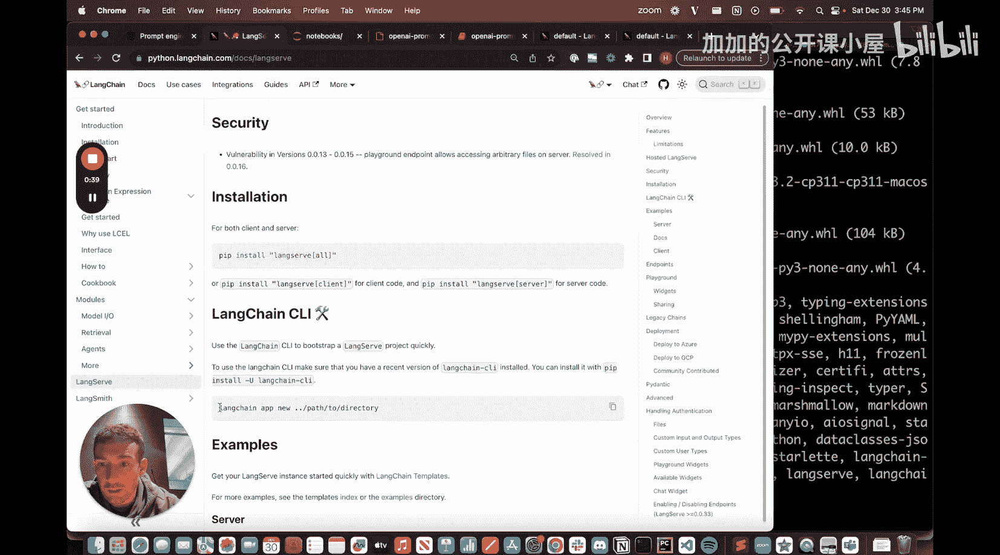
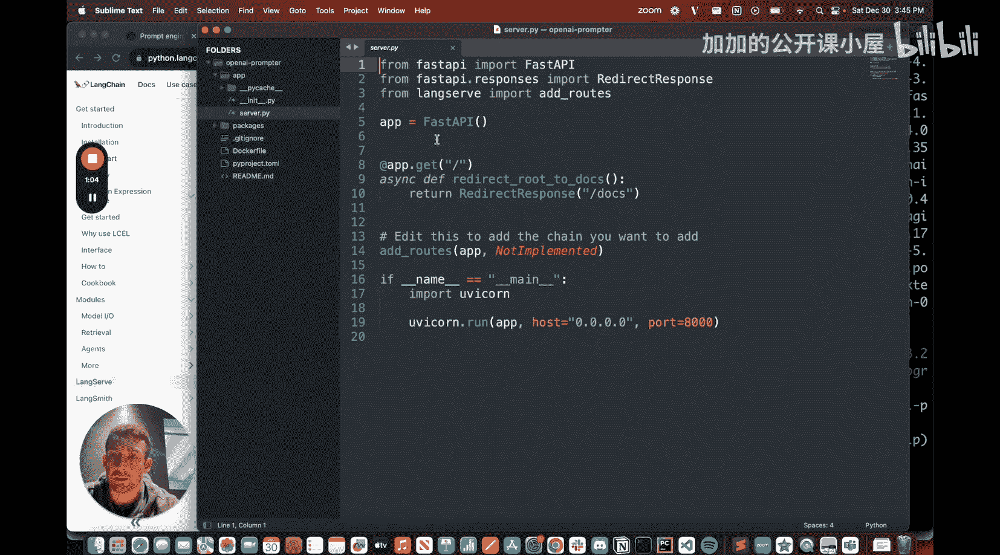
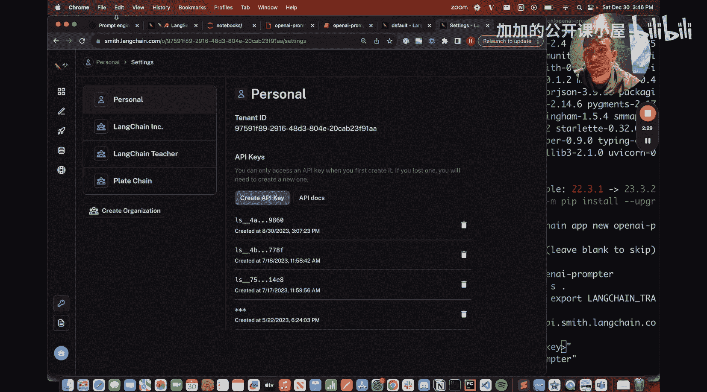
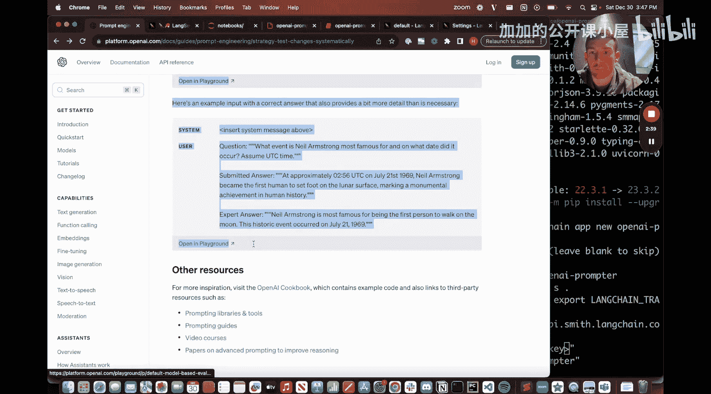
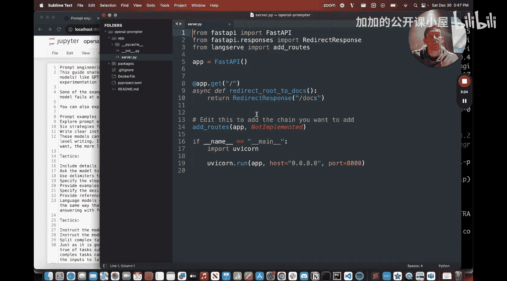
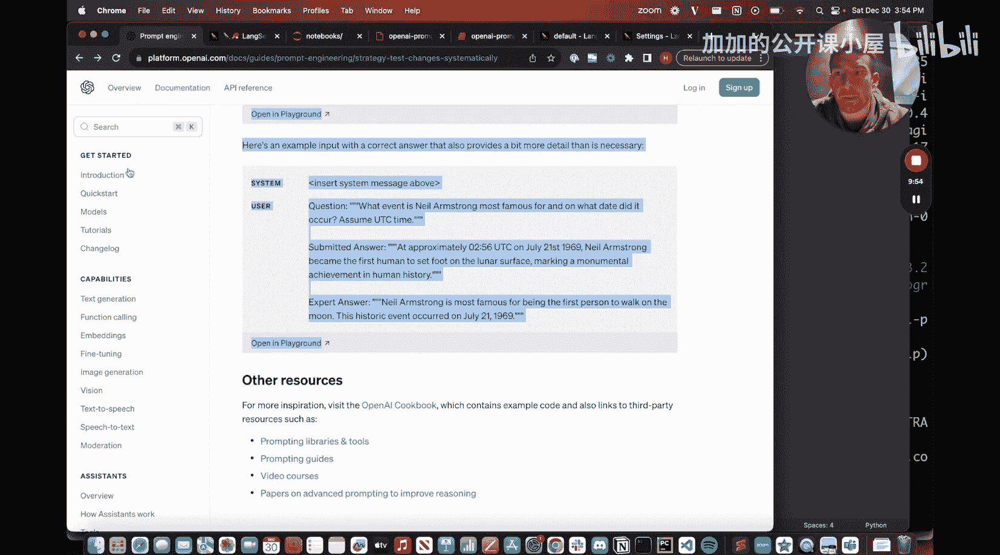

# LangChain【中英⚡LangChain 使用指南｜Build with LangChain】 p01 P1 Auto-Prompt Builder (with Hosted LangServe) -BV1xwfMYDE3n_p1-

All right， let's get started。This is the opening eye prompt engineering。Page。

 before we can start building with it， though， we need to set things， some things up。

So I've created a fresh， a fresh， virtual environment。

What I'm going to do is Im going to set up a L serve。Template link or application with this。

The reason that I'm going to be using laying serve is it'll make it easy to deploy this once I finish。

So the first thing I'm going to do is bootstrap a link or project。

 I'm going to do that with the L chain CI。 I'm installing it here after it finishes installing。

 I am going to create a new app。 I will call it。

Open AI。Prompter。I am not going to add a package because I'm going be creating my own。

I can then go inside it。And if I open it up， the main thing that I'm interested in is this L server right here。

 which wraps around fast API and will make it really easy to deploy my L chain chain。

The last thing I'm going to do for setup。Is set up L Smith。

So Langsmith is in private data If you don't have access to it and you're seeing this and you want to follow along。

 shoot me a DMm on LinkedIn or Twitter， and I will get you access to it。

 What it will make it really easy to do is debug as we go along。

 and this will involve a lot of prompter engineering。 and so we'll see how that becomes very。

 very helpful。Someone in a previous video commented that I should go over how to set this up more。

You can go to your projects。 let's even create a new project。 Let's call this。Open AI promptter。嗯。

That's all we can do。 Let's then go to setup， and then we can just export some API keys here。

So you can just copy this。You can paste it here， you then need to add in your API key。

 you can do that。我 me。Let me move my face over here， and let's move this over here as well。

You can do that by going to API keys。And all right。

 good it's not showing mine so you can create an API key and put it there。

I've already did this ahead of time， so mine's all set up but if you needed to do that。

 this is how you do that。All right， so let's go back to this prompt engineering guide。

The first thing we're going to do， we're just going to copy it all because we are going to be using this in our prompt to help us write better prompts。

Was pasted into a file。And then I'm I'm going to create my chain in a Jupiter notebook。

 and then I'm going to put it and then I'm going to put it into this app。

And so the reason that I'm doing this， there's。There's one real reason and then one fake reason。

 The one real reason is that this will be a pretty iterative process。

 I'm going to do some prompt engineering。 some of that I'll do in Lsmith。

 but some of that I'll do in the notebook as well and we'll see why and so having a notebook like environment is really。

 real helpful because it's an iterative environment。 and I can really easy iterate。

The other reason I want to do this is I want to show how it's really easy to create a chain and then just export it from a notebook。

Most of the time， it's， it's pretty simple。So let's save this。

I've now got this Jupyter notebook book。 Let's load what I just。Put it in there。All right。

 so let's do that。Let's import。 We can print out the head， I guess。See it。

 Let's import some stuff from lane chain that we're going to want。Co的。Promp。Temporate。That。2是。

String up a parsor。So。Not all。AI。 So I'm importing three important things。

 I going a pretty simple chain that I'm writing。 maybe we'll get more complex。

 but it should just be pretty simple because I'm just gonna use a model that has a long context window and can work with all these instructions。

 So I'm importing a prompt template。 This will help me structure the inputs to the model。

 I'm importing output parsor that will basically just convert it from a message format。

 which is how the newer models respond。 the chat muscles respond with a message。

 but I really want to have string。 So I'm getting that。 And then I'm importing chat openaiI。

 which is the La chain wrapper around the open AI models which are the ones that I'll be used。Now。

Is the fun part where I'm going to write my template for creating or my template that's going to。

Help me create a chain that can take in an objective and write a good prompt。So let's add this。There。

嗯。And okay， so， so this is actually an interesting point that I'll get to later。 But basically。

 what I'm doing right here is I'm going to have these instructions as a variable that I'll pass into the prompt。

And I'll go into that more later。 But for now， let's just assume that's what we're going to do。

And then let's add just some delimiters here。 and then let's say this。And。Go。Help。A good。Pm。That。

Okay， so what I actually want to write is not actually a prompt， but I want to write a prompt。

Template。Because I think most people write prompt templates because they want to write prompt templates that they can use in their code。

 or at least most La chain users want to write prompt templates。Help me write a good prop templatet。

This template should be a Python。8。Take in any number of。と。Depending on。Return。Your。Yeah。And。Format。

Let see。Ojective。Just this seems like used in first pass， I don't know， we'll see。

And then we're going to create the chain。 Okay， so as I mentioned， we have this thing here。

 which I'm going to pass in the instructions to。Let's see what would happen if。We didn't do that。

 And if we just did like。This， which you could also easily do。So if I did this。I would have。

Equals prompt template。And play。Template。Chain。诶。Equals。Ding up the par air。Shame dot invo。

 And now I'm going to pass an objective。 What should my objective be。电是。Question。Based on。

Context provided。好的。So this is a pretty typical rag prompt or retrieval augmented generation prompt you want the language model to respond to a user question based on the context provided。

So let's do this and then I get a here because basically what's happening is in these instructions。

 there's other。There those are curly brackets， which aren't variables that I want to format。

 They're just part of the text。 And so this often happens when you're working with code or something like that。

 And we've gotten a lot of questions about how to deal with it。So。

My preferred way to deal with it is to do what I done earlier。

 treat the text that has these unwanted curly brackets as input variables。And then， okay， so。

 so one way to do this is you may be thinking， okay， so that means that I now have to provide。

Text as。Text here。 this is a little bit annoying because now you have two input variables。

 It's not the end of the world， but it's a little bit annoying。

 And if if this chain is part of a larger chain， then then it starts to get more and more complicated。

 more and more annoying。And。I had。That should be tax。this is airin， because the models。

Not long enough， I could do some fancy rag。

It's just like barely over the context window and I'm going to want to use。

