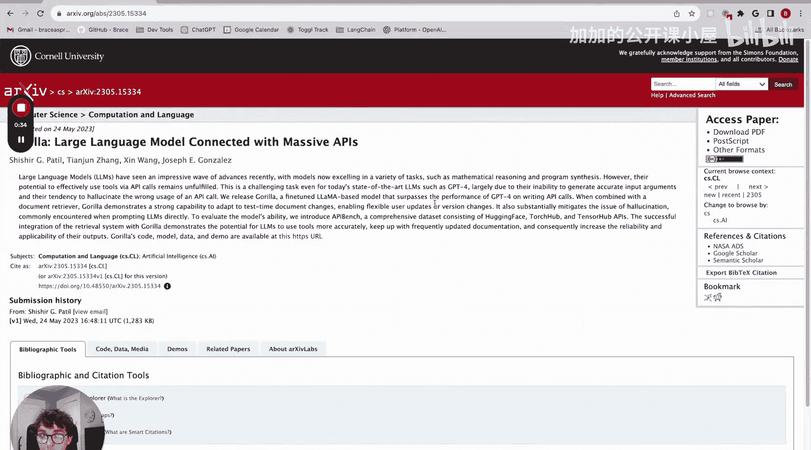
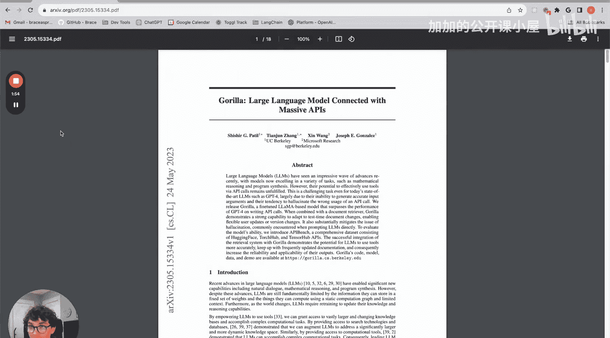
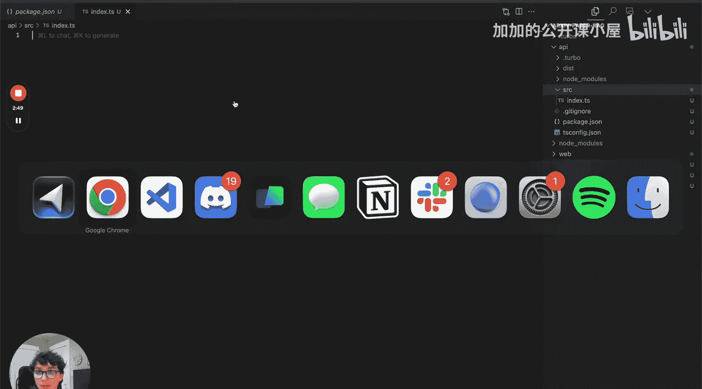
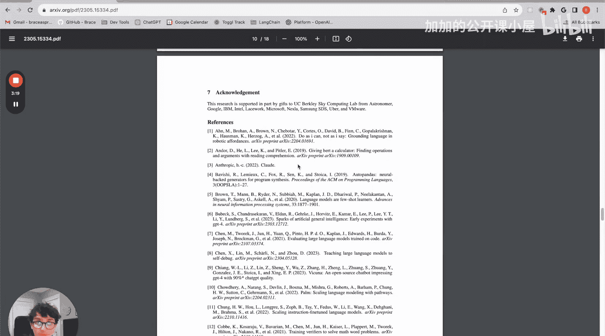
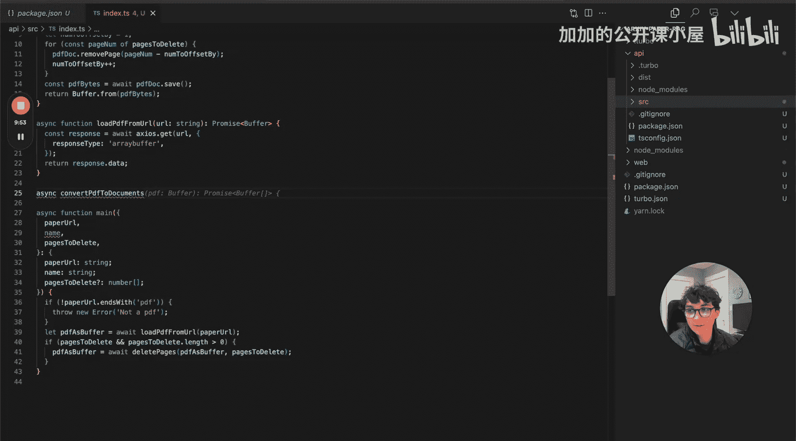

# LangChain【中英⚡LangChain 使用指南｜Build with LangChain】 p02 P2 Build a Full Stack RAG App With TypeScript -BV1xwfMYDE3n_p2-

Hey everyone， thanks for joining today I'm going to be doing a long form YouTube video on creating a full stack web app which uses L chain and an XGS front end for indexing。

 form QA， taking notes and overall just an easier interface for understanding papers from archive。

If you're not already familiar with archive， it's a website by Cornell。

And essentially it's a place where researchers can publish their papers and if you go to。

 for example， this archive URL， you can click download PDF and then you can easily get access to their paper in a PDF format。

So this app is what at a high level what it's going to do is you're going to have a front end。

 you can submit a paper URL。And then the back end is going to parse that paper。

 it's going to split up into chunks， it's going to hit G4 thanks to their new 128k context window we can confidently fit the entire paper no matter what paper it is into that context window。

 we're going to G4 take notes on that paper then we're then return those notes along with a set of questions which it's essentially prompting our user to say。

 you hey， you can also ask questions about these different parts of the paper。And then from there。

 the user is going to be able to say， you know， what is。X， Y。

 Z talking about in this paper and it'll go back to our server。

 our server will then using our we're gonna embed the paper。

 you know split it in the chunks using that it'll be able to look up context and answer your questions based on the context that paper so you can chat with your paper and understand it a little bit easier than having to go through and read the entire paper you know maybe instead of having to read all 18 pages like in this paper。

 you might only end up reading four or five pages total。

 and you get a pretty good understanding of the paper。

So to start， we're going to have a Typecr Monte repo， I've already created this spoiler platelate。

 essentially what it has is a web directory and an API directory and the web is going to be a next JS app。

 we will get to that later and the API is just a simple Typecrpt app we're going to use Express JS to make it to be able to turn to an API。

嗯。You can clone this from my Github。 I'll have this this template setup up so you can you clone there and start from where I'm starting at。

 Yeah， so API source director we're going to have an index file and to start off we're going to create our main function。

This function is going to take in three things。 The paper URL， the name of the paper。

 And that's just for like U I。 So you can on the website。

 you can see what the name of this paper is here， you're doing Q A over。

 And then a third optional argument pages to delete。 this is important because if we go back to。

This paper， we sees 18 pages， however。As we scroll down on page 10 through。10 through 12。

 So three pages。 there are， know references， citations。

 and these are full of text we don't really care about。 And oftentimes they have lots of keywords。

 which can hinder our our semantic search capabilities when we then go and try and perform rag in this paper。

 So this page is to delete optional argument is going to be the user can specify which pages they want to remove。

 and then we won't， you know， take notes on that paper room and send these G。

 We won't embed that or touch them at all so that we can have a cleaner。

Inbedding， so it would start by making an ay。We're going to take in three arcs of paper， URL。

Name and pages to。Do eat。So this is going to be a paper URL。I just string。 Thank you。

 Copi name Str page you to delete this number， but we want the number array。

 We want this to be optional。And then the first step for this function is actually loading the paper from the URL。

 So we're going to use axios。It's going to be。 we're going to load it as a buffer and return it。

 And that way， you know， it's an easy way to actually load this Pf and then be able to interact with it。

 So let's go ahead and create helper function。 We'll call it。嗯。Function。Load P F。From URL。

 So U string， and then。We actually don't want that copilt。Al， let's type the response。

 promise of buffer。Nice。And here we're going to have to import axios so import。Axios from axios。

And declare our。That is。What we want。Thanks， gopit。Yes。

 what this this is doing is this making an H TTP request to the you always specified。

 and it's defining the return type as an array buffer。

 This is we're gonna want to wrap this in a buffer dot from， though。

Just to make sure we actually do get our buffer return。And then inside of our main function。

 we can do a quick check if paperur。ends。Well。Bangs false。PDF。

 we're going to want to throw because that will not be the valid types， but throw a new error。

 not valid PDFf。Allright， and then we can call our function， so it's going to be cons PF。

As buffer equals weight。It beF paper URL。 So what it's going to do is we're going be able to pass in our paper URL。

And it's going to load that as a buffer。 And the next step is we're going to want to pass that through to unstructured。

 which is a tool with La or it's a component that La chain offers。

Wwhich will allow us to break this paper down into smaller chunks。

 more manageable chunks that we can embed， and can then convert that back to a string to send a GT and it's overall just a really great way of dealing with unstructured data they support most data types。

 PDF HTML pages， they kind of do it all and they've got some magic that happens to the background which is able to parsees PDF and breaking down to pieces like a header or a body description or image or a table whatnot。

 and it makes it really easy to deal with these unstructured data formats。Actually， for this。

 I'm in a mistake since we're specifying the return type as a ray buffer。

 we don't need to wrap it a buffer up from instead， we can just do return。Response do data。

 And as you can see， our typescript is not keep complaining about that。

 And that's because it's any type， but。We know that since we're using this response type。

 it will be the right response type。So after we've done this。

 we're going to want to go through and delete the pages first if a user has specified pages to delete and we want to do this before we actually use the structure to parse the PDF because we don't want to be parsing pages we don't care about。

So let's do with a quick check to see if pages to delete is true and。Pages to delete。

Length is greater than 0。 And if this is the case， we're going to want to call our pages to delete function。

 So let's go specify that up here。 step 1， we're going to be using a library called P D F Lib and their P D F document class to actually load in handle leading。

The pages。 So let's define a new function。A think function。Delete pages。

 And this is going to take in the Pd F。As a。Oer。And the page to delete as an array of numbers。

Let's use this， So what they're doing here， they are loading the PDF and awaiting that。

 which is what we want。But this is not going to work。 What we want to do instead， is iterate over。

Each page to delete。 So we need a counter for the number of pages to offset by。

 And this is because once we remove a page， the total number of pages in that P F is going to change。

 So we need to add one to a number offset by。 So let。Numb to。Offset by， and we'll start that as one。

And then four cons page number of pages to delete P F doc。 remove page， page number。

 minus number offset by， and then plus plus。And that looks right。

 And then what we're doing here is we're saving the new PF and we're turning it。

 This is going to be our unit 8 array。 but we want to return it as。A buffer again。

 to match our previous type。 So we are going have to match wrap this in a buffer do from to convert this back to a buffer。

So now we can go down here and if a user is specified， they want to delete some pages。

 then we can delete them here。We're going do wait。Pages delete delete pages。

 PDFf as a buffer and pages to delete。And then we're also going to change this to。

Not be a constant so we can reassign the P D F value there。Okay。

 so the next step is actually using unstructured to chunk and parse our PF。

 So we're going to define a new function。 We'll call it async。 Let's see， convert Pf to。

Documents and the documents is referring to L chain's document type。

 It's the the type we use for specifying。

Documents that we then embed。