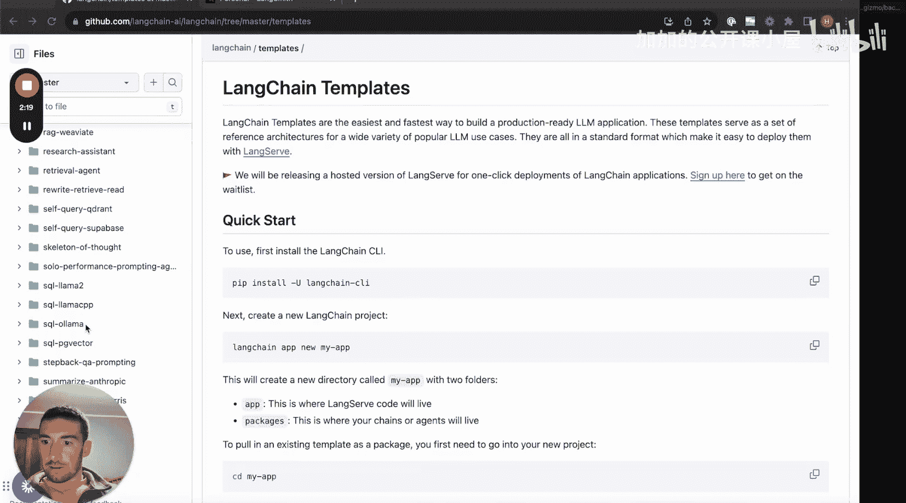
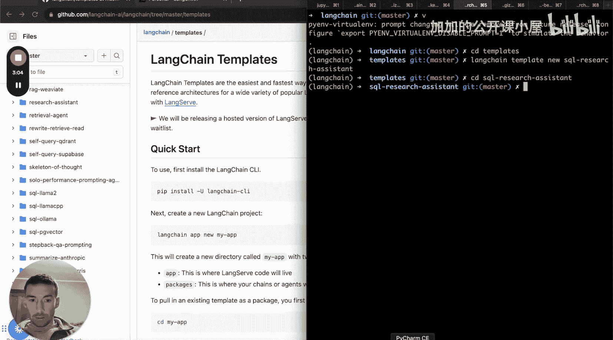
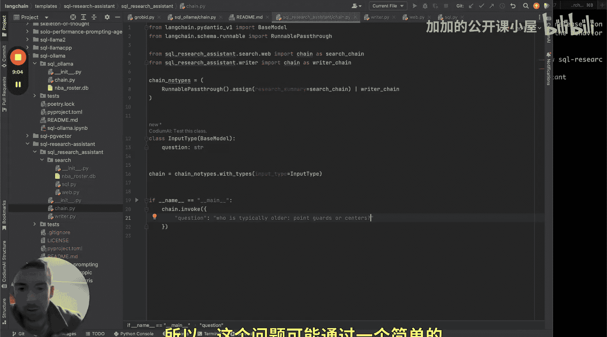
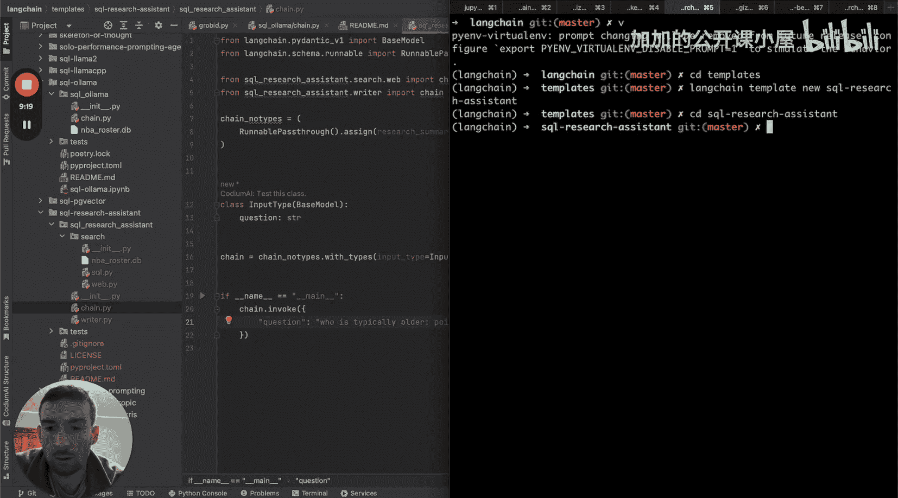
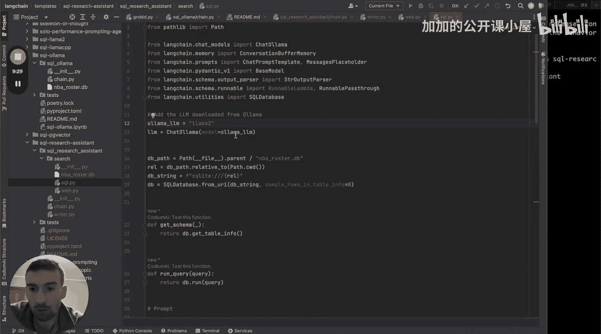
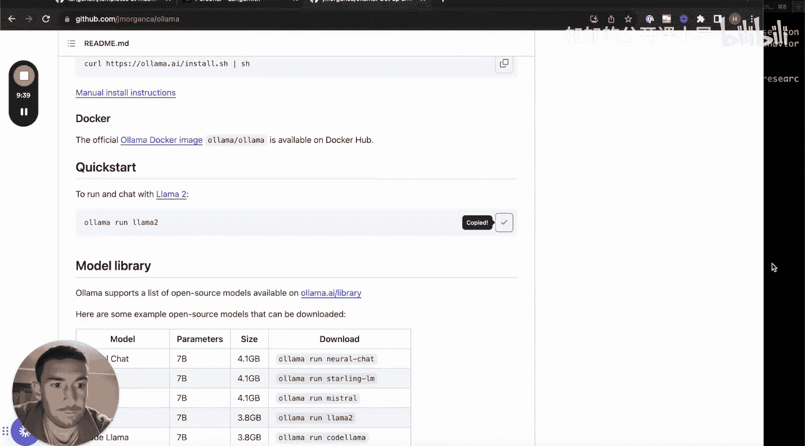
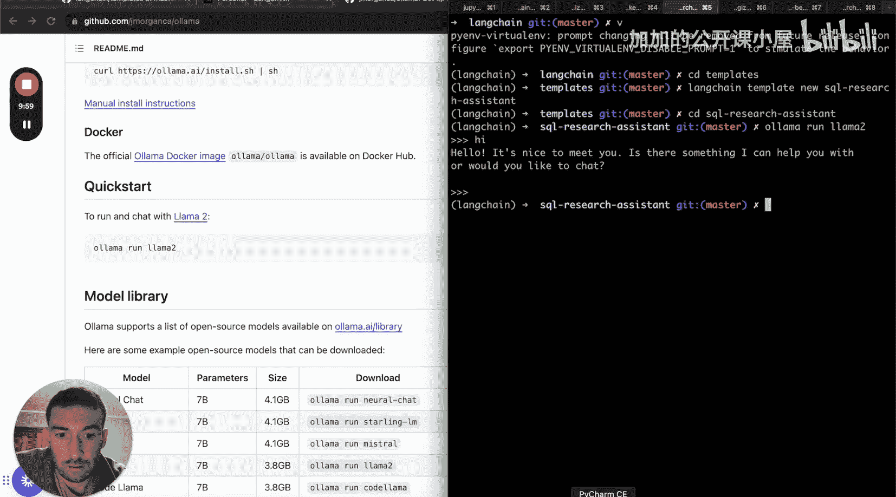

# LangChain【中英⚡LangChain 使用指南｜Build with LangChain】 p03 P3 SQL Research Assistant -BV1xwfMYDE3n_p3-

Welcome to another YouTube video where we're going to build something really cool。

 This is going to build off of a previous template。

 It's going to build off of a it's going to build off the research assistant template。

 but it's going to be a modified version specifically。

 we're going to get it to work over SQL databases。 So what that means is we're going to create a research assistant that does its research by executing SQL queries and and asking questions of SQL databases。

 And I think this is interesting for two reasons。 probably many more。

 but two reasons to highlight first。😊，A lot of data is in structured format。

 and so being able to not only ask questions of it， but also write research reports over it。

Unlocks a massive amount of use cases。Secondly， what we're going to be doing is actually using a subchain。

A sQL chain as the thing that's doing the research。

So this is hooking up the research assistant to another chain， which is itself。

 using the LLM to generate SQL queries and then returning that。

So I think that's really interesting because it shows off this idea of having multiple LLMs with different responsibilities。

 communicating and delegating。And so we're going to combine the research assistant with a SQL question answering template we'll pick one that exists already。

And yeah， I think this will be a pretty cool combination of two interesting topics。

So we're going to be working out of the L chain templates repo， this is it pulled up here。

The research assistant template is。Right here there's a few SQL templates。

 we're going to use SQL Oma。 I really like Oma， it's a great way to runllma as well as other models locally。

嗯。And yeah， we're gonna dive into it。 we'll be setting some environment variables。

 but I'm going to do everything from scratch so you guys will be able to see exactly what I'm setting and what I'm having to do。

 I'll probably pause my screen at various points so I can use environment variables and things like that and not leak those but other than that。

 this will be completely one take from scratch。

So。This is my copy of the link chain repo， I'm going to initialize my virtual environment。

 I already have one set up and then I'm going to go into the templates repo。And I'm going to create。

A new template。So I created a new template called L chain or sorry I created a new template using the L chain template new。

 and then it's called SQL research assistant。 I can now。MoveInto it。And there we go。

 I've got that set up。If we take a look at what is inside it。

We can see that we have a basic skeleton and the chain file， which is here。Is。Yeah， pretty basic。

 it has this has this like talk like a pirate example。

So what we want to do is we're going to be working off the research assistant。And so， let's grab。

Let's grab this。And let's move this in here。Let's call the SQL research assistant and let's overwrite everything。

Then I need to fix some imports probably， so I need to add SQL there。SQL there。

 Where else is SQL used， not there。 Do we use SQL。Okay。So I've copied over the research assistant。

 I've renamed it to SQL Research assistant。That seems like a good start。

If you haven't watched the research assistant in YouTube video， you definitely should。

 this will be doable not having watched that， but that would provide a lot more context。

The research assistant basically has two components。

 it has a research chain and then it has a writerer chain。

 the writerer chain can be relatively untouched if we look at that it is oh actually this I think。

No this is good it has a bunch of prompts that say to write research report， it uses open AI。

 we can keep on using open AI and so the writer chain is good what we want to change is is the research chain so previously we look things up on the internet we want to change this to now。

Use SQL， We can see the chain down here。 and so。Looking at this in more detail。

 the first component generates a bunch of smaller search queries， and then basically we look up。

 we do a search on each of those sub questionsions， answer them。

 and join the responses and then we pass that as the final research report which then gets rewritten into an essay。

So what we basically want to do， we still want to generate sub questionsions。

 so this is going to be the same wellll maybe change the prompt a little bit。

 but that'll be the same What we want to do is replace this part if we look at where this is defined。

This basically gets a bunch of links， scrapes them， summarizes them。

That we want to replace this with a SQL chain。So we have a bunch of sub questions and we want each sub question to go to a SQL chain and then respond。

So let's take a look at sequel oldma。To see what's going on in here。

So this is the SQL chain it actually does more than we want， so it has a conversational memory。

 we don't need that because remember we just want this one particular chain， but let's copy。

All of this。And lets。Put it in a new file here， I guess。嗯。Let's call this SQL， let's put that there。

 we also need this so this this example is doing question answering over a SQLite database。

That has information about MBA rosters So we'll end up asking it's a pretty simple database。

 So the questions that we're going to end up asking in this video are probably going to be pretty simple。

 but that's fine。 The point of this is to show how you can heavily modify the research assistant template to do research over any source。

 And so the fact that this particular source is a pretty lame and on interesting MBA roster database doesn't matter too much。

So we'll paste that there。Then we're going to modify this chain slightly。This。Is unnecessary。

 So so this you can see is doing some saving of memory。 We don't want to be saving me memory。

 we don't want a concept of memory。 If we're just doing this， we really just need a SQL chain。

 the SQL chain， we can also remove this history bit。Yeah， we can remove this history bit。

 and then that'll be good if we can use that。 so we'll replace the SQL response memory with just a SQL chain。

um。Cool， that seems relatively fine。We might have to change some typing around the outputs。

 but let's work with that。 Let's call this。SQL answer chain。And then what we're going to do in here。

Lin chainin， nope。From。Squal research。Assistant。Search。SQL import that。

And then we are going to use that right there。So we're taking this chain。

 which comes from the SQL template and is designed to answer a single question。

 and we're basically dropping it in here， the map is going to mean that it's going to apply for all the questions that are generated from the subquestion generation。

嗯。Let's add。Let's add a little test case just to try this out before we spin it up。嗯。Chain。

Dock in lo。Question。And。hoho。Is。Typically。Older。Point guards or centers。

So this might be answerable with a single SQL query， but it's a good。

It's a good example of it's a working functional example。嗯。Okay， so before running。

 we need to make sure that Obamama is running。 Alma is what we're using to。

Use a local LLM and actually。Let's take a look at which So we're using Zephyer Zephy' is actually a little bit too big for my backBook。

 so I'm going to switch tollma2 if you haven't set up Oama。

Definitely check it out。 Super cool Repo makes it really easy to interact with language models。

In order to make sure that I have it running， I'm going to do this。Let's taking a little bit。Okay。

 hi。Awesome， cool so I can see it running。 That's fantastic。U。I'm using。

