# LangChain【中英⚡LangChain 使用指南｜Build with LangChain】 p04 P4 Skeleton-of-Thought： Building a New Template from Scratch -BV1xwfMYDE3n_p4-

Alright。So today we are going to implement a new template and we're going to implement it for this new paper that just came out。

Skeleton of thought， large language models can do parallel decoding。 So I saw this on Twitter。

 I figured out where I saw it， but I thought it was really cool。

 and it places some strengths of lane chain and of La chain expression language。 Naly。

 it's going to use multiple LLM calls， it's going break things down into small chunks。

 And then a bunch of those LM calls are going to be conducted in parallel。

 And so with lane chain expression language， we can do that fairly easily。😊。

So we're going to create a template for those and for minor what templates are。

 those are really easy way to get started with any application。

 and so we have a bunch of predefined templates here。

 but we're going to create a new one and so we should have instructions on how to add yeah all right。

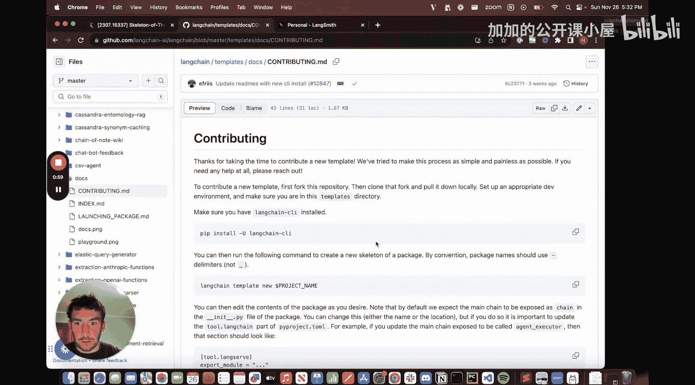

So let's create a new template。 I'm， if you look here。

 I'm in my workplace L chain templates directory， L chain template。You。Skeleton of。啊。AndThere we go。

All right。ああ。Yes， alright。So now have this。Examp template that was just set up。

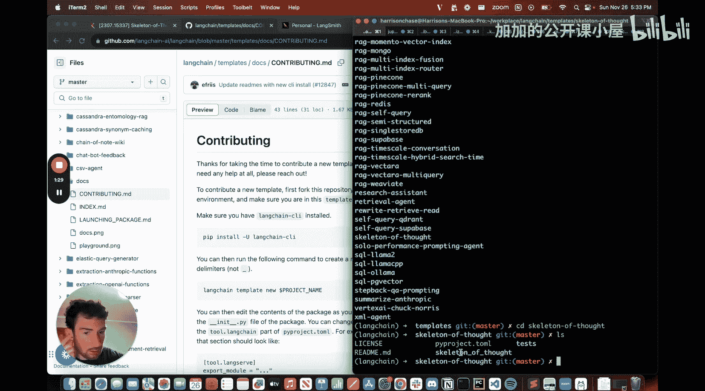

I can go inside it。Let's find it where are we skeleton of thought？

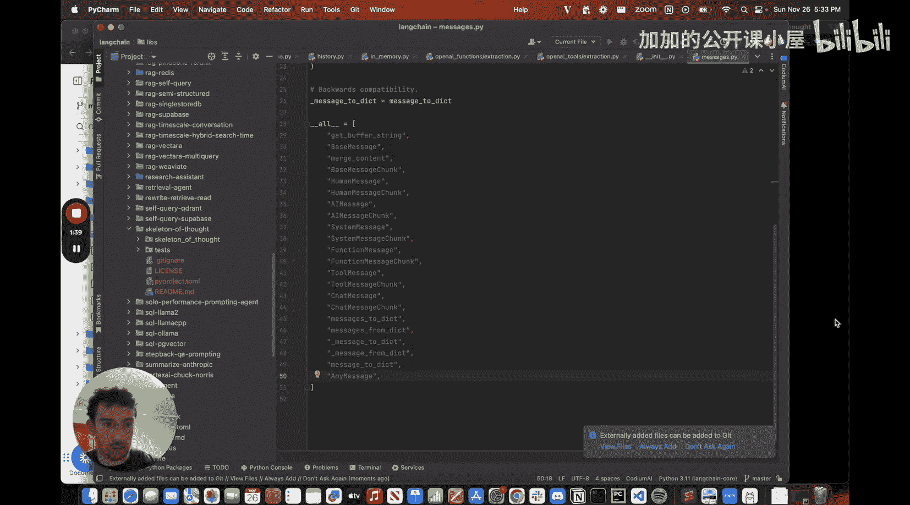

K。Everything in here， get。

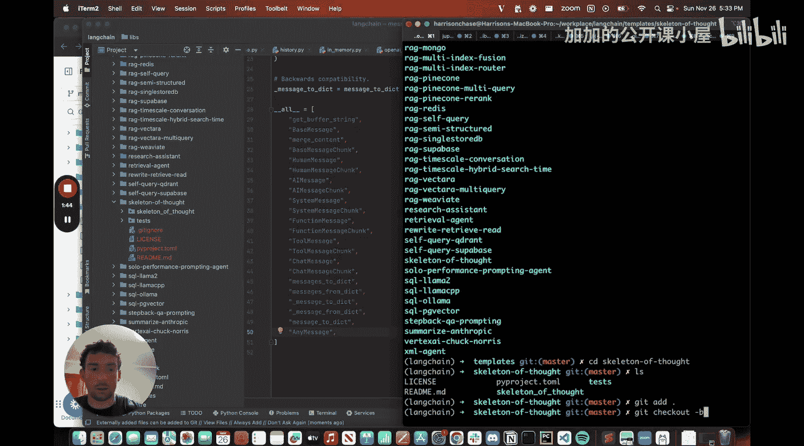

，keleton。Thought all right just checking out a queen branch we've added a bunch of stuff in here we can see that we have a really simple readme so I need to add a description here。

 I'll do that later， environment variables I'll do that later and then a bunch of predefined documentation there。

Got some pi project at Tels with some dependencies。 We'll use open AI for this。

 Maybe we'll go into how to do this with a different language model。 It should be pretty easy。

And then the main part here is such chain。 we have a really simple dummy chain here， but of course。

 what we're going to do is to going implement this new paper， skeleton of thought。

 So what is this paper。

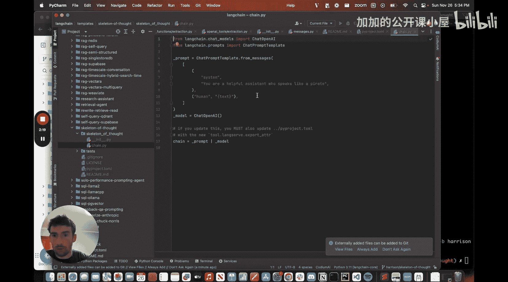

'Pot a link to this in the YouTube description as well。But basically， the idea is。

It's a really cool idea。If we take a look at here。If you get a question like what are the most effective strategies for conflict resolution in the workplace。

 a normal LLM response would just be generating this answer one by one。

What skeleton thd does is it generates a skeleton， really short bullet points。

 and then it expands each bullet point。And the reason I like this is it。

They speed things up such really， really fast。😊，Wwhich is good And then also this kind of speaks a little bit to kind of using the language model to plan and then execute on things。

 So here each execution is just expanding with another language model call but you could easily imagine that each execution could be another you know it could write a whole paragraph it could write a whole research report for each bullet point it could actually take actions and do them  importantly like here the reason that this is helpful and that you can do this as opposed to like a react style agent or something is that all of these are kind of independent so you can do one without doing two and you can do two without doing three or two without doing one and that makes it really easy to paralyze them which leads to the speedup So if you're doing things where it relies on the results of previous steps that may not be as good of fit for this。

So。Let's see。 Okay， so this is prompt 1。 This is prompt 2。 That's great。

 It looks like they're already in。Okay。Okay， so we've got one and this is being used to generate the skeleton。

So。Let's。

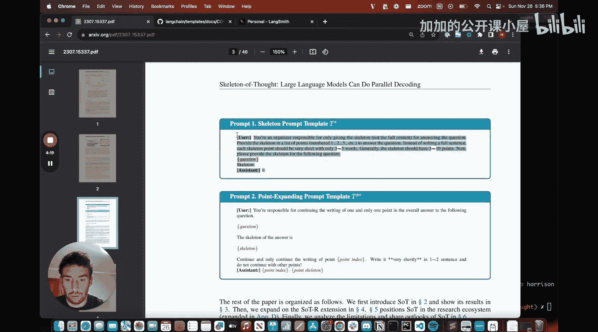

py this。嗯。That was in。Very。Template。Mm。There's some weird， like， new line stuff here。嗯。

I'll just do that。No。That seems fine。 And then。Gtton。And then we're working on your from template。

From this template。嗯。Let。嗯。We're going to import this because now we're going to create our chain。

 Our chain is going to be really simple。 The first chain。 So we're going to create our first chain。

 which is generating the skeleton。 So it's going to be this prompt。The same。The I。

And then we're just going to parse out the string we're probably going to actually need to do other things。

We're going to need to parse out the bullet points because we're going to want to work with those。

But for now we can just do this and then let's test out。

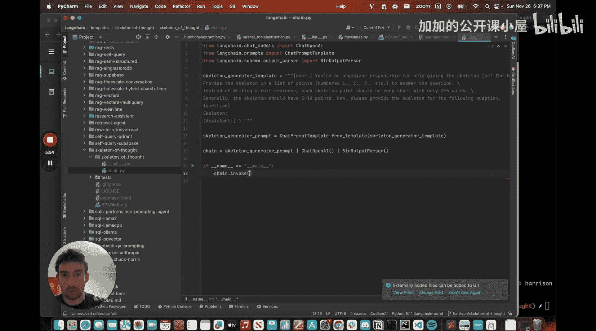

Let's see。 Do they have a good example in the。So this is an example they give in the paper。

 we'll use that。

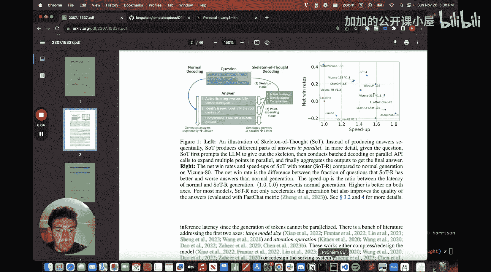

嗯。Some weird stuff happens when copying things over。Okay， let's try that out。

Print out this just to make sure we're also lockging things to Lismith。

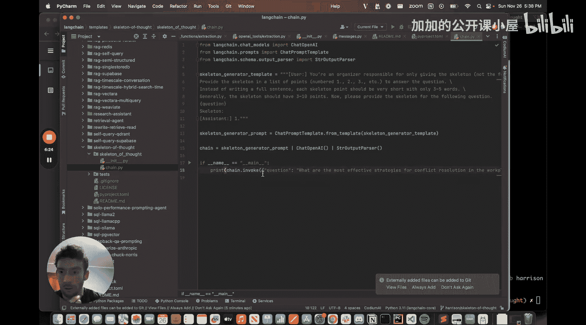

So what Lnksmith is is the debugging logging。A tool that we've built on the side。

And so what I've done before is I've basically copy pasted。 I'm using my dev account， but。

you should use the regular Lsmith account it's Smith@lingchain。

com you can sign up practice there it is on a waitlist if you don't have access。

 shoot me a DM on non Twitter or LinkedIn and we can give you access pretty easily。Once you do that。

 I've just exported these three variables， you want to pop in your API key there。

 I've already done that， but you should do that and then what that does is it will trace everything that we do。

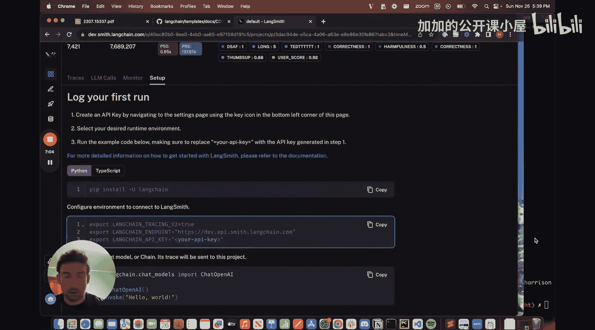

So here， let's do Python。Skeleton of thought。Chain， let's run this。

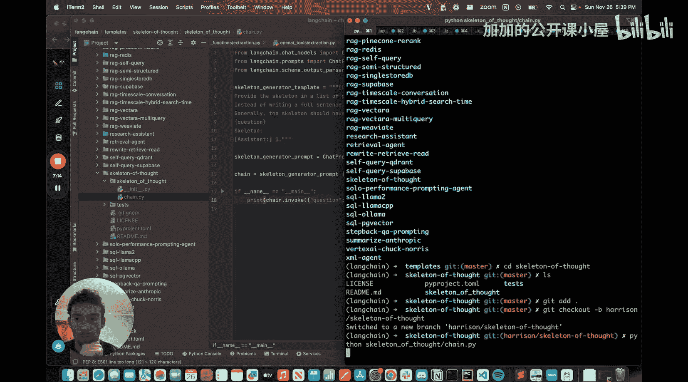

And so it should print it out here。 Okay， so this spits out the。Skeleton 10 bullet points。 Okay。

 that's a lot。 We can also see that it should show up here。 So here we have this re sequence。

 We can see it's really simple。 It's just a prompt template。 Albert parser。

 What I really like about Lsmith is it will let you open things up in a playground。

 So here if we wanted to play around with the prompt for whatever reason， Like I said。

 we wanted to try to change this to just have。😊，Two to three points。

Let we do that and we can rerun it。And here reads say that just generates two points。

 So this is really useful for debugging things， especially when they in chains。

 it's also useful for seeing what's going on under the hood。

 which right now doesn't really matter because it is quite simple。 It's just this。

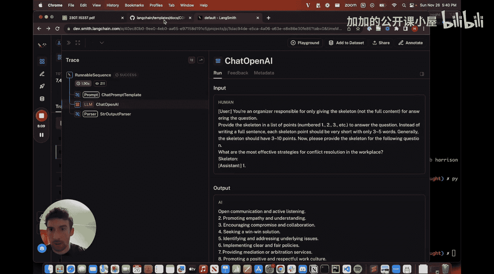

But when it comes time to add in the next point， the point expanding stage。

 it will come in quite handy。So let's take in this point expanding stage。

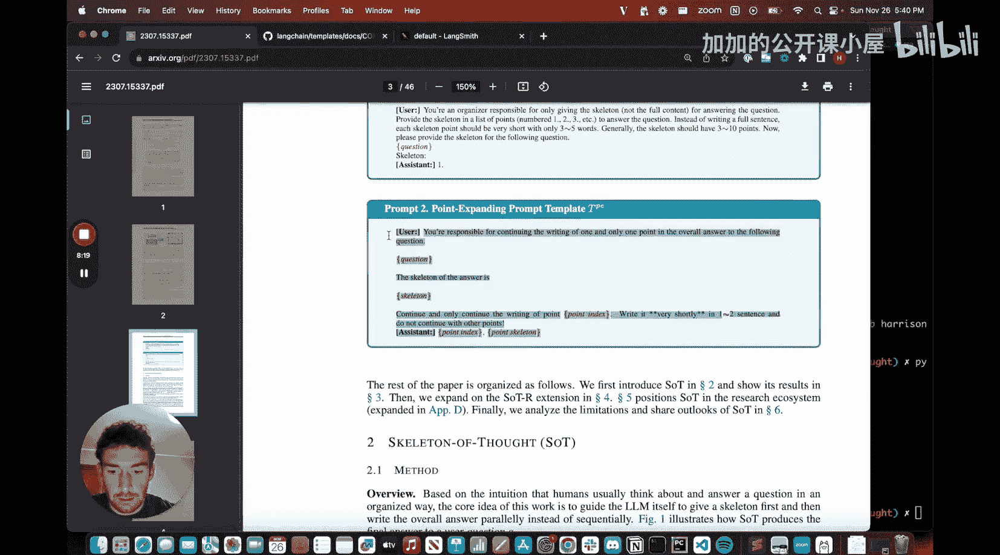

And let's do。And。Template。All right， we're going to add this in。Okay。

So now this takes in a few different variables。Let's。Make this。Template from template。

expanded template， so this takes in question skeleton， which is what we just generated， point index。

 and then point skeleton。Okay。So what we're going to want to do is we're going to want to。

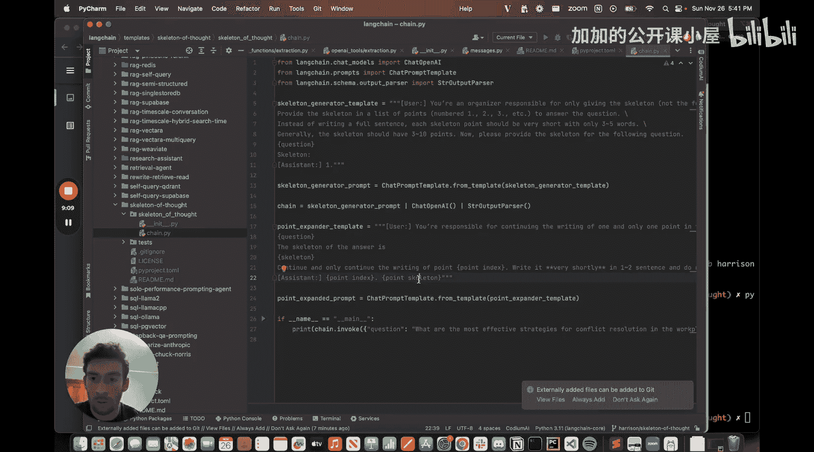

Take。Let's see if there's any good diagrams for here。I guess the main digger， wow， okay。

 there's a big appendix for this。 What's in this appendix？Okay， so they run it on a lot。Oh。

 different。They have some。Yeah， okay， so they have a bunch of different prompts for different models。

 which is really cool。 we'll probably just do a basic one one shot prompt。😊，嗯。Oh， that's cool。

 So they do some。That's cool， So they they do some like routing between， it looks like just a big。

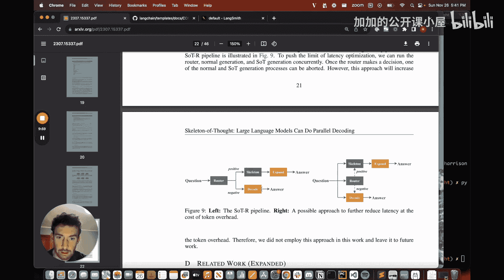