# LangChain【中英⚡LangChain 使用指南｜Build with LangChain】 p05 P5 Building a Research Assistant from Scratch -BV1xwfMYDE3n_p5-

Today， we're going to build a research assistant from scratch。

This research assistant from Tvili AI is one of my favorite LM applications。 It's complex。

 It's more than just chat。 It's actually useful， and it performs well。 And。

 and so we're going to build this from scratch， using L chain and。

Take a look at what goes into all the decision points along the way。

So if you're not familiar with T VI research assistant。It is a web hosted platform。

 although there's also an open source version。 and we'll talk about that。

 but it's a web hosted platform where you can give it a task。

 such as what is the difference between Langtrainin and Lang Smith that will do a bunch of research from the web。

And then write this really long report。So this is much longer than you know you might get back from Chad GT or one of the other search engines。

 It takes a lot longer as well， as we'll see， there's a lot going on behind the scenes。

 So you're not going to get back this instantaneous response。 So there's pros and cons。

 but I really like this because you are able to do a lot of research behind the scenes。

 You are able to put more work in， and that generally allows better and more interesting responses。

So Tvi AI is based off of this open source repo called GT Researcher。

 we've worked very closely with them at Langtrainin and to understand what's going on。

 they have this great diagram。And so what's going on in the hood is it takes in a given task。

And then for that task， it generates a bunch of research questions。

So it will generate a bunch of research questions。 And for each one。

 it will then look that up online。 It will get a bunch of web pages。 So this is a web research agent。

 We'll talk about how to make it more generic than that。 But this is a web research agent。

 So we'll get those web pages。 It will then summarize those web pages and then using all the summaries。

 it will generate a final report。So that's going on。 What's from the hood。 A lot of moving pieces。

 A lot of it can be paralyzed as well。 So I'll talk about how to do that。

 So it gets a little bit faster。And。Yeah， let's， let's jump into it and build it from scratch。

We are going to be using Open AI so if you don't have an Open AI API key。

 you can go ahead and get one from Open AI themselves。

 and then we're also going to be using Lismith a bunch to kind of like show what's going on under the hood So this is a login debugging tool that we built that link chain if you don't have access to this yet feel free to shoot me a message and we can get you off the wait list。

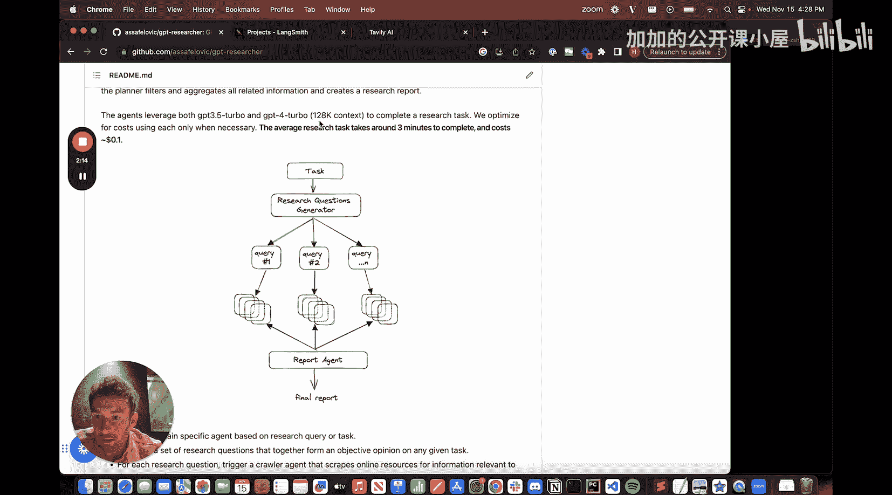

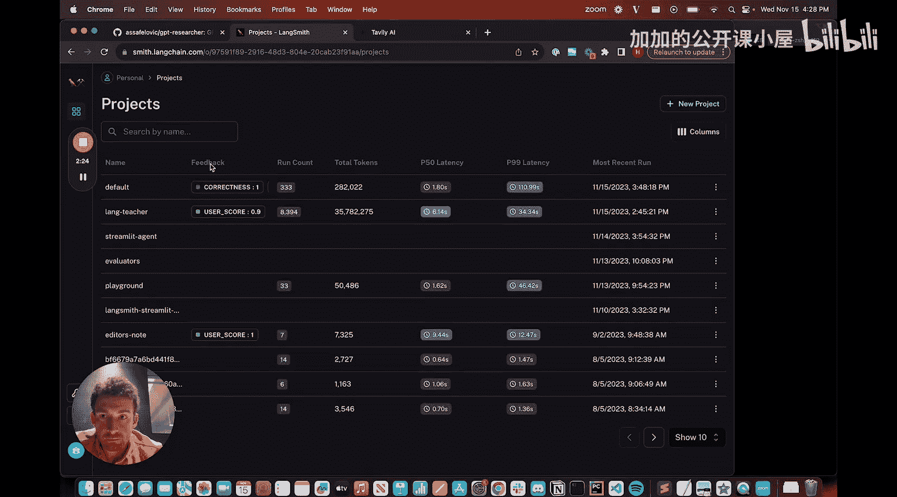

So the first thing I'm going to do is I've got my environment。

I've got my coded editor set up。What I'm going to do is set a few environment variables。

 I'm going to set。Open AI API key。 I'm going to set my linksmith keys。

 I'm going to pause the video and do that now so you don't see my secrets。All right， done。

So now we're going to install a few packages， we're going to install a plane chain。Open AI。

And then duckduct go as well。 So we're going use them as our search engine。

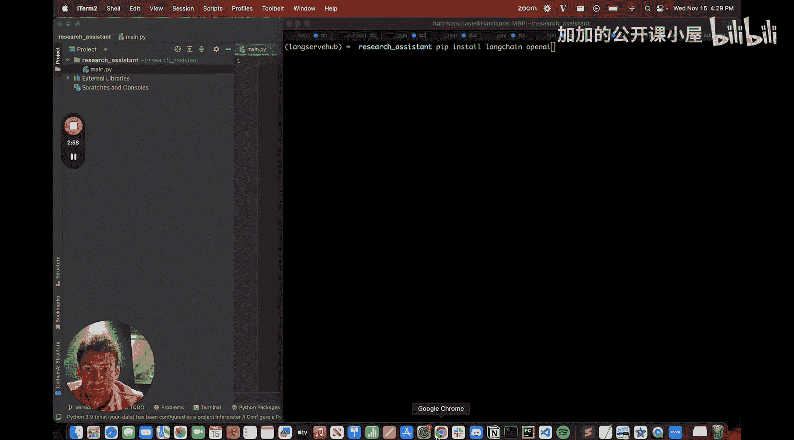

Gota look up what there。Python package。 name is。

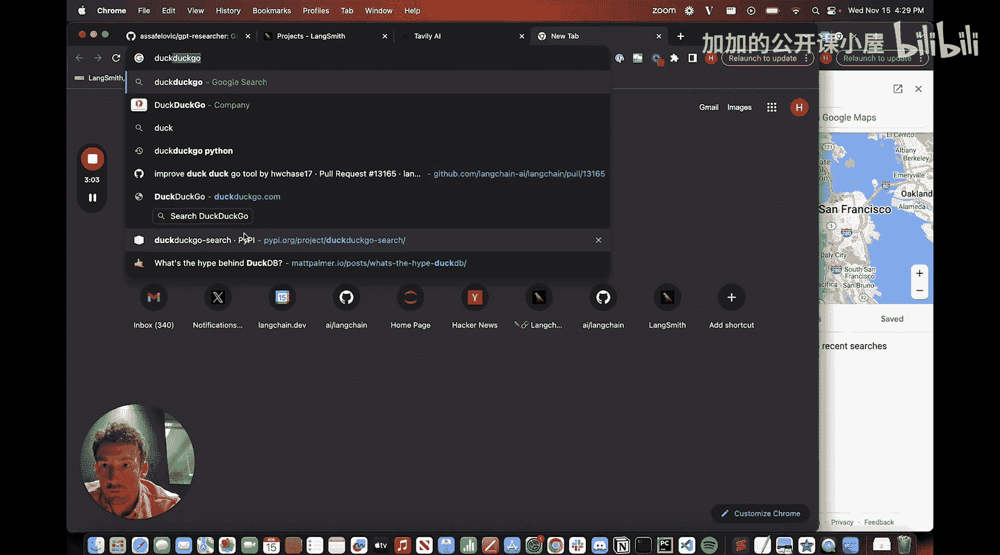

Here it is duck， duck go dash search。So we're going to install that。We may need some more libraries。

 but we'll install that to get started。

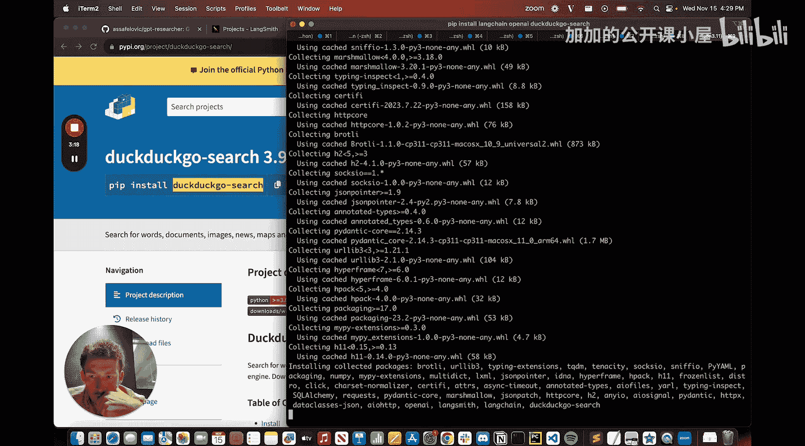

While that's going， let's think about what the first thing that we want to implement is。

So let's start from one of the smaller kind of like parts。

Which is basically the sumization of a web page。So at the core。

What it's doing in the middle is it's taking a question。 it's taking a web page。

 and it's summarizing the response。 And the reason that we want to do that。Is a few fold， one。

There's going to be a lot of different web pages and a lot of different information here。

 So maybe we could pass this all to the final report agent， maybe the128 k context window enough。

 but even if it is。It's generally more performant to split it up into these smaller tasks and ask the language model to kind of perform those。

 It's more focused for one。 You can parallelze it better for two。And then three， you know。

 you can use other models besides the really long context window ones。

So let's focus on this first task where we're going to take in a web page。

 take in a question and summarize the response。So let's write this。 And the once we get this working。

 we can work worry about kind of like scaling that up。 So just as an example。

 let's go to the link chain blog。Let's pretend we're asking about the difference between Ling chainin and Ling Smith。

Let's pretend one of the sub questions is like， what is Lsmith， So L chain。

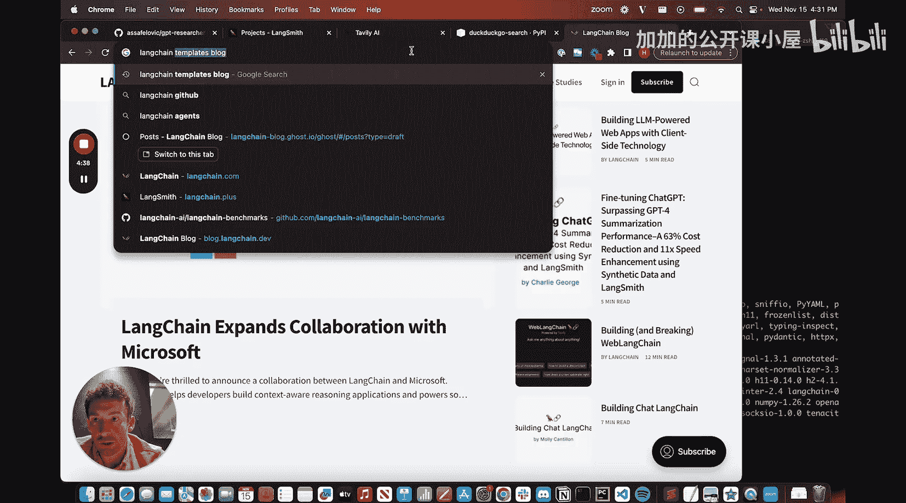

The lot going。Let's find one of the blogs。

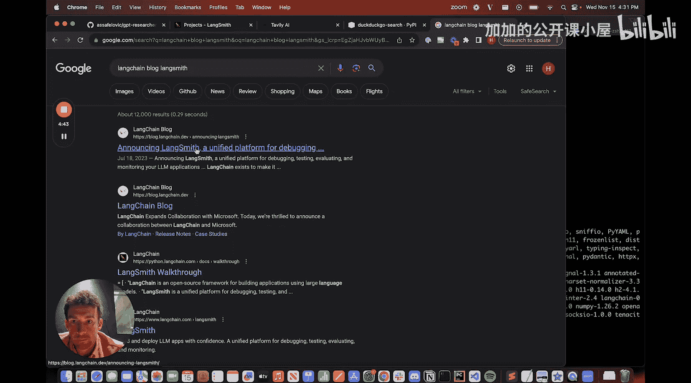

系。So let's take this URL。I'll just set this as the URL。嗯。What are we going to import？L chain。じまろ。我不爱。

うた。Partt。Template。诶。Or let's make。Some prompt template。 Well。

 I'm gonna pause it and fix my python interpreter issues to avoid all those wreck s little。All right。

 we're back。So let's make our template。 Let's say our template is going to look something like。那么。Oh。

Question。Based on the context， we're going to update this is is a placeholder。

 we're just going to get started。Question。Quest。Unt。Context。Prompt。

 we're gonna set chat prompt template。From Tlo。Template。嗯。Okay。

 so that's that Now we need to figure out how to get the content from this URL。In order to do that。

We're going to need actually two more modules。 We're going to p。

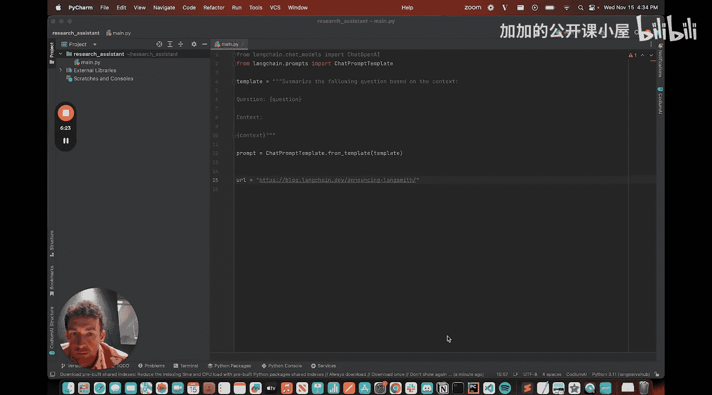

St。Requests。 And then we also are gonna want。 Let's look up。ABe。I may have spell that wrong。Yes。

 so this is the one we want。

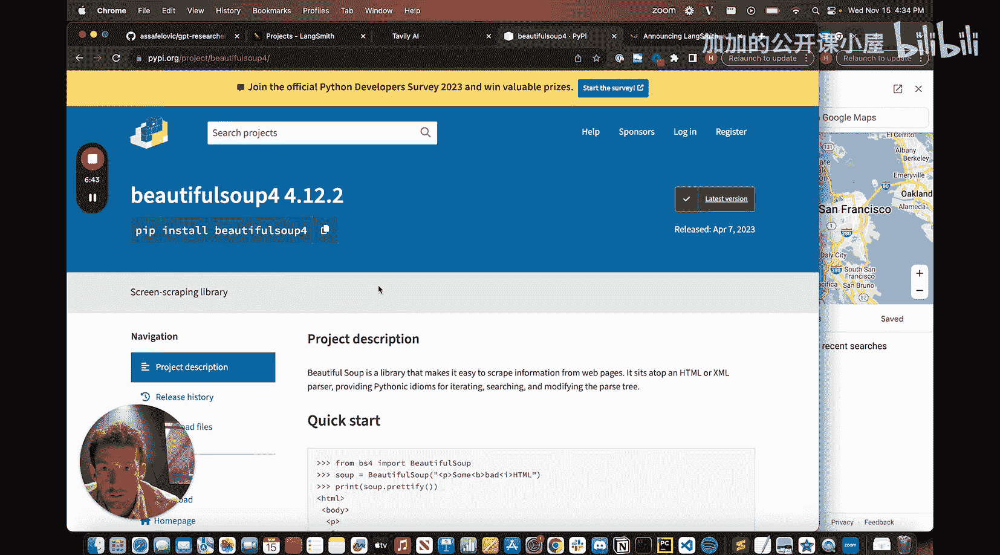

Let's add。With that。These are going to help us scrape some web pages。All right， so we've added those。

We're you to go back。We're now going to create a function to get the content of this web page， so。

I'm going to put this here。Inport。Request。嗯。For import court。Beautiful soup。

 This is just a nice little helper function that's going to scrape text from a web page it takes in a URL。

 then hits that with their requests。Then scrapes it with beautiful soup if it was able to。

 otherwise it just print that and print that。Princeier says that is failed to retrieve the webage。

Kun。So we've got that。We can now do something like a page。Content equals。It's great tech。URl。

This could be really， really long。 So what I'm going to do is I'm just gonna take the first like 10000 characters。

 I should probably work。And。I am then going to create a little。Chain to get this working。

So let's do the prompt。Chat open AI。Let's use， let's use a longer context one。 So open AI。

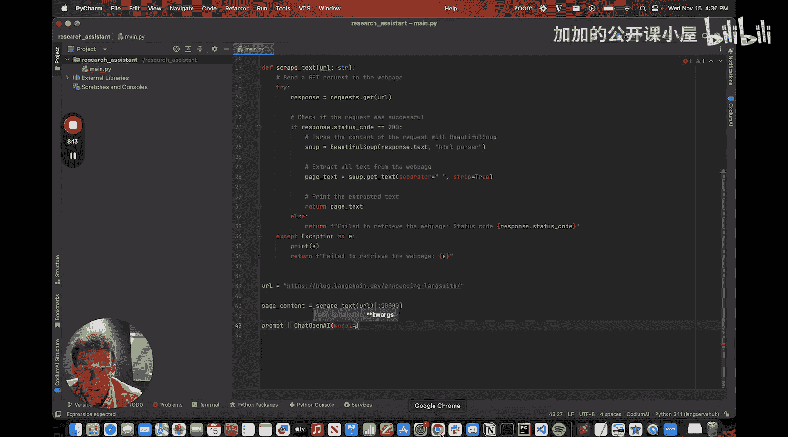

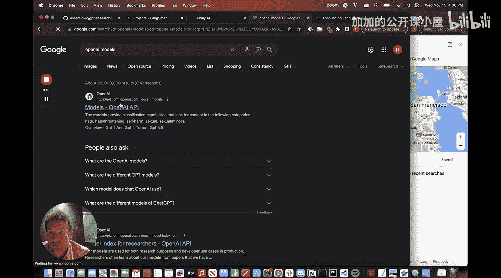

Let's see what we can use。Let's use， let's use this one。You know， cheaper， longer context window。

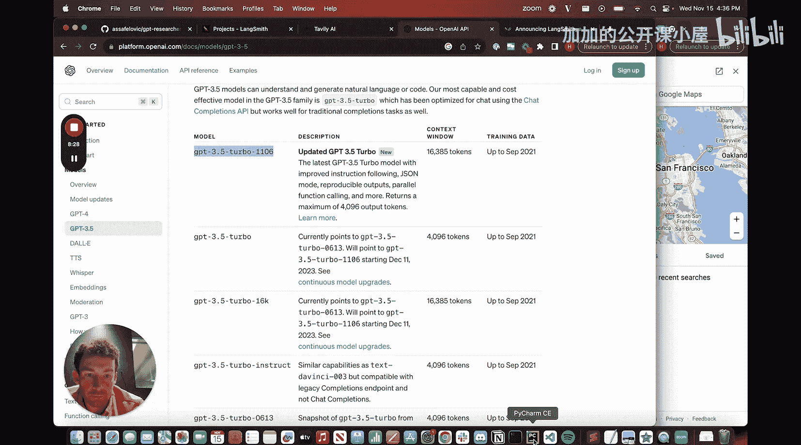

That sounds fantastic。So let's use that。We then， so this is going return a chat message。

 We just really want the string from here。So from Ling chainin dot schema dot up par in port。

Stir out the pis here， this is really simple， just parses the message into a string。嗯。

Let's call this our chain， and then let's do。嗯的。In thevo。Question。W。Is。おすね。Content。Cont。So again。

 we're using this pretty basic prompt。 We'll update it。 We'll get better。

 Let's just make sure this works right now。 so let's do。Maade up pi。 Can run it。Okay。

 we get some error context。Cool， update that。

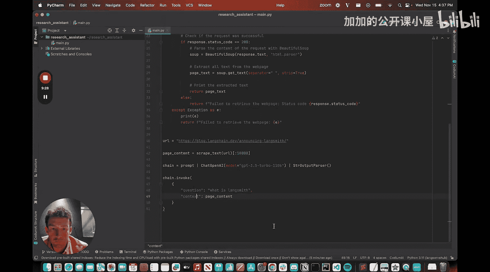

Right it。

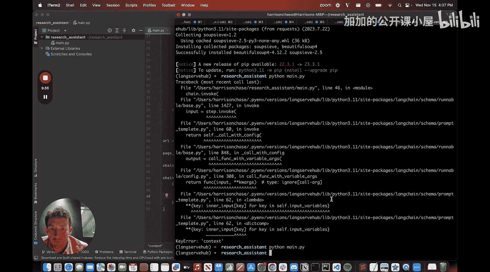

Okay， I forgot to print out what it was。 Luckily， we can go to Lsmith。 We can see here。

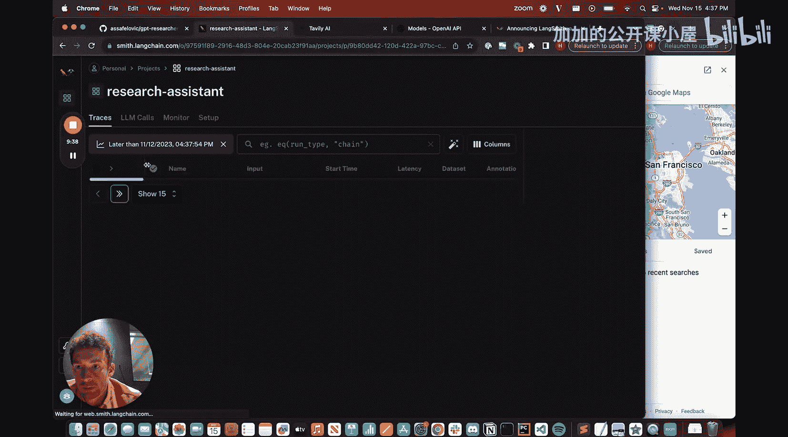

We've got this。And we can see the chain， really simple one， only three steps， prompt template。

 LM output parser input is this input is basically this dictionary of context and question and then the output and then we've got the answer here at the question asking frompresent Lismith。

 which is described as。