# LangChain【中英⚡LangChain 使用指南｜Build with LangChain】 p06 P6 Build and Deploy a RAG app with Pinecone Serverless -BV1xwfMYDE3n_p6-

Hi， this is Lance from the Line Cha team。And today we're going to be building and deploying a RAg app using Ponservless from scratch。

 so we're going to kind of block through all the code required to do this and I'll use these slides as kind of a guide to kind of lay the groundwork。

So first， what is rag？So undercarpaththeus this pretty nice visualization that shows LLMs as a kernel of a new kind of operating system。

And of course， one of the core components of our operating system is the ability to connect like your CPU or in this case。

 LLM to disk， or in this case， say a vector store or some kind of data storage that contains information that you want to pass into the LLM。

And LLMs have this notion of a context window， which typically pass in， like say， prompts。

 but of course， we can also pass in information， retrieve from external sources。Now。

 one of the most popular external sources are vector stores。These have really nice properties。

 like the ability to perform semantic similarity search。

 so you can take a kind of a chunk of text and perform similarity search based upon kind of embedding similarity with indexed chunks in your vector store。

 so this is like a very popular paradigm for retrieval with LLMs。But it comes with some pain points。

 so in particular， one is the need to provision your own vector store now some providers like Pine cone for example。

 do have hosting， which has become really popular。But even with hosting。In Pine cone。

 you do have to pay for your index， and that is up kind of a monthly fee that is not a usage based fee。

So as of query in this video。Pinecone has released this new service called Pine cone serverless。

 which addresses these two pain points。 It offers unlimited scaling with kind of cloud storage， GCS。

 Strure。U as well as uses based pricing， so promise to be significantly cheaper is this is something that I'm actually personally pretty excited about after having used Pcoe for quite a few projects。

🤧So。We're going to use Pine cone in this demo and connect it to a RAG app。

 and we're going to show how to deploy that and how to work with it。Now some disclaimers。

 we're going to be using Langsmith and hosting Langer for this。So both are in private data。

 but you can get access， you can feel free to DME or other folks in L chain team if you want access and then also we'll share these slides and I share some relevant documentation down here。

Now let's kind of go to the coding section and first you can kind of see here we're going to create our environment I'm using Anaconda and we're going to install a few things。

 so this is the La chain CLI and also Lserv。

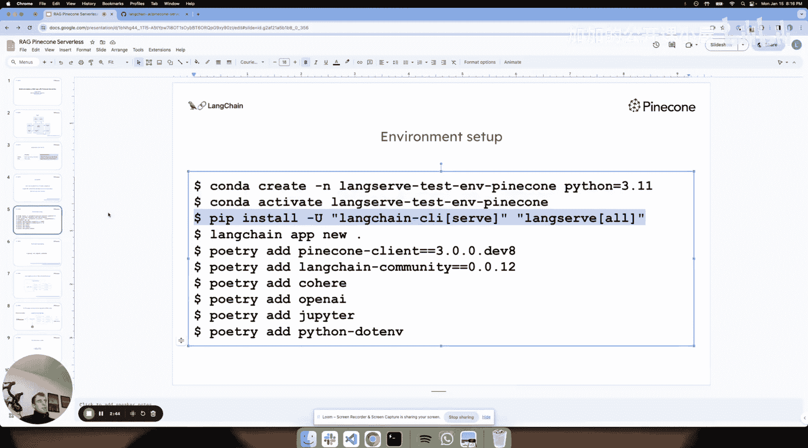

So I've done that over here， I've already kind of done those steps so you can see our environment is here and we have these packages installed。

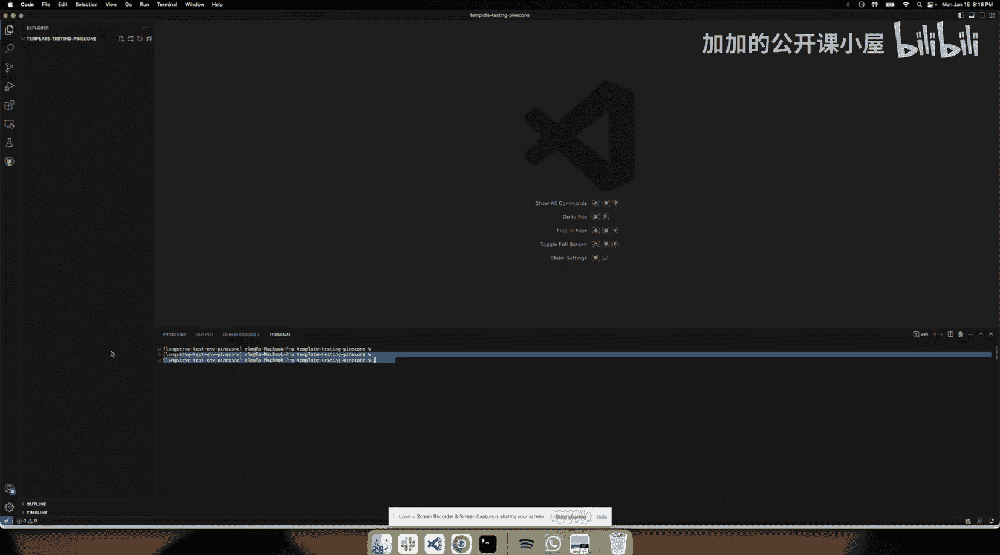

Now what you see right here， I'm going to run Lang chain app new。

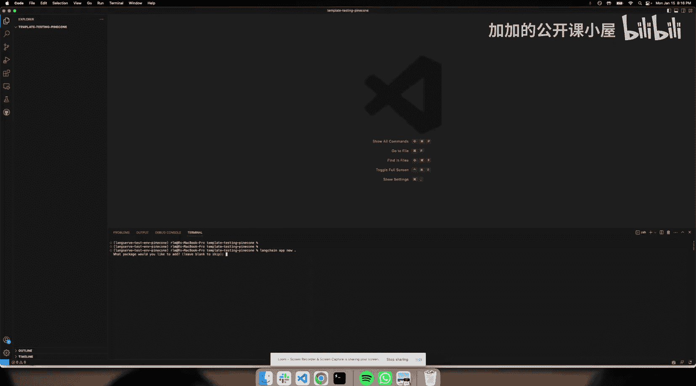

So this is actually going to create a new and blank L serve app。

And we don't actually need to worry about this quite yet。

 this is going to help later when we think about deployment。But for now。

 what we're going to do very simply is just install。

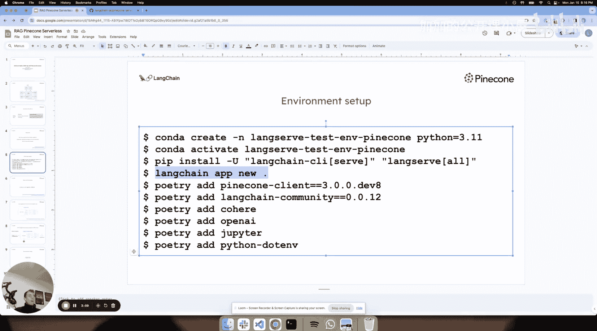

A few packages that we want to work with Okay， so this is the P cone client that has serverless enabled and you we see there is an issue related to Python version so we can actually kind of go here。

And this empty laangser project is actually managed by poetry and we can actually look here and we can say。

 okay， I want to change my pathin dependency to match what Pi compliant needs， no problem。

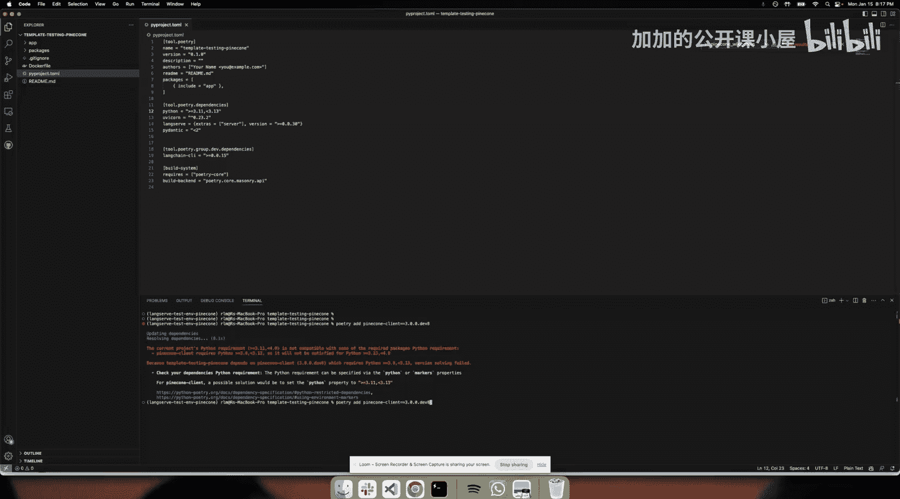

So that'll go ahead and install and we can go ahead and add these other。Packages accordingly。

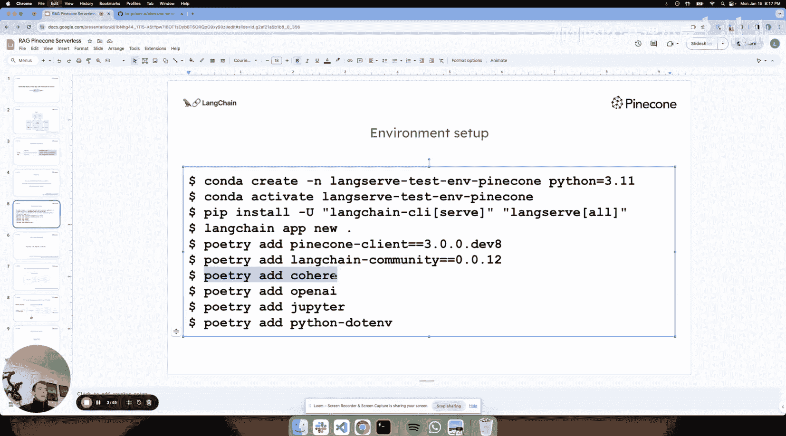

哥。

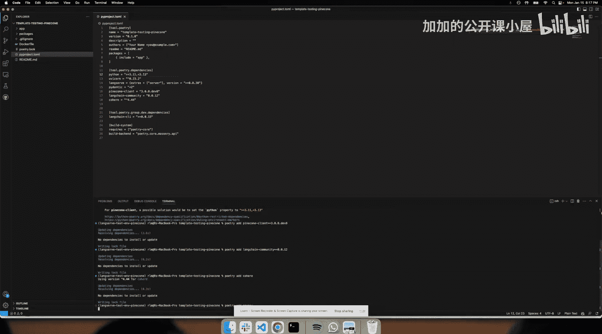

Good。What Jupiter。And just the end for environment variables。

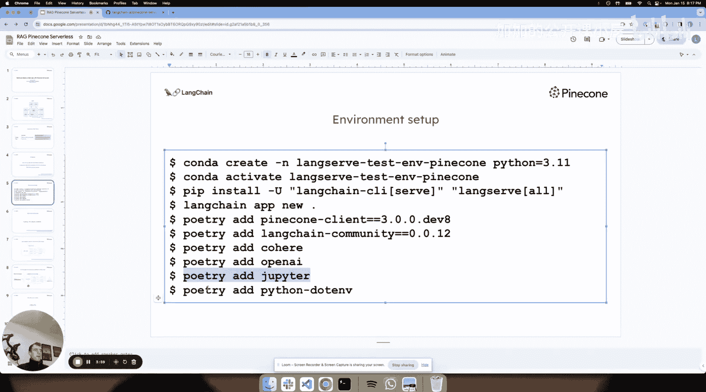

Okay， so Jupiter still installing good， so now you can see something is kind of cool。

When we run these commands Poad， we can see that our Tobel file has these new packages added to it automatically。

 so our project now has a bunch of useful packages that we want to work with， so that's great。

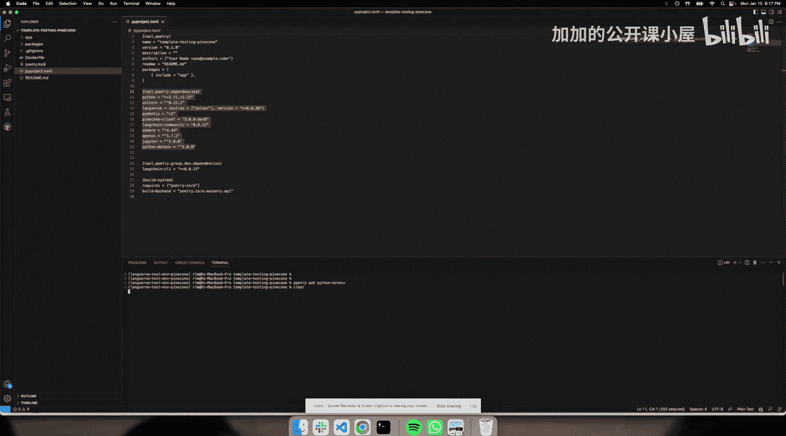

Now。

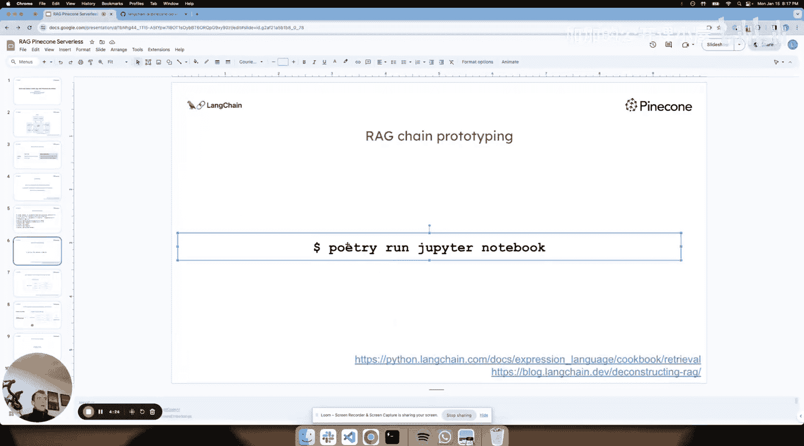

Typically， when I'm building a rag app， I start with a notebook。And so for example。

 I' like to use Jupyter notebooks， obviously really convenient。

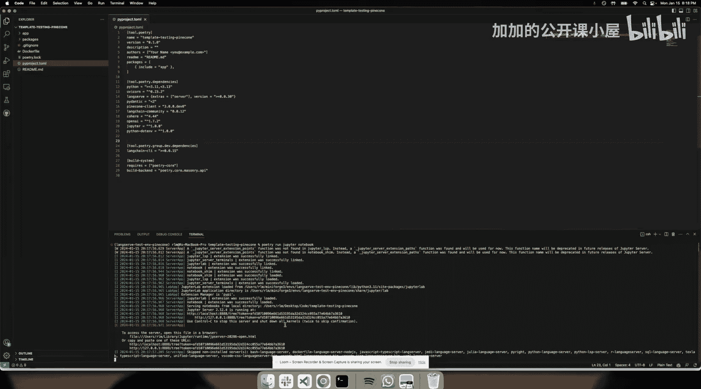

And we can see here。That let's spin up a new fresh notebook。Great， we'll select a kernel。

No this is nice， so we've created a new Lserv empty project。

 we've added a few packages we want to work with we spun up a Jupyter notebook。

 So next I want to walk you through the process of actually。😊。

Kind of prototyping some RA code in our notebook。Now， I'm going to start。

With some code they've already pre used previously just to kind of ease things a little bit and save time。

 but we can kind of walk through what's going on。So first things first。

 we're going to un performform bunch imports， that's not fine。

And this is actually an interesting point。So the folks from Pine cone have actually created a serverless index already。

And have given me access to it by providing a Ponee API key， environment and index name。

So this I already have， I've set these keys and I'm just simply defining them here。

And one other thing I want to highlight is that this index was created from this data set。

Which is a dump of Wikipedia available on hugging face with coherent bedding。

So I'm going to kind of make a note of that， this is our data set。啊。Right here。

So we have the serverless index， which contains this very large data set of Wikipedia dump that was provided by Pine cone。

 we're going to initialize our P cone client。And right here you can see that we're actually defining our embeddings as well as the vector store。

So now we've initialized our serverless index， we have access to it and now it's a Lang chain retriever。

 which we can use。Now the second piece here is when RAG apps。

 we typically define a prompt something like this， which is basically saying answerer the question based upon only the following context。

 you this variable for context， and you have this variable for question， okay。Now。

 let's define our model。 So here's our L M。We're going to use open AI and this is a recent large context LLM。

That has 120 ak context window， so that's pretty cool。

Now this is where it's kind of interesting and I want to kind of walk you through this a little bit carefully。

 so Lanching expression language allows us to compose elements like you can see we have a tree re defineded。

 we have a prompt， we have a model。😊，We can kind of compose these very easily into a chain， okay？

So' going call this L cell chain。And what's happening here very simply is that。

We are using our retriever。To extract context relative relevant to our question。

 So what's happening behind the scenes is when we run this chain。It's going to take the question。

 perform similarity search using that question on a retriever and of course we defined our embeddings and choice。

 so it's going to be using coherentbeddings， so they'll take the question， embed it using cohere。

 perform similarity search on a retriever and then those documents that come back。

 are going to be passed to this context key。In our map here， in addition。

 a question is going to be passed through from the user to our map and saved to the key question。

Then this will be plumbed into our prompt， which you indeed see expects question and context。

We'll then plum that to our model。And then we'll clean the output So let me define this。And okay。

 let's make sure you have everything defined here， good。Now。What's nice is。This chain。

Is alynching expression language object？Which means that it has a runnable interface with a few invocation methods that are consistent for any language chain expression language object。

So we can call like stream。We can call batch。And we can call invo。And we can invoke with a question。

 so again this is Wikipedia contains lots of information。

 let's just say what is film you are like it kind of a completely random question， right？

And now this is spinning Now what I like to do here is I like to look kind of look behind the scenes and see what's actually happening。

And so to do this。I will pull up Langsmith。Now I mentioned previously in the slides back here that I have already set my Langsmith API key。

And I've already become a user of Langsmith， so it happens when I go to just Langsmith。com。Here。嗯。

I let me just make sure I'm in the right user Okay， so let's go to my personal user。

 this is what you see when you kind of go to Smithallinecha。com。

I can click on this and see all my projects。And this RLM is just kind of my default project。

 I can click here and I can see something kind of neat。See this question right here。

 This is exactly what we asked right here。 What is from Noir and the trace associated with that chain is now logged automatically lasmith。

 This is pretty nice。

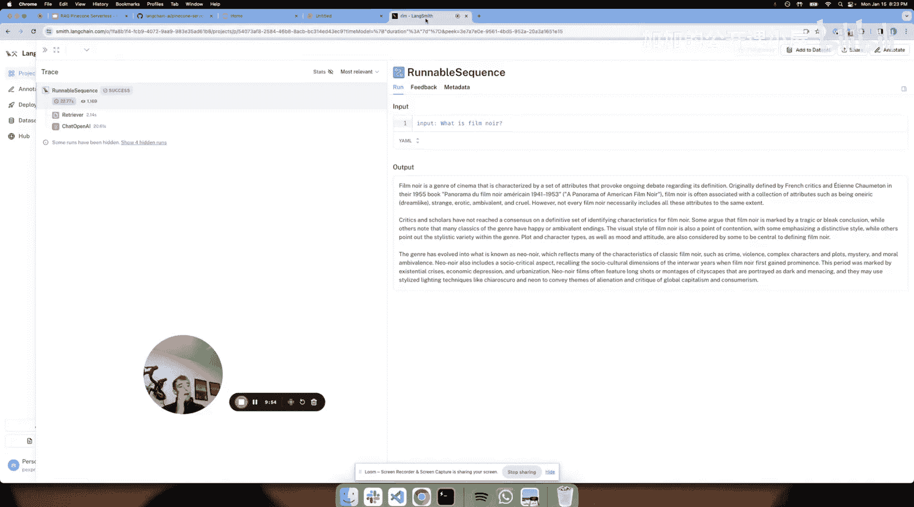

So。