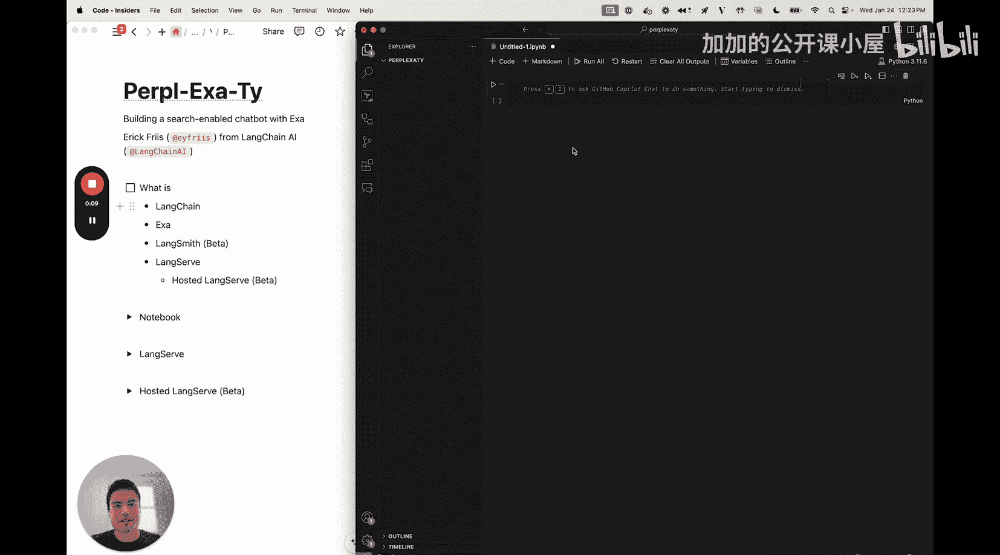
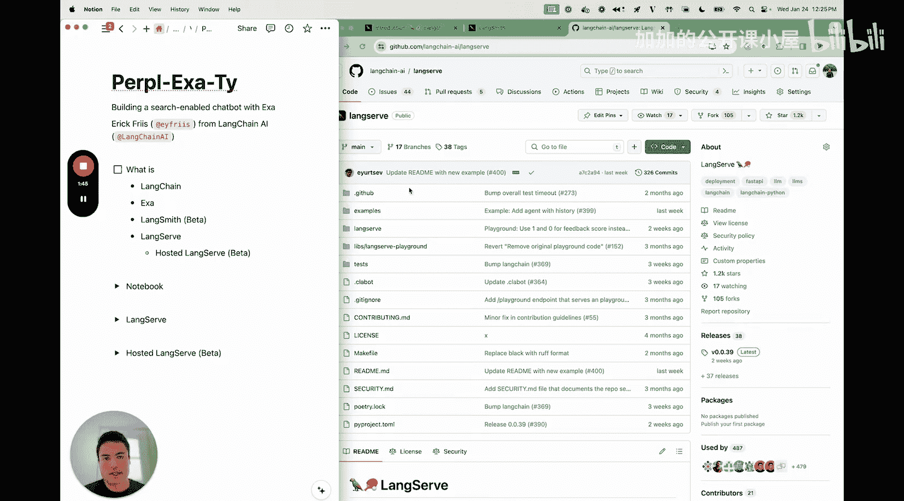
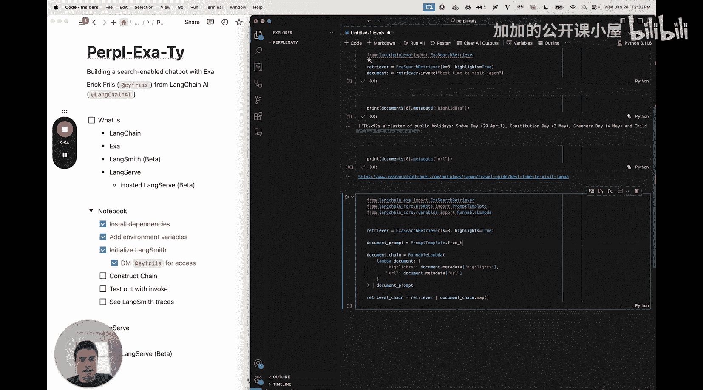

# LangChain【中英⚡LangChain 使用指南｜Build with LangChain】 p07 P7 Building a web RAG chatbot： using LangChain, Exa (prev. Metaphor), LangSmith, -BV1xwfMYDE3n_p7-

Hey folks， I'm Eric from Langchain and today we're going to be building a search enabled chat bot with Exa which launched today。

Let's get started to begin let's go through the main pieces of software that we're gonna to be using to start we're going to be using Lang Langin is a framework for developing LLM powered applications it's the company I work at and it the framework we'll be using we'll be using the Python library but we also offer a JavaScript library for folks building in that language The second thing we're going to be using is Exa Exa is a LLM focused search engine which allows us to retrieve results from the web to provide additional context for our generation chatbot before giving you your results Langsmith is what we're going to be using for debugging and observability today it is the firstpart。

Observability tool built by the asset Lang chain， we're going to be using it to inspect some traces and we're also going to be using the hosted Langserv product which is part of Langsmith in order to host our application in the end and we're also going to be using Langserv kind of as previously mentioned it is an open source package that allows you to host your chains as rest endpoints and we're going to be using the hosted one as well within Langsmith。

Let's dive it so first we're going to be building our chain in a Jupyter notebook then we're going to be porting that over to Lngservve as a rest endpoint and we're going to be playing with that in the playground that's provided there and last but not least we're going to be hosting that in Langser in order to。

Get it accessible from anyone on the Internet。 So let's dive in so。For our notebook。

 I'm just going to be using the Jupiter notebook in my V code instance。

First we're going to want to install some of our dependencies as some of you may have noticed we're starting to split out the package into multiple smaller partner packages as well。

 so today we're going to be T installing Lang chain core。

Wwhich offers we're going to be mostly using the runnable utilities as well as prompts from there。

 we're going to use Langcha open AI in order to use the GT 3。

5 model for our generation you can obviously install any other LLM into this application as well and last but not least we're going to be installing the brand new L chain Exa package which is going to give us our retriever which allows us to kind of search the web。

 the Lang chain Exa package also offers some tools which enable agents to have search capabilities as well。

 but for today's generation use case we're going to be using the retriever。嗯。

Once you have that installed， we are going to set some environment variables。So to do that。

 we'll have OSs and we'll set。Our open AI API key。And our XI API key。

I already have these set in my environment， so I'm not going to fill this out for y'all today。

 but you can provision your own openaiI API key at platform。openai。

com and I'll link the Exa docs on how to get your own Exa API key with some free search credits on it as well to this video。

嗯。The other thing that we're going to do is we're going to set some environment variables that enable us to use Langsmith Langsmith is in private beta at the moment feel free to DM me in order to get access to it。

So in order to do that， we are going to set the length chain。Fracing。V2。啊啊。To do that。

 we're going to set the La in tracing V2 environment variable。 We're going to set。Our。嗯。

Lang chain API key， and we're going to set our Lang chain project as well。 The last step is optional。

And。It just allows us to find the traces for what we're doing today a little bit easier。And。

And most importantly， we're going to build our chain So the rough architecture of today's chain is we're going to first take some sort of user query。

 We're going to search Exa to get some documents related to that Exa has this great feature we're going to use called highlights which kind of summarizes the highlights from any of the sources it retrieves and so we're going to be able to plum those into an LLM we're going to kind of wrestle with formatting that prompt in a way that the LLM understands well for a little bit and then we're going to pass that into the LOM for generation so to start let's actually just play with Exo a little bit and see what that looks like so we can import our retriever。

From the La chain extra package， we're going to be using the retriever today。

Let's just use the default settings and see what。Documents we get from that so we can just run retrieveever。

 invoke of best time to visit Japan。And if we inspect those。あ。Or inspect the first one。啊。We can see。

That we have some content。Wwhich is actually going to be the entire page content of that website。

 so it's going to be rather large and we'll also have some metadata on that document。

And so here we'll have some like kind of page titles， URLs。

As well as if we pass the highlights feature in， we'll actually get some highlights as well。

 so let's pass in。嗯。Highlights is true。 And then let's actually only get。

The three most relevant results， just so we can。Save some of our exit credits。

So here we'll now see that we get this highlights array。

 which is going to summarize kind of the main points。Of this page。

 So we're mostly going to be using that。Highlights。Field as well as the URL， since we want our。

Generation bot to cite its sources in the generations it do does。嗯。So with that。

 let's try to create some sort of retrieval chain。Which is going to format all of those outputs in a way that we want to pass it to VLM。

So the kind of first step of that is we're going to run our retriever and just to keep it clear。

 we can。Define our retriever down here as well。Um， keeping the kind of final output in a single cell makes it a easier for us to convert this to a Lserv application at the end。

We'll also want to format this with a prompt template， so let's import that as well。

From Langing court up prompt。And we can import other things as we go on。

 So first we're going to start with our retriever。Then we're going to want to format that list of documents in some sort of way。

Pass that into some sort of documents chain。Or single document chain。

 and we'll have it operate on each element of that list so we can kind of call dot map on that and let's define that。

Up here and so the assumption here is that input is going to be that single document here will have this be a runnable lambda。

Where。Will take。That document and we will pass back。The highlights as well as the URL。

Of that document， so here we'll have document。metadata。Highlights and。Documented。Me的 data。URL。嗯。

And we'll need import。Our runnable lambmbda as well。

 which is going to be from line chain core runnables。Aorable lambda。

And then the next step is we're going to want to format this with some sort of prompt。

 so let's pass this into our documents prompt， which we can define up here。As prompt template。

From template。

And。