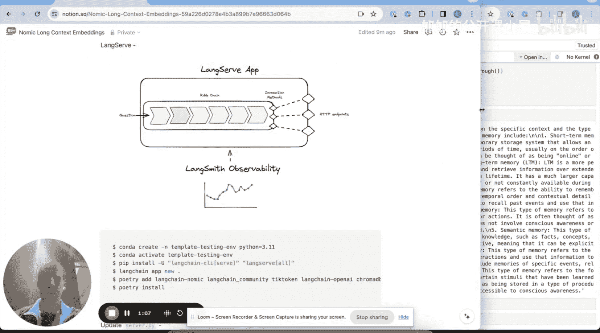
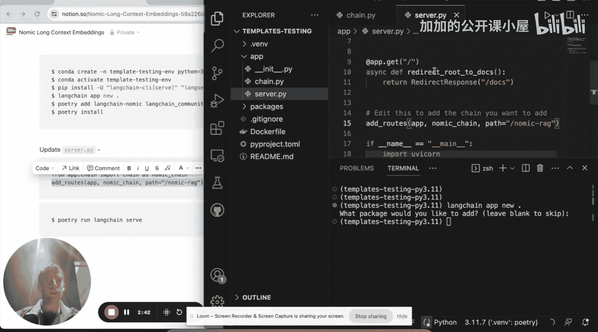

# LangChain【中英⚡LangChain 使用指南｜Build with LangChain】 p08 P8 Open Source RAG with Nomic's New Embedding Model (and ChromaDB and Ollama) -BV1xwfMYDE3n_p8-

Hi， this is Lance from Langcha， I want to walk through building a rag app from scratch using Nomix new long context embedding model。

So one trend I think is really interesting is the expansion of Con Windows for LLMs and embedding models。

So we can see with methods like rope or selfixt， open source LLMs like Lama2 and Phi2。

 Mistr Mi Trawl have all seen expansion in their context windows out from you know 4K up to 32K or beyond。

 which is really interesting because it lets us fit from， you know at 4K。

 it's like a few dozen pages up to like many dozen or small hundreds of pages。

 we can actually pass into these LLMs。And we've actually seen embedding models go through the same transformation。

 most recently with NoM model， we actually have a context window on 8，000 tokens。

 which is on par with8 to2 from Open AI and a few others。

And so Noec produced a nice blog post today in the paper。

That shows really strong performance on a few benchmarks。

 including this long context benchmark that was recently put out by Hazy Research。

So what we're going to do is we'll show how to use this from scratch and we'll build a RA app that's going to look something like this。

 we'll take documents， we'll embed them using this noic embedding model。

We'll then store them in a vector store。We'll take an input question， embed it。

Retieve relevant documents。And then process them using an open source LLM to produce an answer。

 that's going to become our workflow。Now let's kind of start from scratch here。Now。

 all I need to do is a few Pip installs， which I've already done。I've also lo a enomic here。

It's give me an API token。 I set my token。 I also set that as environment variable so you can just do take care of that yourself。

 I also use Langsmith， and we'll see why that's kind of useful next。 But of course， is optional。 Now。

 let let's kind of kick this off。 So first， I want to load some documents。

So I'm going to use this L chain web based loader to load from three URLs。

 which are blog posts I really like。So I can load those。 Now， those are loaded into this list。

 That's great。A few blog posts here， okay。Great。😊，Now what I'm going to do is I'm going to split them。

 so I'm going to use this character text splitter from Lang chain。

And I'm going to use TikTotoken encoder， which means I'm going to split based upon tokens。

And I'm setting a big chunk size， so 7500。Okay。So there we go。 We have our splits。

 Now we can kind of look at those。Those。Good， okay。So we've taken our documents， we've loaded them。

 we've split them using a big chunk size because I have an embedding model that can process up to 8K。

 and I'm going to use an LLM that can process up to 32K。

Now I just may have a few imports here there we go now I'm going to show you something that's pretty interesting which brings in the noomic embeddings。

So all I'm doing here is I'm creating a vector store from Chromo， which is open source vector store。

I simply pass in my documents splitlitz， which we defined here。I define a collection name。

 I call it ragg chromroa。 Now I apply my open my bedding model here。

 and I'm specifying pnomic embeddings with this new model。And that's it。

 I build my retriever from this。So what this allows is when I have this retriever。

 I can basically call get relevant documents on it。Right。

 and I can pass in any question and it'll get me you know task。Decomposition。

And it'll get me documents， so now I have a retriever。

That has taken my usingnomic embeddings to bend my documents and makes them easy to retrieve。

So this now I'm going to show you something that I really like。When it comes to running local models。

I like to use allama。It's super convenient， all you have to do is just download Alllama and have it running。

 so I actually have just have been running on my machine。And all you have to run is this command。

 allama pull like your model of interest。嗯。So， for example。Right here。A longama pull Mr All instruct。

U。And this will actually just pull the model for me。Then it's accessible to me when I want to run it。

So now I actually have some codes set here already， which is just for convenience。

I can specify a prompt for rag。Which is answer the question based on the following context。

 here's my context key， here's my question。And' set that as a prompt here。Now。

 here is where I specify my LL M。 So I set Oma LL M to Mr Rinstruct。And I set it here。

And I build a rag chain。So all that's happening then。Is。

I am building a dictionary that I can pass into my prompt。

Context is what we from our back store right here。The question we pass through from the user。

And those populate these two keys context question those go into our prompt， So populates our prompt。

 We pipe that prompt into our local LLM。 We parse the output， and that's really it。Now， we can see。

I can run invoke here， and I know this will take。You know， around 20 seconds when run locally。

But what I'll show you in the meantime is。I can go over to Langsmith and we can actually see this is running right now。

So this shows me my retriever and what's going on， so here's the documents that I retrieved。

And you can see they're pretty big because we used， again， a large chunk size。

 and we embedded them using noic large context embeddings。And then I can see my chat model。

 It's still running。 But here is the prompt。That was passed in。Let's check our notebook， oh okay。

 here it is， so actually the answer is here and it should refresh， there it is， very nice。

It is all refreshed and we can see here's our answer。So that's really all there is to it。

 it's a pretty simple process。As you can see。Going from。Some set of documents， splitting them。

 embedding them and indexing them using noMs embeddings。

 and then running an open source LLM locally using Oama to all my laptop。To process them。

And give me answers so that's really the basic workflow it's pretty simple and this is all run using open source components it's on my laptop the embedding models run through their API but it will be available to run locally soon so I'm actually really excited to try that out and then this entire workflow can be run both using you know of course the embedding model through API or locally on my laptop。

Now you can see in our notebook we've laid out this rag chain。

 and we talk through kind of how it's architected。 We've shown how it works。

I want to show one extension here。So if your call， we invoked our chain， just with chain invoke。

 we passed our question， we get our answer。Now， what if I want to turn this into an app？

Like I want to just kind of abstract this chain away。

And what I want is that the invocation methods of this chain。Like invoke。

Are just map to endpoint in an application。So that's actually what Lang Ser lets us do。

So LangSer kind of sits on top of Lang chain， it's kind of a platform that wraps any chain that we build。

 and it basically just maps the invocation methods of our chain。

 in this case our RA chain to ACTV endpoints which we can access and then we can do all sorts of things with that。

 we can serve it， that can be accessible via the web and otherwise。

So I'll show you kind of how to do this really easily and all I'm going to do so we can kind of open up over here。

 I just have a， you know empty an empty environment。

Um， so now all I've done previously is I've created this condo environment。

 I've done this Pip install for Lang chain CLI and Langer， that's really it。

I'm going to run is this command here。Lang chainin app new。And it's going to ask me about packages。

 I'm going to say no packages， and I'll show you what's going to happen here shortly。

So what you see here is that it'll close us down a little bit。We've created this empty template app。

Was just has this app director with Serdo Pi and has packages， which is empty。Okay。

So all I need to do now is in this app director， I'm going to create a new file chain dot Pi。

And into this file。We had our code previously for our rag chain。 It was basically right here。

 I just kind of copied it and formatted it slightly for convenience。

 But this is the same code that we had in our notebook。 I'm just going to save this。

So now I have this chain dot pi file defined in my app directory here。

And all I'm going to do in Ser dot pi is two things really quickly。 so you can see it right here。

From that chain dot pi， import my chain， as I'm going to callnomic chain。

And I'm going to call this add route here。So what this is going to do is you can see our chain is defined here。

 this is exactly what we had in our notebook。It's going to map the invocation method up in this chain to HtTB end pointss in。

