# LangChain【中英⚡LangChain 使用指南｜Build with LangChain】 p09 P9 Gemini + Google Retrieval Agent from a LangChain Template -BV1xwfMYDE3n_p9-

18 I'm Eric from Langchain and today we're gonna to be building a Langcha agent on top of Google's Gemini Pro model as some of you may seen today they launched their Gemini Ultra 1。

0 offering or Gemini Adv offering in kind of a chatbot chattPT style interface Gemini Ultra still isn't publicly available over API yet but kind of a fun time to celebrate the ability to use different kinds of models for agents so to start let's walk through some of the things we're going to be using today first will be using Langcha Langcha。

 as it says on the right is framework for a building LLM powered applications I work at Langcha and so we're going to be using Langcha today the model that we're going to be using is Gemini we're going to be using Gemini Pro not the Ultra 1。

0 model that was launched today and we're going to be using it through the Langcha connector to Google AI you can。

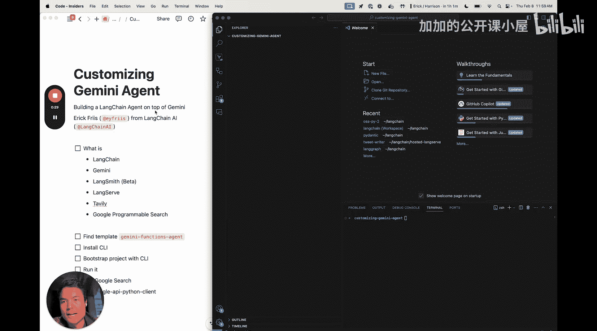

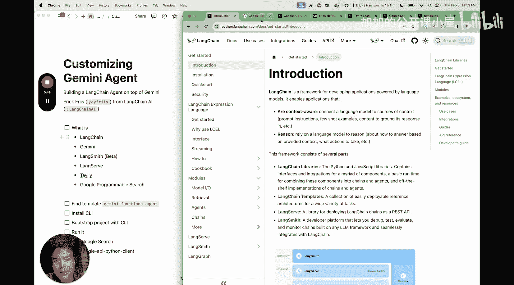

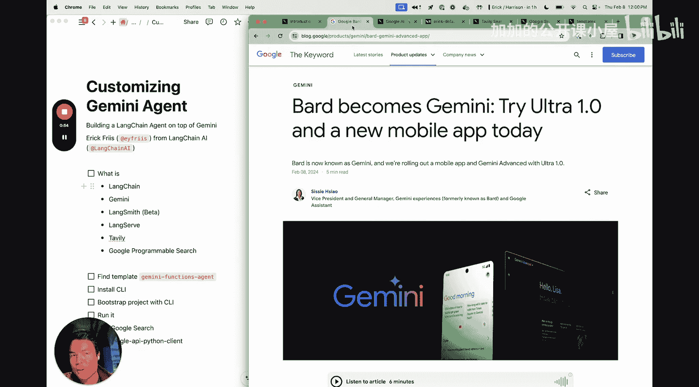

Use the Google vertex connectors if you'd like to use the more like Google Cloud centric vertex APIs。

 but getting started with the Google generative AI model here is a little bit more straightforward if you're just getting started we're also going to be kind of looking at some of our traces in Langsmith。

 which is our。Kind of observability and debugging application at Linkcha we are going to be able to this is actually a run of the template that we're going to be building today and we're going to do some modifications later that swaps out to for Google programmable search so we can kind of compare the two search outputs there and Wsmith makes it really easy to kind of see what's happening in each step of our chain。

😊，We're also going to be using Langer， which is our kind of RE API hosting product。To start。

 we're going to be using TV Research， the template that we're going to start with Gemini functionss agent uses TVV Research as the default tool。

 and we're also going to be adding in a Google search one just to kind of stay on brand with all the Google stuff going on with Gemini。

And with that let's dive it so to start we're going want to find the template that we actually want to use and so going to templatelingchain。

com is the easiest way to do that this is a listing of all the templates that we offer and you can even like them if there's particular ones that you have enjoyed using so because we're going to want one that uses Gemini we're going to search for Gemini we have one that does drag but today we're going to be starting from the brand new a Gemini functions agent which was added just yesterday and this readme is going kind of walk through some of the。

Stuff required to use this one so we'll start from there and from there the only string we're going to need is actually this Gemini functions agent string here and then we can go over to our code editor so I'm just starting from a blank folder called customizing Gemini agent and the first thing that we're going to want to do is we're going to want to install the Lang chain CI command line interface in order to be able to very quickly bootstrap our application and to do that。

😊。

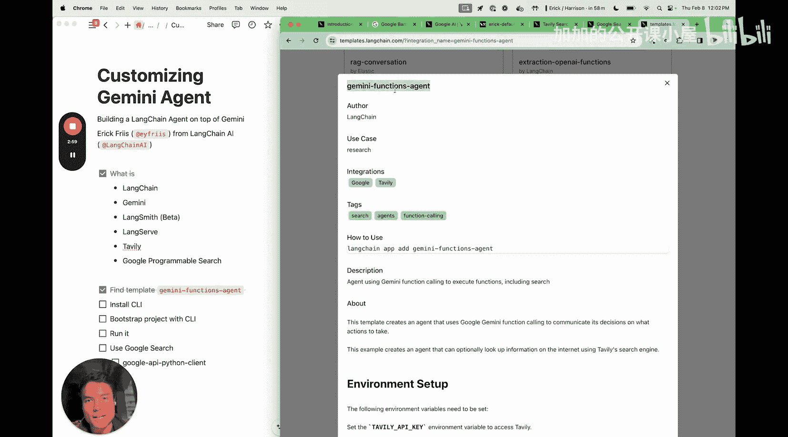

Where are you' going to run Lang chain at new？嗯。

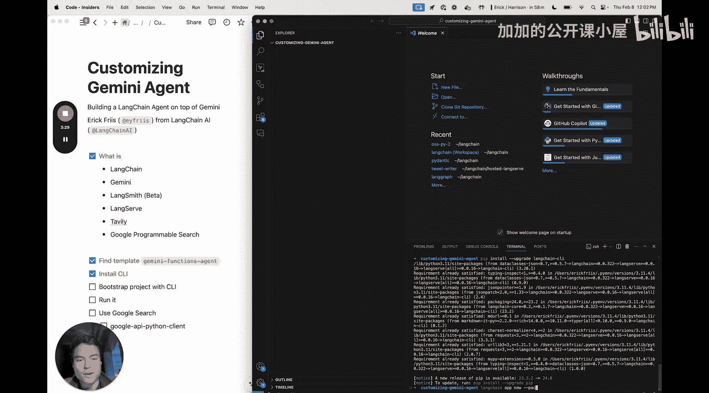

And we can actually look at this， read me。

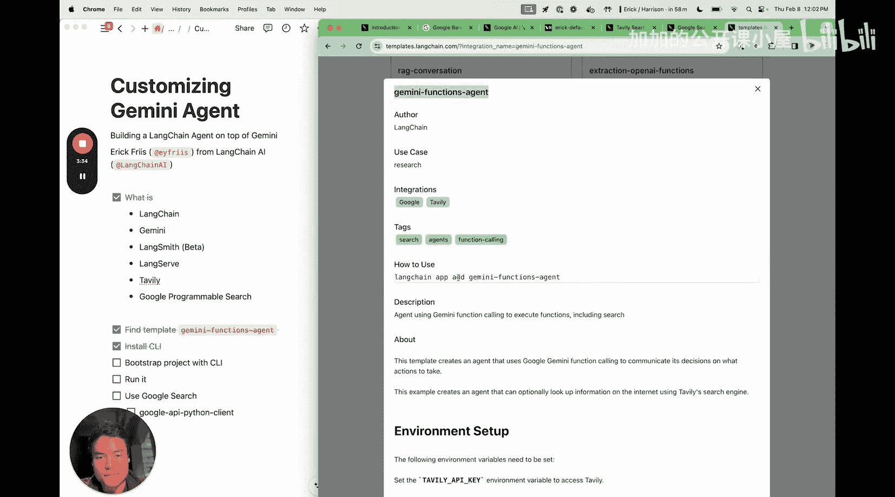

Well， first we can actually just run Lank chain Avenue。Dot which will create a blank。

Blank project for us and the package that we want to add is Gemini Fun agent。

We'll only add that one package， we will actually let's skip installing to our environment with PP。

 I'll use poetry instead。Wwhich will kind of manage our dependencies for us and then the one well we can see that it bootsttrapped kind of this app for us where we have a server file。

 this is where we're going to be editing some things in a moment and then we also have this packages folder which installs our Gemini functions agent agent which this is kind of the default implementation which we're going to be editing a little bit at the end of today。

So the first step， as kind of pointed out to us by that would put down here is that we need to add the following route to our application。

 So we're going to be adding that to our server do p file。 And instead of this not implemented line。

 we're going to。嗯。Install kind of Gemini functions agent chain here。And then， let's install。

All of our dependencies， so one other thing that the CI has done is it has created a pi project Tamel。

 which is the kind of poetry way of declaring all our dependencies as opposed to PipPs requirements TXT PIip can actually read these as well。

 but poetry kind of manages it all together in kind of a nice way and we're going to have this path dependency to our Gemini functions agent。

 but if we just run poetry install here it'll be able to read all of that it's telling me that I have an invalid distribution。

嗯。And。One of the site packages in here， I think this is actually from an old。Um。

Old virtual environment I created from an old demo so we don't have to worry about that too much and here it says that we have our project and our lock file so we should be good to go there and then in order to run it we can use our poetry run Lang chain serve command the reason it's better to prefix of the poetry run is it because it makes sure that it's using the virtual environment associated with this folder。

嗯。Which can kind of trip you up if you just run light chain serve so now that that's running we can go back to our。

Web browser， we can see that we have this Gemini functions agent playground。

 so let's see if we can actually。

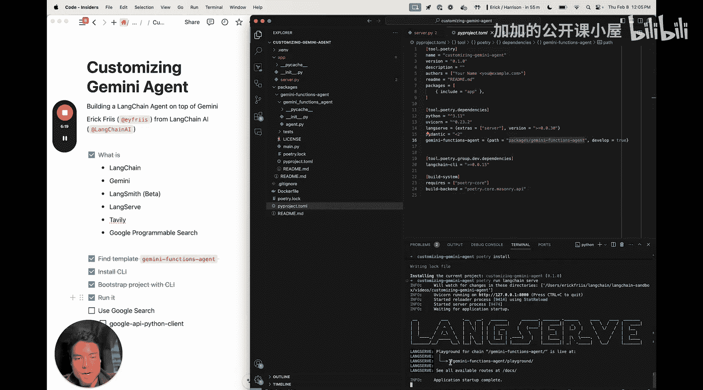

I get that to work， so that'll be at localhos 8000。And we'll want。Just that path。

 And so we have kind of our default output here。 and then let's ask， what is the。

What's a good thing we can ask a search engine， what is the best？嗯。Place to。Or what are some。

Events happening in San Francisco。In 2024。And so our agent is working now and we can actually go back to Lnksmith and see it。

Kind of working through that was kind of an old one。

 but we have our Gemini functions agent here with what are some events happening in San Francisco in 2024 it looks like the first agent call wanted to use the Tvili search results Jason with two Ls here so Gemini produced kind of an invalid function name here。

 which is why I think down here our L chain agent is saying that。

We can't output is that that's an invalid tool， so try one of the ones in this list。

 then the second one。Does properly gets to be research results JO。

 which is good such that we can actually go and run that。And we can see that our output has some。

Documents are related to。Exhibitions and those kinds of things and then our final。

Result about some events， what are some events happening produced some output which we can hopefully see in our playground。

 which is sure here are some events and it kind of results in a summary of some of the outputs that T Lee gave us。

How I am back a few hours later to wrap up this video。 and yeah， so we。

 we just wrapped up using the default template with the research。 and now we're going to use our。

Googleoogle search instead of Tly search as our tool， so if we go back to our text editor。

 we can see that the tools are configured up here and actually the template as updated today is going to look something a little more like this or it's just going to pass in the tools themselves。

 you actually don't need to do any custom formatting on those functions and so our goal here is actually going to just be to switch ourivVL tool for a Google search tool here。

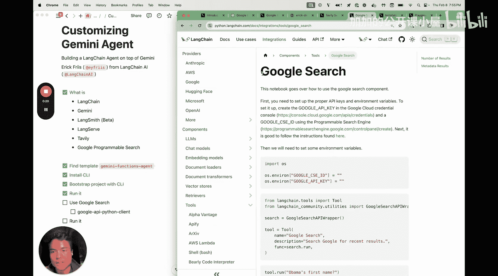

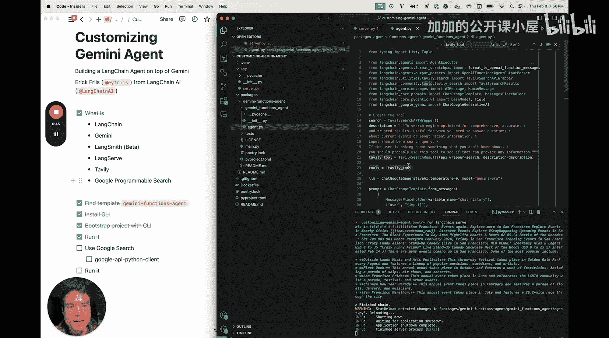

And see if that makes some sort of difference so the first step is we're going to have to install the Google API Python client in order to get this Google search API wrappper working we can actually。

😊，Just try making this work。

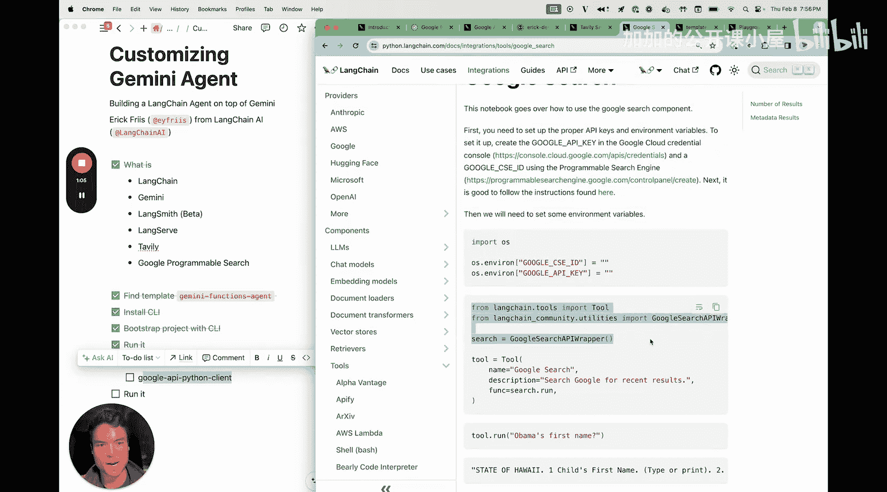

Out of the box here and see what it tells us。🤢，To start my guesses。

 it tells us that we are missing some sort of package， Google API Python client is not sold。

So here we can just do a poetry ad。Google API Python client。In order to get that， and then we can。

Lnk chains are again， to get that hot reload going。 And then here we're going to。

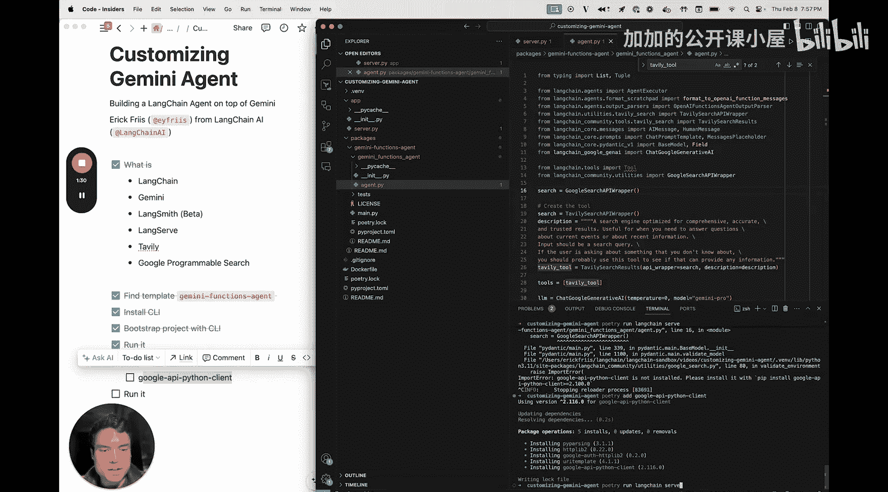