# LangChain【中英⚡LangChain 使用指南｜Build with LangChain】 p10 P10 LangChain Agents with Open Source Models! -BV1xwfMYDE3n_p10-

Hello and welcome to another L chain build video Today we're going to be building a L chain agent on top of Mistral and noic embed text V1。

5 we're going to be using both of these through。😊，Plaforms that host those models instead of runninging them locally。

 Lance is making a video later this week， doing some Wgra work with local models so stay tuned for that as well and let's get started I'm Eric from Lang chain AI and first let's dive into what some of the platforms and models that we're going to be using our first and foremost we're going to be using Langcha Langcha is the best way to develop LLM applications it's a framework that allows you to connect to language models embedding models and then kind of stitch them together into a functional application we also offer some templates which are kind of reference architectures for how to build things so today we're going to be starting from a retrieval agent template and then modifying it in order to use a vector store instead of kind of a webbased retrievetr the language model that we're going to be using in order。

to make decisions in our agent is Mstral Mstral is a open source model they have hosting built in through their Mstrral AI platform as well。

 or you can host it on locally or through anything else we're going to be using the fireworks connector today fireworks has kind of an added bonus feature of JSON mode which kind of enables forcing structure and output from some of these models Funnily enough the template today actually doesn't start from JSON mode but we can play with that a bit if we have time the embedding model we're going to be using is the brand newnic embed the 1。

5 model which is going to be an open source model and has a lot of cool features such as using Matroial learning which allows you to kind of choose the length of the embedding the dimensionality of the embeddings that。

act produce the Nic announcement， which will be linked in the description。

 has kind of a cool write up of how that works， and so we're going to be using that V1。5 model。😊。

For our vector store， we're going to be using Chroma。

 which we're just going to be using local persisted version of Chroma as a vector database。

 we'll be using Langsmith which is Langcha's kind of firstpart debugging and observability product in order to see what's actually going on in our agent and what tools are getting called we're going to be using Lng serve in order to host it L chain templates are all designed to be hosted as rest APIs so Langserv is kind of a fast API extension that allows that makes it really easy to host chains and play with them in a playground which we'll be using a bunch。

The initial template uses an archive retriever which looks up academic paper summaries based on the query。

 so you'll see that for a little bit and then we'll be using kind of community contributed Dokuaurus loader in order to index a few pages of our the Lang chain Python docs in order to be able to ask questions about that and with that let's dive in。

😊。

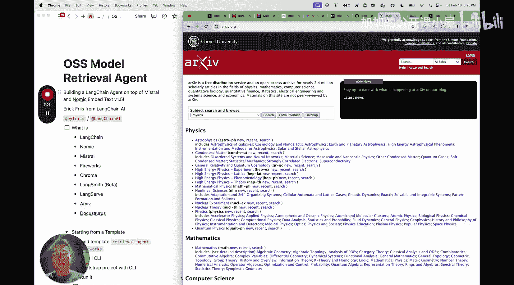

So that template we're going to start with， you can find on template。Langchain。

com that's where all of our templates are and we'll search for our retrieval agent。

 we're going to be starting with the fireworks one which uses an open source model。

 the base one uses an Azure hoststed Open AI model instead but today we're going to be focused on open source models and we can use just the instructions that are in here so first lets install the Langcha CLI。

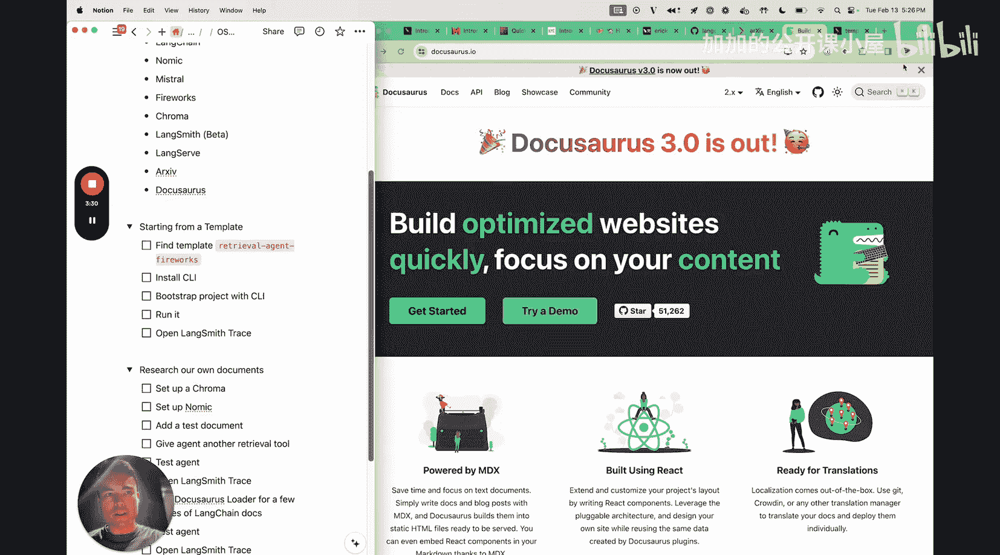

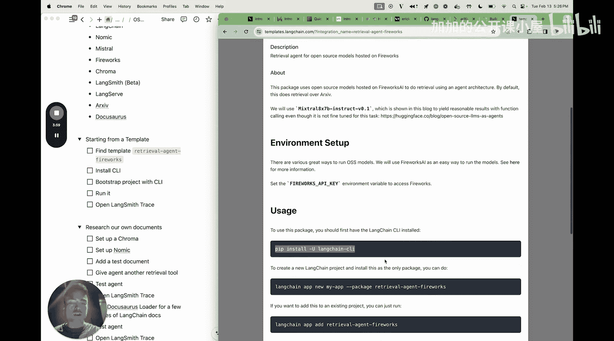

Wwhich is going to be we're going to use to kind of pull down that template and to do that I actually have the command already here。

 we're going to do a light chain app new command in order to create a new application and we're going to initialize it with the retrieval agent fireworks package we'll actually skip installing them with PIP and we'll use poetry instead。

And it spits out this helpful message， which gives us some code that we'll want to add to our app sservver。

pifile where we're supposed to add our routes。And we can even put our import at the top to make V S code a little bit happier with us。

 I can make that a little bit smaller。 So here we're just going to import our default retrieval agent and we're going to add that at our retrieval agent fireworks out here。

 Then we're going to。Run it。 First， we need to。Do a poetry install。

In order to install our dependencies， the CLI has helpfully added the package to our Pi project Comal so poetry knows where to find it。

 and then we can do a poetry run Lang chain serve。In order to。Access that playground。

 So it's going to oh， and it looks like I didn't save my server file。So if I save it。

 it'll hopefully reload that and it works better now。

And we can see that we have a little playground link。

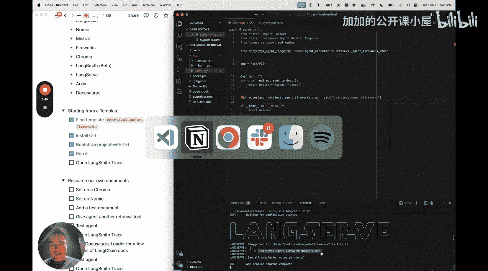

Here for the path。And that's going to be at local host， 8000。Retrieval agent fireworks playground。

And so to start， let's ask it a question about。😊，Something that it's going to want to use the archive tool for。

Which can be what is。Matri skill learning。嗯。And。It looks like it's looking up Maricia learning and archive and we can actually follow this progress in Lang Smith。

诶。Where， hopefully， it's。gonnana look that up。 It looks like it's。

Wasn't successful at actually pulling something out because the two archive searches for Matroger learning。

嗯。Had some summaries that were not particularly helpful at describing what it is。

 but that's okay here it retrieved a PhD thesis as well。

 which is probably a little bit in the weeds for Mistral to be able to emphasize what Maral learning is。

But。That is all good as we and we'll kind of go through the code and see how we can swap out this archive retriever for one over some of our own documents instead。

In a second， which is kind of the end goal of today。So to do that。

 let's start by ingesting some documents so today we're going to be using our Cha connector。

 this is a community LaangIn community vector store and so we can import it as such done here we're going to be persisting it to disk just so we can have kind of a separate ingestion script which is going to kind of download all the documents and put them in there as well as kind of connect to it in our agent through a retrieval tool。

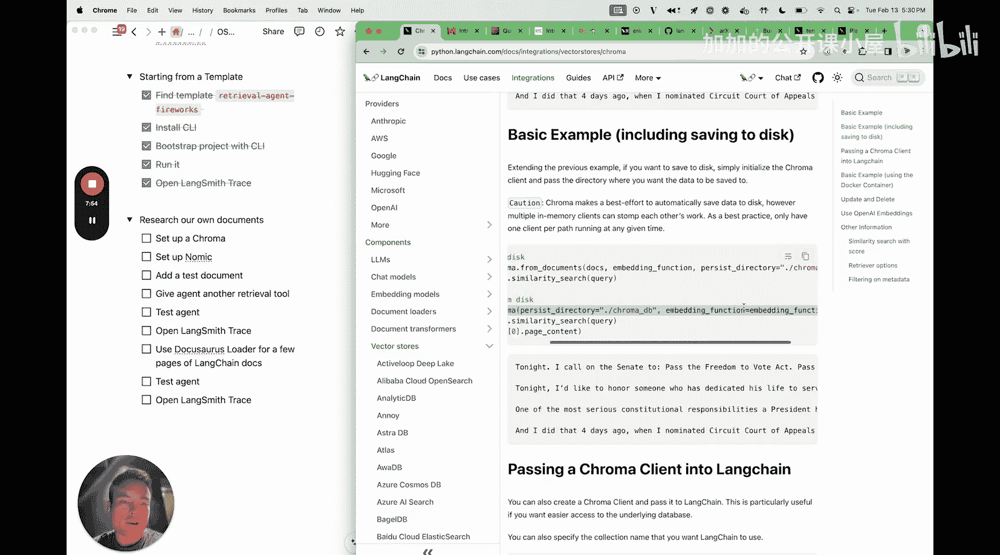

And then we're also going to be using ournomic embeddings， which will allow us to use that 1。

5 text model in the docs， we use the V1 model because the 1。

5 model is coming out with the release of this video tomorrow and。

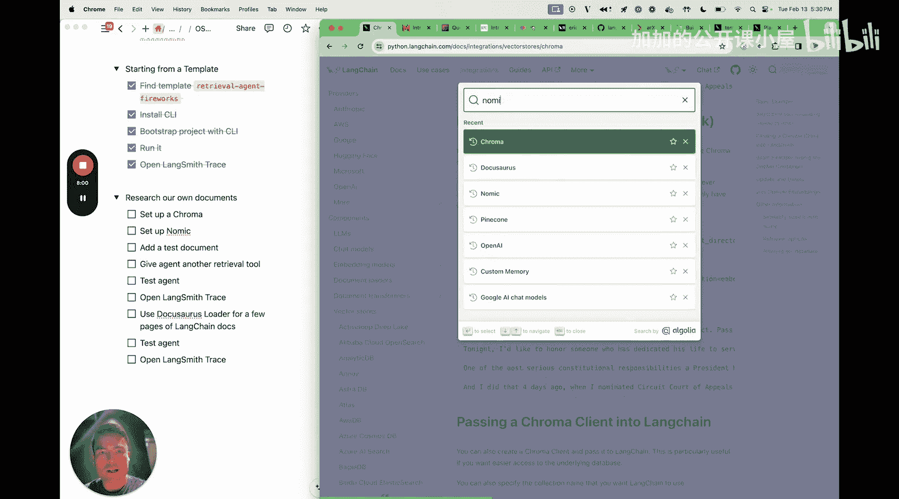

That should all be good。

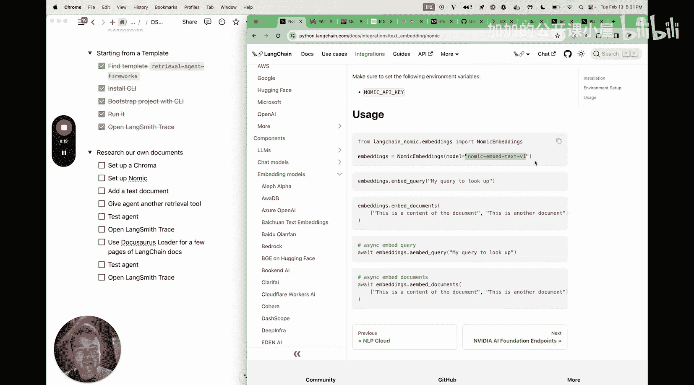

So， let's actually create a ingestion。

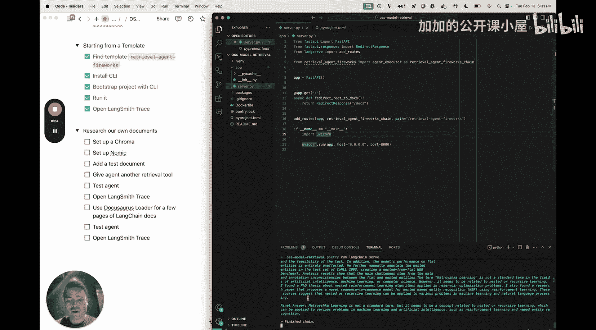

Scrt， we'll call it in just that pie and we'll put it in just the root of our project。

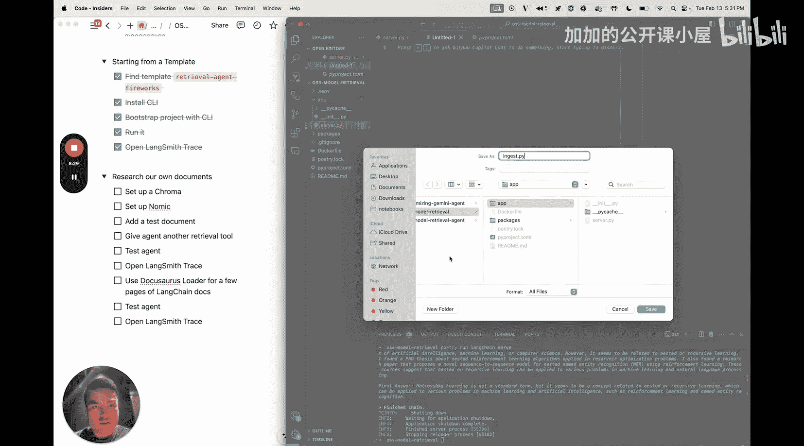

And we can first import Baromic embedding and Chroma。

So we'll import Langsing community vector stores。We'll import Chroma and from Lang chainnmec。

Import noic embeddings and we'll need to add some dependencies for the noic one Chroma will already be available because the template we had had L chain as a dependency and here we'll want to poetry add Lang chainin noomic。

In order to get access to that package as well。And we'll first iniate。Our embeddings。

Where we'll just want that to be。Based on our noomaomic embed text to V 1。5 model。

And we'll have Chma as。We'll call this our vector store。As a embedding function of embeddings。

And we'll want to set a persist。

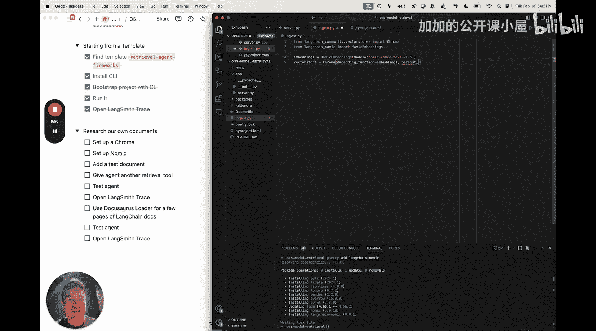

D or directory。

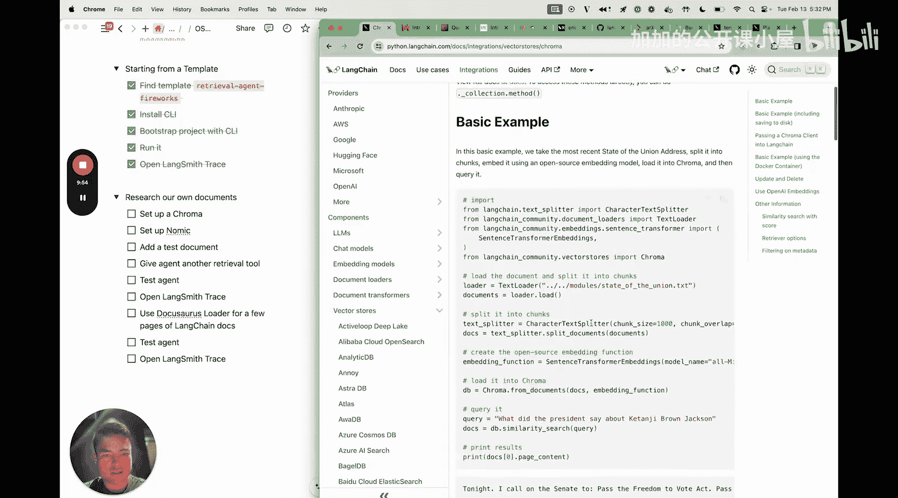

嗯。Of dot slash chromid。