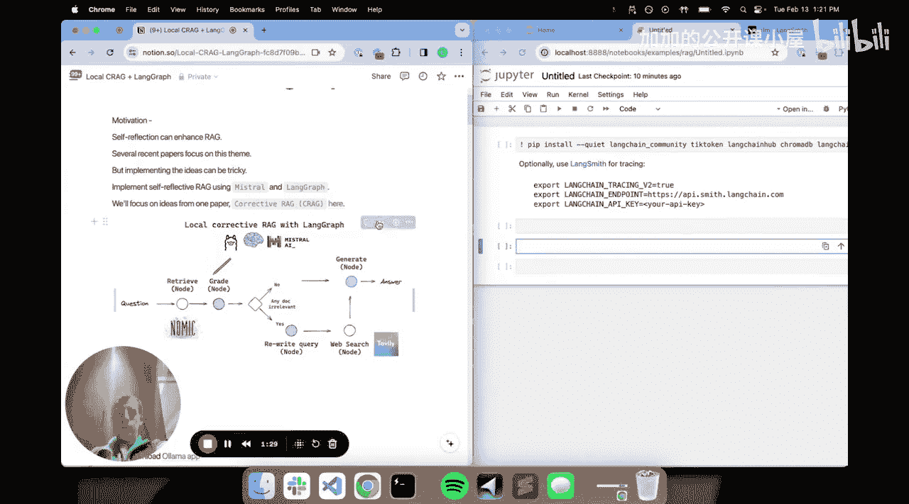
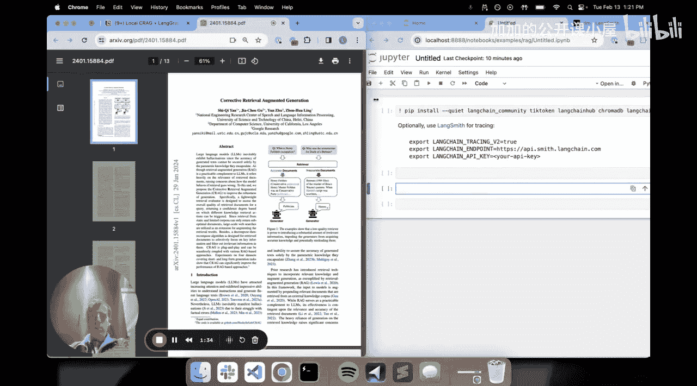
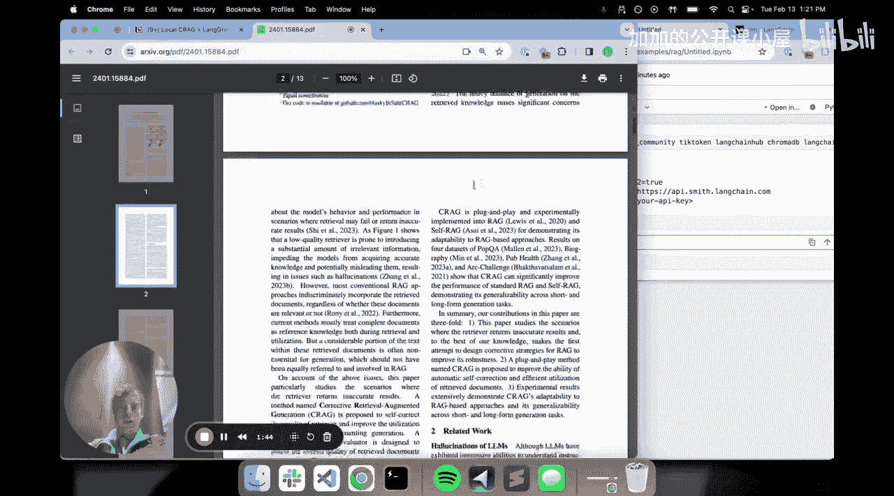
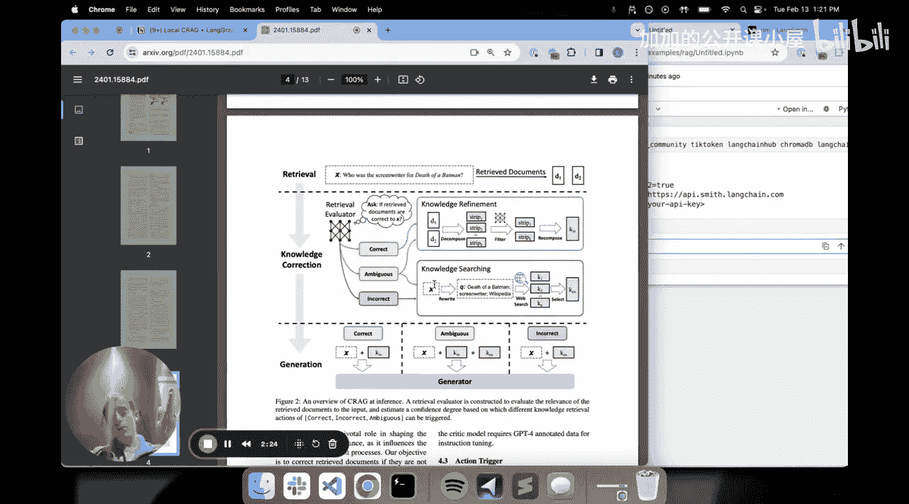
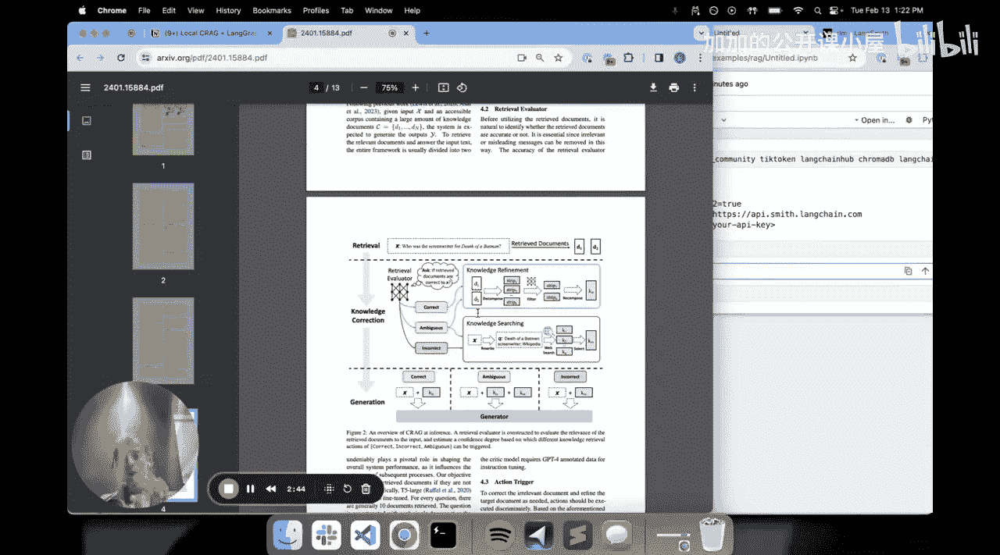
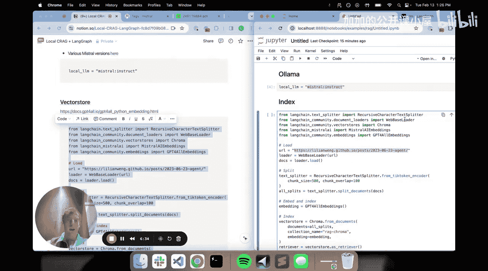
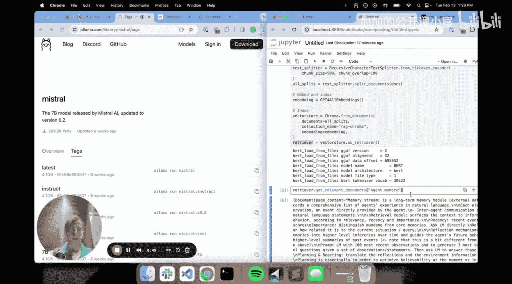
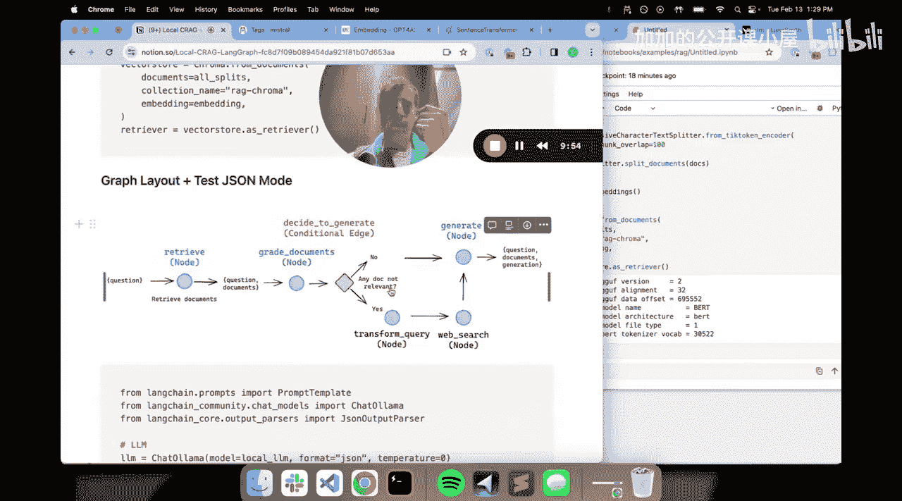

# LangChain【中英⚡LangChain 使用指南｜Build with LangChain】 p11 P11 Building Corrective RAG from scratch with open-source, local LLMs -BV1xwfMYDE3n_p11-

Hi， this is Lance from L chain team。I'm going to talk about building self reflective rag apps from scratch using only open source and local models that run strictly on my laptop。

Now， one of the most interesting trends in the RAG research and a lot of like methods have become pretty popular in recent months and weeks is this this idea of self reflection。

So when you do rag， you perform retrieval based upon a question from an index。

And this idea of self a fractionction is saying。Based upon， for example。

 the relevance of the tree documents to my question or based upon the quality of the generations relative to my question or the generations relative to the documents。

I want to make I want to perform some kind of reasoning and potentially feedback and retry various steps。

 so that's kind of the big idea。And there's a few really interesting papers that implement this。

And what I want to kind of show is that implementing these ideas。

Using something that we've developed recently called Lgra。Is a really nice approach。

And it works really well with local LLMs that are much smaller， for example。

 than API gated very large scale foundation models。

And so we're going to look at one particular paper called corrective rag or CRG。

Now， this paper is kind of， there's been some attention on， for example， Twitter about this work。

It's a really neat paper。And the idea is actually pretty simple and straightforward forward if you go under the figure here。

 you're going to do perform retrieval。

And you're going to grade the documents。Relative to the question。

 So youre kind of doing a relevance grading。And there's some heuristics。

 like basically if the documents are deemed correct。

They actually do some knowledge refinement where they further strip the documents to compress relevant chunks within the documents and retain them。

And if the documents are either deemed ambiguous relative to the query or incorrect。

 it performs a web search and supplements retrieval with a web search so that's kind of big idea but it's a nice illustration of this general principle of don't just do rag as kind of like you know a single shot process where you perform retrieval and then go to generation。

 you can actually perform self-reflection or reasoning。

 you can retry you can retrieve from alternative sources and so forth， that's kind of big idea。

Now in our build here we're going to make some minor simplifications。

 here's kind of a layout of the graph that we're interested in。We're going to perform retrieval。

 and for that we're going to use noic embeddings， which run locally。

We're going to build a node for grading those documents relative to the question to say are they relevant or not？

And if any documents are deemed irrelevant， we'll go ahead and do a query rewrite。

Web search and we then go ahead to generation based on the web search results。 So that's the flow。

Now， first things first is how do I get started running LMs locally and kind of where do I go and where I often direct people and what I found to be really useful is Oama。

It is a really nice way to run models locally， for example。

 on your Mac laptop very easily and they are launching support for various other platforms as well。

And so basically， if you go to their website， it's very simple you simply download their application。

 you can see it's running here on my machine。😊，嗯。And once you have it downloaded。

 all you need to do is you can go to their model list。

And you can kind of search around so you can actually look I think it's sorted by popularity you can see Mistr obviously a really interesting open source model is kind of one of the top so you can see it has like 210。

000 poles it's one of the top models I click on this and where this takes me is a model page I can look at this tags tab。

And this basically shows me a bunch of model versions that I can really easily just like download and run and we'll show how to do that here very shortly。

😊，What I'm going to do is I'm going to choose M Dllinstruct。

 so that is their 7 billion parameter instruct model and so all I would do I'm going to go over to my notebook here。

So I have an empty notebook。And all I've done is I've already done a few P installs。

And I've also set a few environment variables to use Langsmith and we'll see why that's useful later。

That's really all I've done now I'm going to put a note here to。For Oama。

And what I'm going to do is this Oama pull， the model I want。And use run that。

So normally this will take a little bit because you're actually pulling the model and typically it's like a couple gigs I actually already have this model so it's faster it's actually already done but that's really all you do okay so that's kind of like step one and then what we're going to do is I'm just going to create this variable local LLM。

😊，That I am going to， yeah。 So I'm just going to define this variable mystrstruct because this is the model that I download using a Lama pole mystrstruct。

 That's all that's going on here。So this is going to be the LLM I'm going to work with。

 I've pulled this so it's local on my system， it's available via llma。

 which is basically running in the background on my system。

 and you can see it's really seamless and easy to use。Now。

 the first thing I want to do for this approach is I'm going to call this index。So。

Because this was a corrective rag approach。 I need an index that I care about that I'm actually performing rag on。

And so here I'm going to use a particular blog post that I like on agents and we can like pull it up here and have a look。

Now it's pulled up over here， actually。So this is a pretty neat blog post on autonomous agents it's like pretty long and meaty so it's kind of like a good target for performing retrieval on lots of details here really neat really detailed to a blog post so what I'm going to do。

Is I'm going to load it here。I'm going to split it and I'm going to use a chunk size of 500 tokens These are kind of somewhat arbitrary parameters you can play with these as you want。

 The point is here I'm just building a quick local index so I load it I split it into chunks now this is the interesting bit I'm going to use GPT for all embeddings from Noic which is let's actually pull up the link here I had it available here so these。

R。You can see right here it is a CPU optimized contrastively trained as basically SBRT model so you can drill an tocent transformers so you can see yep。

 so there it is the initial work described in our paper SBRT basically so the key point is this。

 this is a locally running CPU optimized embedding model that works quite well I found。

Drrunt on your system， no API， nothing， so it's pretty nice， runs fast。

 so we're going to go ahead and use that from our friends at NoOic。And I'm also going to use Chromo。

 which is an open source local vector store that's really easy to spin up runs locally。

 and all I'm doing is I'm taking my documents， I'm going to define a new collection。

 taking my embedding model， GP for all embeddings， I'm going to create a retriever from this。

So there we go okay and it shows you some you some parameters。

 so cool I have a retriever so we can actually call we can say get relevant documents。

And I can say something about like， let's say like agent memory or something。 you know。

 let's just test。 And okay， cool look at that。 So it's nice and quick。

 We get a bunch of documents out that relate to memory。 So you can see memory stream。

 like the documents are are sane。 So it looks like everything's kind of working here。

 So that's great。 We have a retriever。😊。

Now。Let's think a little bit about what we want to do next。

So when I do these kinds of kind of logical rag flows， but as graphs。

 first I always try to lay out the logic。And let me move this up here。

I try to lay out kind of the logical steps。U。And in each logical step。

What is happening is I'm transforming a state， so in these graphs really all you're doing is you're defining a state that you're just modifying throughout the flow of the graph。

Now in this case because we're interested in RAG， our state is just going to be a dictionary and that dictionary you can see I actually kind of schematically laid it out here。

 it's just going to contain a few keys that are things relevant to RA it's going to be like a question then it's going to be youend documents to your diict and then eventually you're going append to generations so that's really all that's going on in terms。

