# LangChain【中英⚡LangChain 使用指南｜Build with LangChain】 p12 P12 Building a self-corrective coding assistant from scratch -BV1xwfMYDE3n_p12-

All right， this is La from Laang chain， I want to talk about using Lagra for cogen。

So Co generation is one of the really interesting applications of LLMs。

 like we've seen projects like GitHub Copilot become extremely popular。And a few weeks ago。

 paper came out。

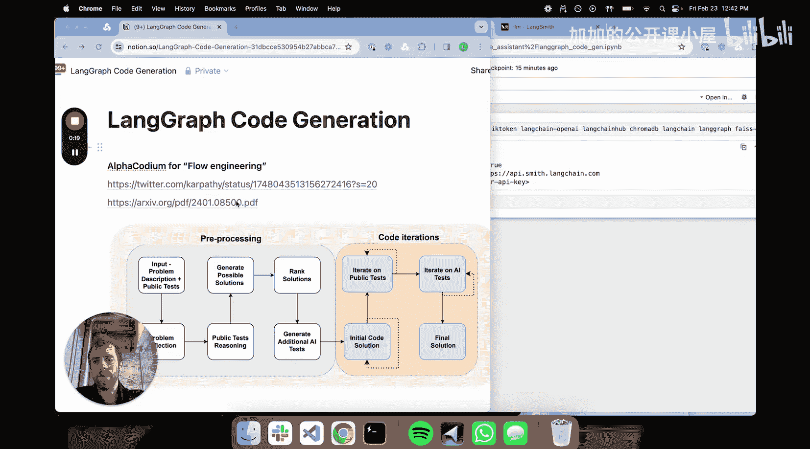

By the folks at codedium AI called Alpha codedium。And this was really cool paper in particular because it introduced this idea of doing cogen using what you can think of as like flow engineering。

 so instead of just like an LLM， a coding problem to like solve this problem and a solution。

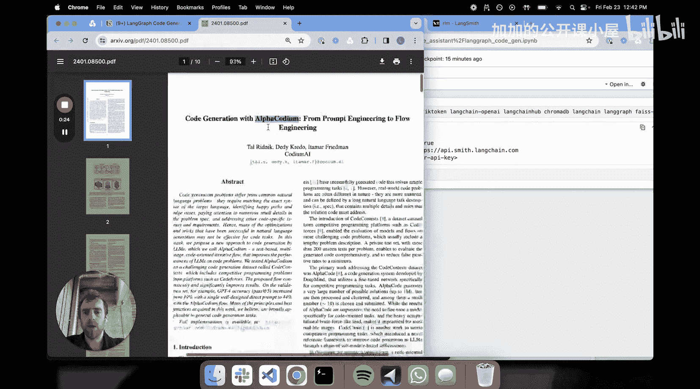

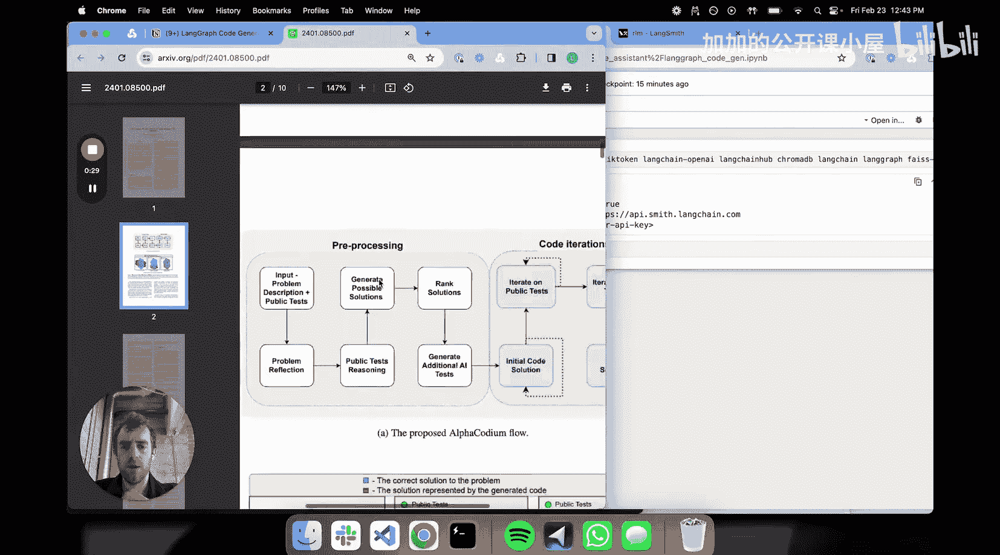

What it does is it generates a set of solutions。Rannks them。 So that's fine。

 That's like kind of standard like kind of prompt response style flow。

 But what it does here that I want to draw your attention to is。

It actually tests that code in a few different ways on public tests and on AI generatedative tests。

 and the key point is that it actually iterates and tries to improve the solution based upon those test results。

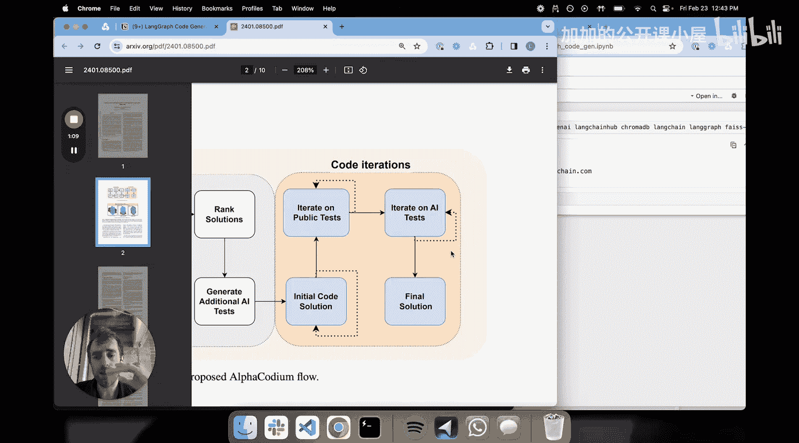

So that was really interesting。

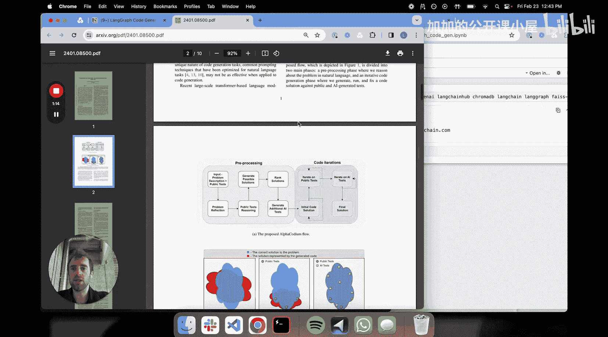

And a tweet came out by Car Po。On this theme， which kind of mentions， hey。

 this idea of flow engineering is a really nice paradigm。

 moving away from just like naive prompt answer to flow where you can build up an answer iterly over time using testing。

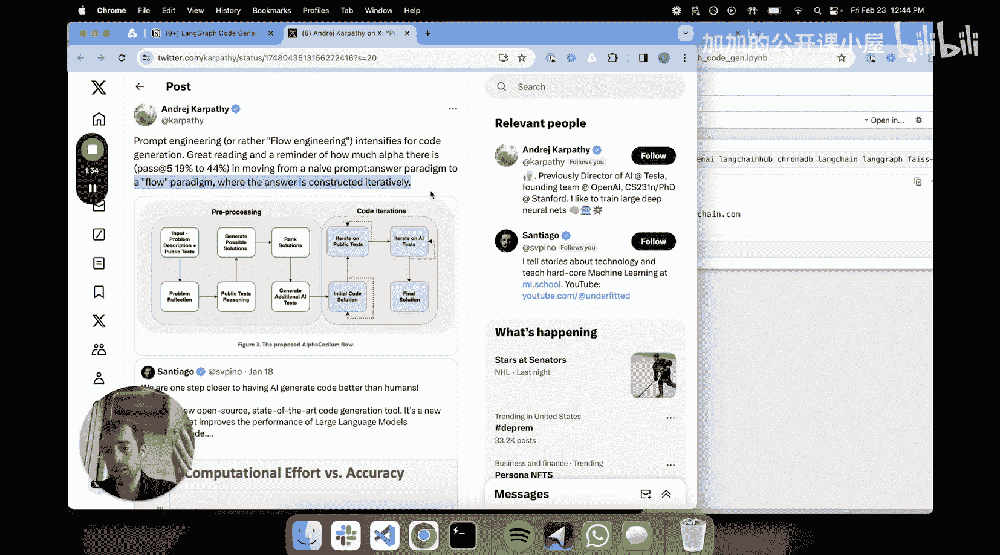

So it's a really nice idea。And what's kind of cool is。A few weeks ago。

 we introduced Langgraff as a way to build kind of arbitrary graph。

 which can represent different kinds of flows。And I've done some videos on this previously talking about Lagra or things like RaG。

 where like you can do retrieval， and then you can do like a retrieval quality check。

 like grade the documents， if they're not good， you can like try to retrieve again or you can like do a web search or something。

 but it's a way to represent arbitrary kind of logical flows of the LLMs。

In a lot the same way we do with agents， but the benefit of graphs is that you can outline a flow that's a little bit more。

 it's kind of like an agent with guardrails， it's like you define the steps in a very particular order。

And every time you run the graph， it just executes in that border。

So what I want to do is I want to try to implement some of the ideas from Al codedium using La graph。

And we're going to do that right now。So in particular。

 let's say we want to answer coding questions about some part of Langching documentation。

 and for this， I'm going to choose the Langching expression language docs。😡。

So it's a subset of our docs， it's around 60，000 tokens and it focuses only on line chain as fresh in language。

 which is basically a way you can represent chains using in line chain and we'll talk about that in a little bit。

But I want to do a few simple things， so I want to have one what we're going to call a node in our graph that takes a question and outputs an answer using Lanching expression language docs as a reference。

😡，And then with that answer。I want to be able to parse out components。

 so given the answer I want to be able to parse out like the preamble， what is this answering。

 the import specifically， and then the code。😡，And to do this。

 I want to use some like epidemic objects， so it's like very nicely formatted。And if I have that。

 I can really easily implement tests for things like。Check to make sure the imports work。

Check to make sure the code executes and if either of those fail。

 I can loop back to my generation node and say， hey， try again， here's the error race So again。

 what they're doing in alphacodium' is way more sophisticated they don't mean to suggest we're actually implement this as is this actually works on like a bunch of public coding challenges it actually has tests。

😡，For each question that are both add and publicly available， so again， we're doing much simpler。

 but I want to show how you can implement these kinds of ideas and you can make it arbitrarily complex if you want。

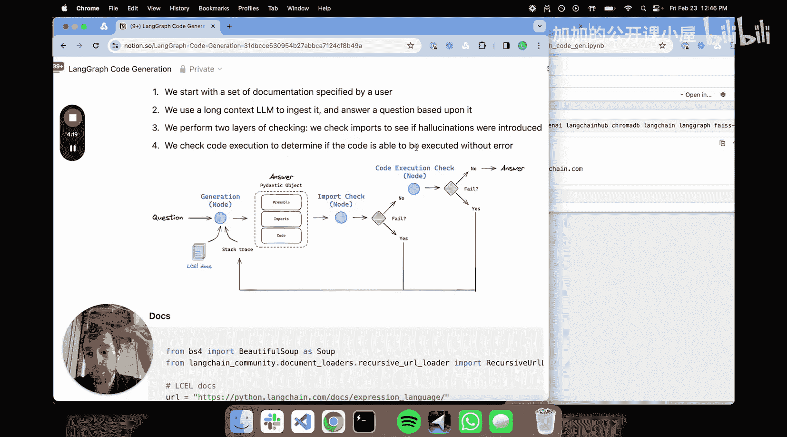

So I'm going to copy over some code into a notebook that I have running。

 and all I've done is I've just done some PI installs and I've basically defined a few environment variables for Langsmith。

 which we'll see later is pretty useful。

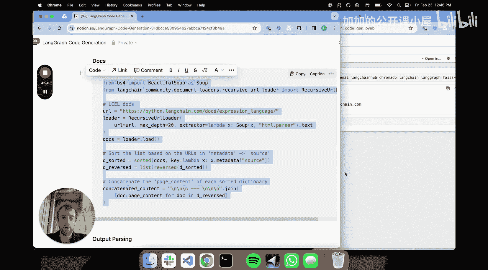

And I'm going to call this docs。So this is where I'm going to ingest the docs related to Laing expression language。

And I'm going kick off this right now， So that's running So again this is using a URL loader。

 grabble the docs， sort them and clean them a little bit and here we go So here we go these are all the docs related to lanching expression language it's around 60。

000 tokens because I've measured it in the past so there's our docs。

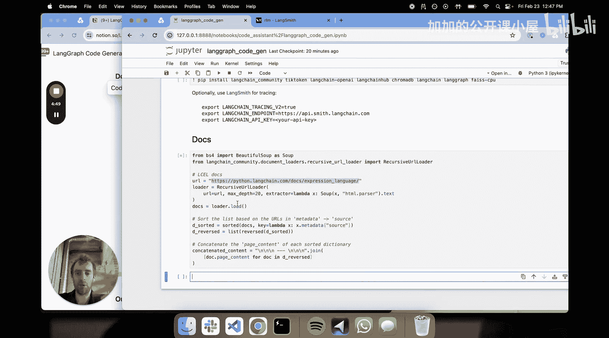

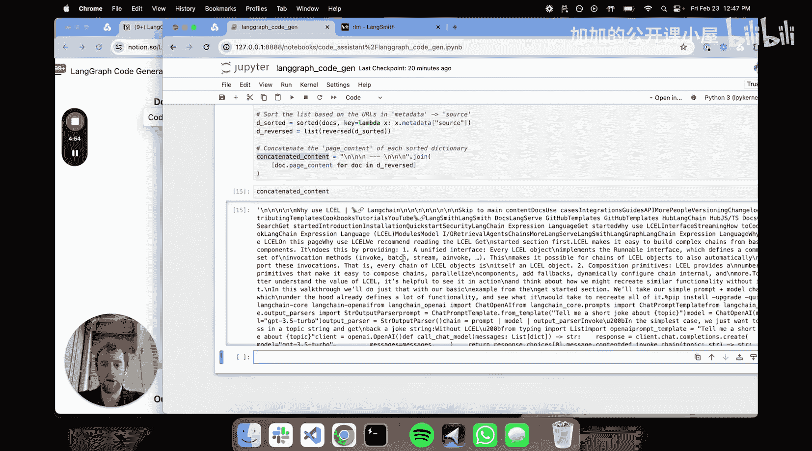

Now I want to show you something that's very useful。

I'll call it tool use with open eye models and other Ls have similar functionality。

 but I want to show you something that's really useful。 What I'm going to do here is show。

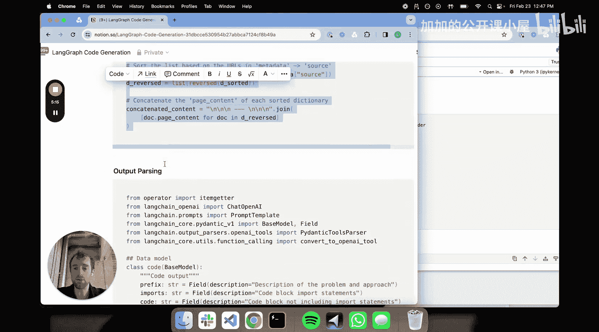

How to build a chain that will output， remember we talked about in our diagram。

 we want three things for every solution。 we want a preamble， we want imports。

 We want code as a structured object that we can work with individually。

I'll show you right here how to do that。So what we're doing is we're importing from Panantic this base model in field and we're defining a data model for our output。

 so I want a prefix which is just like the plain language solution。

 like here's the setup to the problem， the import statement and the code I want those just three distinct things that I can work with later。

I'll use DPT4， 0125， this 128 context window model。

And what I'm going to do is I'm going to take this data model， I'm going to turn it into a tool。

 and I'm being going to bind it to my model。 And so basically what's happening here is it's going to always perform a function call to attempt to output in this format I specify here。

 that's all it's happening。😡，I define a prompt that says here's all the L cell。

 or laching expression language pronounced or substituted as LCCEL， here's all the LCEL docs。

Answer the questions， structure your output in a few ways。

 But what's cool is we're always growing that function call to basically try to output a pantic object。

 So there we go。 Now what's nice is I can just invoke this with a question， So let's just try that。

So I'm going to say question。And I'm going to say how to create a rag chain in an LCCEL。Wantna run。

Okay， this needs to be addicticed。There we go， boom， so that's running。Now this is actually just。

 we can see right here we passed in all those docs that we previously loaded， so it's like 60。

000 tokens of context and again， you think about new or long context LLMs like Gemini。

 that becomes more and more feasible to do things like this。Take like a whole a whole code base。

 a whole set of documentation， load it and just stuff it into a model and have it say， hey。

 answer questions about this。 that's still running。

 Now the latency is definitely higher because it's very very large context。 But that's fine。

 We have a little bit of time And we can go over to Langsmith else's running and have a look so we can see here is our prompt。

 Okay， so there you go look at this 63000 tokens you can see it's a lot of context。 that's fine。

 and we can actually see it all here。 So it's in Langsmith。

We don't want to scroll through all that mess， but you can see we've asked a question。

 we're grounding the response in all this L cell docs。

And we're going to hopefully output the response as a pedantic object that we can play with。

 So let's just see and okay， nice， it's done So you can see our object here has a prefix and it actually has。

It's also going to have our imports here as well。We can actually can see that in Langsmith the answer is going to be here and there you go。

 see your imports， your code and your prefix and these can all be extracted from that object。

 really easily so it's basically a list it's a pantic object code and you can extract each one but just like you know answer dot prefix。

 answer dot whatever our variables or whatever our keys are answer audit imports。

 answer not code so that's great。

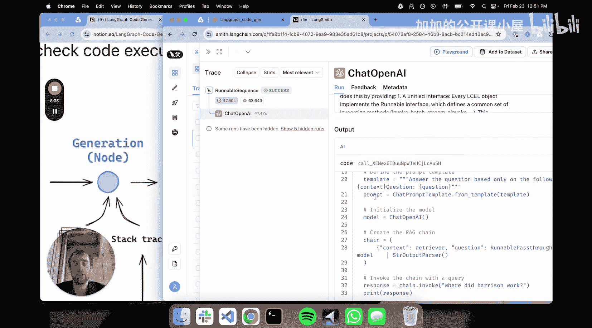

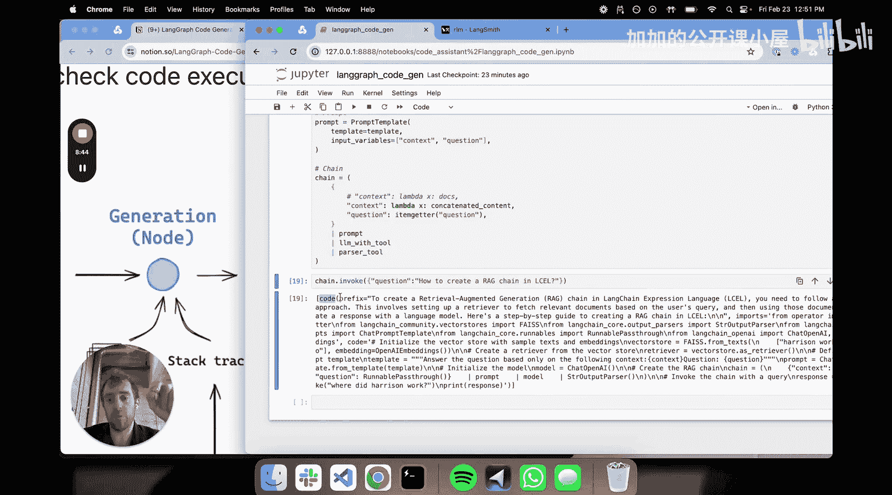

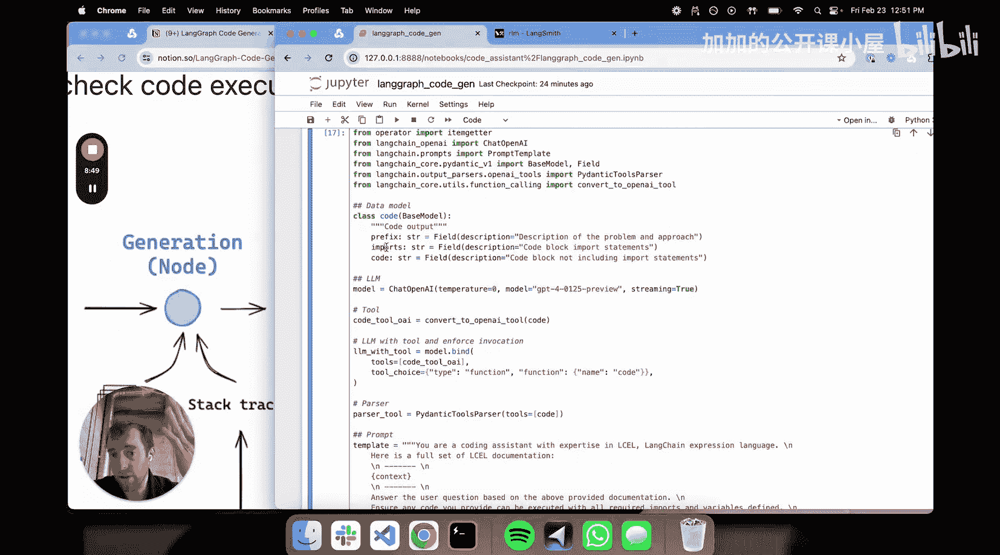

So that just shows you how tool You works and how we can get the structured output out of our generation node。

Now， what I'm going to do here is now we've established so we can do that。

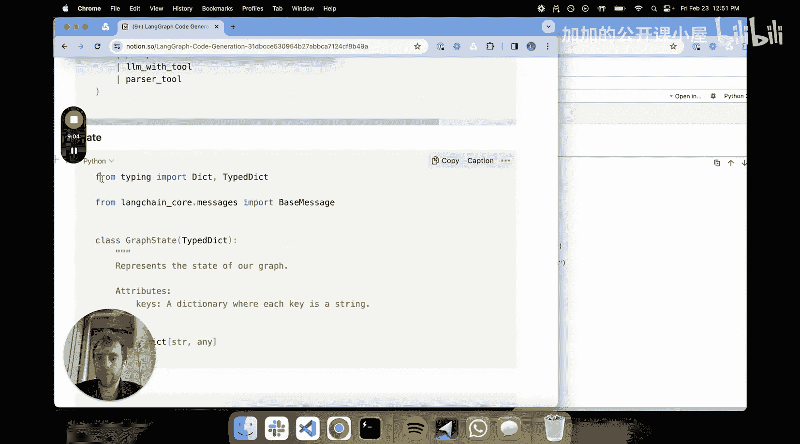

I'm going to start setting up our graph。And what I'm going to do is for us I'm going to define our graph state。

 so this is just going to be a dictionary which contains things relevant to our problems。

 so it'll contain our code solution， it'll contain any errors， and that's all we're going to need。

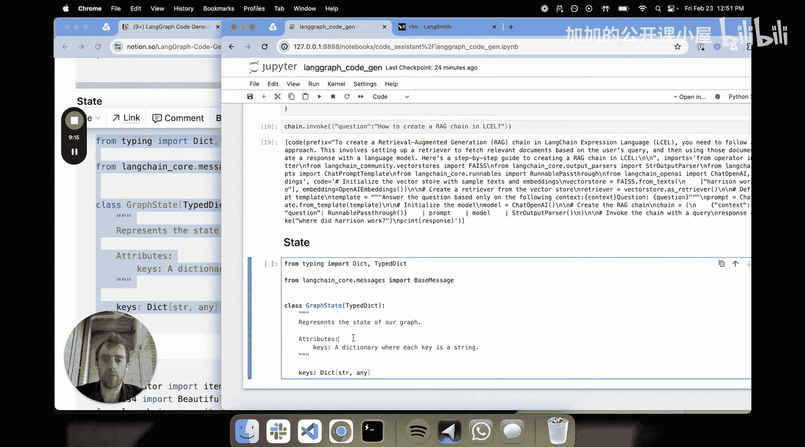

And here is where this is all the code related to my graph and we're going to walk through this。

 so don't worry too much， but I just want to kind of get this all here。

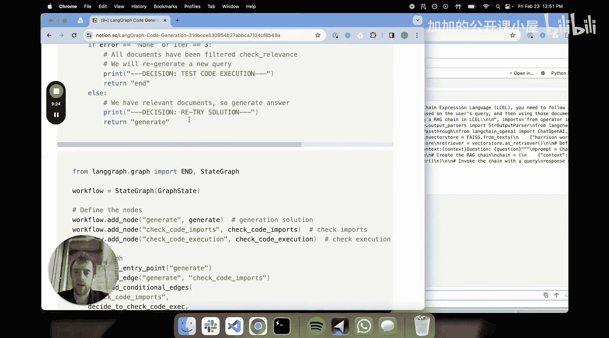

So here's our code now if we go up， the way to think about this is simply this。

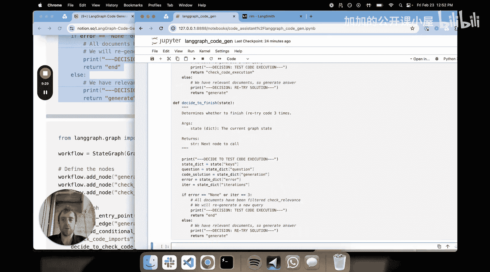

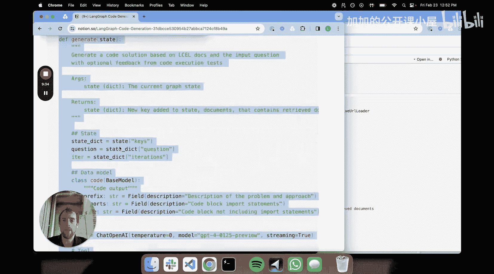

I want to go back to my diagram here， so every node in our graph just has a corresponding function and that function modifies the state in some way。

 So what's happening is our generation node is going to be working with question and iteration。😊。

Those are the parts of state that we want as like inputs。

 you can see kind of maps to here you have question and you have iteration just counts how many times you try。

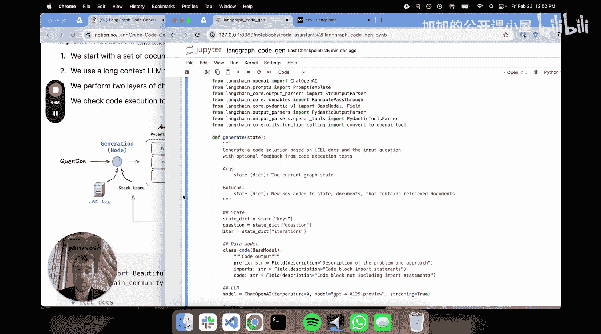