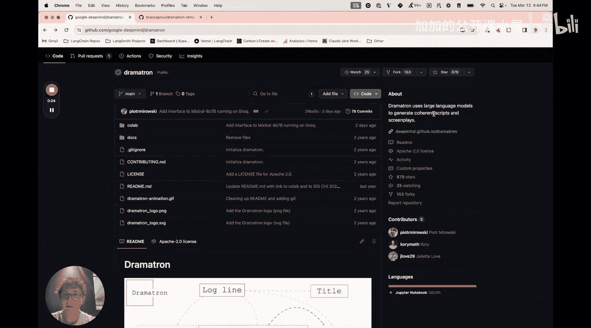
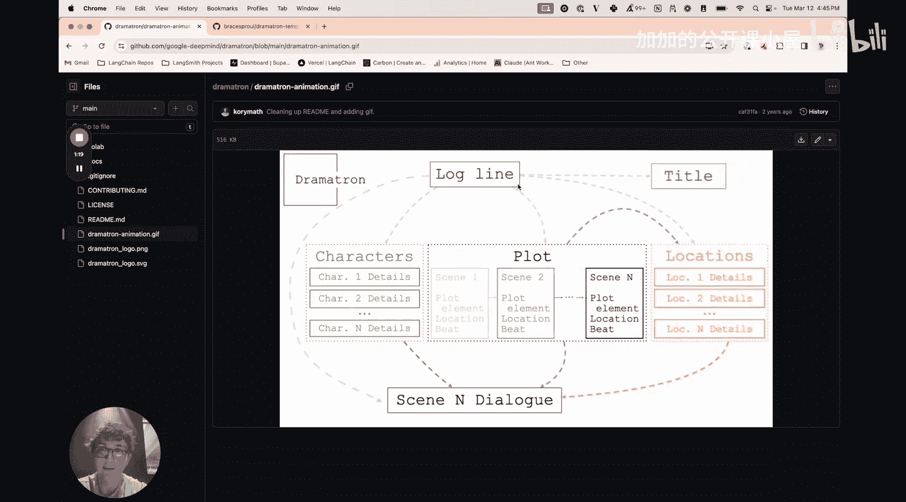
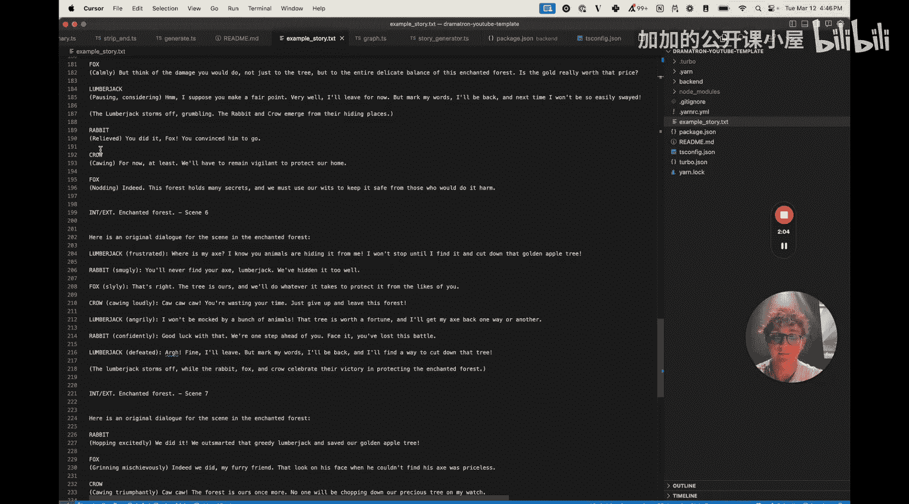
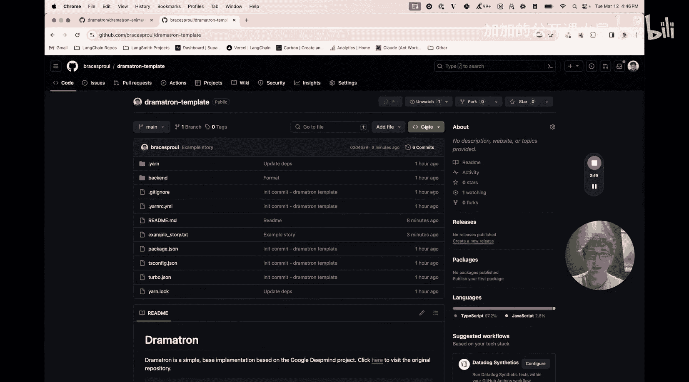
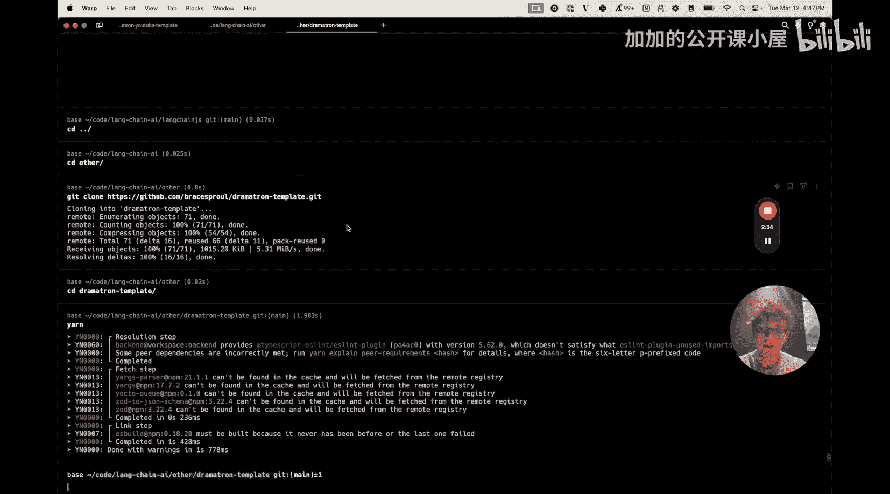
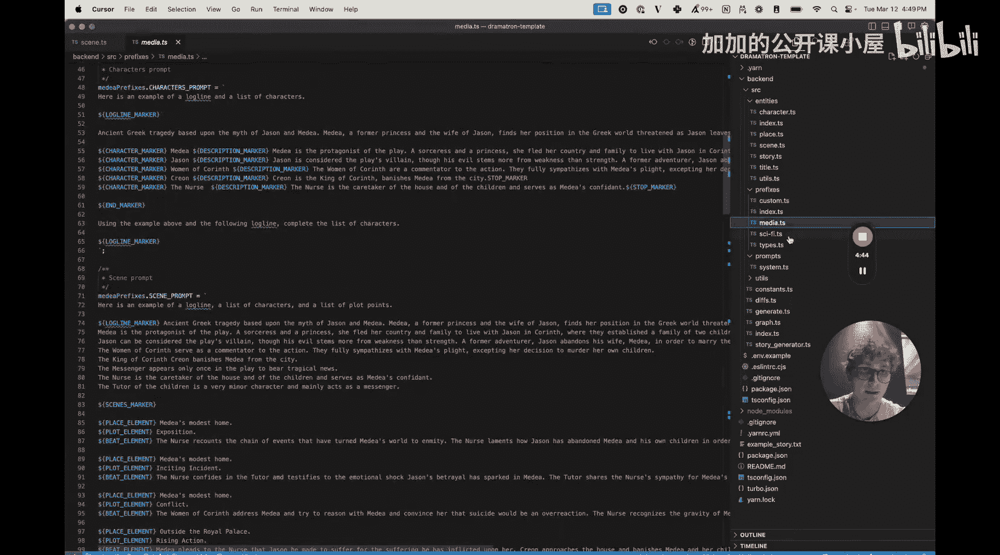
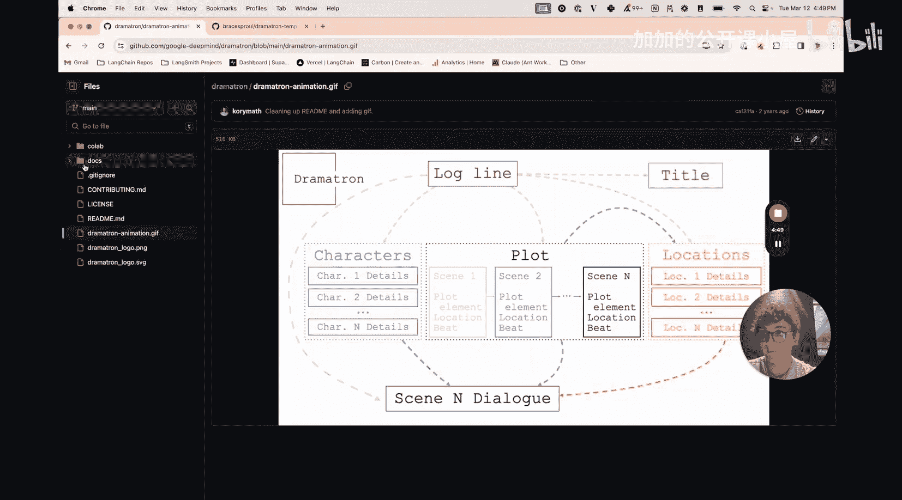
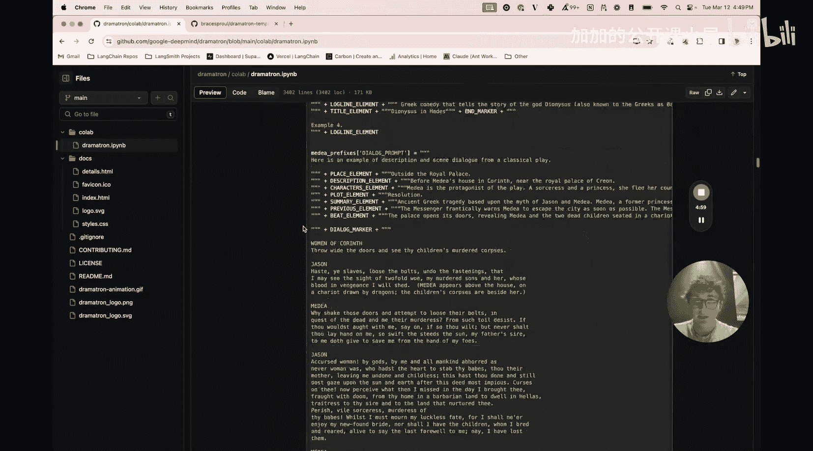
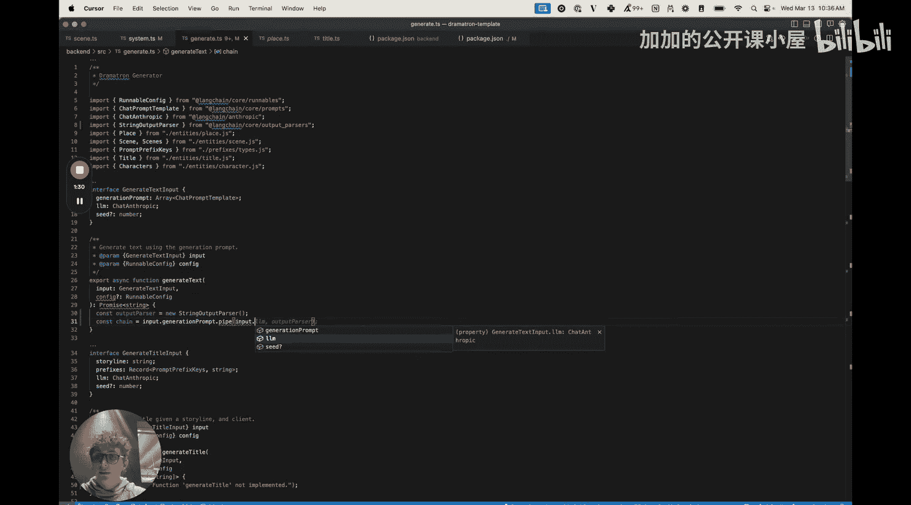

# LangChain【中英⚡LangChain 使用指南｜Build with LangChain】 p15 P15 Building Google's Dramatron with LangGraph JS & Anthropic's Claude 3 -BV1xwfMYDE3n_p15-

Hey everybody， Grace here from Langchain， and today I'm going to be doing a quick tutorial demo walkthrough video on implementing Google Deep Minds Drmaron in Langchain JS。

And La graph。If you're not aware， dramamaron is a or was a project by Google Deepmin from， I think。

 2022， where they take large language models and using。

Their flow， they can generate entire plays。 And there is a little gIif in their homepage。

 which kind of does a good job of explaining how it works at a high level。

 So you present dramatron with a log line。An。This log line is kind of like a description of。

The story you want or the play you want to generate from there， it creates a title。

 Then it generates some characters。 These characters have descriptions。

After generating the characters in the title， it generates the ski or the plot。

 which contains scenes， scene descriptions， places， what they call beats。Ploot elements and whatnot。

 then generates including in the plot， it generates locations for those scenes。

And then once all of that is generated， it goes and it generates a final dialogue and puts it all together into。

What will eventually look like。This。So at the end of this tutorial。

 when we've finished implementing all the code and we've。Executed it using La graph。

 It'll log our play， which looks like this。 so it has little heading。Scrrit description。

 different scenes。And then， the actual dialogue。And as you can see， it's it's pretty pretty in depth。

 It generates a lot of content， but it does all of this using。

A large language model in this tutorial， we're going to use anthropic their new models and does it all without function calling。

 it's simply prompting and then a tiny bit of parsing on the end。

So to start， you're gonna want to go to my dramatron template repo。 There's a lot of。Kind of code。

 which doesn't really matter， but you need it。 And I've already implemented that just so you don't have to。

Implement that busy work， you're going to want to copy the get URL。

And go and clone it。So。Once you've cloned it， navigate to the directory。Install dependencies。

By calling yarn。

Next， you can open it up。And you'll see this is the structure。

 So it's a Monteripo based off of a Monteripo template I have。

 We've delete the front end because we don't need that。 We're only using the back end。

And then inside the back end， source directory。In example。Environment variables。

 you can want to set this with your own anthropic API key and your Lsmith keys for tracing so you can see how your app's working。

And then inside here， we have four folders at the top and then a few files quickly to go through entities。

 these are the different。Entities that the abuses so characters， plots， titles， stories and whatnot。

 And these are different classes， which essentially are just going to hold the character name。

 the character description or。Characters， plural description。

 and they usually contain one or two methods for doing things like passing in the generated text。

 splitting it out， setting it into the class。And then you can access it all later。

 and it's not just a straight string from the OLM。So if we look through character and characters。

Place has this as well。Format name from string， my prefix and whatnot。Yeah。

 so I already implemented all this。 It's kind of busy work。 You know。

 its really the same thing with slight tweaks。Many times over， scene scenes from string。

And then as you can see inside a lot of these， we're using these constants called place element。

 plot element， beat element， these are also implemented inside the constants file。

And here we can see all these different constants。End marker， stop marker， character marker。

 and these are used in the prompt。I can show that right now。

s the problems are live inside the prefixes directory。 There are three main pre prefixes。

 custom media and scifi custom is kind of just the base implementation allows you to customize it。

Media and scifi are both prompts from the to prefix this custom media scifi。 these。

 these were all ported from。

The dramamaron repo， that would be a lot of porting to Js if you did it yourself。

 So this is something that I quickly did beforehand。

U。They are way down here。 and these are essentially the prompts that we're going to use when we're calling the LLM to generate and then these different markers。

 what's what they're called kind of split up like the character， the description， and then log line。

 So then when we're actually calling the LLM。 it sees these patterns that we use in the examples and we'll respond with those patterns as well。

 So it's easy to parse out their response without needing to use function calling。

How many example we use the media 1。It looks like this。 You can take a look at it， if you would like。

But it's just a few different prompts。Which contain the characters prompt， scenes， prompt， setting。

 title and dialogue。 And these are the different steps we're going to take when generating。

 So we're going to generate the title。 We're then going to generate the characters。

They generate the scene， the settings， and finally， the dialogue。Andm。

After the prefixes and entities， we have this system prompt file。

 which we can actually go do right now。 This is just going to get appended to every single LM call you make。

 so you can， this isn't too important。 You kind of make whatever you want。 But for this。

 we're going to use。You are a。Brilliant。Storyteller。嗯。To the。Users。Very。Exactly。Without。Exactly。

 that's enough。And then， here。Or can import this in two hour， generate file where we'll go next。

 where we actually generate the LM responses and prefix this to every single LM call just as a kind of base system prompt。

Next， Us file folder， three files in here。 The render story is also implemented by default。

 just because this is rendering the story once it's all been generated into this nice string that you saw here。

 this is not really。um。Specific to drama and。 it's just a lot of。You know。

P to an array and then joining at the end， this is already implemented。

 and it kind of gives you the structure that you saw in that that example story file。

HowThe next few files are prefit summary and strip end will implement these later。

 These are going be used as little us after we generate before we generate and whatnot。Diffs。

 these are also generated。We will come back to this。 This uses a diff library。

 which is similar to a diff library that they use in Python。 We'll get back to this。

 We we actually use it。The generate file， I have all of the functions and the interfaces pre builtil。

 but the content or the actual core functionality is not there。 So we'll do that after。Graph。

 this is where we're going to define our L graph graph with all the different nodes。

 calling the generations。Iterating and kind of stepping back or forward based on what has exceeded。

And then we'll run it from the index file。 And finally， the story generated file。

 which contains the story generator class。 This is where the core functionality between generating the title and the characters and whatnot will go on。

I'll explain all of this when we get to it。This is the one method we really care about step。

 it's what we call。 It's what we're going to call inside our graph。

 and step will' then call all the different generate functions we write。And yeah。

 I think we can get started inenia now。Alright， so the first function we're going to write is to generate text function inside this generate file。

All of the generate title generate characters generate scenes， functions。

 They will all call the generate text to actually call the a and generate and then。

These individual functions will just do。Extra things like putting together the prompt。

 parsing the output returning。A title entity and whatnot。

 but they will all come down to just calling this generate text to generate the initial text。

 So we can see our input as a list of prompts in an optional seed argument。

So we are going to want to first define an output parsor。 And we always want to turn our strings。

 We'll just use the。嗯。String。Type output parsor。Well always be。String output hersor。

Which we can import from Lang chain core。Like so。And next。Our prompt。

Which we can use to pipe to our LLM using the La chain expression language and then pipe the LM to the output parsor like this。

AndI'll explain what that's doing。So we can have our chains and cons。Chain equals。Input dot。

Nation prompt dot pipe。We' going to pipe that to the。

