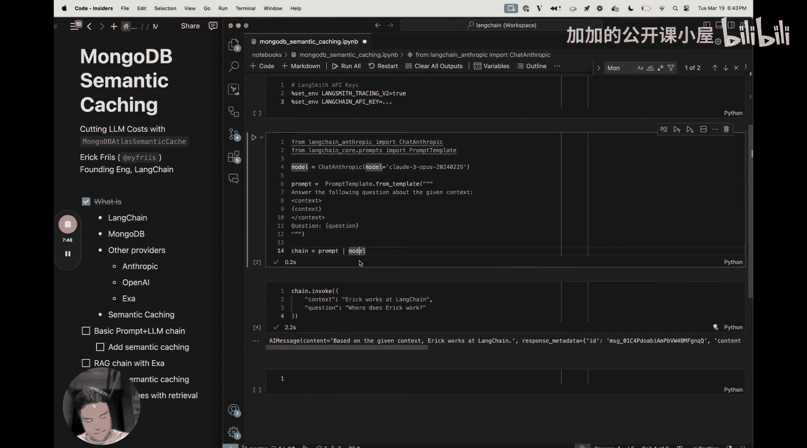
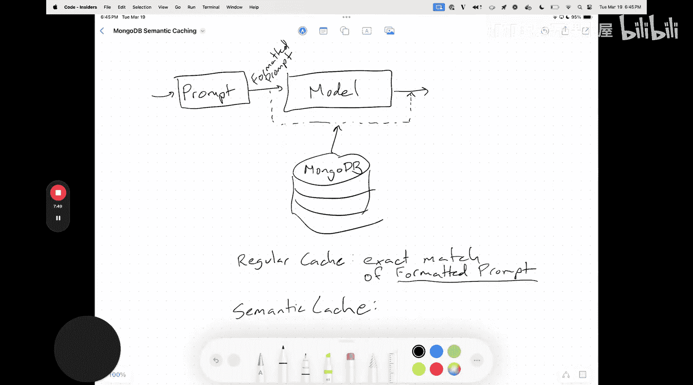

# LangChain【中英⚡LangChain 使用指南｜Build with LangChain】 p16 P16 Cutting LLM Costs with MongoDB Semantic Caching -BV1xwfMYDE3n_p16-

Hey folks， I'm Eric at Langchain， and today we're going to be talking about using MongoDb semantic caching in order to cut our LOM costs。

Today， MongoDV launched their integration package with Langcha so you can use MongoDV as a vector store or as a cache or even a semantic cache。

 which we're going to go through today。We're going to be using a few different providers in our solution。

 So the first thing that we're going to go through is。Kind of who each of them are。

 then we're going to go through two examples from our cookbook。

 one just being a basic prompt and LLM chain with semantic caching and one with RAG where we'll actually discuss some of the challenges of using semantic caching with a retrieval based system。

So without further ado， let's dive in。The first orchestration framework that we're going to be using is Langcha。

 the company that I work at， these are the Langcha docs we allow you to connect to any LLM。

 any vector store， different kinds of tools and we're kind of a one stop shop for all those different integrations and then we provide some standard abstractions for those integrations as well as some other approaches。

 we have lots of cookbooks that allow you to implement academic papers or just kind of basic solutions which we're going to be going through today。

The next up is Mongodb specifically。MongoDB is a NosQL database provider that also provides Atlas。

 which is a cloud database available in a few different environments。

 it has native vector search which is the reason that we're going to be using it today。

 cementmantic caching involves kind of an embedding lookup very akin to a vector store retrieval step so we're going to be leveraging the Atlas vector search instance there。

 and we're also going to be using some other providers as well。

 so we're going to be using anthropics cloud3 LLM in order to actually generate some responses from our application we're going to be using open AIs embeddings for this particular application and when we get to the RaG step。

 we're going to be using X's search retrievetr in order to retrieve some documents to actually base our responses on。

So let's dive it。The first chain that we're going to implement is the basic prompt and LLM chain from our cookbook。

 It's the first entry and ride conveniently is the second one as well。

 The idea behind this is it's really the simplest thing that you can do for getting started。

 And so we're going make something kind of similar to that。 So let's go into our editor。

So the first thing you're going to want to do is you're going to want to install some packages。

 So today we're going to be using。Four main providers， MongoDB， Anthropic， Open AI and Exa。

 so we're going to want to install those four partner packages so we can see those up here where you're going to install Langchain MongoDB。

 Lang chain Anthropic， Laangin， Open AI and Laangchain Exa。

The next step is we're going to want to set some environment variables in order to get those set up。

 I already have those set up in my environment so we're not going to have to worry about those。U。

We're going to be using open AI for embeddings in this particular example and then last but not least Langsmith is our kind of first party observability and debugging tool at Lang chainin and if you want to use that in order to debug traces。

 we can actually just quickly open that to see what that looks like。

And just briefly showing what Lasmith looks like， we'll look at this a little bit more later with some of the further examples it allows us to trace all of our different。

Applications in order to see kind of how the prompt is constructed and which documents are actually retrieved as part of different retrieval steps。

 as well as other things such as kind of L and pricing， token counting， those kinds of things。

 so we'll be using that。downown here and you just need to set these two environment variables to activate that throughout kind of your entire plan chain application。

 which is quite nice。So once we have all of the that setup， we can dive it。

 So first thing we're going to do is we're going to want to set up some sort of prompt。

Into model chain。嗯。So the kind of。Way that we compose prompts and models。

 as well as everything in La chain is kind of through this runnable interface where we can pipe the output of a prompt into a model。

Now let's configure what that prompt and model actually are。

 So first we're going to want to set up our model。And we're going to use a chat anthropic model using their new cloud3 height sonnet model。

 so we'll say from Lang chain Anthic。Import。Aropic。

And actually let's use OPus instead just so we can show off some of the speed gains as well from caching so OPus is Anthropic's largest and slowest cloud3 model if you want faster ones you can obviously use Sonet and Haiku as well so we'll use cloud3 OPus。

24。2，2，9。They have their nice leapier date in their model。

 and then we'll also want to set up our prompt so in order to make a prompt we'll do from Lang chain core。

Dot fronts。ports。I'm b。And we'll set our prompts。To be。Template。散杯。And we'll give it。

A nice little string here and we' do actually we'll start with just a classic rag prompt where I will'll say answer。

The following question about the given context。And what it gives。Kind of Xml surrounded context。

 So the squiggly bracket context field is what we're actually going to substitute in as part of。

Our prompt template， and then these XML tags are actually just there to indicate to the LLM that that is what the context is。

And then we'll give a question below there。So that should form our prompt and our model。

 and we'll see if that runs。 Look like we successfully did that。

 And then we can now try invoking it with。Some sort of context。And some sort of question。Where。

We are essentially substituting in those two kind of blue variables from up here from whatever we set it to so we could。

 for example， give it something like Eric。ExLang chain。With a question of where。Does。

And we can see what we get back from that。In 2。6 seconds， again， Opus is kind of a larger model。

 we can see that based on the given context Eric works at L chain。

 so looks like our our basic chain is working if I were to run this again， it should still take。

Two or seconds because it's going to actually send that API call to Anthropic every single time that we do this。

 as well as rack up token usage， as well as our good anthropic bill there。

So in order to kind of cut some of that， let's go into semantic caching so caching in general。

 and I'll actually draw a bit of a diagram here。嗯。

Semantic caching in general， intends to kind of。Prevent us from sending too many API calls to our model provider。

 So in the chain that we just set up where we have。A prompt。Going into a model。

And giving some kind of output， what we're essentially going to do is we're going to create a kind of bypass path around the model step。

Where if we've seen。Kind of the formatted prompt。Before we're actually just going to grab that from our cache。

 So in this case， we're going to be doing that with kind of a mongo。DB。Based。Cash。

And we're going to just get whatever response we had last time from that。

And there's kind of two main ways that we can do that。 so the first is with a regular cache。

Where we're going to be looking for an exact map。Of the formatted prompt。

And this is good for instances where we know we're going to get very similar prompts。

From whatever system we're using so in our particular example。

 this actually likely won't work particularly well because it's passing in a user's question as part of it and then likely that context is coming from some sort of retrieval step which we're going to add in a second。

嗯。😊，And so if I asked even something just slightly different， such as where did Eric work？

Period instead of a question mark， it's actually going to not be able to look that up because it needs that exact match in order to look it up。

 And so the approach that we're going to be using today in order to make that work is called semantic caching。

Where instead of indexing by the kind of exact formatted prompt string。

 we're going to index by an embedding。

