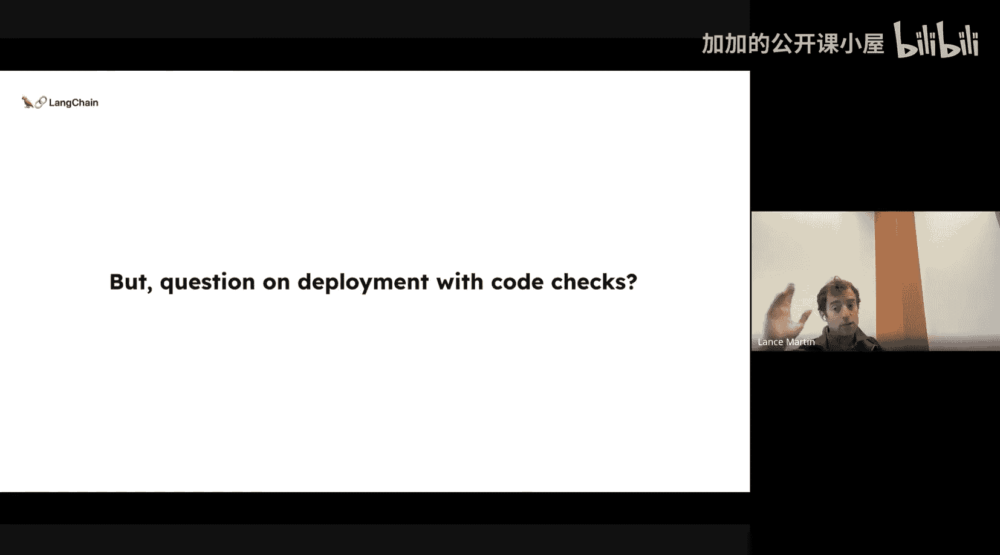
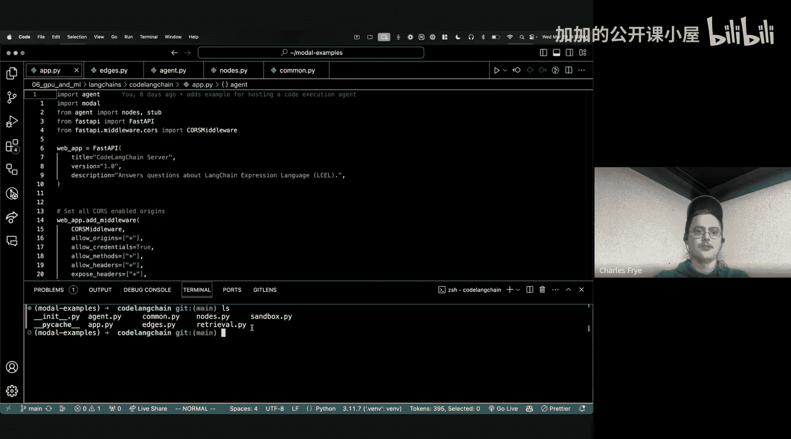

# LangChain【中英⚡LangChain 使用指南｜Build with LangChain】 p17 P17 Deploying code agents without all the agonizing pain -BV1xwfMYDE3n_p17-

So I had a notebook that had some code for this landgra code assistant I was doing code checks in the notebook that's not deployable for all such of reasons Charles took that changed my code execution so then code execution is not happening just in your environment anymore what's happening in this isolated sandbox security considerations sandboxing secrets management those are productionization pain points so we've helped with that more painful development cycles that are typical of interaction with production is also pain points that we solve Do you want to kind of close the flywheel using the production data to improve the overall system you're going to want scalable infrastructure。

Great to be here with you yeah nice to see you too Lance excited to talk about this little project that we worked on together Yeah definitely。

Yeah， let me kick it off and I can kind of give some context that a slide here Now。

 a couple of months ago， there's a pretty neat project that came out of Kodium AI called Alphacodium。

Which presents like a very nice way to do code Gen。

 where the main idea is it produces an answer based on the coding question。

 and then it performs a number of checks。 So in this case， it actually like you know。

 it works on public coding challenges。 in this case throughs public tests it references。

 it does some AI generated tests。But basically， it checks the solution。 If there's an issue。

 it goes back， it retries。 and Carpathy had kind of a nice tweet here。

 which was like prompt engineering， you know intensifies for codegen and moving from a naive prompt answer paradigm to like a flow paradigm where the answer is itly constructed with various attempts。

 checks， retries is kind of a nice way to approach the problem of cogen。

 So that's kind of lays the groundwork。 This alpha codedium work was pretty cool introduce this idea of flow engineering for codegen。

 So that's kind of to set the stage。😊，Now we have a lot of people who go to chat L chain to ask coding questions。

😡，That La chain is a RAG system， it's in our documentation。

 it definitely does not reliably produce executable code， it is really good for qualitative answers。

 it can send you roughly to the right place， there's no guarantees that the code you get back is actually executable though。

😡，So we've been interested in this question of how can we do better and kind of drawing inspiration from the Apple coding paper we said。

 well， what if we built a little system we can call it in like code La chain， for example。

 that produces code solutions but actually checks them。For for example。In this case， just imports。

 make sure the imports are real and functional， and then just code execution， make sure it executes。

😡，And if either of those fail， you can loop back。That's kind of motivation。

You can obviously make this arbitrarily complex， you can do all sorts of different checks。

 but this was like a starting point let's see if like just something like this would work。

So the setup is this， I just took the Lanching expression language docs。Smaller scale， 60000 tokens。

 so it's a bit constrained。I don't do retrieval， I do just context stuffing a generation using GP4。

 which has context window of 128，000 tokens。But what's interesting is。

I use function calling to produce an object out， which is like what I call like an answer object。

 which has like a preamble， here's what the problem is about。

 the imports in the code all easily partitioned。😡，Which allows me then to do two checks first I just check to make sure the imports actually work。

Second， I make sure that the code is actually executable Now this seems kind of like naive and simple。

 but actually what I found when looking at some testing prior to this。

Hallucinations often creep their way into the imports so like the model in many cases will kind of hallucinate a non real import that's a very common issue so this checks for that。

😡，Likewise through execution， if you， you know， just had either coding errors or， you know， some。😡。

Another hallucininate， for example， you know， in the code block itself。

 then that will get caught and you'll loop back。 And this is all using land graph。

 So means land graph to kind of orchestrate this flow。So that's kind of the setup， right？Now。

We ran an EL set I ran this audience and Eval set that I built for a language chain expression language。

So I test。Just basic， I actually don't use Ra， I use basic single shot。

Cont stuffing in generation with this landgra multi attempt approach。

So what I see for imports is imports are actually already pretty good。 no real change there。

 so with or without this landgra flow engineering thing， imports are fine。

 but cogen gets much better。We have a blog post on this like a separate video that goes in depth there's a whole bunch of examples where there's like kind of minor logical errors in the code solution if you loop back and give the system the error message and say here's your prior solution。

 here's the error message retry。It often can resolve it。

Nice little trick seems to work really well big improvement in Eval so that's all pretty cool Yeah actually there's one thing I want to call out here which is I actually think you're underselling your results on the imports like if you look there it looks like you're at some like high 9s% correct without the import check and then much closer to 100% that's true。

And I guess like when you actually like when you get close to there's a reason why we measure reliability of systems in nines and not percent when we talk about software systems because it can actually be a very noticeable qualitative difference between interacting with a system that is 90% reliable and 99 and 99。

9 and so on because especially if you're interacting with this thing multiple times。

 if you have a 90% like of like success rate， then like within 10 or 15 iterations。

 you'll see a failure， but if you have a like 99% then it takes 100 iterations and。No or more。

 And that's like。If you are a like if your number of interactions to somebody has the it is lower than the like。

 you know， mean number of interactions to failure， that's a very noticeable changing experience。

 even though it looks like， oh all we did was boost it from like 92 to 99 like yeah。

 there's some there's。That's a good point。 You're exactly right Like the UX difference between 90 and like 99 is significant so you're absolutely right one other interesting thing I was testing as the baseline case contact stuffing which was already pretty good using rag hallucinations are actually quite a bit worse and the reasons for that are a little bit unclear to me I'm still digging into kind of why that is so that is to say that the baseline here is probably better than you would get from a lot of other systems potentially like a rag system for any number of reasons so anyway that's another little thing to call out。

Yeah。So right this cat sets the stage you know again just to like just you know kind of lay this out we have this kind of flow we implement as a graph。

 it does import check， it does code check， we found a big improvement in execution code execution performance with this but here was kind of a catch so we can deploy this as a Langserv app no problem there So Langser just basically wraps this chain the invocation methods of the chain which are like stream batch invoke just get mapped to HP end points。

This all should work out of the box。 So that's kind of okay。But there's a catch here。As noted。

 we do these code execution checks， code importing code execution checks。

 how do you do that in deployed app？Little bit non obviousous you need some environment in which you have like all the libraries installed that you could possibly need and you can like kind of run these checks and it's reliable against kind of weird prompt injection error you know。

 attacks and so forth。 And so this was like a big open question that's kind of where Charles came in I kind of laid this out for him。

And he has some really interesting stuff with Moal that supports this that that he set up and yeah。

 Charles， maybe you could kind of take it from here and kind of show what what you did and how it works because it's it's really cool I think it。

You know these code assistants are of really high interest these kind of codeche style flows are really interesting and promising。

 but how do you deploy it right that's a tricky thing so one thing yeah I would call out because like connecting back to our theme of productionizing coding agents without all the agonizing pain like getting these things to work in production you've already shown like a couple key parts of it one is like finding a new research idea that's interesting right and then the next step is like evaluating that so like a lot of people have started to get like better at evaluating their language model applications they started to build these tests sets be synthetic data generation etc building confidence that this is going to be a quality experience for users besides just the like looks good to me kind of metrics that you start with and then you also called out using Lsmith for observability to watch the application So those are all really important components I think to like bringing something into production so there's already。

A lot of good bones here for like a well deployedeployed application and so I want to talk about some of the other pieces coming not necessarily just from the lane chain ecosystem but from the modal platform that helped make it easier to deploy these applications robustly and at high quality so as you may be familiar with you' worked in ML engineering context Las had a Jupyter notebook that that would create the application and then run some evaluations on it and I wanted to take that and turn it into a web application and then also fix some of the security issues with the way that it was doing code execution now it was pretty straightforward and i'm going walk through some of the code here I'll also gonna show you。

