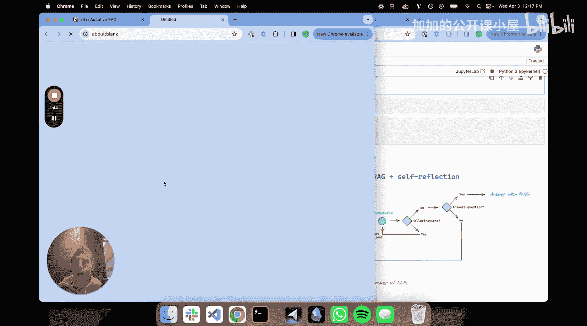
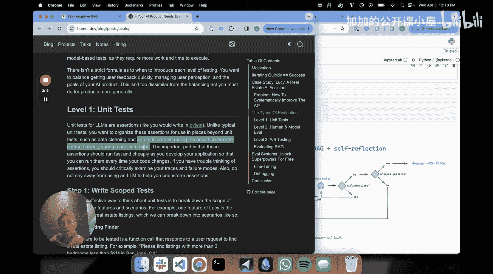
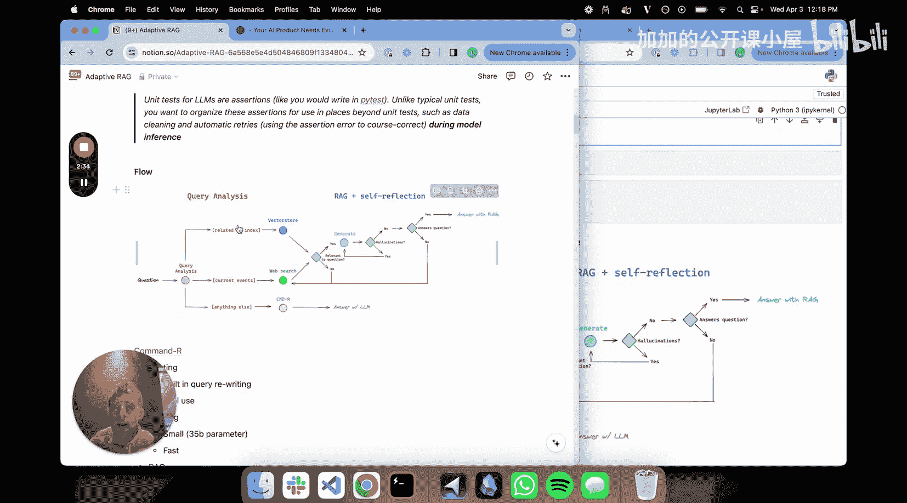
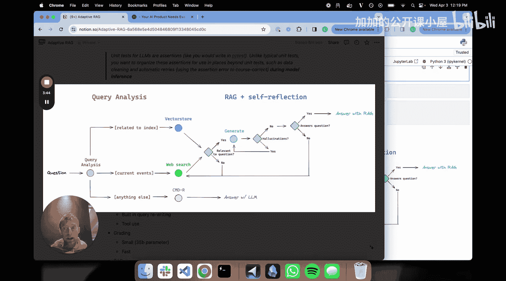
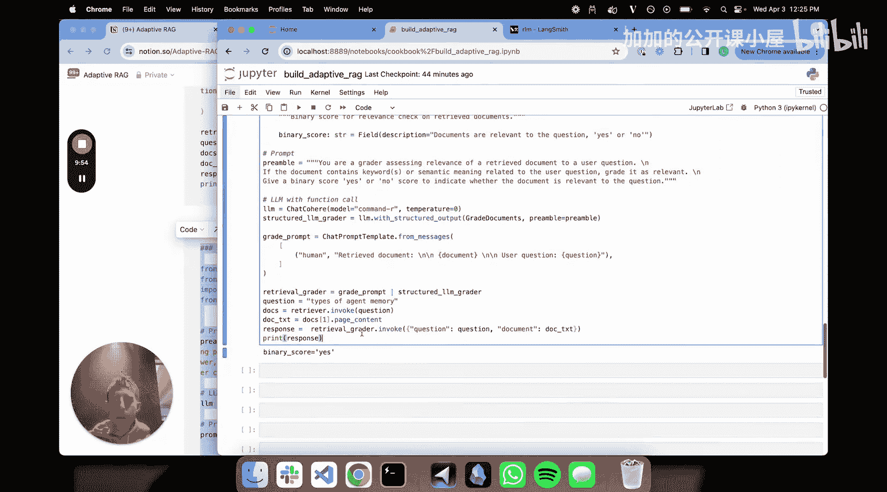

# LangChain【中英⚡LangChain 使用指南｜Build with LangChain】 p18 P18 Building adaptive RAG from scratch with Command-R -BV1xwfMYDE3n_p18-

Hey， this is Lance from Langchain。 I want to talk to a recent paper that I saw called adaptaptive Rag。

 which brings together some interesting ideas that have kind of been covered in other videos。

 but this actually ties them all together in kind of a fun way。

So the two big ideas to talk about here are one of query analysis。

So we've actually done kind of a whole rag from scratch series that walks through each of these things in detail。

 but this is a very nice example of how this comes together with some other ideas we've been talking about so query analysis is typically the process of taking an input question and modifying it in some way to better optimize retrieval there's a bunch of different methods for this it could be decomposing it into sub questions it could be using some clever techniques like step back prompting。

But that's kind of like the first stage of query analysis。 Then typically， you can do routing。

 So you route a question to one of multiple potential sources。

 It could be one or two different vector stores。 It could be a relational Db versus vector store。

 It could be web search。 It could just be like an LM fallback。

 right So this is like one kind of big idea of query analysis。 right。

 It's kind of like the front end of your ragg pipeline。 It's taking your question。

 It's modifying it in some way。 It's sending it to the right place。 be it a web search。

 be it a vector store or be it a relational Db。 So that's kind of topic1。

Now topic two is s that's been brought up in a few other videos of what I kind of call flow engineering or adaptive ragG。

 which is the idea of doing tests in your RAG pipeline or in your RAG inference flow to do things like check relevance documents。

 check whether or not the answer contains hallucinations。

So this recent blog post from Hamil Hussein actually covers evaluation in some really nice detail。

And one of things he highlighted explicitly is actually this topic。 So he talks about unit tests。

 And in particular says something really interesting here。 He says， you know。

 unlike typical unit tests， you want to organize these assertions in places beyond typical unit testing。

 such as data cleaning。 And here's the key point。 automatic retriries during model inference。

 That's the key thing I want to like draw your attention to。 It's a really nice approach。

 We've talked about some other papers that do that like corrective rag， selfra。

 but it's also cool to see it here and kind of encapsulate in this way。

 The main idea is that you're using kind of unit tests in your flow to make corrections。 Like。

 if your retrieval is bad， you can correct from that。 If your generation ass。

 you can correct from that。😊。

So I'm going to kind of draw out like a cartoon diagram of what we're going to do here。

And you can kind of see it here we're starting with the question。We talk about query analysis。

 we're going to take our question and we're going to decide where it needs to go。

 And for this particular toy example， I'm going to say either send it to a vector store。

 send it to web search or just have the LM answer it right so that's kind of my fallback behavior。

Then we're going to bring in that idea of kind of online flow engineering or unit testing。

 where I'm going to have my retrieval either from the vector store or web search。

 I'm then going to ask， is this actually relevant to the question？If it isn't。

 I'm actually going to kick back to Web search， so this is a little bit more relevant in the case if I've routed to the vector store。

 done retrieval， documents aren't relevant， I'll have a fallback mechanism。

Then I'm going to generate， I check for hallucinations in my generation and then I check for for whether or not the the generation actually answers the question。

 Then I return my answer。 So again， we're tying together two ideas。

 one is query analysis like basically taking a question。Routing it to the right place。

 modifying it as needed。And then kind of online unit testing and iterative flow feedback。

So to do this。I've actually heard a lot of people talk online about command R。

 the new model release from go here， it has some pretty nice properties that I was kind of reading about recently。

So one， it has nice support for tool use。And it does support query writing in the context of tool use。

So this all rolls up in really nice capabilities for routing is kind of one。 Now two， it's small。

 35 billion parameter。 it's actually open weights。 you can actually run this locally。

 and I've tried that we can talk about that later so it's also fast served via the API so it's kind of a small model and it's well tuned for rags。

 I heard a lot of people talking about using cohere for rag and it has a large context 120000 tokens。

 So it's like a nice combination of properties。 It's a po tool use and routing it's small and fast so it's like quick for grading and it's well tuneed for rag So it's actually a really nice fit for this particular workflow where I want to do queer analysis and routing and I want to do kind of online checking and rag So kind of there you go。

Now， let's just get to the coding bit。 So I have a notebook kind of like usual I've done a few pipen installs。

 we can see it's nothing exotic。 I'm bringing Lang chain cohe。 I set my cohe API key。

 Now I'm just going to set this Lang chain project within Langsmith。

 So all my traces for this go to that project。And I have enabled tracing。

 so I'm using Langsmith here。 So we're going to walk through this flow and let's do the first thing。

 Let's just build a vector store。 So I'm going to build a vector store using coherent beddings。

With Chroma， open source vector Db runs locally from three different web pages on blog posts that I like。

 So it pertains to agents， prompt engineering and adversarial attacks。 So if I have a retriever。

 I can run retriever in Voke。And I can ask a question about， you know， agent memory。Agent memory。

And there we go， so we get documents back， so there we go， we have a retriever now。Now。

 here's where I'm going to bring in cohere。 I also want a router。 So if you look at our flow。

 the first step is this routing stage， right， So what I'm going to do is。

I'm going to be going to find two tools， a web search tool， and a vector store tool。

And my preamble is just going to say you're an expert routing user questions to vector store web search。

 Now here's the key。 I tell it what the vector store has。 So again， I've indexed。

 my vector store has agents， prompt engineering averarial tax。

 I just repeat that here agents prompt end averarial tax so it knows what's in the vector store。

 so use it for questions on these topics otherwise use web search so that's it。I use command R here。

 now I'm going to bind these tools to the model and attach the preamble。

 and I have a structured LLM router。So let's give it let's give this a few tests just to like kind of sandbox this a little bit。

 so I can invo。 here's my chain of a router prompt。 I pass that to the structured LM router。

 which I defined right here。And let's ask a few different questions like who will the Bears draft and NFL draft。

 what other types of agent memory， and hi， how are you， so I'm going to kick that off。

And you can see， you know， it does web search， it does。

 it goes a vector store and then actually returns this false。 So that's kind of interesting。

 This is actually just saying。If it does not use either tool， so for that particular query。

 web search or the vector store was inappropriate， it'll just say hey。

 I didn't call one of those tools， so that's interesting， we'll use that later。😡。

So that's my router tool。 Now the second thing。Is my greater。

And here's where I want to show you something really nice that is generally useful for many different prime problems you might encounter。

So here's what I'm doing。I'm defining a data model for my grade。

 so basically grade documents going to this is a pedantic object。It is basically a binary score here。

Field specified here。 documentsments are relevant to the question。 Yes， no。

 I have a pream but you're greater assessing relevance of retrieved documents to use your question。

 b b So you know， and then basically give it a binary score。 Yes， no。 I'm using command R。

 But here's the catch。 I'm using this W structured outputs thing。

 And I'm passing my gray documents data model to that。 So this is the key thing。

 We can test this right now as well。 It's going to return an object based upon the schema I give it。

 which is extremely useful for all sorts of use cases。 And let's actually zoom back up。

 So we're actually right here。😊，So this greater stage right， I want to constrain the output to yes。

 no， I don't want any preambles I want anything because the logic I'm going to build in this graph。

Is going to require a yes， no binary response from this particular edge in our graph。

So that's why this greater tool is really useful。And I'm asking like a mock question。

 types of agent memory， I do a rer， I do a retrieval from our vector store， I get the tuck。

 and I test it。 I invoke our greater retrieval grader chain with the question。

 the doc text and it's relevant， as we would expect， so that's good。But， again。

Let's just kind of look at that a little bit more closely。

 what's actually happening under the hood here。Here's the authenticanttic object we passed。

 Here's a document in question I'm providing。 Basically。

 it's converting this object into coherre function schema。It's binding that to the LLM。

We pass in the document question it returns an object basically say Json's string pur or pedantic schema。

 That's it。And then it's just going to like parse that into a pyantic object which we get at the end of the day。

 so that's what's happening under the hood with this with structured output thing。

 but it's extremely useful And you'll see we're going to use that at a few different places because we want to ensure that in our flow here。

 we have three different grading steps and each time we want to constrain the output to yes no。

 we're going to use that structured output more than once。

This is my generation， so this is good old rag。Let's。

