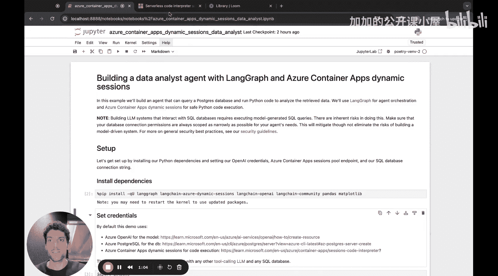
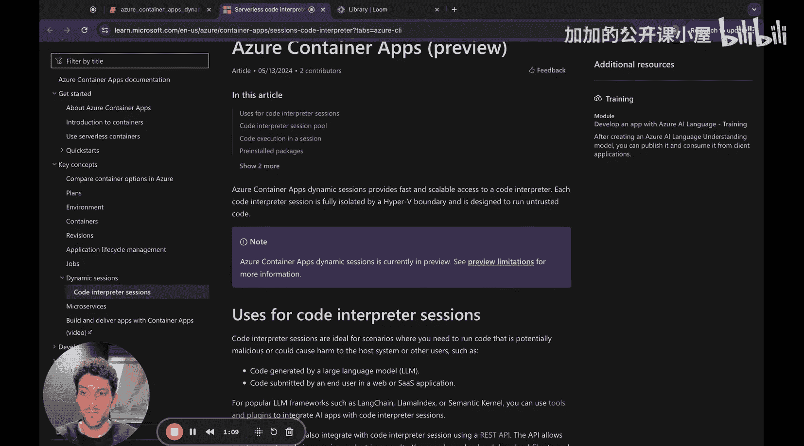
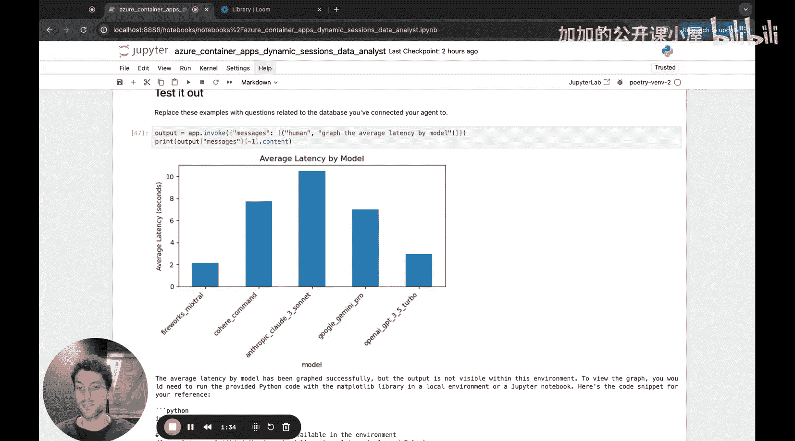
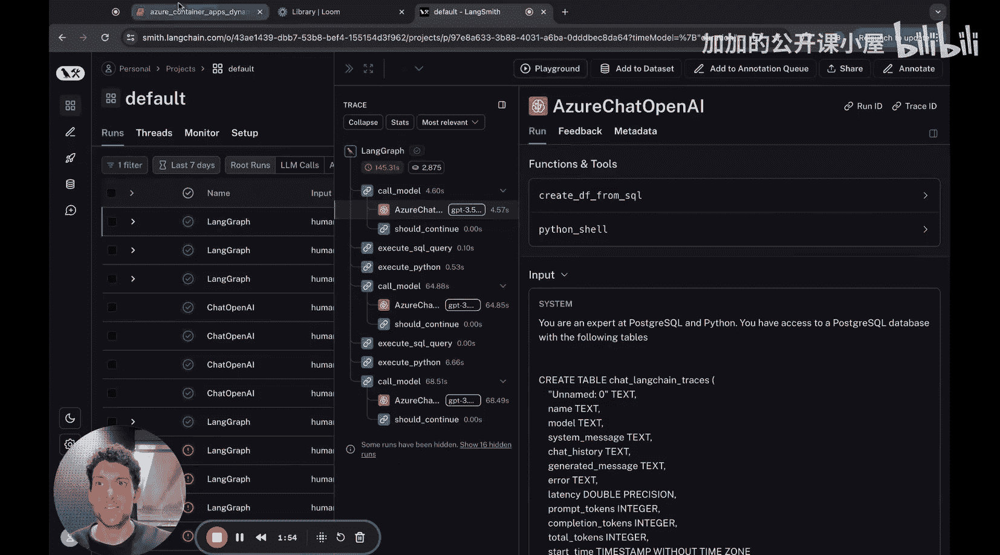
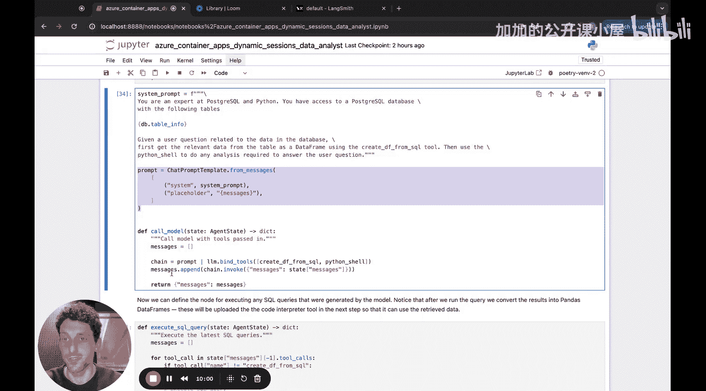

# LangChain【中英⚡LangChain 使用指南｜Build with LangChain】 p22 P23 Building an Agent to Query a SQL Database and Analyze Data -BV1xwfMYDE3n_p22-

Hi， this is Bgaator from Linkedin and today I want to show you how we can build a data analyzing agent using Laanggraraph and Azure container apps dynamic sessions。

So the agent will build will be able to query a SQL database and then write and run Python code to analyze the retrieved data。

It'll be built on top of La graph and make use of the new Azure container apps dynamic sessions。

Dynamic sessions is really the key feature。We want to show off here LOMs are great at a lot of things。

 but rock computation isn't one of them Fortunatelyly OOMs are great at writing programmatic logic that if executed could perform the rock computations for the LOM。

So if we had the ability to hook up our Lms to fast and safe code interpreters。

 then we could unlock a lot of use cases。 Fortunatelyly。

 this is exactly what the Azure container apps dynamic sessions integration allows us to do。 It is a。

Reliable and safe code interpreter service provided by Azure container apps now in preview and it has a nice L chain integration that makes it really easy to use with any L chain and L graph agents that you built。

And as a sneak preview of where we're going to get。嗯。In my case。

 I'm going to hook up my agent to a database of Wayne Smith traces。

If you're not familiar， Li Smith is our observability and evaluation framework。

 and one of the key things it does is trace LLM applications。

 including things like the latency and token counts and inputs and outputs of different LLM calls。

And so once I've hooked up my agent to a database of Wang Smith traces。

 then I can start to ask questions like。

Or make requests of it like graph the average waitency by model。

 and it's able to generate these nice plots for me。

 showing the different latencies for different models across the traces within my application。嗯。

And the agent architecture we're going to use for this is actually pretty simple。

 we will use a tool calling model to be able to invoke two different tools。

 one for writing and executing SQL queries against our SQL database and the other for writing and executing Python that is given access to our retrieved data and then can。

Perform computations on it。So let's see how we can actually put all this together。First。

 we'll need to install all of the row Inencies， Chief Hui Wnggraff and the new Wang chainin Azure Dynamic Sessions integration。

Then we'll need to set up some credentials in this case we'll use Azure Open eye for our model。

 we'll use Azure Postgres for our DB and of course Azure container wraps dynamic sessions for code execution the links in the notebook should show you how to set up all of those and the La graph architecture we're going to show here should actually generalize to any LOM that has tool calling abilities and to any SQL database。

Now， we can。Set up all of our。Cruedentials for these various services， so first。

We'll set up Azure opening eye。And then our dynamic sessions。And lastly hour。S工 databaseベース。嗯。

One important thing to remember whenever you are hooking up a model to a SQL database is that there's inherent risks in executing model generated SQL。

 and it's really important that you scope your connection permissions as narrowly as possible given your application。

 so in this case we only need our agent to be able to read from our SQL databases。

 so we should scope the connection permissions accordingly。Once we've set up all our credentials。

 we can import all the roughin classes and methods and actually instantiate our SQL database。

 our Azure Open eye model， and our Sessions code interpreting tool。嗯m。

Now we can actually define our wing graph agent， so the core elements of any agent are the state nodes and edges。

 so nodes are where the agent actually performs various functionality。

State is what is passed through all the nodes， so the input to every node is the current agent state。

 and the output of every node should be an update to that state。

And then edges defines the flow of our agent from one node to the next。In our case。

 our agent state will be simple， it'll just be a sequence of messages。

And the only custom message we'll need to add is something we'll call raw tool message。

Our tools will be creating。Outputs like data frames and in the case of our code interpreter sometimes images。

 and we want these things to be part of our agent state so that they can be accessed by future nodes。

 but we don't want these to be part of any message contents because we don't want data frames and images to be sent back to our model in future model invocations。

So we'll simply add a new attribute to our tool message， we'll call it RA for raw tool outputs。

 and this will allow us to add arbitrary additional tool outputs to our tool messages so that future nodes can access the tool outputs。

 the full tool outputs of past node executions。So now we can。

Define the actual nodes of our La graph agent。 As a reminder， we will have three main nodes。

One will be for actually calling our model and then two for executing。

The tools that our model might invoke one for the SQL tool， one for the Python tool。

So in the case of the model node。Again， we'll be using tool calling APIs to make sure that our model is correctly invoking the tools that we wanted to have access to and tool or function calling in case you're not familiar is a specific type of chat model API that allows you to pass in tool schemas when you're calling your model and have it generate inputs to whatever tools you've passed schemas in for。

嗯m。Crucially， the tool calling models don't actually call the tools。

 they just generate inputs to the tools。It's up to the application to actually then take those inputs and pass them through to the tool。

So in our case， we will have two tool schemas that will be passing to our model。

 one well call create Df from SQL and the other will call Python shell so the create Df from SQL will be for querying our SQL database and。

Generating panda's data frames from that。And so the key attribute of this tool schema will be the select query attribute。

 which should just be a SQL select statement that our model generates to get relevant data from our SQL database。

And then the other two attributes will be DF columns and DF name。

So once we extract data from our SQL database， we'll convert it into Pada's data frames that have the corresponding variable name and the column names that the model generates。

And then our Python Shell tool is really simple， it just has one attribute code。

 which should be Python code that we want our code interpreter to execute。

The other part of our model calling node is there will be a simple prompt。

 the prompt will have a system message and then we'll pass in whatever messages are in our state to the model as well the system prompt will have a little bit of positive encouragement telling the model that it's great at SQL and Python and then also this Dv do table info information so if we look at。

What this looks like。In this case。Like I said， the database I've connected my agent to has Wang Smith traces in it。

And so if we look at DB do table info， it should tell us a bit about the。

Table schemas that are in my database and have some example rows from my database。

 and this is really important because if we want our model to be generating sensical SQL queries。

 then it needs to understand what types of tables are in the SQL database that it's being given access to。

So this information should all be in my prompt that is being sent in every model call。

And then the rest of what's happening in the actual node。

