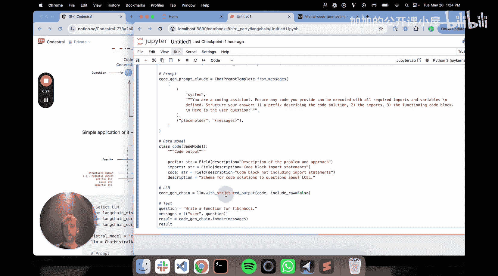
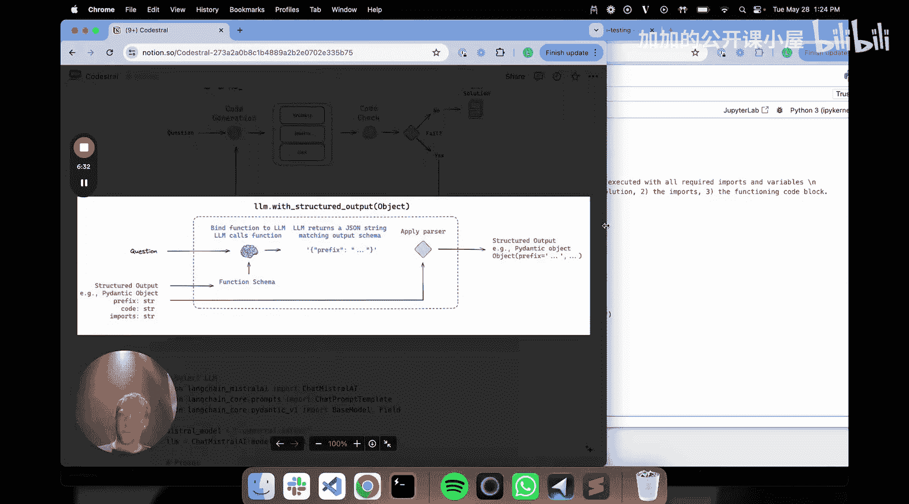
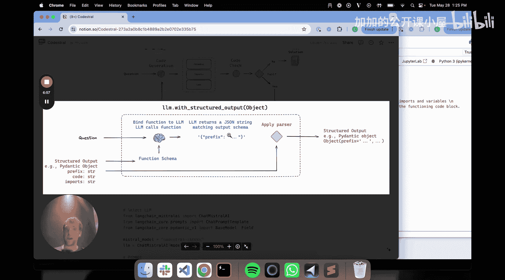
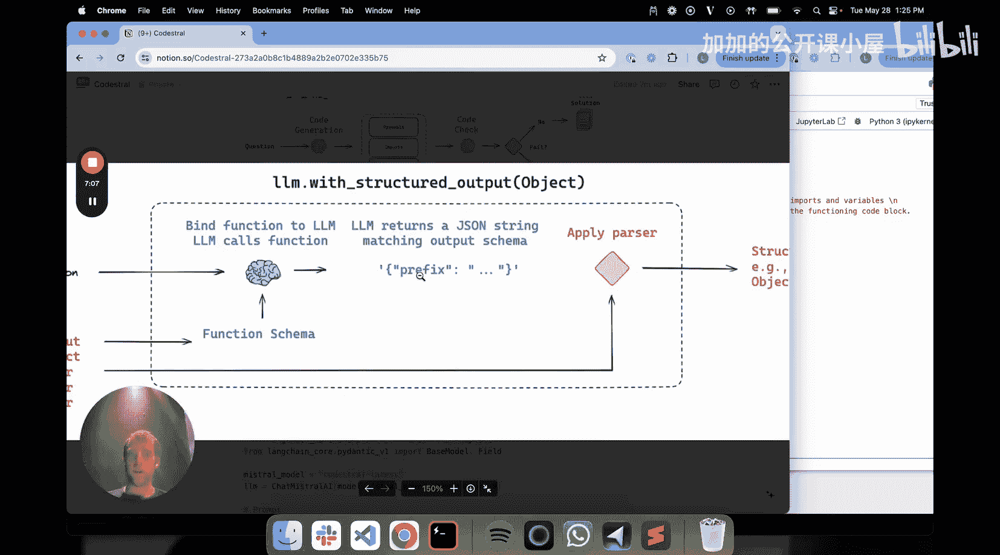
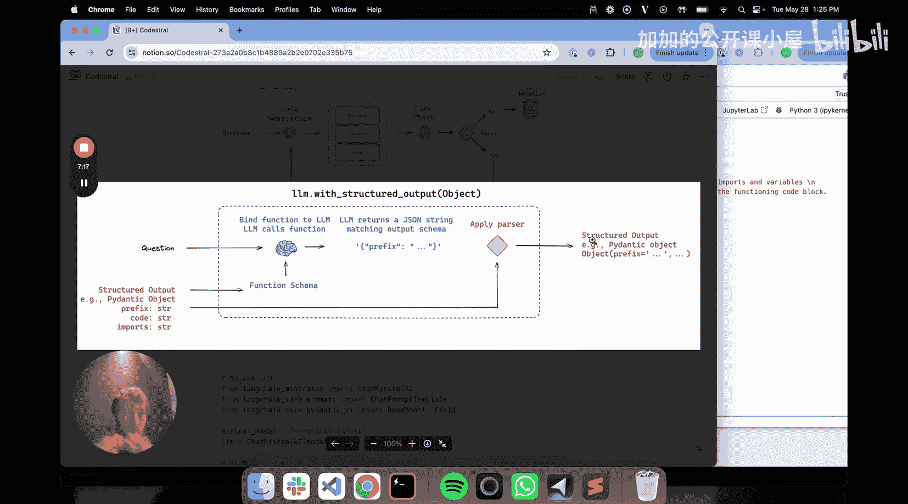
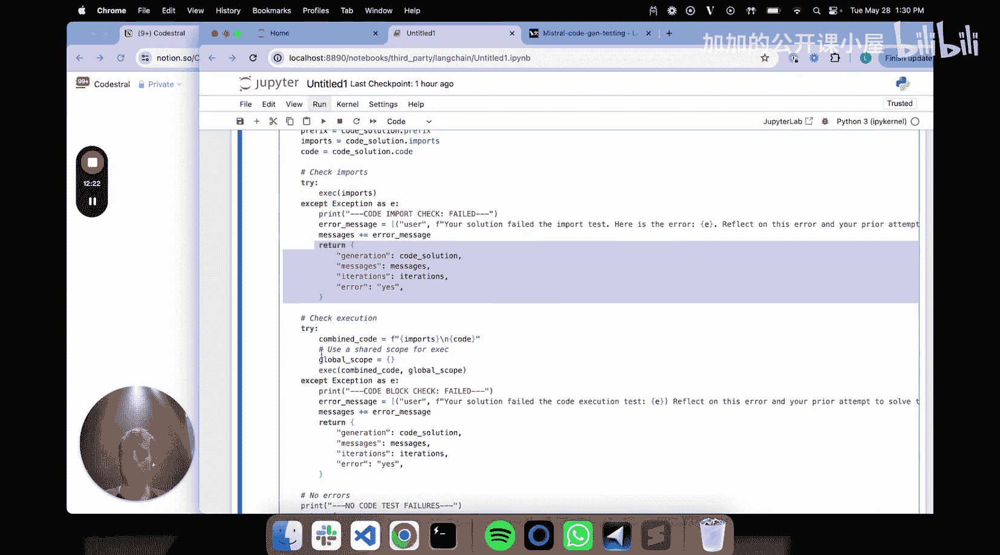

# LangChain【中英⚡LangChain 使用指南｜Build with LangChain】 p23 P24 Self-correcting code assistants with Codestral -BV1xwfMYDE3n_p23-

Hey， this is La Lcha so Mistr released code Str today， which is a code generation model。

 which I'm actually really excited about so if you look at a code generation task like fill in the middle or code completion。

 it's trained on a programming language， it has an instruct version that supports tool use。

But one of the reasons why I really like codegeneration models and I've actually done quite a bit of work with them is that they're just very general useful。

 so lots of companies， for example， want custom code assistance that might combine like some documentation plus codegen at Lang chain for example we have something called chat Langcha it's basically QA over our docs。

 it can produce functioning code blocks for users based on questions and when the other things that's cool about code is really easy to evaluate。

 it's really easy to test does this code actually execute or not and so a really powerful idea related to codegen was put out a few months ago from the folks at Codeium AI。

And Kbahi summarizeds really nicely here in that this idea of flow engineering for code generation is really powerful。

And the idea shown in the paper， the alphacodium work。

 and kind of highlighted here in this tweet from Carpai is simply that if you produce a code solution。

You can really easily check it in line kind of as mentioned here it's pretty easy to evaluate code at the minimum does it execute to the imports work at the maximum case do you have like an actual solution to unit test。

 but in any case the point is code is very easy to test and you can actually test it in your inference flow so you produce a generation you then test the code if it fails you can loop back and try again and this idea of kind of a code generation flow was's shown in the paper to produce much better results and it's something that I want to show today using codestr in a really simple test case。

So this is something I've done a little bit in the past and I found it to be extremely effective。

 it's a very simple idea， but here's the basic flow that we will kind of highlight。

So I want to be able to take a question related to cogeneration， pass it to the model。

 so pass it to coastal， and how Coast will produce a solution。

Now what we're going to do is I'm going to use a function calling your tool use with code drill to produce an output object that has three things。

 a preamble stating like here is the problem I'm trying to solve the imports and the code itself and what I'm going to do is I'm going to show how it's really easy to incorporate some simple code checks like do the imports work does the code execute if either fail like there's a bug in the code then I'm going to show how to loop back and retry and this simple kind of like check。

 retry loop is a way to significantly improve the accuracy and kind of usability of codejo models I'm going to show how to do that right now。

So to kick this off， I have a notebook here。I've done a few P installs。

 I've just set my Mistral API key that's really it and I'm also going to use L method tracing。

 of course this is optional， I'm going to set environment variable for my L chain project。

 which will basically will indicate where all my traces will go。

And this is just like the kind of flow we want to lay out so we basically want to use codetro to take a user question。

 produce a solution and we want to test that solution if it passes our test return to the user if it doesn't try again。

 that's all we want to do So what I'm going to do here is first let me just show some very basic components。

So first， let's just talk about how to actually use codes Here's my general prompt。

 I basically just I'm going to tell the model you're a code assistant ensure that all the code can be executed with all the imports and variables defined。

 structure your answer in three ways， give me a preamble or a prefix describing the code solution。

 give me the imports， give me a functioning code block So I'm going ask for those three things Now here's where tool use comes in I can actually define the schema of the output that I actually want。

And what I can do is I can bind that using length chains very convenient with structured output。

 I can basically bind that to the LLM and then this chain will invoke the LLM using the structured output Now here's how that actually works under the hood。

😊。

Basically， this object that passes a pottanic object is converted into function schemeche of form straw。

And it's then passed or bound to the LLM。 So the LLM has access to this function。

 and it knows the schema that it should return when that function call or tool is invoked。

 So basically what happens is I can take a user question。 The function is invoked。

 and then the LLM knows to produce an output that adheres to my schema and this will basically be a Json string again。

 remember an LLM is a string to string。 So it's gonna to be a JsonN string and then under the hood with this withstructured output thing that I'm using from length chain we apply an output parser that basically a pedantic parser。

 take a JsonN string convert it back to pedantic object So that's that's all that's going on then I'll show you how this is really cool So I'm defining this object。

 This is what I want to get out。 Here's my chain。 Now let's test this out。

 write a function for Fibonacci。 I pass it in as the user question， So that's it。

Now this is running。Great， and we see a result。 Now now here's what's cool。

 if you look at this result object， it actually is a code object。

 so it basically a spantic object following the scheme we specify here， it has a prefix boom。

 it has some imports。😊，Actually， in this case， none and then it has the code block。

That's it So we'll see why this is really useful in a little bit。

 but I just want to introduce that idea of basically we can use codetro with tool use to produce structured outputs。

 which is generally very useful and in particular for this notion of kind of like inline self correction is extremely useful。

😊，Cool， so that's that first piece。Now what I'm going to introduce here is Lnggra。

 so Lgraraft is a library from the Lang chain team。

And we've used this a number of other videos and I've used this kind of extensively in general to build flows and this is an example of a flow。

 the main characteristic of the flow that I highlight here that Land graphraft is really well suited for is anything with a cycle。

 so anything with feedback basically what it's saying is I want every time I run my app。😊。

I want to do this code generation， produce a structured output， do some kind of code checks。

 make a decision based upon the outcome of those code checks， feedback if they fail。

 finish if they pass that you can think of as like a very simple kind of like workflow and Land graph is a great way to build these kinds of workflows and we'll see why so the first I need to specified land graph as just simply the graph state。

 Now this is just a thing that lives throughout the lifetime of my graph。

 It basically represents all information that's shared across what you might call these nodes So in this case I two particular nodes and you might call this an edge so this is kind of where I'm making a decision。

 so state lives across these nodes and edges， so that's really it。

 So I'm going to define my state it's going some information that's relevant to the flow I just talked about so it's going an error message it's going my final generation it's contained the messages that are being passed to my L。

And this will become a little bit more clear as we go forward。So here I'm going to lay out。

 this is basically the nodes and the edges of my graph。Now what you'll see is for every node。

Here's my generate node， and that's what we laid out here， generate。It's going to take in the state。

And the nodes just modify the state in some way， so that's how to think about the nodes。

 so in this case I taken the state I unpack the state into like some messages， some of iterations。

 an error message， these are things we're going to use throughout a graph。

So then what I'm going to simply do is compute a code solution so I'm going to look at my messages in and I'm going to generate a solution Now remember that's exactly what we did up here。

 so this is actually nothing new。 remember look at this this is just we define a set of messages invoke our code gen chain。

 get an output same thing we're going to be doing in our graph so this is nothing exactly we've actually already tested this。

😊，And once that runs， I'm just going toend that output of code solution to my messages， okay？

So you know again， here's attempt to solve the problem。

 I'm just going to take the codes the prefix the imports and the code。

 I'm just going to add that as a new message， I'm going to increment iterations we'll use this iterations to determine when to stop and I'm just going to return then my state with a few things here first is going to be my code solution。

 my generation that's it then's going be my stack of messages which is basically dised to and then the number of iterations that's really it。

That's it。 So nice and easy there。 Now the code check is the second kind of big node that we're going to be working with。

 so our first node is generation， the second node is our code checks we just saw generation generation is going to return the generation with the three pieces that preamble the imports and the code block now it' going to be passed to code check。

So code check is really anything we want to be。 We can do any kind of checks on this code now it maybe in the best case。

 with some kind of unit test we could run， I'm going to show you the simplest possible code check that we might want to do。

So in this particular particular case what I'm going to do is I'm going to get the code solution from our state。

 remember we wrote that out to state so the generation contains our code solution。

 and in this note I just pick it back up from state you know states past every node I get the code solution。

 I extract the three pieces and we just show that above so I get the prefix the imports in the code and now all I'm going to do is simply just test execution。

Does imports execute if not， I'm going to throw a flag or I'm going to kind throw a message here。

 code import failed， I'm going to take an error message。

 I'm going to pin that error message to our messages object and I'm going to return that。 That's it。

And。Alternatively， if that passes， I'm going to go ahead and try the whole thing。

 so I'm going to combine on the imports on the code I to ahead。

