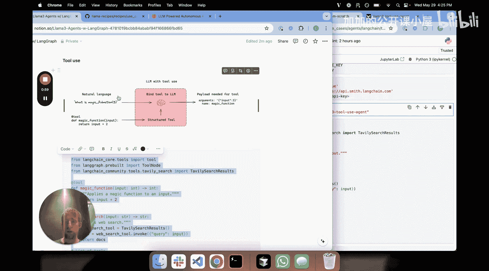
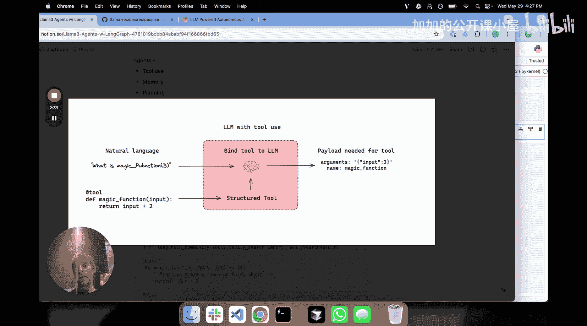
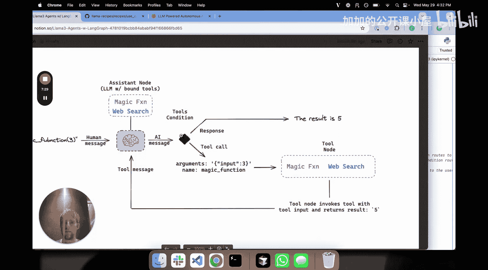
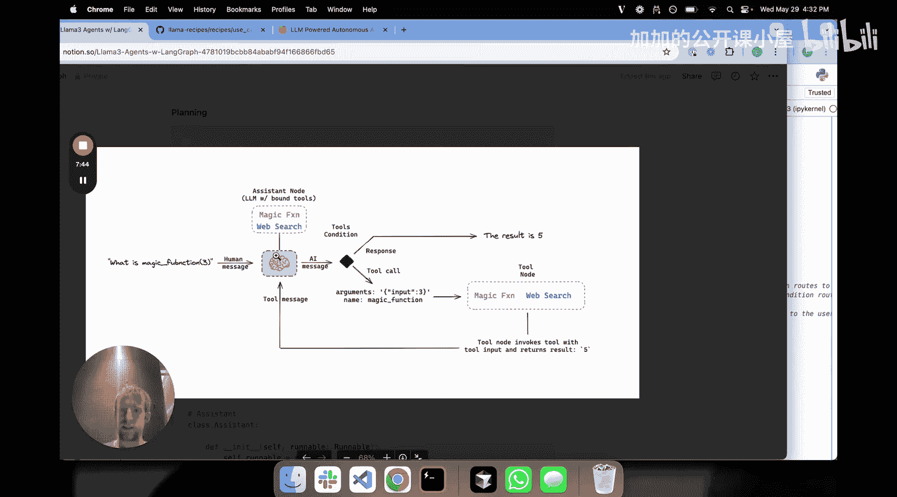
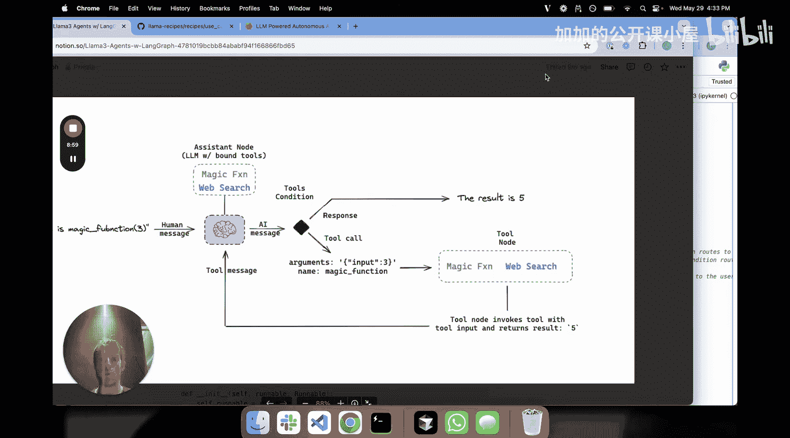
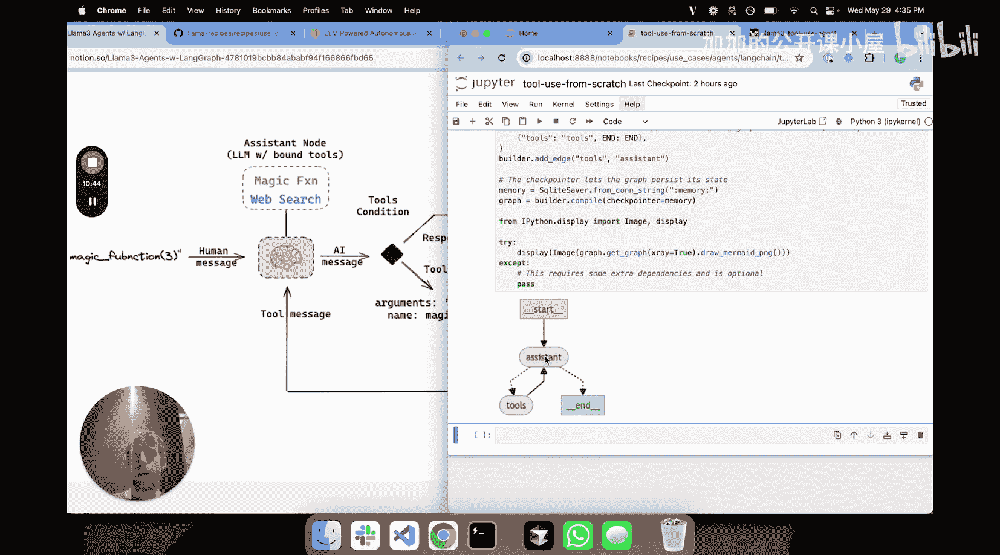

# LangChain【中英⚡LangChain 使用指南｜Build with LangChain】 p24 P25 Building open source LLM agents with Llama 3 -BV1xwfMYDE3n_p24-

Hey， this is Lance from Langcha， we seem very interested in building LLM agents using open sourcece LLMs。

And so we wanted to talk through how to do that from scratch using Lama3。So first， what is an agent？

So Lily and Wang is a very nice blog post that laid out the central components of agents being planning。

 memory and tool use。So I want to walk through these components individually and how I can use them with Lama 3。

So first， let's talk about tool use。I'm going to copy over some code and we're going to walk through it。

 so I have this notebook done a few Pip install， set a few API keys， we'll use GC as our LM。

 we'll use Tvily for web search as one of our tools， and we'll use Laangsmith for tracing。

 but that's all I've done here okay。And I'm going to kind of have this image side by side so we can look at it。

 So first tool use。 What's the big idea here。 The big idea is simply this。 I want to take an LLM。

 give it awareness of some external tool that exists。

 and have the LM return the payload necessary to invoke that tool。 That's really all that's going on。

 Now， this is often kind of confused。 And I wanted to kind of zoom in and explain this exactly。

 So let's say have a function called magic function， which which takes an input and adds to to it。

 I want to give an LM the ability to recognize whether it not or not to invoke this function。

 And to return the payload necessary to run the function， given the user input。

 So here's exactly what I want to have happen。 I want to take that function。

 somehow bind it to my LM。

And given an input， then return both the function name itself。

 and the arguments necessary to run the function。 Remember， Lms are just string to string， right。

 It doesn't have the magic ability to call that function natively。 But what it can do is return， O。

 I've seen this function。 I know it exists。 And I'm going to give you exactly like the input format necessary or the payload to run the function。

 as well as the name of the function。 Okay， so that's really all's going on。

So first。This tool decorator and L chain allows you to take any arbitrary function just turned it into a tool。

 And let's just kick this off。 So here's my magic function。 and here's a web search function。

 So these are two things that I want to kind of turn into tools， and I can do that right here。

So we can run this。 Now， if I look at magic function， now it's a structured tool。 It has a name。

 It has a description， and it also has that input or arguments as captured as a pedantic schema。

 Okay， so all this information can be passed directly to our LM。 That's the key point。

 So this allows us to go from arbitrary functions to tools that can be bound to an LLM。 Okay。

 so that's kind of step 1。 Now， step 2， this is where things are kind of interesting。😊。

I'm going to use Goc here。And I'm going to use a prompt。

 I'm basically going to say you're a helpful assistant with two tools。

 web search and a custom function。 Use web search for current events。

 Use the magic function if the user directly ask for it otherwise just answer directly。 Okay。

 so that's kind of my prompt。And let's test this in two cases to explain exactly how this works。

 Okay， so all I'm doing I'm using chat rock setting Lama 3，70b， and I'm creating this runable。

 This is kind of a length chain primitive for it basically invoking LLM。 so that's all I've done。

 Now here's what's interesting。This is piping the prompt to an LM。 And I've bound my tools to the LM。

 So this is automatically taking those tools we defined。

 and it's basically giving them to the LM so that that it's aware of them。

 So it that's basically represented in this red box here。 You take external tools。

 and you basically bind them to the LM。 So the LM is aware that they exist。 That's kind of step 1。

 Now， here's step 2。I can basically take a question。

 so I'm going to ask what is magicic functionction 3。

 I'm going to invoke my runable or my chain right with this， and let's see what happens。

I'm going to run this now here's what's interesting that payload contains an object tool calls which contains the name of the function and the arguments that's it So that's the key thing。

And I can look at the raw payload as well。 So the raw payload is just simply this AI message。

 It contains a bunch of information。 but here's the main thing it contains basically the name of the function to call and the arguments to pass to the function。

 So again， that's exactly represented here。 All that's happening is I've taken a function。

 I've turned it into a tool。 I've bounded to my LM。

 I can ask a question natural language and the LM can respond directly with the function to call or the tool to use。

 and the input argument to use based upon the user input。 That's the key point。

 And that's really all that's happening function calling。 that's all I didn need to know。 Okay。

 so here's the other key thing。What if I just ask a question about the United States based on my prompt。

 It should not try to invoke any of these tools。 And La let's test that。 I run this good。

 And so this payload tool calls is empty。 I can look at the raw payload。And yeah。

 now it's just a chat response， right， the capital of the US is Washington D， great， okay。

 so that's it。So hopefully now you understand how tool use works and now remember this requires an LLM that's actually been fine tuned or prompted or otherwise is compatible with tool use and this is a very important point。

 We talked to folks at Croc， they have kind of a proprietary implementation for how they do this which we don't know fully but it is reported that works very well withllma 70b ma 370b and in my experience I've seen it to indeed work quite well so in any case the key point is this。

I can take any arbitrary functions I want。 I can turn them into tools。

 I can then pass those tools to an LLM。 I can bind them。

 and then you can see right here when I invoke my LLM with a question。

 the LM makes decision to use one of the tools。 and if it does。

 it can return to you the name of the tool it wants to use and the input argument。

 That's the key point。 So that is really what you need to know about tool use。

 Now we get to the fun stuff。 we're going to build the agent。 And for this， I'm going to use Lagraft。

 and I'm gonna explain kind of how this works over time。 But first。

 the only thing about Lagraft is basically it's a way to layout flows。

And flows in particular with Langrara are often characterized by cycles。

 the ability to kind of do feedback， and that's really relevant for agents and we'll explain why here shortly。

So Landgra basically takes a state which can live over the course of your graphal flow and it can be accessed by all kind of what we're going to call nodes in your graph。

 Okay， so first as state I'm just going to find a set of messages and don't worry too much about this for now。

 this all makes sense in about a minute。Okay。Now， here's where things you arere going to get interesting。

 I'm going to define an agent that contains two nodes。 Okay， so first。

First， we're going to take our input。Again， it's a human message。 We pass that to our LM。

 which has the bound tools。 The LM is going to make a decision to use a tool or not。

 And we just walk through this。 That's the step 1。 That's this thing we've already seen， right。

 Now what we're going to do in Lagra is we're going to add basic or're going to call and a conditional edge。

 So this edge is going to all it's going to do is say Was there a tool call or not。

 If there was a tool call。 I'm going to route that over to a separate node that basically runs the tool。

 So let's walk through with our example we just did。 What is magic function of three。

The LLM made the decision to invoke the magic function and it gave it had it gave us the payload right we just saw that。

 So that's arguments。 input is three。 name is magic function。

 Those get plumbed over to what we're going to call tool node which actually invokes the necessary tool。

 So it's going basically take in this name magic function。

 It's going to look up magic function itself， and it's basically just going to run that function with this input payload and then it's going to return that as a tool message to the LLM。

 That's all it's going to go on。 LLm is going to see that tool message It's going to make a decision about what to do next。

And eventually this is gonna keep running until there's a natural language response and in this kind of toy example。

 the tool message would return with the result of5， that would be returned to the LM。

 the LM would see that and say， okay， the result is5 and then you would exit。

 So that's like the toy example we we want to see。 Now we can implement this all in land graph really easily and let's actually just talked through that quickly。

 I've copied over the code here。 So all basically we've defined here is we have this assistant So this is basically just wrapping the chain that we defined up here。

 this assistant runnable we just wrap that and basically all we're doing here is we're adding a retry。

So basically， if a tool is if a tool is called， then we're good。 that's valid。

 If it has meaningful text， we're good。 but otherwise we do reprompt it。 That's all we're doing here。

 right we're just making sure that the Lm actually return a valid response。

 So that's really all to worry about here there。 We're also creating this tool node。

 So this tool node basically just will try to invoke the tool。

 and it'll basically have a little we're gonna to add a little thing to handle errors and the feedback that this is all these are just like utility functions。

 So I don't really worry too much about them。 Now here is kind of the interesting bit。

 We're just going to build the graph。 and it's going to look exactly like we show here。

So what we're going to do is we're going to add a node for our assistant right。

 we're going to add a node for our tool node， and that's kind of this piece and this piece。

 that's our tool node。And then we're going to add this conditional edge， which is a tools condition。

 which is all it's going to be is this piece it's basically going to take the result from the LM is a tool called if yes。

 go to the tool node if no and and we can implement that right here so this tools condition that's all it's going to do is's basically going to return either a tools invoked or end and then we go from tools back to the assistant now let's run all this and we can see what's nice about LaGra is we actually it'll automatically lay this out as a graph for us。

 we can visualize it here so what's going to happen is we're going to start we're going to invoke our assistant our assistant will in some cases as to use a tool。

