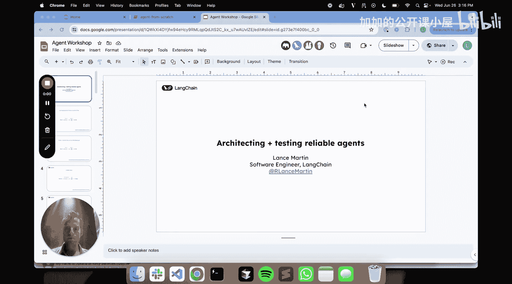
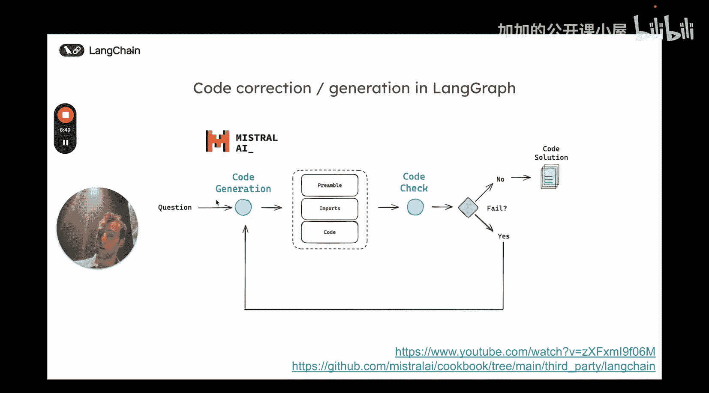
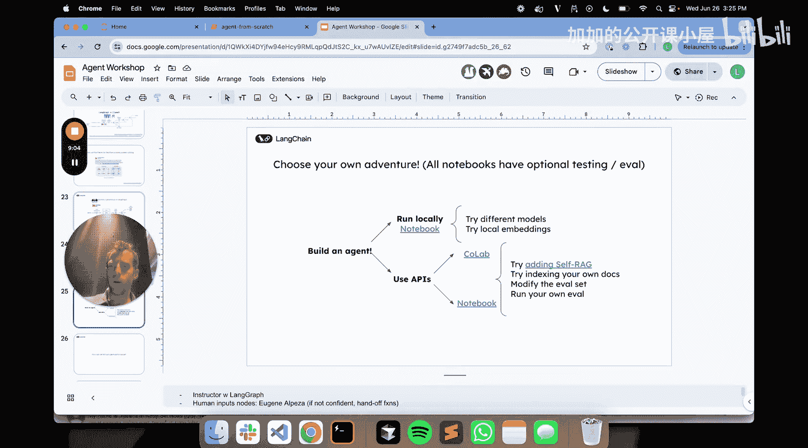
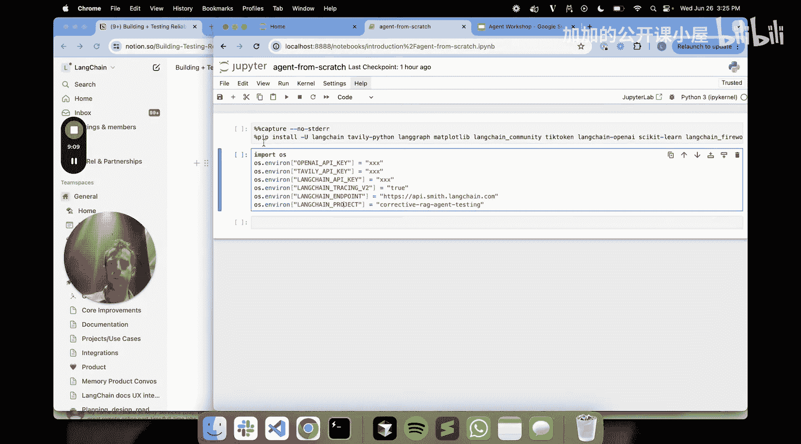
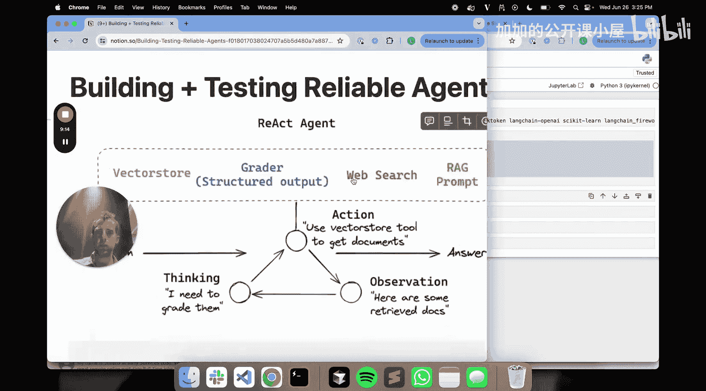
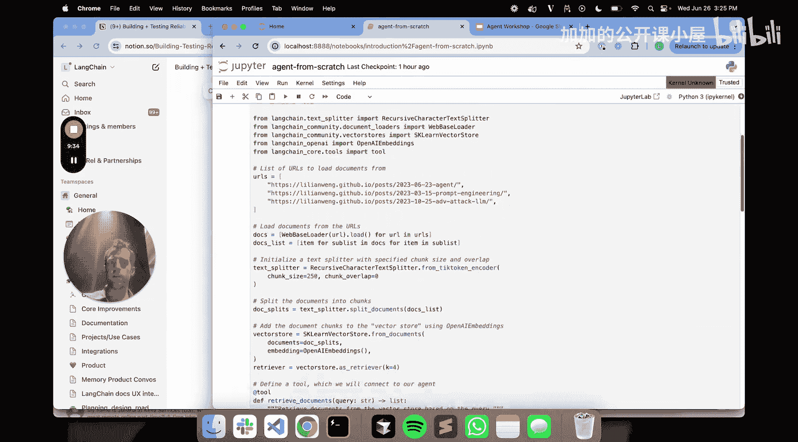
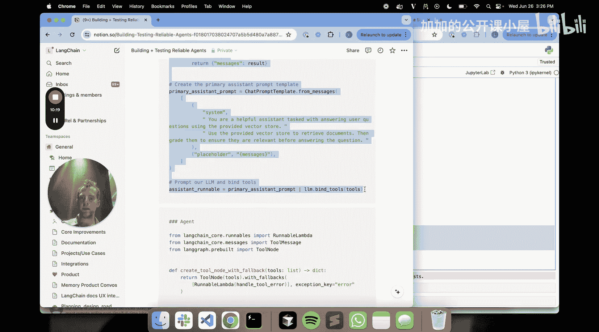
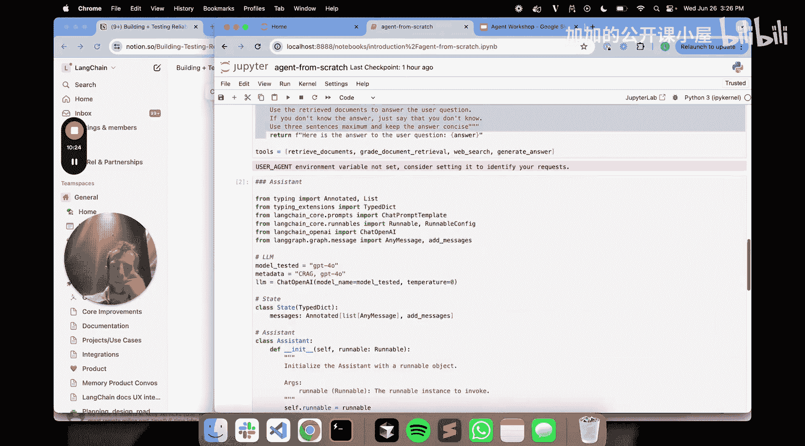

# LangChain【中英⚡LangChain 使用指南｜Build with LangChain】 p27 P28 Building and Testing Reliable Agents -BV1xwfMYDE3n_p27-

Hey this is Lanceom Langcha， this is Ta A yesterday at the AI Engineer World Fair and I want to get on here and just kind of give it again。

 show all the slides and then also show kind of a quick code walkthrough of everything I talked about。

And the thema is architecting and testing reliable agents。

So LM applications follow a control flow you typically start the application with some kind of user input。

 it follows them seven steps and it ends。A chain you can think of is just a control flow set by the developer。

 so it follows some set of steps that the developer determines ahead of time。

And a chain is a good example of this question comes from the user， you hit a vector store。

 you retrieve documents related to the question， you pass them to LM。

 the LM produces an answer which you return to the user。Now， an agent。

 you can think of in simple terms as a control flow that is actually set or gated by an LLM instead of the developer alone。

 So in this kind of toy example， you start your chain， you pass from step 1 to an LLM。

 which had reasons about do I do step 1 again or do I move forward to step 2？So again。

 chain is developer defined control flow that's fixed， and agent is just an LLM defined control flow。

Now， typically， when you talk about agents you kind of also hear about this idea of function calling or tool calling and really when you think about it。

 how does an agent make a decision about what step to go to？

So we can use tool calling to actually select a step or tool that we want to use。

 so here's an example。An LLM receives natural language input。

 what is the output of step  two and you pass three to it？

We can actually bind step two as a tool to our LLM。

And the LLM can return then the payload necessary to actually run that tool called step2 and again it it returns the arguments。

 for example， from the user input， the argument of F is going to be3 and the name of the tool is going to be step 2。

 So the way to thing about tool calling or function calling is basically you're giving the LLM access to some set of tools allowing it to choose a tool to invoke along with the payload necessary to run that tool based on the user's input So that's really what time tool calling is。

And a popular approach is just to run this as a for loop so that as you give an LLM access to some set of tools and you allow that LLM to call tools in this kind of cyclic fashion。

 so you take user input， the LM decides to call tool basedase from that input。 The tool runs。

 you return the output of the tool back to the LLM then the LM thinks about it and says okay I need to run another tool and this will continue until the LLM finally says I don't need to run any more tool calls。

 I'm just going return a response directly to the user and then you end So this is the classic kind of react style agent setup that runs more or less as a for loop。

And the nice thing about this is extremely flexible。

 so you can implement many possible control flows with this type of agent it can run step one or step two only。

 one， two， or2，1。And flexible agents have a lot of promise for open ended tasks， for example。

 a lot of hype last year about different projects like AutoGPT， baby AGI。

 and these were kind of open ended agents that had access to many tools and could perform kind of arbitrary control flows based upon the set of tools to solve open ended problems。

What we saw is， and many people have reported this。

 mixed reliability with open ended or flexible agents。

And the problem often boils down to L and nondeterminism in particular problems with tool calling so in this particular to example。

 again， this is basicallyly passing a tool step 2 to our agent you can either get the wrong payload so basically improperly format the input based upon the user's request to the tool so in this case the input is3 and we pass4 or you can call the wrong tools in this case the user ask for step 2 and we call step 3 so these are some of the challenges with tool client that' have been widely reported。

So if you think about it， you can kind of imagine a continuum from on one hand you have chains which are not flexible。

 but they're very reliable。On the other hand， you have like an open ended or like kind of reactile agent。

 which is very flexible can implement any control flow given the tools you provide。

 but it's less reliable， So can you have something in the middle that's both flexible and reliable that's kind of the problem statement。

And。That's really the intuition for Lagra and I'll kind of set up in two different ways so one part of the intuition is let the developer set parts of the control flow okay so let's say I always want to start with step1 I always want to end with step two and let the developer interject the LLM in certain places to make it an agent and make it flexible so in this particular case I want to interject and have the agent always run between step2 we're running in two。

And La graph allows you to express this as a graph， so again。

 you can express your steps as graph nodes and you can express these the connection or potentially the conditional connection between those nodes as an edge。

And a La graph agent just has a few components which is consistent with any kind of agent in terms of memory。

 it has a shared state that lives across the lifetime of the agent and that any graph node can access。

Tools can be called inside the nodes， so the nodes can call tools and importantly the nodes can modify the state。

 so you're passing the state along to each node， the node can call a tool。

 and then you can write out the output of the tool to state。

And the edges can route the control flow based upon LM decisions to whatever node you want。

 So in this case we can start with node 1， we do some tool call inside node 1。

 The LM then reasons about what to do next， and it decides either to go back to one or to proceed to2。

 But of course， you're getting that control flow。 you always want to start with one。

 you want a reason about one versus2， let LM make just that decision， And once you finish two。

 you're going to end。So we've seen this theme quite a bit， papers have used this for routing。

So this is kind of a nice paper called corrective Ra that does retrieval。

 grades a documents for relevance to based upon the question， and if any documents are irrelevant。

 kick out and do a web search to supplement your documents with more recent results from web search and then perform RAG based upon the mixed results。

We've seen other papers used the steam and self reflection。

We've implemented this in land graph as well， so this is kind of a case of a longer land graph that uses routing at the start to take a question。

 route it between retrieval or web search， do retrieval， do grading route。Do web search。

 generate your answer based on the results of web search and your retrieval。

 Now we also incorporate grading of the answer relative to the documents for hallucinations。

 And we can also do a standardy check on the answer relative to our question。

 So that's kind of the overall flow that we can implement。 We've done this in land graph。

 We show them that this works locally。And another paper uses this same theme inerative problem solving like coding The idea here is simply to produce a code solution。

 run a set of unit tests if any unit tests fail pass those back to the LLM and have a try again we've also implemented this in Lagra this is a collaboration with Mistrral in this particular case we generate the code solution we do a number of unit tests we check for example like imports。

 do they actually work we ran this on a bunch of questions related to lane chain expression language and we found we can significantly improve performance relative to just naive RA。

So again， if we kind of step back， a chain is not flexible but the most reliable。

A typical react agent runs as a for loop most flexible but it's the least reliable and implementing an agent in Lagrara actually kind of balances these two in a pretty nice way。

 it can be quite flexible， it can be quite re we've shown that a few different examples in particular we've shown you know in cases where you can even we can run a relatively complex rag flow with local models you can run these kind of corrective rag flows that go run very reliably all the way down to running this with local models and you can run these kind of iterative cogeneration flows really well with Lagraph as well。

So I want to jump over and actually show this what I want to show is let's try to build an agent in two different ways。

 let's build an agent with both react。And with Lagra， and let's compare them directly。

 So I'm going to go over I have an empty notebook。 I've just done a few Pip installs。

 I've set a few environment variables。

And I can go over here and let's build a reactation first。

 and let's actually just show in detailed terms what I'm actually actually talking about here。

So first I'm going to set up a few tools right， you think about an agent。

 agents very simply require some number of tools， I'm just going to reset my kernel to make sure everything's fresh here。

So what I'm doing here， let's just kick this off。

Cool， so I am defining a vector store， I'm indexing four blog posts。

And there's my vector store and here's my tool， this is going to be my retrieve documents tool。

 so I'm going to retrieve documents from the vector store based on the query。

 I'm going to have a greater tool which is basically going to grade the documents for relevance relative to my question I have a web search tool。

And I'm going to have a final generation tool。 So this tool is basically going to generate my final answer。

 So if you go back to my diagram， that's exactly what we show here。

 We're going to build an agent that has these four tools。 So there we go。

Now let's just build our assistance， so this is like kind of the core part of the agent's planning。

So all I'm going to do is just copy this over so what's happening here is。

I'm setting a model， salt Fer nowe use GP 40。This state we're going to see。

