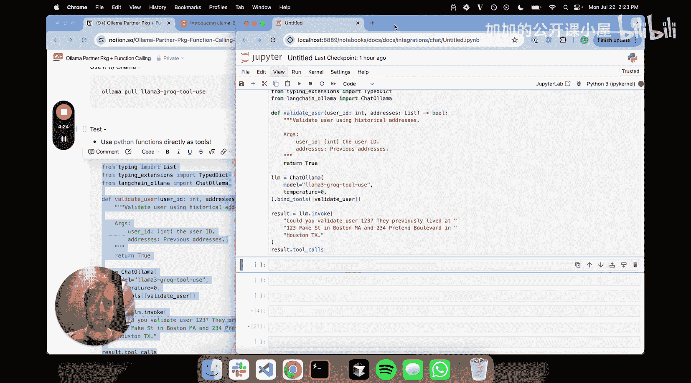
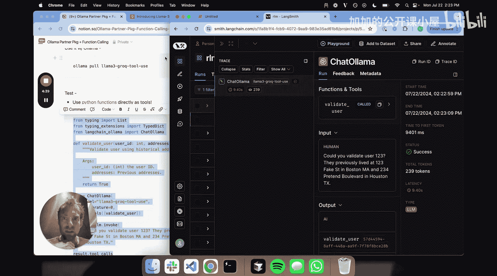
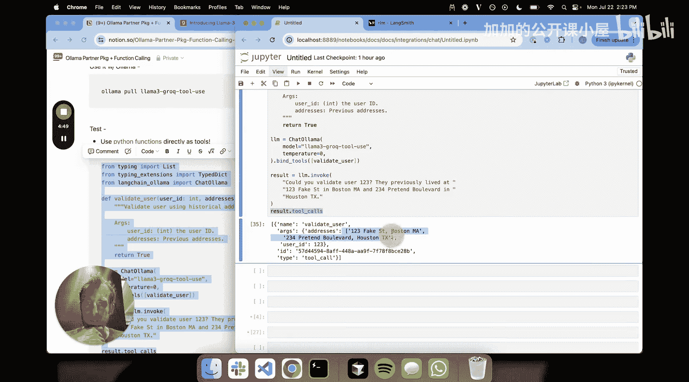
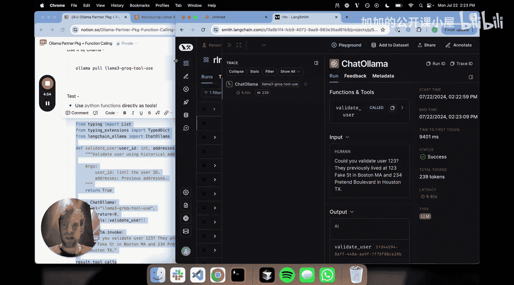
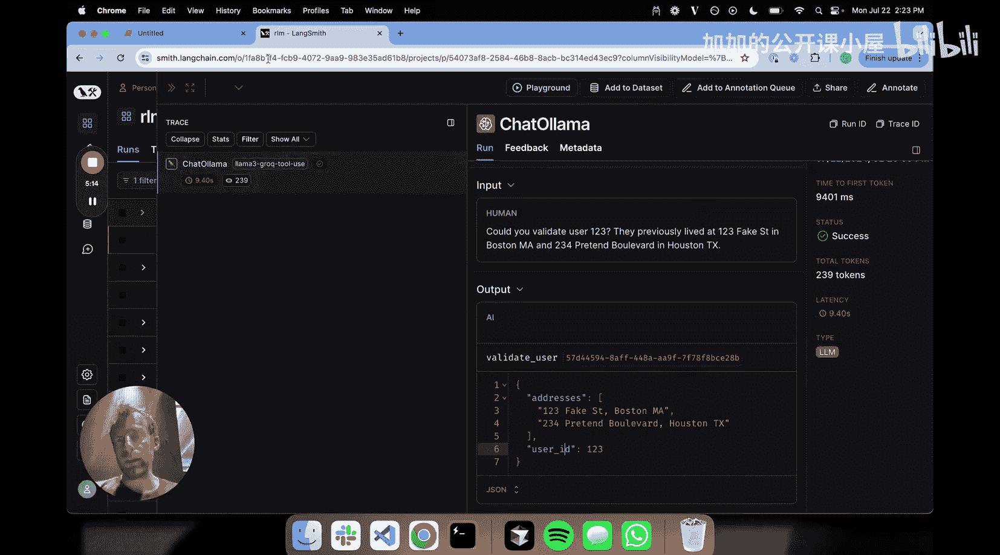
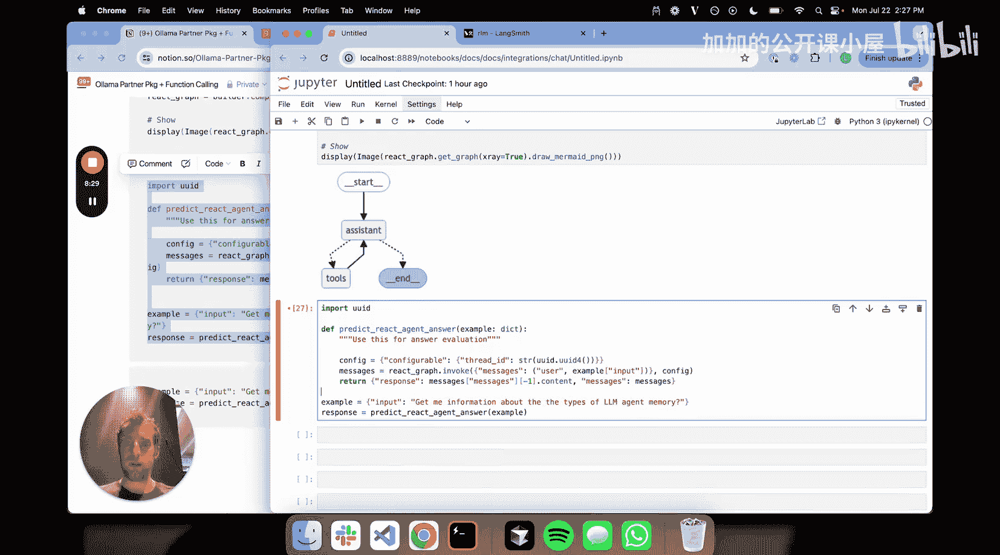
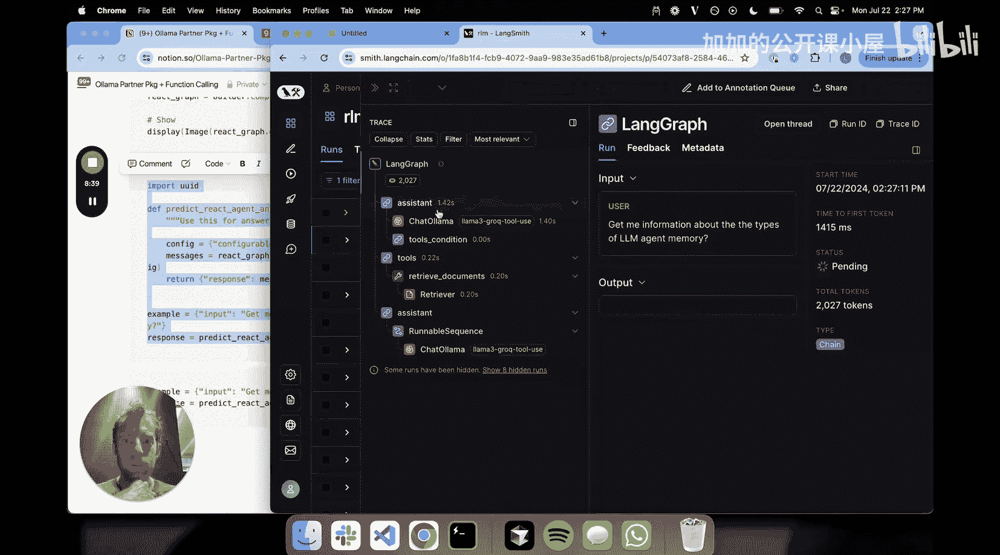
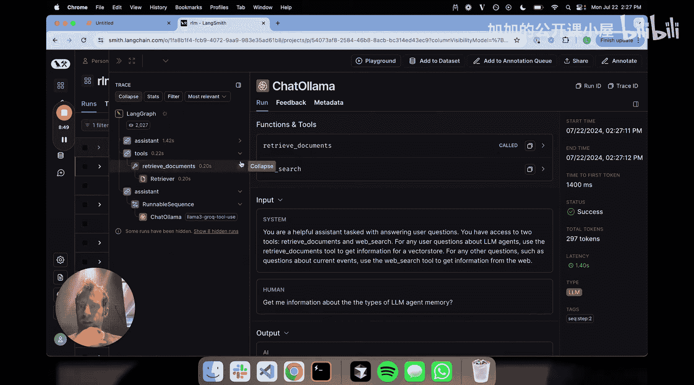
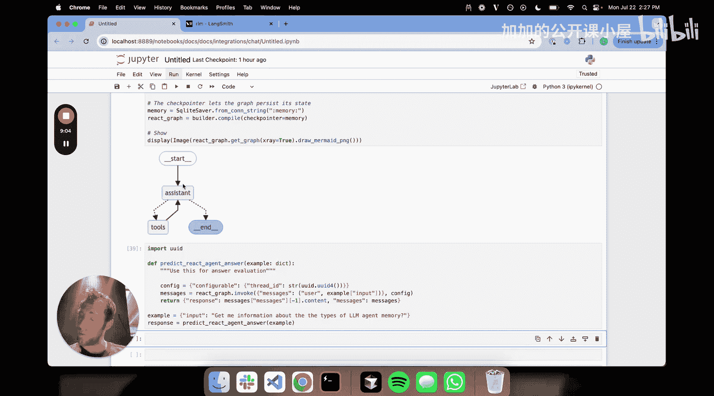
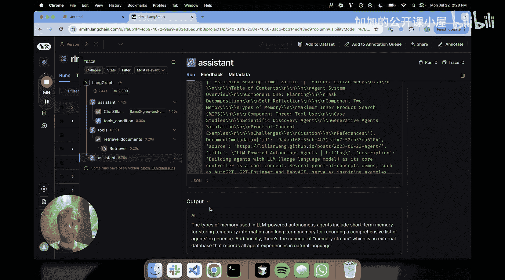

# LangChain【中英⚡LangChain 使用指南｜Build with LangChain】 p31 P33 Fully local tool calling with Ollama -BV1xwfMYDE3n_p31-

Hey this is La Blankcha， so today I'm going to show how to do tool calling with local LLMs on your laptop using Alama。

 and we're also going to show how to build agents using Landgra as well as Oama tool calling。

So we're releasing a partner package with Alllama， which is really nice because it allows you to do things like tool calling in a way that's consistent with other LLM providers。

So all you need to do is just p install line chain llama and this gives you access to the partner package Now I'm going to show you how to do tool calling。

 which is one of the things that we've kind of seen the most interest in or the most kind of demand for local models。

So function calling a tool calling our synonymous， I'll just kind of add that in here for clarity。

 and the main idea is what you're doing is you're taking a function。

 which is some kind of tool that you can call Now this can be like an API it can be an arbitrary step。

 it really doesn't matter。The point is you're taking that and you're binding it to your LLM such that your LLM has access to that tool and can produce outputs formed in order to call that tool or I。

e create a payload need to run the tool。 so here's the big idea。Right。

 let's say we have some like made up tool。 It's called step 2， takes some input fo。

We combine that to our LM。 And when our LM sees what is step 2 of input 3。

 it can formulate the arguments necessary to run that tool。 Okay so remember。

 Lms are type string to string， So it can't just magically run the tool。

 but it can produce the payload necessary to run the tool based on the user input。 So really。

 you can think of this as basically payload generation from kind of raw unstructured user input producing the output necessary to actually run the tool。

 So in this case， you know I want to know， I want to run the tool step2 on the input of3。

 and it produces the argument Fo is3 and run step 2。 Okay so that's the big idea。

 And that's kind of the motivation by tool calling。Now， here's the thing that's kind of been tricky。

 There haven't been that many good local LMs that can actually do this。

 Okay so and when I say do this， I mean， really do it reasonably well at a small size like 8 billion parameter。

 Now we've seen， of course， Lama 370 B is actually pretty good at tool calling。

 I have yet to see an 8 billion parameter model that does this pretty well。

 I can put this out on Twitter。 I do think the mouse fine tune is pretty good。

 And I actually showed that in a prior video。 But what's neat is Goc recently put out this particular fine tune on Lama 3。

 that does quite well on the leaderboard。 So they show results。😊，On yeah。

 here it is on the Berkeley Function calling leaderader board。And they show some data down here。

 And in a case， the point is there reports very strong performance。 And here's what's nice。

 It's available in an 8 billion parameter version。 it's finetd from of course Lama 3。

 So that's really cool。 and they do in collaboration with Give So that's pretty interesting and check out the blog post of course。

 link so you can kind browse around here。 But the point is we have a small open source Lama3 variant that's been fine tuned for tool calling。

 So you know I've seen some interest in this and seems pretty promising。 So let's try it out。

 it's available in llma All I need to do is this llama pull this particular model Lama 3 crop tool use。

 Okay so I've already done that。 so basically here's an empty notebook Pip install laang in llma I've pulled the model。

 and so I have kind of all the foundational pieces that I need so let's test this out。

 So what's really nice is that with L chain tools tools can just be python functions。

 so here's like an example tool validate user validate。😊，User using historical addresses。

 arguments are user ID and addresses， okay， and this is going be a list and this is going to be an int and this is my tool called right now in this of course。

 in the real world there'll be some logic and and that's totally fine。

 But the point is here's my tool。And basically， I set up my LLM。

 and all I need to do is is bind this function as a tool。And there we go。 Now let's test this out。

 I just invoke my LLM。 and now this LLM again， remember it's Lama 3 Goc tool use and this is run locally on my laptop。

U。And basically validate user 1，2，3。 They lived at these addresses。 So basically。

 this should be able to produce the payload necessary to run this function。And let's see。

 hopefully that runs reasonably quickly and it runs locally。

 And I can you can see it's taking a little bit of time。 I can spin up Langsmith here。

 and so you can actually see we can actually inspect the trace here。 So here we go。

 It's just being logged to my default project。 Here it is。

 And so it looks like it's probably still running。 No， it looks like it's done。

 Let's have a look here。 Okay， cool。 So look， this is pretty nice。 You see the tool calls populated。

 The arguments are user I addresses， addresses are a list。 user I is an int。😊。

Seems to work。 Now， we can go to Langsmith and actually investigate this a little bit further。

 So it this is pretty cool。 So you can see here's the bound function valid user。 It's called。

 So that's really good。 We can actually confirm that the tool is actually called。

 and then we can see here's the output。 Look addresses and user I D。😊。

I mean， look， that's pretty cool。 You can see it takes  nine seconds。

 but's running locally in my laptop， which is something that， you know。

 there aren't that many local tool calling models that actually work reasonably well And from this simple use case。

 at least you know it can perform this tool called we don't actually require enforced in vocation。

 which I have seen with other models， So this is kind of promising。

Now， let's step this up a little bit。Let's say one run this is Landgra and so here's some dependencies I'm not going to well I've already set these of course openI and open A and Tvi API keys。

 this is going be useful for embedding model and for web search。

 which you're going to see in a minute so let's actually test building a we'll call this a simple agent。

Let's just building a simple react agent that relies on tool calling。

And what I'm going to do here is I'm going to copy over some things。

 so I'm going to copy over first the LLM so we' going to need the same LM we just did okay。

 now I'm going to build a retriever。So this retriever is going to index three URLs。

 we're going to use open ionbeddings to index， so that's fine。

 and we'll put those in a vectorex store， so that's what we're doing。

And we're going to find a tool from that。 This is going to be retrieved documents。

 so the tool is going to be a query string and it'll retrieve documents from the vector store based on the query Okay and I'm also going to give it a search tool so this I'm going to use Tvily for and I'm going to call this have this web search function run web search on the question again the input just a string and I get some documents out so here and here's my tool list。

So kick that off。So I'm creating two tools。A retriever tool and a web search tool done， okay。

 so that we have our tools。Now， here's where I'm basically going to create my little line graph agent。

 and we have a bunch of other things on this。 So I'm not going to walk through all this code in detail。

 I'll share some other talks and other notebooks that kind of walk through this in detail。

 But here's the big idea。 It's just a really simple kind of LM that we're defining。 Now。

 here's what I want to draw your attention to。This is the prompt necessary to kind of run those tools so your' helpful assistant tasked with answering user questions。

 you have access to two tools， retrieved documents and web search for any questions about LM agents。

 Use Rettri documentsments tool， otherwise use Web search。

 and that's because if you go back and look at our tools here。I've indexed three URLs。

 one of those related to agents。 So basically I'm going to keep it simple and say questions related to agents send to the retriever。

 everything else send to web search。 Okay， so that's what I'm instructing my kind of LM assistant to do。

 And so there we go。 So that's step。Now， I'm just going to copy over。

 This is some kind of standard code that we've kind of walked through in some other videos。

 But this code basically sets up a really simple react style agent and lagra。

 And you can even see that right here。 This is exactly what's going to happen。

 So I have an assistant。 The assistant is basically the L O M。 It'll decide to make a tool call。

If it decides to make a tool call， it goes to the tool node， calls a tool， goes back。

 and this repeats until there's no more tool calls。

 And then it'll just answer the question directly and finish。

 So we're going to walk through that very shortly here。 But this is just。

 that's a kind of the basic react setup up。 And so here is kind of the invocation test。

So let's test this out。Give me information about the types of LLM agent memory， okay。

 so here we're going expected to call that retriever tool， let's try this out。

So this is now running and this should take a little bit of time。

 we can open blanksmith just to kind of send check our agents。

 our agents running here and cool we can actually go look at so this is kind of nice so we can actually look at here' here's our assistant right and so we can like let's kind of back up here so basically remember our diagram。

 we're going to start with our assistant， this system will make a decision to use a tool or not based on the question。

And if it decides use a tool， it'll basically go to the tool note， tools invo。

 the output of the tool gets return back to the system。

 and this will repeat until no more tools are called and then answers directly。

 Let's look at our trace。 So you can see what's happening here。 First we go to the assistant。

 the assistant decides， okay， this is good。 you can see it calls retrieve documents tool。

 So basically get me information about the types of LLM memory。

 Westruct we instruct it for any questions about LLM agents Use retrieve documents So it's calling retrieve documents tool。

Not bad。Here's so basically that goes to the tool node， this is the tool node。

 the tool node then called retrieves the documents， here's the documents you get back。Great。

 goes back to the As node。And let's just see this should have run。 And yep。

 here's the retrieve documents from the tool call。 This the tool message we get back。This is perfect。

The types of memory used for LM powerns agents are short term memory level。

