# LangChain【中英⚡LangChain 使用指南｜Build with LangChain】 p35 P37 Text to SQL Agent for Data Visualization -BV1xwfMYDE3n_p35-

Hey， this is Lance from Laangcha。 recently I've been interested in applications of Landgra that showcase some of its capabilities and complex and interesting agents。

 And I came across this repo that's pretty cool that I want to showcase here very quickly。

 So this is a data visualization SQL agent that does Texas SQL。

 We've seen that before that's kind of a common use case。

 So what's really neat is it actually bridges the gap between kind of natural language questioning and data visualization。

 So it's a Texas SQL agent that not only will perform SQL queries for you。

 but also produce visualizations of the results for you as well。

 So I should want to show this in practice first， and then I'll kind of go through and walk walk through the repo a little bit and show how it actually works。

 So it's the fall in the US people are often interested in football。

 I found some recent statistics from a machine learning model that trained on prior seasons and tried to make predictions for players this coming season。

😊，I pulled the data from Kagle。Here it is as a CSV。

 Now I want to show how I can use this agent to interact with it。 Okay。

 I don't like writing SQL queries as many of us don't。

 So basically here is the UI for this agent that's been stood up。

 and I'll walk through all this in detail later， but I just want to show you how it works first。

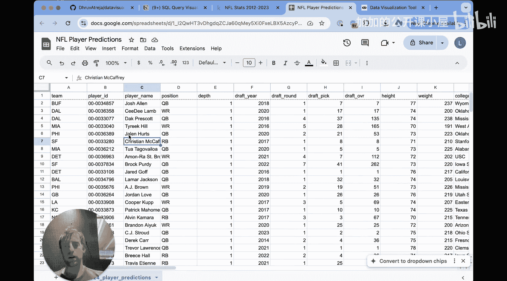

Now what's cool is I can upload either SQLite DB or just a CSV， so I'm going to go here。

 I'll select this CSV that I grabbed， and now this has been uploaded。

 and now I can just interact with it and ask questions。

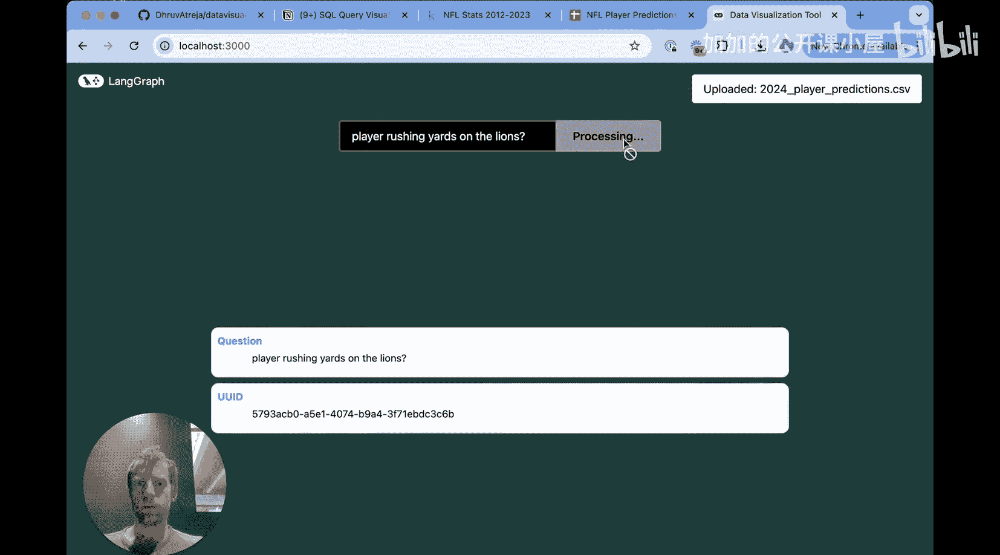

We see some kind of internal state being streamed here。

And we get visualizations is pretty cool right so here's kind of a representation of various players on the Detroit Lions。

 the projected rushing yards from this data set， right So this is just an illustration of what's actually doing what the output looks like。

 Now let's actually go under the hood and explain how this is actually working。😊。

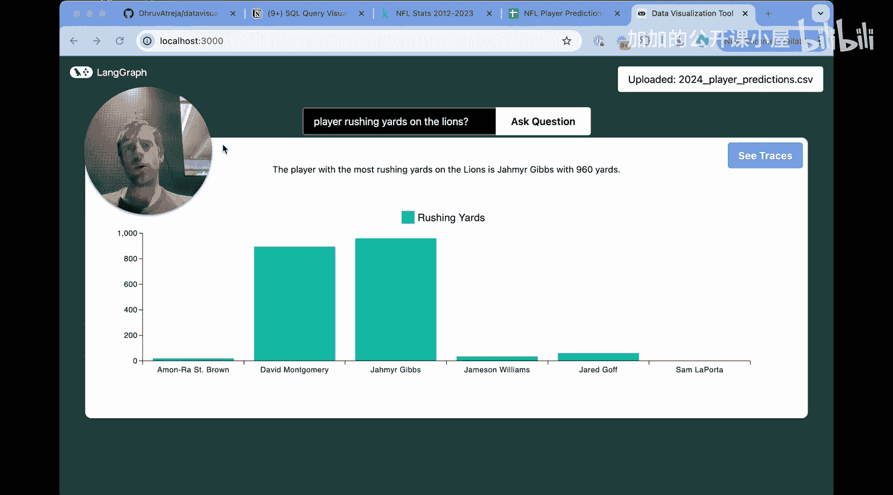

So I'm back in the repo， and let's actually walk through the overall architecture that's shown here。

 So I'm the user。 I gave it a CSv， and I asked a question。 Okay。

 now let's talk through what happened。 So first that CSv， go back， we can look， it was uploaded。

 Now what does that mean and what happened there right So I go the repo。

 What happens that CSV is actually sucked into a sQLitete server that converts the CSv into a sQelitete Db。

Then I have this SQL agent here that actually interacts with that DB。

And query is it based upon the user's question， so basically case the question。From the front end。

 converts it to SQL， executes it and returns formatted data。

 So that's what's happening inside this black box。 if we're going to dive in a bit later。

 and then that formatted data is passed back to the front end， which we see here。

 and then this actually renders the visualization， but all the heavy lifting is happening within this SQL agent。

 which is defined in Lagra。

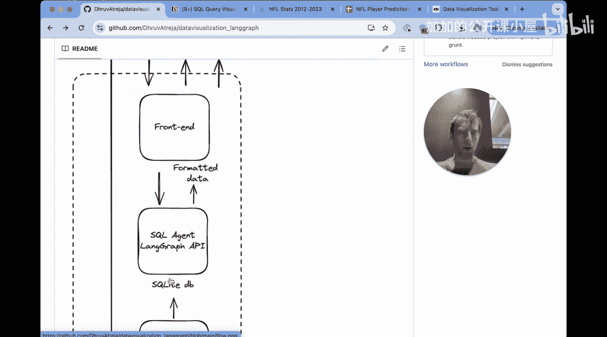

So let's actually walk through that now。So I'm over in the repo right now。

 we'll see a few directories here， you see back NJS， backend up pi front end SQLite server。Now。

 let's do the kind of more straightforward pieces first。 The SQLite server is what we talked through。

 This is what actually takes the CSsv in our case， and converts into a SQLite Db and serves。

 it makes it accessible。 In fact， you can even go in the SQLite server upload。

 and you can actually see here's all the files I've uploaded。

 So I've done a few different tests with this。 and they're all saved here with this I D。

 which I can actually use later。 That's pretty neat。😊，Cool。

 so that's kind of the SQLite server piece and if you're interested in all the code。

 you can kind of dig into it here， but this is kind of where it all lives。

I want to talk most about the landgra piece。There's obviously the front end。

And that's all kind of here。Now you can choose JS or pi to implement the SQL agent in La graphra。

I prefer pi myself so you can see in this my agent subdirecty。

These fit scripts contain all the logic that actually defines our agent in Langraff。 Now。

 we'll see something kind of interesting here。 If you look at this overall directory。

 you're going to see this Langgraft do Json。 This actually provides the necessary config file to run our agent in Langraft studio。

 So you can see we specify our graph。 We call it my agent。 That points to my agent。

 my main dot pi graph。 If I go to main dot pi， I can see here's the graph。

 I can go to the workflow manager。😊，Here。And I can see， this is actually where。

All the graph nodes are being added。And the graphs actually being compiled。 So it's pretty nice。

 So if I go back， that return graph method just compiles the graph and returns it and makes it accessible。

Here。In Lagra studio， now， La graph Studio is actually a really nice way to take this code。

Packages it up as。The Landgra API。Which then allows us to do a few different things。

Our code packaged up via the Lagraft API1， we can interact with it via Langgraft Studio so we can actually test this and interact with it directly with a visual IDE Laanggraft studio and we'll show that quickly。

But also。I can actually work with that API and use it in our application。In particular。

 if I go to front end up high， look at EMV Dog's example。The API URL can be supplied here。

 and it can interact directly with our locally running Landgra API via studio。

 So that's kind of how this all fits together。 If I kind of rewind what's going on is。

Back in dot pi or JS， the agent logic is being laid out here in a bunch of scripts。

Then we have a config file for Langgra Studio。That points to our agent。When we open this in studio。

Studio will automatically wrap this code with the Lagraft API。

And then it makes it accessible locally for our front end。

 and that's what our application is actually using。Now why don't I go show Studio first。

 that's a really nice way to actually get some intuition as to how it's working under the hood。

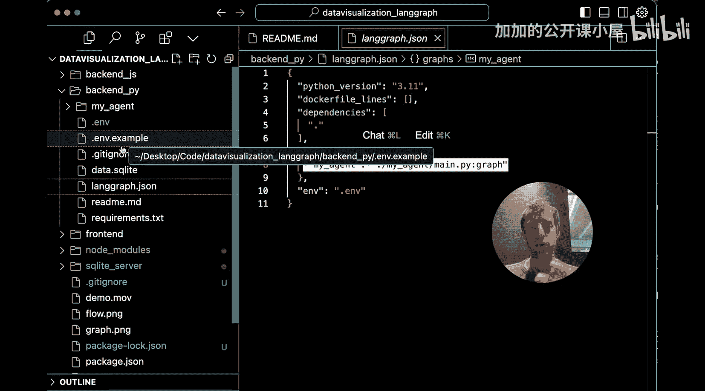

So here in studio， my agent just refers to that agent that we defined in the Laraft JSON Config file。

 and again it points to our compile graph。

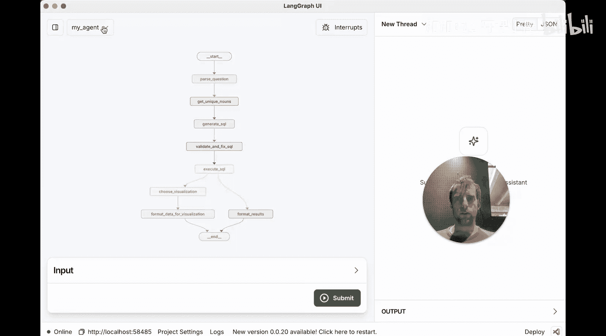

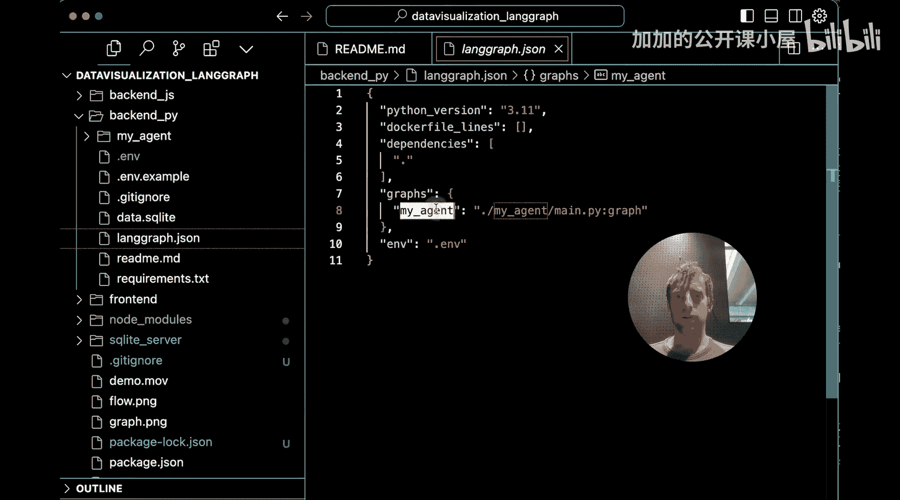

So this gives us a way to both visualize what's going on in our graph。And to actually test it。

 So let's show an example of this。So let's go ahead and retest the question that we asked in the UI as an example。

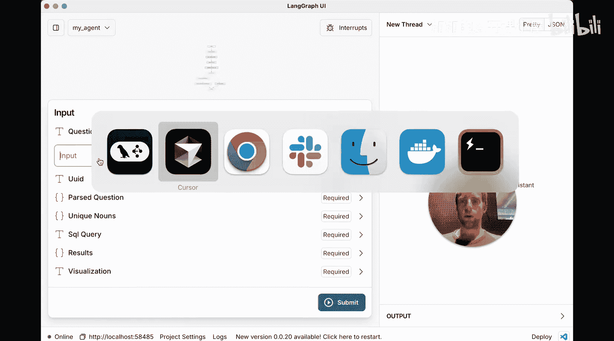

Rushing our to the lines。

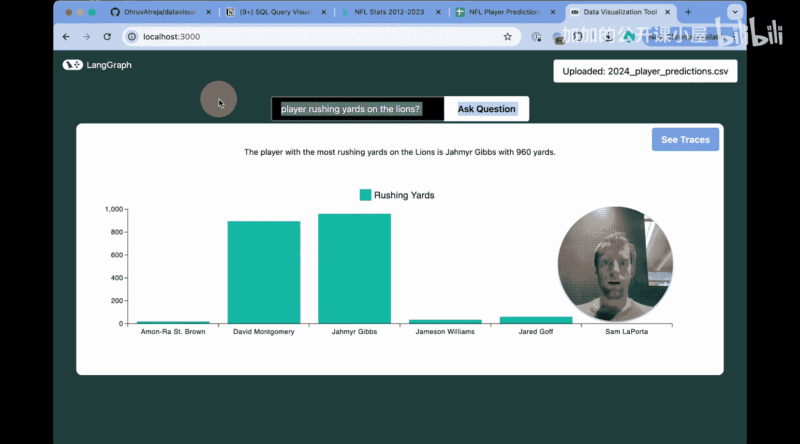

Cool。And this UI。 Now， let me show you that quickly。 I go back to the repo。

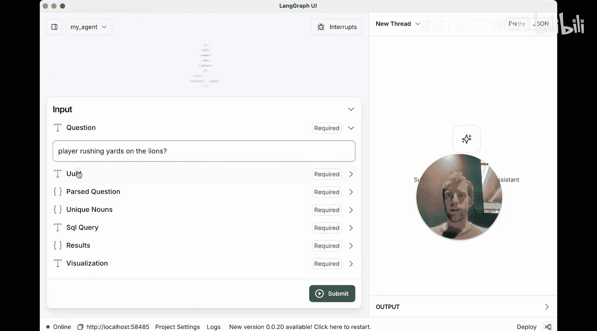

I go ahead to the SQLite server。Go to uploadloads and I can actually look here at the various files that have been uploaded。

So you can see these are all my IDs， their SQLI databases， grab the most recent one。

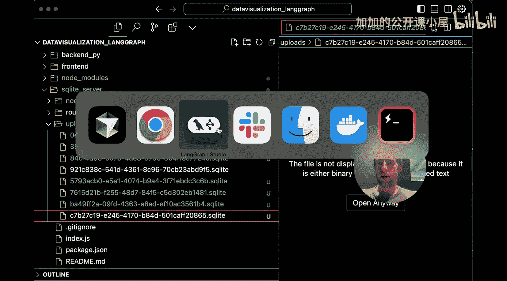

Copy that over and here we go， so I just provide the UID right here。

And I'll go ahead and ask the question， and then let's actually see this running。

Cool let's running this parse question， unique nouns， generate SQL。Nice。

 we can see this here is basically the full end and run of effectively the back end or the SQL agent and the final data。

Represent right here， labels， values。And data， as shown here。

 as is exactly what you see rendered in the U。 The Ui just takes that data from the back end。

 which is our agent and does the visualization here in the front end。 Pretty nice。

 Now let's actually talk through what it's really doing under the hood。

 This is actually a great example use case for Lagra studio， of course。

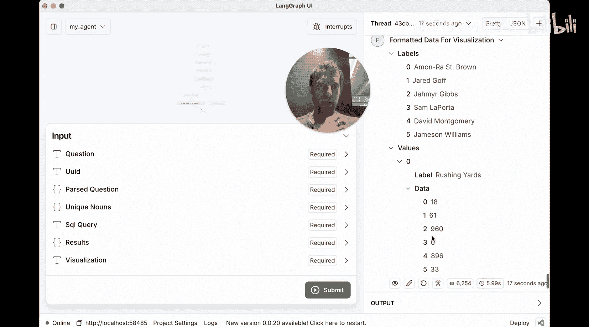

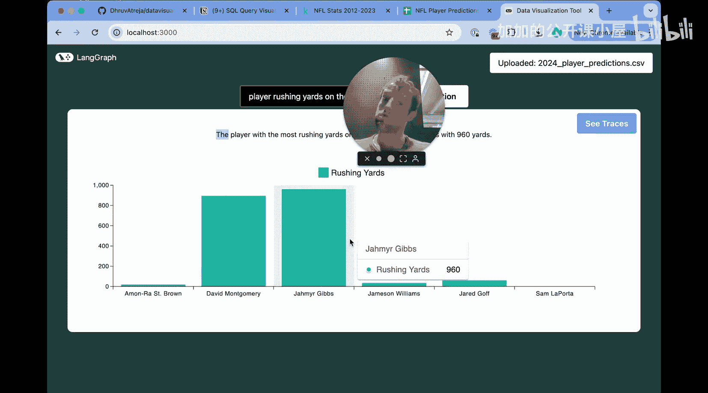

So this is a Texas SQL dial flow。Now， it has a few different nodes。Paarse question。

 so what was doing first is is looking at the question。

And determining whether or not it's actually relevant to the table。 So in this particular case。

 it determines， yes， it's relevant。 So with the table name in this case is a CSV data。

 here is the columns that it deems to be relevant to the question。 So my question is player。

 rushing yards for the lions。 So basically deems O。 The columns are probably going to need here。

 include team， player yards， rushing yards。Now this nouns column is kind of interesting。

 this represents any non numerical data columns and you'll see why this is important very shortly okay。

Now next it does get this this get unique nouns， this I had to dig into a little bit because it's not obvious right。

 but it's actually intuitive when you think about it， here's what's going on。

What it's doing is is taking these noun columns and just dumping the unique values in them Okay。

 so you can see it's dumping all these unique player names and team names Okay。

 so why is it doing that？So this is a really common problem with Texas SQL， that's tricky， right？

Notice that my question asks lions， okay？This Texas SQL process has to do a mapping between the natural language input of lions and what the database actually houses for team names。

 right， those are not going to match。 So this is pretty clever。I。

 in my C query asked lines in lowercase L， the team names in the database actually are three letter acronyms。

 Okay， so what's interesting is Texas SQL needs to do that mapping to say I actually mean in this case。

 I believe it's probably D ET for Detroit right， know it's in here。

 it's going to be dumped somewhere right？ So actually you're going to see something kind of cool because we have all that's accessible。

😊，When。We do this SQL query， okay， we do this mapping is pretty cool from what I pass。😊。

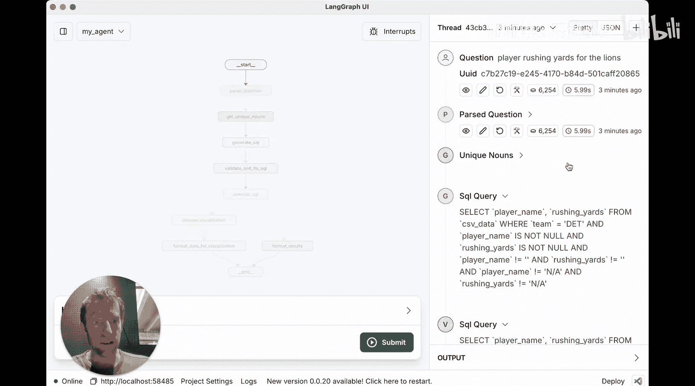