# LangChain【中英⚡LangChain 使用指南｜Build with LangChain】 p36 P38 LangGraph Data Enrichment Agent Template -BV1xwfMYDE3n_p36-

Hey， this is Lance from Bcha we've seen a lot of interest in landgra for the last months and in particular we've seen kind of clustering around a few popular and common use cases。

So we're launching templates today to give template applications across some of these popular use cases that can be easily extended and easily configured。

 but give you a nice starting point， you don't have to go from scratch。

 building something that is fairly common that many other people have built and configured for their own uses。

So I want to show one just to give you a sense for how templates work in general。

So the problems thing from this particular template is structured results。

From some kind of open end research task， here's a common problem statement。I have a database。

 I have a spreadsheet I want to populate with results from open ended research。

 That research is often， for example， from the web， but it could be other research sources。

 So it's basically the problem of going from unstructured research to a structured output that fits into a CV。

This spreadsheet or database format， that's really it。So what's going to happen is as a user。

 when I'm interact with my agent， I specify a topic， I specify an output schema。

The agent goes and does all the research for me and produces results in the schema that I specify。

 That's really it。So I'm going to go ahead and walk you through the functionality here really quickly and then we'll go through the details a bit later。

So I'm going to go ahead and。Grab this。 So I'm going to do is just copy this over。

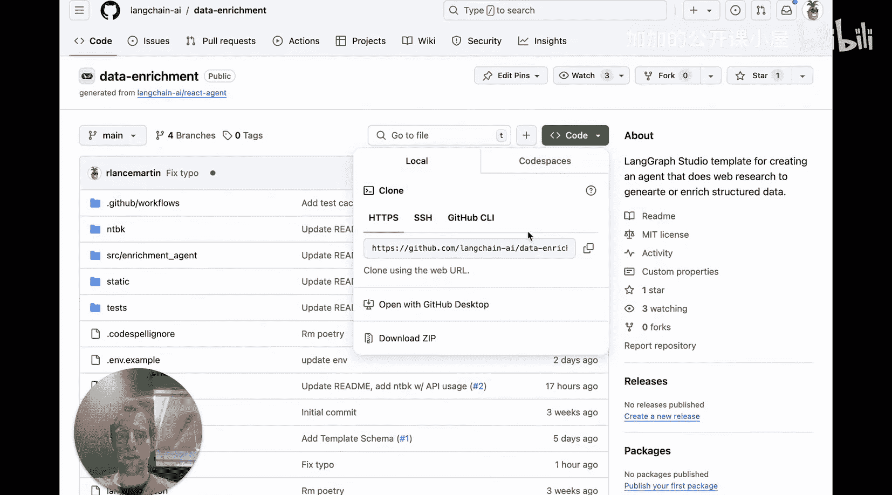

I clone it。And I open it up in my I D。 So here we are。 Here's the code。

 Here's the remi we're just looking at。

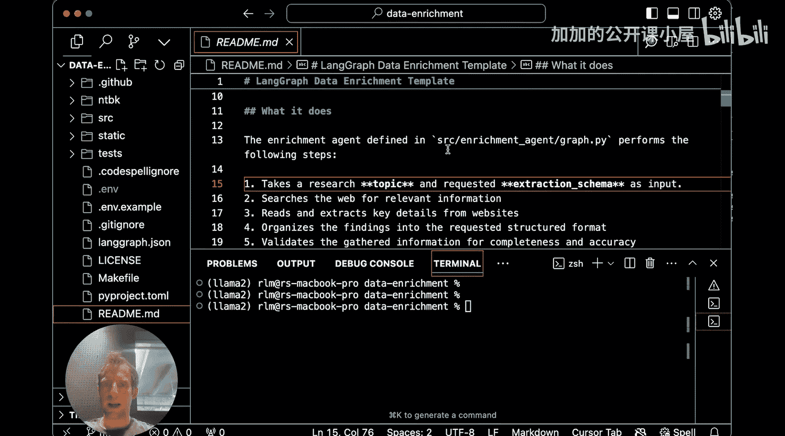

So if I go back to the ReadMe， the first thing I need to do to get this running is Cranian V file okay。

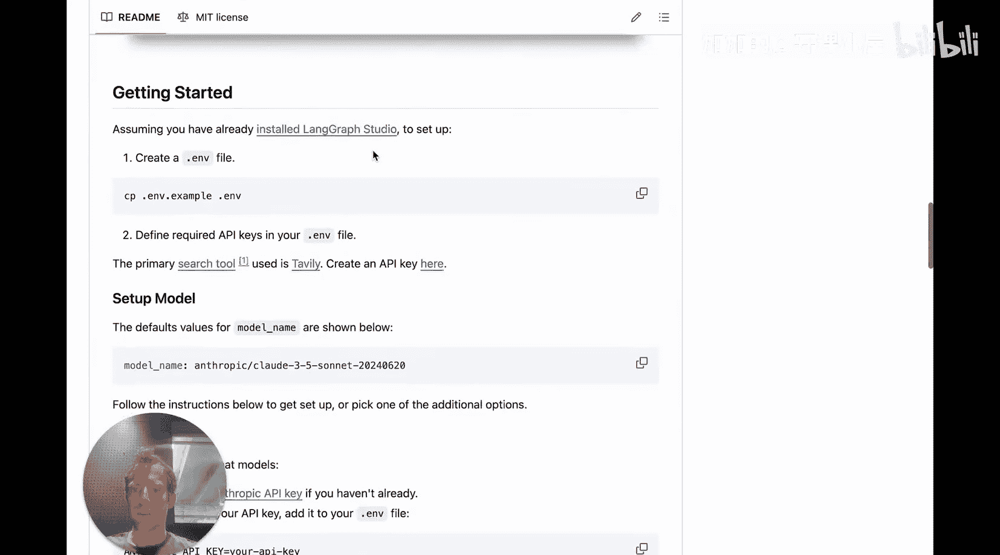

I go back here， so you can see we have this in the example， you're going to set a few things。

Tableli API key， Langsmith project and your LLM。 Now what are these different things？

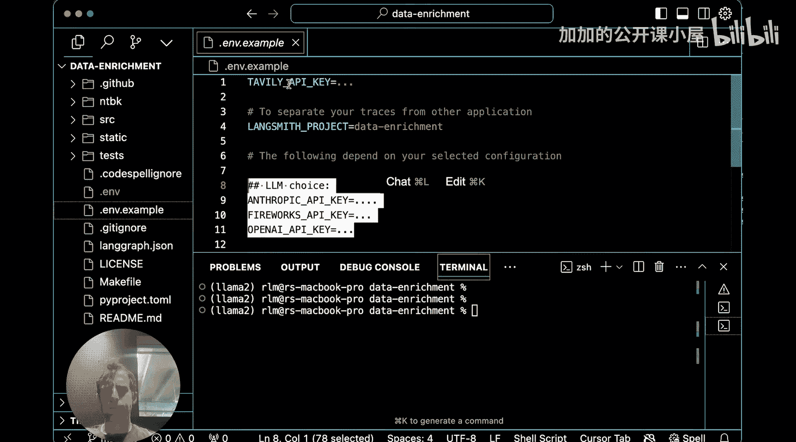

So Tvili， I don't go ahead and show you that right now， let's open that up here。

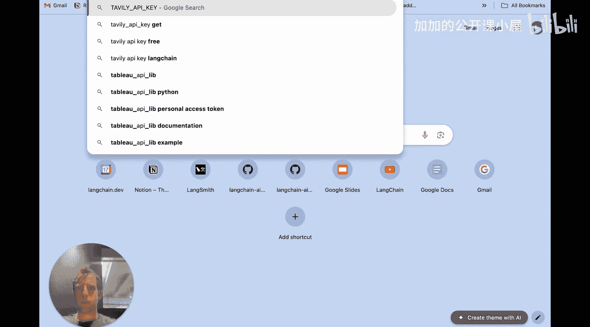

Tavavili is a very nice web search tool that I tend to like。So here's a website for it。

 it's a search API for ElMS of RAG。Now， here's the nice things about it。

 It's easy to set up it has a generous free tier and it kind of just works。

 Now there's other search tools out there。 you can easily configure this to use whatever search tool you want。

 Tablet is one that I tend to like。 And so that's why it's kind of recommended here。

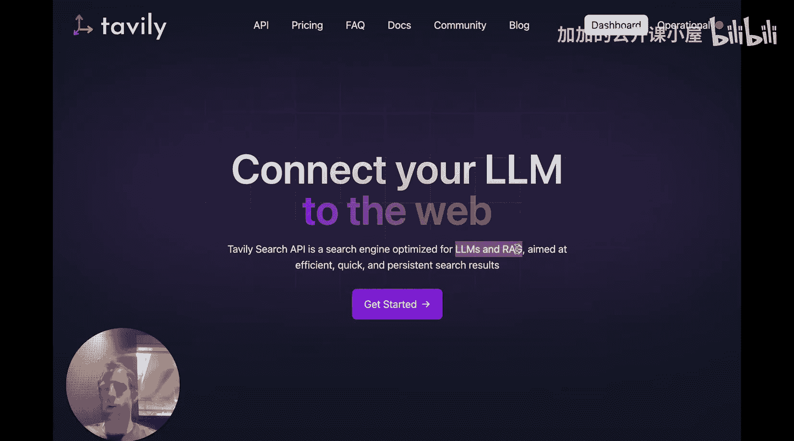

Langsmith project， this sets the project for Langsmith that all of your agent runs will log to。 Now。

 Langsmith is Lang's platform for observability。Traccing， monitoring evaluation。

And you're going to see here it's very useful for debugging and monitoring our agent behavior。Now。

 Ellen of choice， you can choose any model you want， of course。

 these are just some example keys that is kind of by default set to work with。

 but you can extend this very easily。So the first thing I do is I'm going to create my inV file。

As noted。In the read meat here。And I've done that。 I now have my E V file。 Now。

 that's actually all you need to get up and running with this agent template。

So if you look at this Laanggraft。 JSON， this is a config file that Laanggrafts Studio uses。

Linegraft Studio is an IDE4 Landgra that gives you very easy and nice way to run agents。

 look at the results， and kind of understand the internal behavior of the agent。

So all this is doing is basically it's naming a graph that I want to open up in Landgraft studio and it's specifying the source or the path to the compile graph。

 So SRC enrichment agent G pi graph is actually the。😊，Raw compile graph。Right here。That's it。

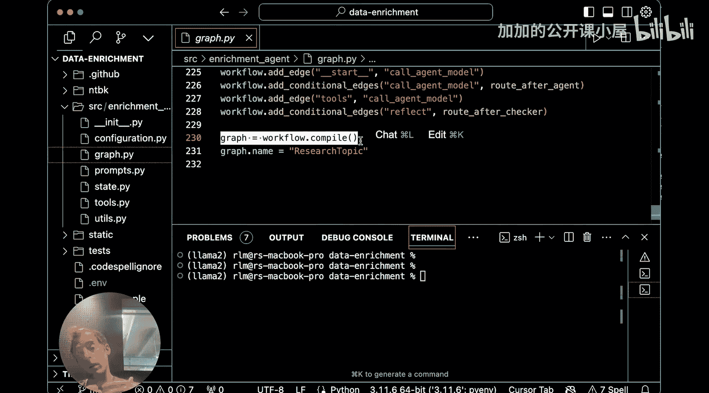

So it's pretty nice， this is all we need to actually get up and running in studio。

So I'm in studio now。 let's just go ahead and open up that directory。 So here I am。

 this is my data and enrich directory。 can see the Laang after deson here。

 the E V files present here， I just click open。And here we are。

 This is what we see once we go ahead and load our graph。 we can see it's named agent。

 that again comes from the config file。 Laang after Json。 We name this agent。

 We give the location of the compile graph。 And here's our graph。

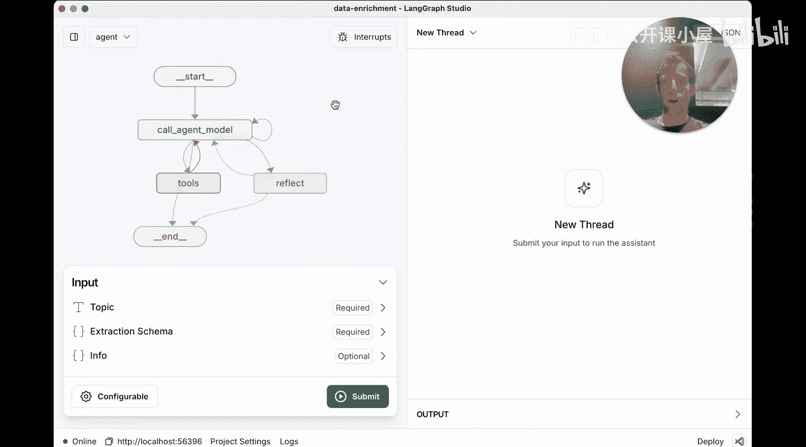

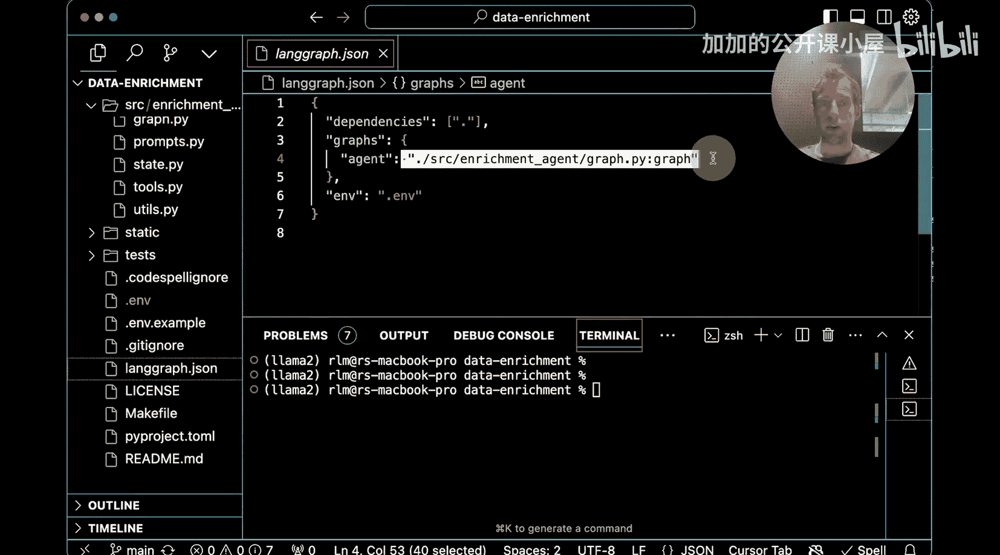

Nice visualization。These are the nodes， these arrow are the edges。Ku。

Now you can see we can very easily input two things here， topic extraction schema。Okay。

We also have this configurable。This allows us to input a bunch of different things。 Max loops。

 search results， model name， prompt。 We'll talk through what all those mean a little bit later。

I'm not going to touch those for now， but I just want to show you it's all here so you can easily configure the functionality of your graph。

 and this is where you're going to input。Now let's go back to the Readme and I'll show you some example inputs that we can use for the research task here。

I'm interested in LM training， I want to know about the top five chip providers for LM training。

 I passed that as my topic。And this is where I specify extractions chchema。

 So this is kind of interesting。 The extraction of chchema is just a JSson object。

And as long as this is all JSsonN， we can use it。There it is。

Now let's go ahead and run this now I just want to rewind a little bit， what have we done？

We we've all we've done is create that E V file that has basically my Tli API key。

 as well as API key for whatever model I want to use。That's all you need to do。

 I opened this in studio。Run。So now agents's running。Nice， so we finished running。

 now I'll show you something really cool in studio。I can just scroll down here。

And I actually can walk through。The entire process of my agent， as it ran。So I can see each step。Tao。

Is all the results from the particular tool call？Goes back to the model。

Finally goes to reflection step。Back to call。Agent model。Final reflection。En。We get a good result。

Now， we're going to walk through what each of these nodes are doing in a little bit more detail。

 but this is a really nice way to just browse the trajectory of your agent， everything that happened。

 Thats pretty cool。😊，Now， we also can look at here's actually the result of our research process。

 You can see we have this list of companies。 Here's NviDdia， gives us future outlook， key powers。

 market share， name， technologies。 It's pretty cool。

 These are all things we specified in that extraction scheme that we want for every company in our list。

😊，So you can see this is what you get from the agent when you run it。

 and we've run this in the IDE Lagraft Studio， and this gives a really nice way to kind of browse through the full trajectory of our agent what it did and what we get out。

This is actually how to use the agent。 Now again， we can dig a little bit further into what it actually did under the hood。

Now， to understand what it did under the hood， I want to walk through each step in studio here and then go over to the code and kind of correspondingly explain what's happening in the code。

 So we start。 Here's the inputs we provided。 top 5 chip providers for LM training。

 And here's the schemechema we care about。 Now we went then to call agent model。 Okay， now。

 here's where things get interesting。 Let's go look at the code。

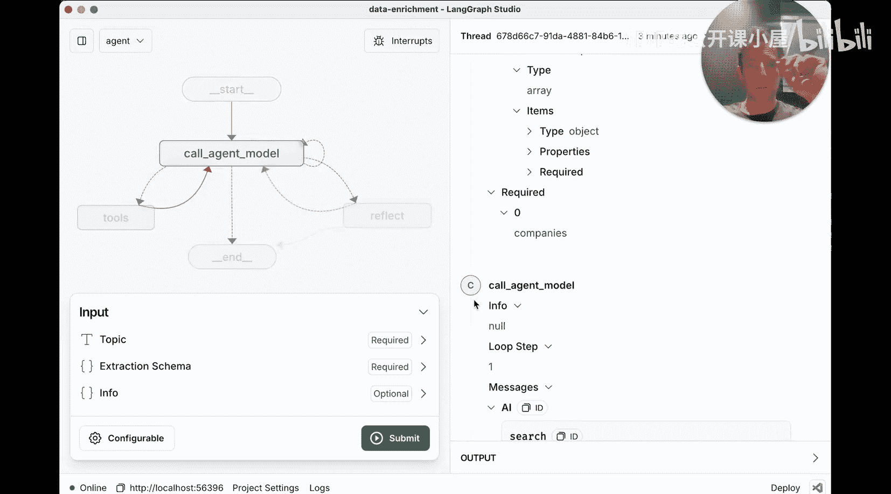

So here's collagen model you can see is's defined in G dot pi。And here's the key intuition。

This agent is basically an LOM， as we define initially。By default。Look at this configuration dot pi。

 The default configuration for the L M is going to be anthropic。

We set the API key and R&V files we can use enthropic without a problem。

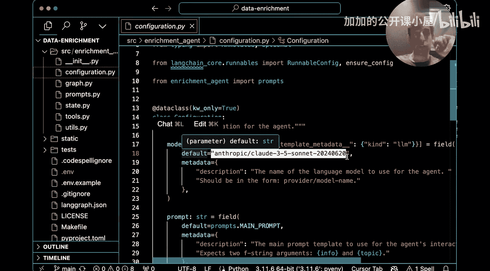

In our configurable here， you can change the model name if you'd like。

And Read me talks about other models you can choose。

 So that just gives you a sense that we we've set our LLM。

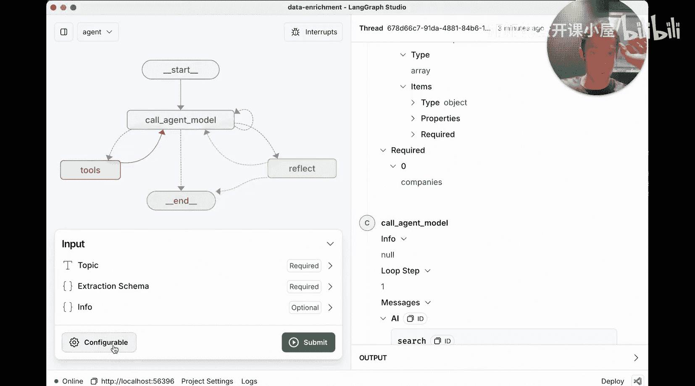

Now in Gratop Pi and we take that LLM and we bind a few different tools。 Here's the key point。

 we bind tools search， infofo tool， scrappe website， So what are these things。

If you open up tools the pie you can see the definition for two of these。 So one is search。

 This is Tvily we talked about before。 This is a very nice search tool。 Basically， it'll call Tvily。

 It's going to return a bunch of summaries of websites related to the question ask you to get from Tvili。

We also have the scrappe website tool， this will take a URL and actually grab the contents of the website so'll scrape it and format the results and can see this info prompt into the schema that we specified so basically it's kind of scraping a full website and extracting the results into our desired schema So that's just kind of the second tool Now this final thing info tool this is a tool that we actually define here in this no definition and this is actually the final result of our research process。

😊，This is going to be called once we've gathered all the relevant info。

 and it's going to basically be like a structured output tool that will produce a final output in the desired schema。

 So that's really what's happening with this info tool。 So basically。

 we have a chat model that we've initialized through config。We've bound these three tools。

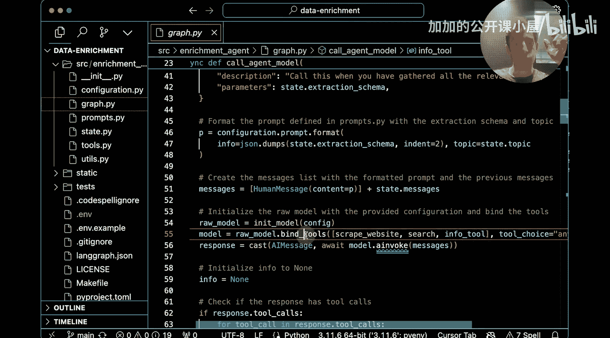

And we let it call tools。In a loop。

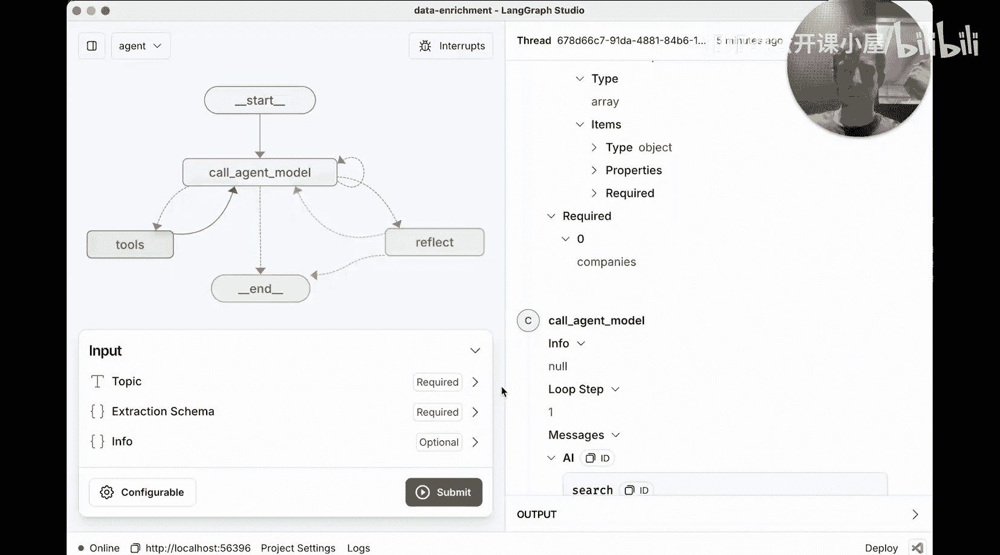