# LangChain【中英⚡LangChain 使用指南｜Build with LangChain】 p37 P39 LangGraph Assistants -BV1xwfMYDE3n_p37-

Hi， my name is Isaac from Langgraft and today I'm going to talk about how Landanggraft Studio can help make building LLM applications a collaborative process。

After your developers have used the Lagra library to code the informational architecture of your。

Agents Langgraft studio is going to allow both developers and business people alike the ability to rapidly create。

 iterate and test on different assistance from that information architecture。

Before we dive into the weeds， let's imagine that we've created a simple react agent。

 and we want to have two different assistant for this react agent。 One is a coding assistant。

 and the other is an assistant that's going to help users who are feeling down。

 have a little bit better day。 Let's hop into the studio and see this in action。 All right。

 Now we're in the studio。 As we can see from the left hand visualization。

 we've created a simple react graph for this example。 In addition。

 when we click on the assistance drop down， we're going to see that we've created two different assistance for this graph。

😊。

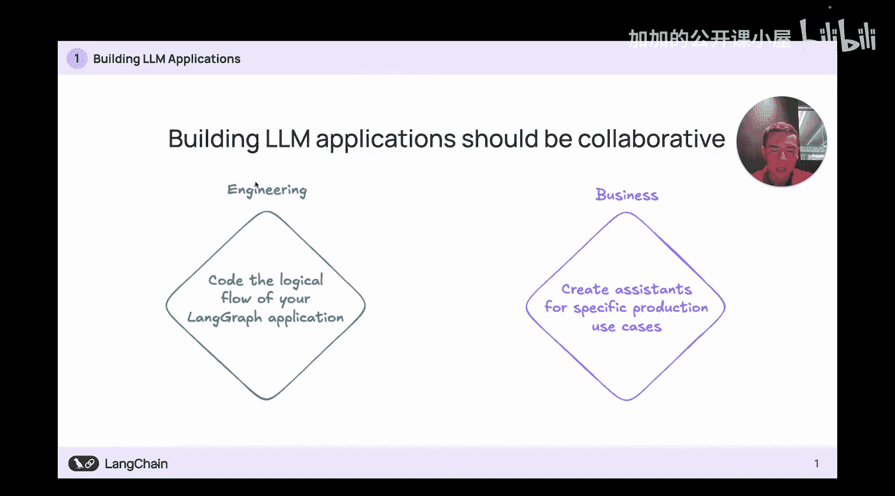

If I click on the edit assistant button， I'll be able to see the config and the history of this assistant。

 This assistant is called the anthropic coding assistant。 As you can see。

 its system prompt tells it that it's an expert at coding in Javascript。 And in addition。

 we've given it access to the Resa code interpreter tool。

 which is going to allow it to run code safely。😊。

If we click on version 1， we can see that this version is an assistanted that is an expert at writing code in Python。

 Let's say we're interested in learning some Python。 If we click the set as current version button。

We should see this pane close and the anthropic coding assistant V1 selected as the assistant that we're going to run in the studio。

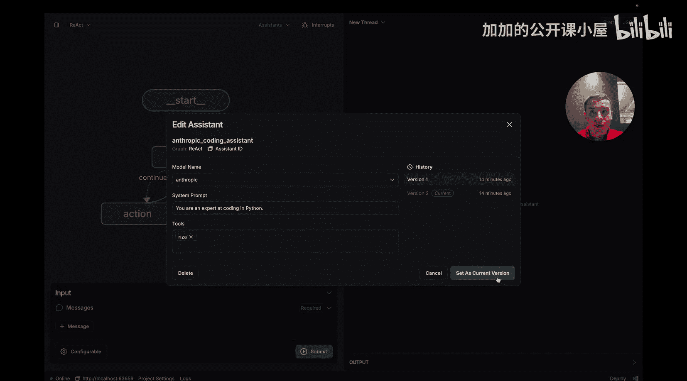

Perfect， if we look right back up here to where the assistance drop on was。

 we can see the anthropic coding assistant V1 is selected。

 and now we can ask it a simple coding question。All right， we've just asked our assistant。

 how do you loop through an array and increment every element by one， As we can see。

 it writes out the proper Python code and then explains to our user exactly what happens。Now。

 let's create a new thread and use V2 of the anthropic coding assistant to verify that it responds in JavaScript instead of Python。

Al right， we can see that we've selected version 2 of our anthropic coding assistant。

 and now we're going to submit the exact same question and see if it responds using JavaScript。

Excellent， the agent now uses the jascript executor instead of the Python executor and still responds to our user with the correct code。

 Now， let's take a look at our other assistant。

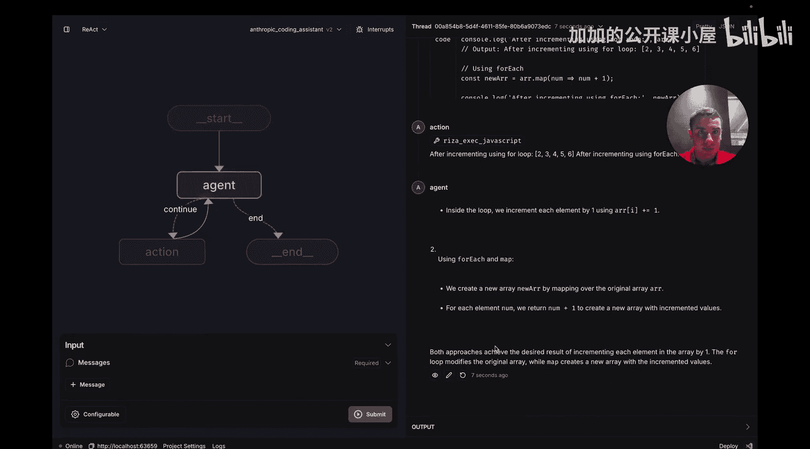

Now I'm taking a look at the Open AI uplifting assistant。

 which has been told in its system prompt to respond to the user in an uplifting tone。

If we click on version2， we can see that we've added some information to the system prompt by telling the agent to look up positive news on the internet and also giving it access to the Tvili search tool so that it's able to look up that positive news。

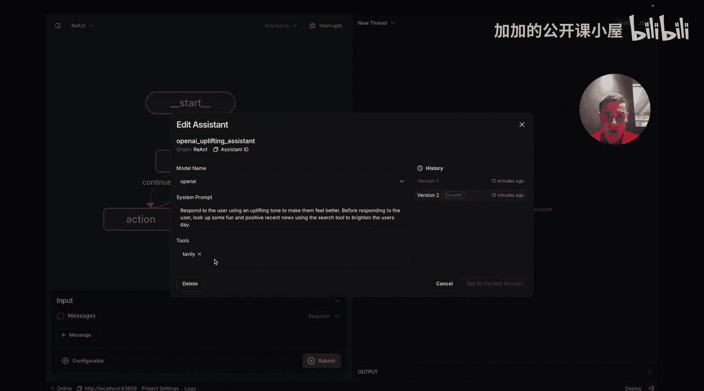

This version is already selected， so all we have to do is go to the drop down and click the check mark next to the Open AI uplifting assistant。

Now we can see that open uplifting As version 2 is selected in the top drop down。

And we can ask it a sample user question from a user who might be feeling a little down。All right。

We've just asked our agent a sample user question， and we can see that it properly uses the Tivli search tool to look up some recent positive news。

 Then it responds to the user in an uplifting tone。

And it makes sure to end on a high note to have our user feeling better。

Let's start a new thread and look at using V1， which doesn't have access to search tools。Alright。

 as we can see， we're using the uplifting assistant V1， and if we ask it the exact same question。

 it doesn't have any tools at its disposal， so all it's going to do is respond to the user in a positive tone。

Now that we've taken a look at how assistants work in the studio。

 let's go back and explain a little bit what versioning and assistance mean with relation to your landgraft applications。

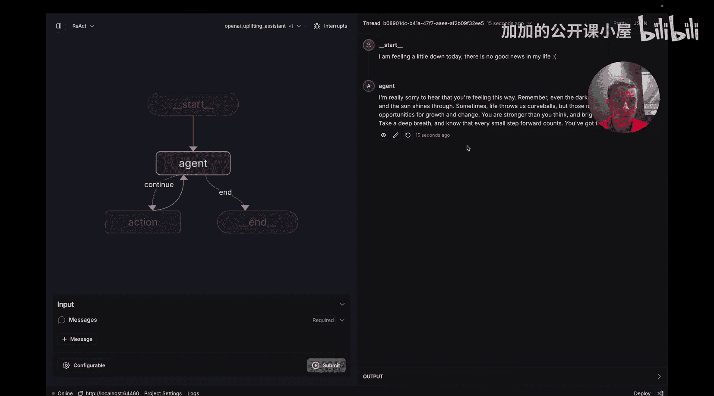

All right， as we just saw， the studio allows us to take a graph。

Create multiple assistance for that graph and then create multiple versions for each of those assistants。

Conceptually， we should think of our graph as the information architecture。

 how information is going to flow through our agent。

This graph is going to be defined using the La graph， Python or JavaScript libraries。

Which are low level to give developers the exact control they want over the information architecture。

However， once this graph has been coded。Business people and developers alike can create and iterate on assistance without having to write a single extra line of code。

 as we just saw。Assistance you can think of as core configuration changes to your graph。

 For instance， changing the L L M that powers your graph or as we just saw。

 giving your graph access to different tools。Versions can be thought of another level of fine tuning。

 and should。Really be used with specific goals in mind。

 such as creating an assistant that's perfect for one user。

A way you can do this is by modifying the system prompt over time。

 such that the agent's responses are in line with what the user expects and desires。

Now that we have a better understanding of how assistance and versions relate to your underlying graph。

 let's go back to the studio and walk through how we can create our own assistance and versions from scratch。

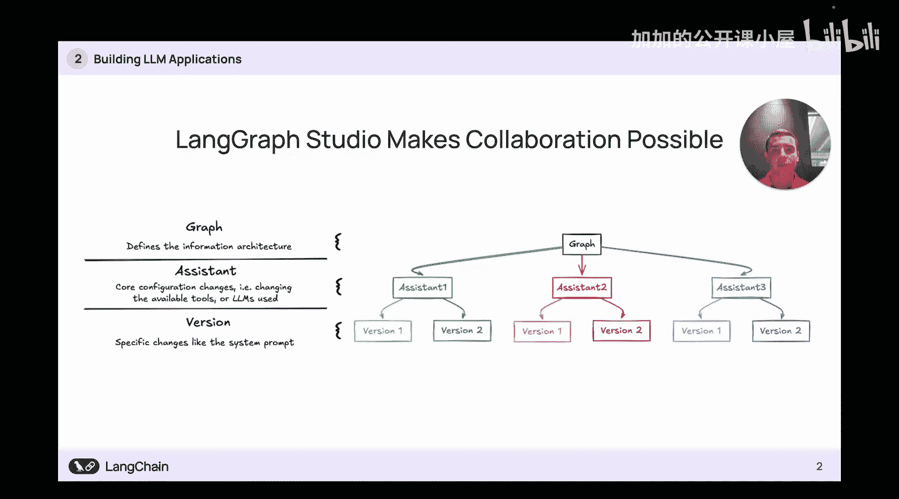

All right， Now we're back in the studio。 We can see we have the same react agent。 But this time。

 when I click on this assistance dropped out， I haven't created any yet。

 Let's click on the create new assistance button and create our first first assistant。

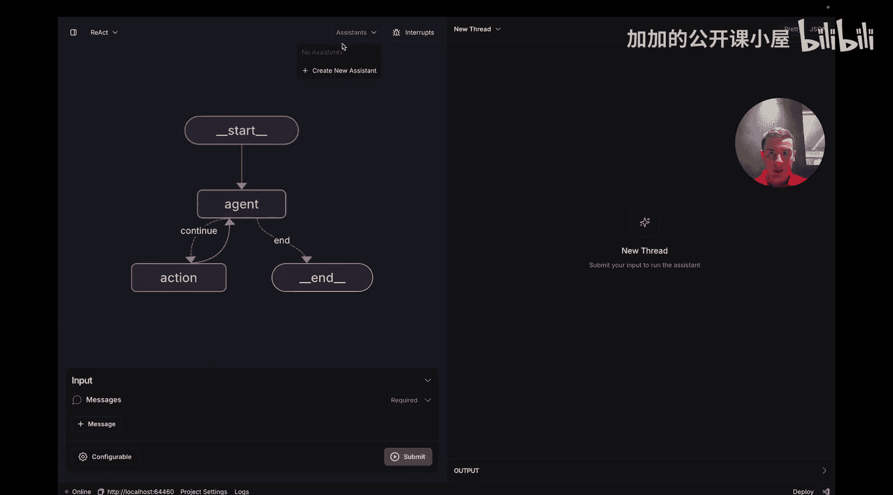

Let's call this one the Open AI assistant。We're going to obviously select the open AI model here。

 And then we're not going to give it any system prompter tools yet。

 We're just going to click save new assistant。

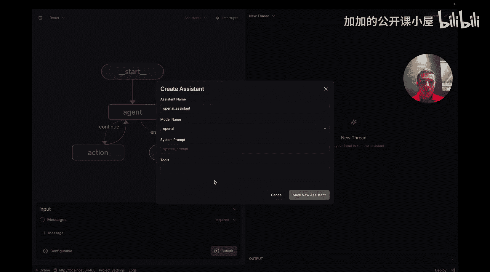

We can see that the assistance dropdown has updated to have the Open AI Asant V1 selected。

If we wanted to add another version， we could click the edit As button。

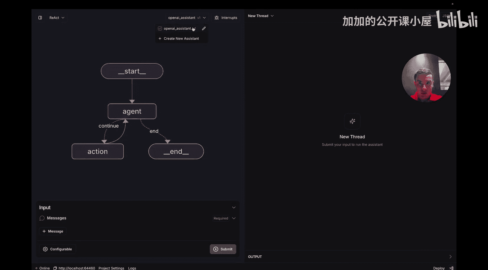

And then type in a system prompt that we want to add to our assistant。

 We're going to keep it pretty vanilla for now and just tell it that it's a helpful assistant。

We are then going to click on this save as new version button。

 and we're going to see that the top drop down changes from V1 to V2。

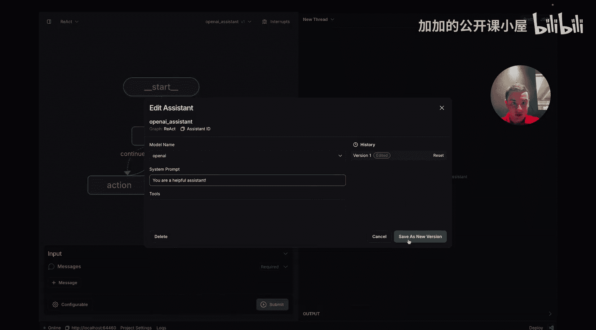

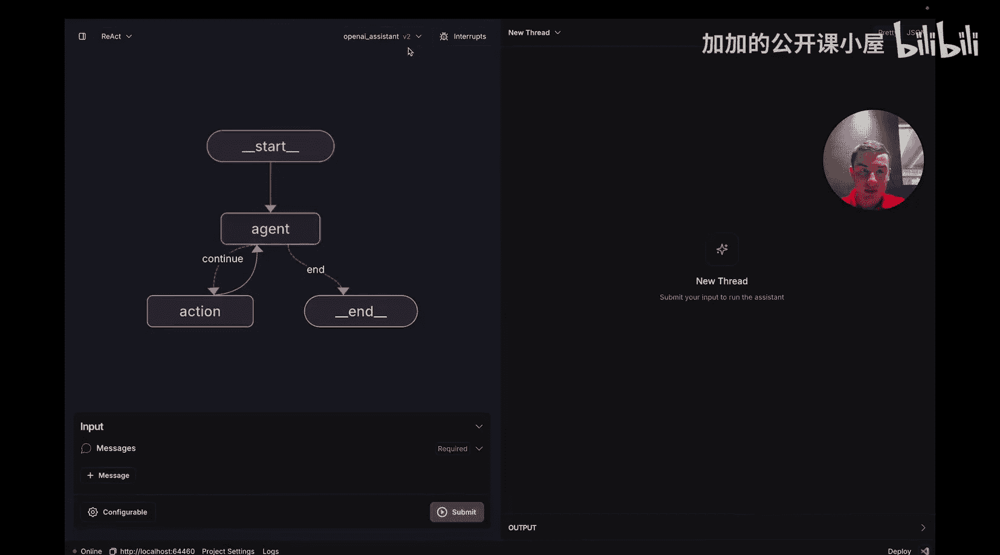

If we go back into that edit pane， we're going to be able to click on both of those assistants and see the config on the left hand side update as we've changed from version 1 to version 2。

As we saw before， if we wanted to go back to version 1。

 all we have to do is click on version 1 and then click set as current version。

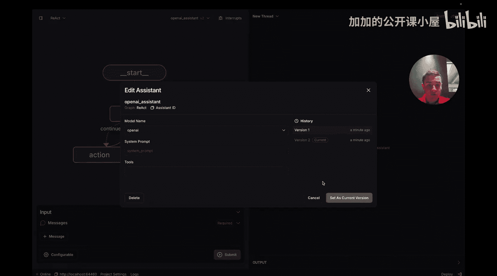

Now in the top drop down， we see V1。Now， let's create another assistant。

 which we can do by clicking the createre new As button。

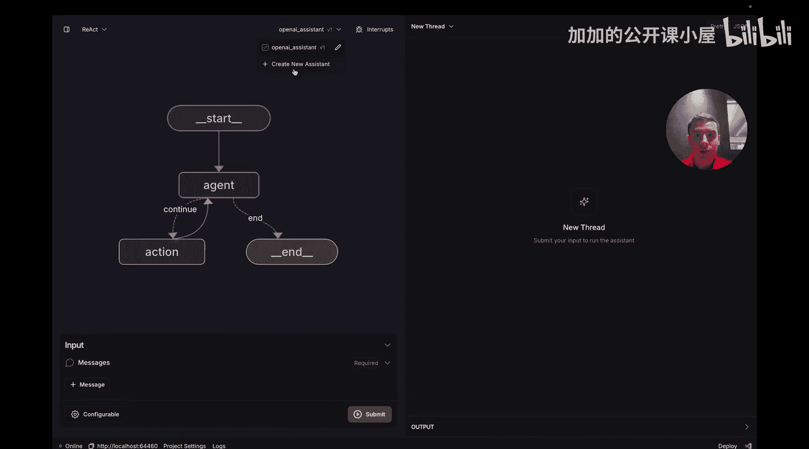

We can call this one our anthropic assistant。We're going to select the anthropic model。

And maybe for this one， we'll give it access to the Tvili search tool so it can use the internet。

As we just did， we'll click on the save new assistant。

 and then we'll see that the anthropic assistant V1 has been selected in the top。

 We can use this check mark to select which assistant we are currently using in the studio。

 This makes it really easy。

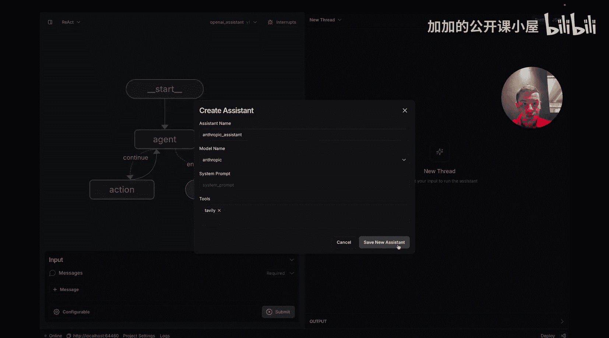

Now， if we've decided that we no longer want this anthropic assistant。

 we can click on the edit As button and select delete。 Remember。

 deleting is going to delete all of the versions of your assistant because each version is pointing to the same assistant I D。

 There are just slight tweaks to the configuration of that assistant。

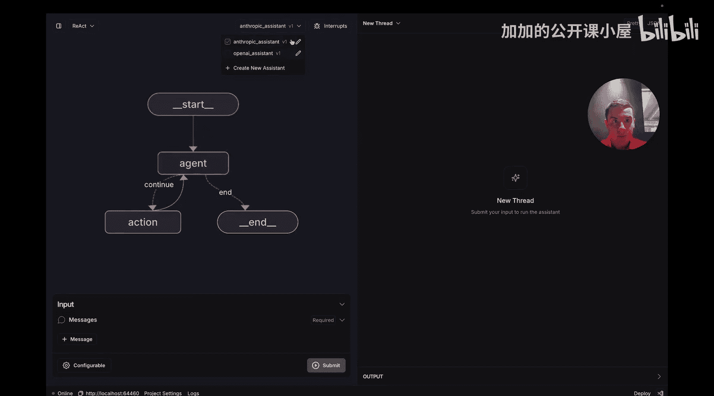

So now once we click Delete， we're going to see that our assistant return to the open AI assistant。

 and if we click on this drop down， the Anthropic assistant is nowhere to be found。

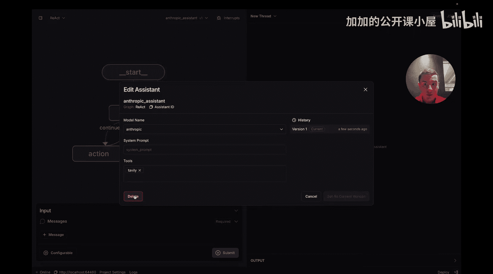

Let's run a simple query on our open AI assistant to ensure that the configuration we see in the front end is actually propagating to the back end。

All right， we've just asked our assistant who made you， as we can see。

 it responds properly that it was created by open AI。

 since we selected the open AI model for the back end。

I hope that this brief walkthrough of how you can create and version your own assistance has given you some ideas for how you。

 as a developer or a business person， can use Langgraft Studio to rapidly iterate and test on your core information architecture by making tweaks to the system prompt the tools available the LLM's powering the agent and any other possible configurations that you have for your applications。

This tool is intended to be used to fine tune agents to get to the exact state you want to put them into production。

 It allows you to create a variety of assistance that can be tailored to each specific user。

 and within each of your assistances， Vering gives you the power。

To really hone in on the exact behavior you want from that assistant。

Which is really easy to do through the studio without writing any code。However。

 if you wanted to do this through the SD K， you could as well。

 Let's hop over to a Jupiter notebook and see that in action。All right。

 now we're in our Jupyter notebook。 This walkthrough is going to be using the Python SDK。

 but all of these functions apply to the JavaScriptscript。

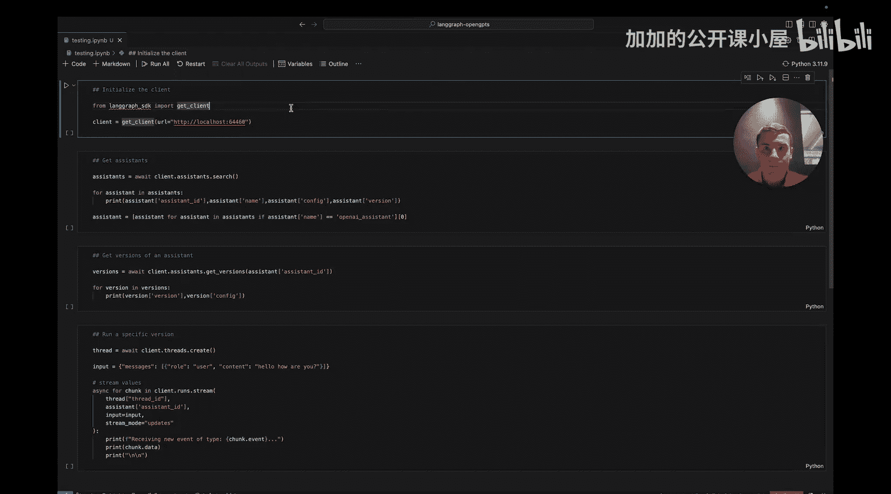