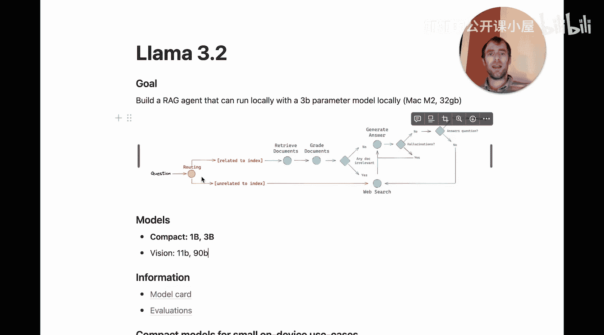
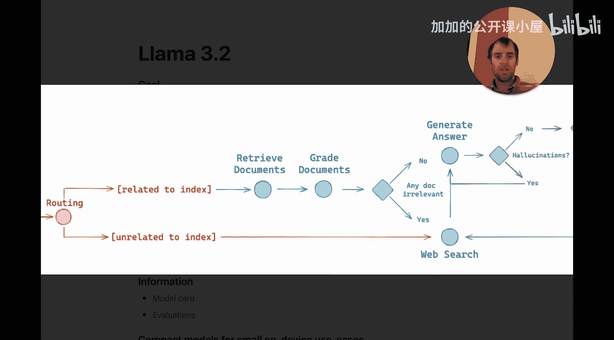
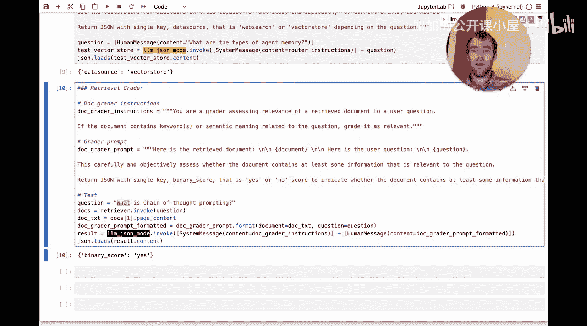

# LangChain【中英⚡LangChain 使用指南｜Build with LangChain】 p38 P40 Reliable, fully local RAG agents with LLaMA3.2-3b -BV1xwfMYDE3n_p38-

Hey， this is Lanance from Langchain。 Someta just released Lama 3。2 today， which is really exciting。

 I've been looking forward to this for a while。And what's really neat is you can use increasingly small models to do pretty interesting things locally on your devices。

So today， I'm going to show how we can go from scratch。

 build a fairly complex rag agent using a 3 billion parameter model that will run locally in my laptop。

 And this diagram shows the entire flow of the agent。 I'll just zoom in here。

 So we're going to be able to take questions， route them using the model to either an index or web search。

Grraade documents from retrieval based on relevance to our question。Produce an answer。

Graade the answer for hallucinations。Grade it for relevance to the question and finally return an answer to the user。

 We can do all that logic locally with Lama 3。23 billion parameter model。

 and I'll show you how to do that shortly。So first， there's kind of two variants of the models here。

 There's compact and there's vision models。 So there's a 1 billion and 3 billion parameter compact model。

 We're going to be working with a 3 billion。 There's also vision models which are interesting for other reasons in which I may talk about in a future video。

So again， these compact models are meant for smaller on device use cases and what's kind of cool is I show some statistics here comparing the prior 8 billion to the current 3。

23 billion， and it's pretty close，3 versus 8， you can see the 3 billion parameter models as strong on one of the Evals and so it's pretty promising is telling us that smaller models are getting indeed better。

 and that opens up access to more folks， which is very exciting。

So I want to talk a little bit about this ra agent we're going to build。

 and then let's just get into the code。So whenre going to incorporate ideas from three papers。

 one is routing， so that's the ability to take a question and route it to either a vector store or web search based on the content of the question。

The other is fallback， this idea that you can basically retrieve documents and grade them if any documents are not relevant。

 you can filter them out。 A big problem with retrieval is erroneous retrievals。

 And so we have a fallback for that。And self correction， we can fix and catch hallucinations。

And we can basically reject answers that don't address our question。

 We can build all that from scratch， and I'll show you right now。

So I'm going to be moving between a notebook， I've already set this up and this code will be available to you。

 I' just done a few P and stalls。And here's where some interesting chip decisions can be made。

I may use local embeddings from Noic， these GP4 all embeddings。

 the appIP installs are presented up here。 you can try other local embeddings I tend to like these。

 but obviously that's up to you。And I'm going to access Alllma 32 Instruct FP16 from Oama。

 you can try other providers to access local models I happen to like Ollama。

 So if you go to Oma's website here they provide a bunch of different models that you can just download and all I need to do is just Oama pull and then whatever model you want So that's all I need to do very simple。

 just make sure you have Alllama installed and you can access any of these models for free pretty cool。

So I've done that and now there's two other pieces of tooling， and then we can get right into it。

 I use Tvili for Web search。 I'm going set up this kind of web search component of my agent and Tvila is a really nice search engine optimized for a rag and other agent use cases。

 It has generous free tiers。 you can sign up and use it simply they'll give you an API key just make sure it's set。

 I'll also use Lsmith for tracing， which is just a way I'm gonna visualize what I'm doing This is totally optional。

 So those only things I've set here。 And then we have a blank notebook。 we can just get going。First。

 I'm just going to find my LLM， so again， I set the name of the model that I pulled using this command Alama pole。

 this is now available to me， and I'm using La chain integration with Alllama。

 so I just simply specify this model name。And I load it。Now you say I do two interesting things here。

 first I load just the raw model。Now I also load this JSON mode and you'll see why we're going to use that a little bit later。

Next， I'm going to build a vector store。So this is where it's kind of up to you。

 this could be your personal documents， this could be really anything you want to work with for any question and answer application locally。

In my case， I'm just to take three URLs from some blog posts that I like。

And you're going to see here， this is just some very simple utilities to load the documents using a web loader。

 split them as I do here， you can select your chunk size arbitrarily。

 So what's happening here is we're loading the raw documents we're splitting them into chunks of size 100 tokens。

And I'm going to add them to a vector store that is free to use vector store from SK Learnarn。

I loaded my document splits， I loaded my embedding。

 Now here's where I'm going to be using thosenmic local embeddings that again， are free to use。

And I'm going to create a retriever from that。 Let's get that started。

Cal retrievever is a line chain abstraction that gives you a few common methods。

 so you can use invoke to very simply。Agent memory， get documents related to。Any input。 Here we go。

 So we've just retrieved some documents relevant to this question or statement， agent memory。

 Of course， what's happening is is taking this statement。

 andbedding it using our model and then doing a similarity search with the embedded documents to find similar matches based upon semantics of my question relative to the documents。

 That's it。 So we get documents back。 So now we have a retriever。

The retriever you can see falls into our flow here。

 this is kind of one of the core components of a rag system。

 You need some document retrieval mechanism and we've built that。

 So now let's build some this lodging around it。 first let's start with routing and I'll show you how we can do that。

So now I'm going to build a router， and I'll show you a really simple trick for doing this with local LMs like this。

Very simply， I'm just going to set up a prompt that says you're an expert routing。

The vector store contains documents related to agents， prompt engineering and adversarial tax。

Use the vector store for questions on these topics， for everything else。

 just especially current events， just use Web search。Now。

 here's why I just instruct return JO object with a single key data source that is either web search or vector stored depending on the question。

 Now， when I use this L M Json mode， if you go up here。Right here， because I've set format Json。

 it's going to enforce the output of the LM to be Json。

 So what's nice is I've built myself a simple little router just using kind of LM and Json mode。

 So all I need to do is I'm going to pass in a question。😊，Now， one other thing I want to mention。

 this is a chat model so we can pass a set of chat messages。

 You can import from Lang chainang core messages， human message， system message。

 This is my system message with the router instructions。

 And then my human message is just whatever question I have。 What are the types of agent memory。

And those can be passed in as a list。啊这。And I can go ahead and run that。I can go ahead and run that。

And we can see it looks at this question reasons that， oh， the data source for this is vector store。

 And I get a little Json back。 that says data source vector store。

 So you build a simple router using Json mode and a local LM。 And I use this all the time。

 It's extremely convenient way to just do really simple kind of binary route and using an LM to reason about some input and return a structured object like a Json with。

For example， the two outputs that I want either vector store or web search。

So now we built this red router piece， and next I'm going to build this blue greater piece。

 so if I go down。Here， it's also really simple。 Let's just give some instructions for grading。

 The main idea here is I want to look at the retrieve documents and determine that they're relevant to the question I asked。

 because sometimes with semantic similarity search。

 you can get kind of erroneous retrievals of documents that are not particularly relevant to the question。

 but happen to be returned based upon the idiosyncrasies of your chunking or your embedding model。

 So this can happen sometimes it's nice to have this additional layer of kind of protection or reasoning on your retrievals。

 So your greater assessing the relevance or retrieve documents。

 if the document contains keyword or semantic meaning related to the question， graded as relevant，😊。

So here I'm just going to pass in the document， the question。

 think carefully about this and return a Json with a binary score。 Yes or no。 That's it。

 So here we go， I'm just going to ask a question。 What is chain of thought prompting。

 I'm going to retrieve documents from my vector store。 I'll pick one of them。 Okay。

 You can see that's what I'm doing right here。 and I'll go ahead and pass that into my prompt right here。

 I just format the string with those two inputs。 And I do just way before。

 I'm going to go ahead and pass in those greater instructions here。

 I'm going to pass in my format of prompt。😊，Here， which has my question in my document。There we go。

 should we get binary score yes， which makes sense， basically what is Ch about prompting。

 we can look at the document to confirm that。

And。There it is， so the document contains chain of thought prompting here。

 so it mention it in a few places。