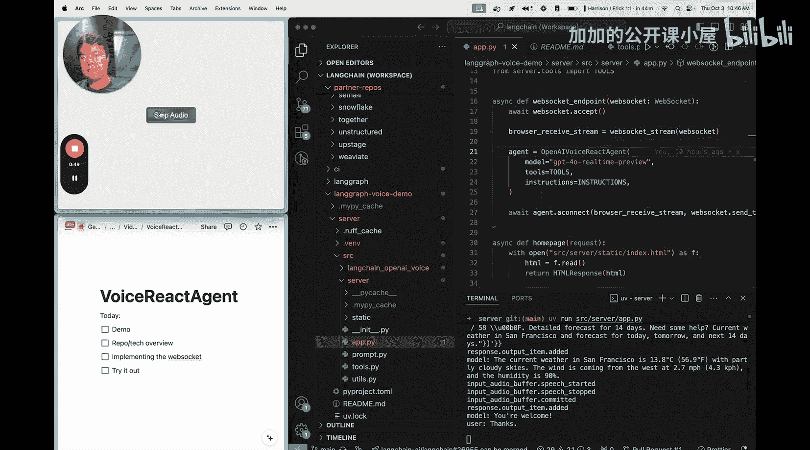
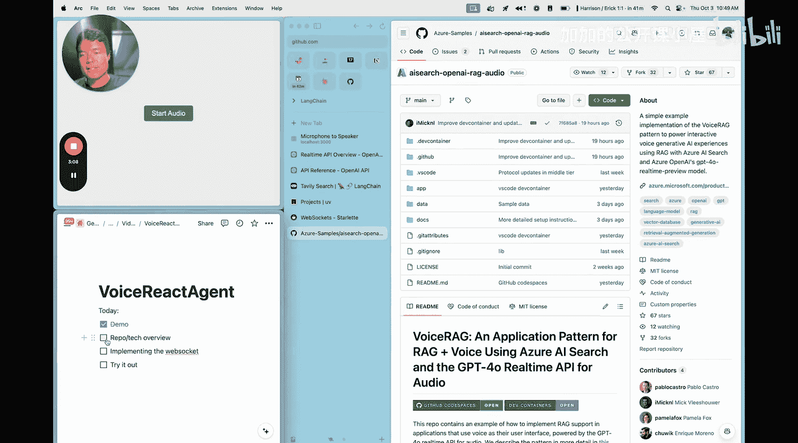
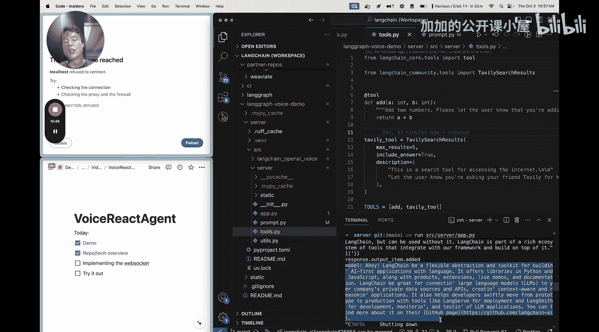

# LangChain【中英⚡LangChain 使用指南｜Build with LangChain】 p39 P41 Talking to a LangChain ReAct Voice Agent -BV1xwfMYDE3n_p39-

Hey there。 I'm Eric from Laning。 And today， we're going to be going through a beta implementation of a voice react agent built on top of Open AI's real time API。

Without further ado， let's dive into a demo。Hey there。 What's the weather in San Francisco right now。

 Please be concise。The current weather in San Francisco is 13。8 degrees， 56。9 degrees。

With partly cloudy skies， the wind is coming from the west at 2。7 milesph，4。3 km。Thanks。

You're welcome。

First and foremost， the voice agent is built on top of Open AI's real time API built that they released on Devday this past Tuesday。

Second， will be using Tli search as our。Tool， you can use any of the L chain tools with this react agent as well as ones that you implement yourself。

And we're just going to use that for internet retrieval。

We're going to be using Uv as our project manager。 You're also welcome to use poetry or something else like that。

 But if you see any U run commands， that's what。I'm using just to kind of manage dependencies。

We'll be using Starlet web sockets as our AG web server Starlet is the underlying library behind Fast API that handles a lot of the routing and because we're just using web sockets today。

 which is something that Fast API doesn't have as good support for。

 we're just going be building it on top of the raw Starlet library here since we'd be using that anyways with fast API。

And last but definitely not least wanted to give a huge shout out to the Azure samples team for putting together a ragg audio agent example。

 We are going be using a lot of their front end code for this little browser demo in the top。

 particularly around routing microphone and speaker output， handling audio in the browser is。

Quite quite a good time， and we are using some of their example implementation here。If you want to。

Use a front end for inspiration。 would highly recommend basing on theirs rather than one in our repo。

 which is also based on theirs。

Now， let's go through some of the code powering this experience。

Would recommend cloning the repo that is linked in the YouTube description。

 and you can follow the installation instructions in the Readme。

 which go through how to install U and make sure the project runs how you see it here。

 One other debugging tip if you run into problems， getting the front end connected to your microphone and speaker is to check your browsers。

 privacy settings to make sure that。Local cost 3000 or whichever。

En point you end up posting this on is given access to your microphone by default browsers tend to block a lot of those。

Most of the app exists in this server folder app dot P file。

 And this is where we can see our entire web socket endpoint。

 So this is what the browser is going to connect to whenever we click start audio over here and all it's going to do is it's going to first format the web socket input as a reminder。

 web sockets。Transfer events in two directions where there's some events going from the browser to our server。

 primarily encoding microphone output。 And there's also some events going from our server back to the browser。

 our speaker output。 And this is just going to format our。

Microphone input as an asnc iterator of encoded events that we can use in our endpoint。

 So this is just going to iterate through and yield all of those events from our web socket。

This is the current interface for our beta open AI voice react agent at L chain。

 where you just initialize it with the model that you want accessed。

 as well as what tools you want to give it access to and what instructions to initialize it with。

 You can think of instructions similar to how you would have used a system prompt with a chat completion end point and。

That's what we're going be using it as today。These can actually be updated over time with the real time API and using this wrapper。

 we're just going to initialize it at the beginning to keep it simple。

 which is good for getting started quickly。And last but not least。

 we're going to connect our agent to the microphone input。

 which is the stream coming from the browser。 And we're also going to give it access to a function that sends chunks back to the browser because we're using starlet。

Web sockets， we can just have Web socket dot send text be that function。

 If you're using some other protocol or if you're connecting it directly to one of the Python audio libraries。

 instead of connecting this through the browser， you would。Format that function differently。

The rest of our app。pifi is defining some of the other endpoints。 We are defining just a home route。

 which is going to serve just this little web UI， and we're also going to host some of the static files。

 These are just JavaScript files used by that front end in particular some of those worklets that we are using from the Azure demo that I mentioned before。

So。In summary， the main thing we need to worry about and what you'll customize if you want to make this your own is this open AI react agent tools and instructions which are defined in our prompt and our tools files。

 So first， going to our。Prompt， we're just using a very simple one。

We'll use something like you're a helpful assistant。 speak English。

 We can even give it an additional instruction of speak like a。Pirate。

To make it a little more entertaining。And now we can check out the two tools that we're giving to it。

In this file， we're using one function defined with a tool decorator。

 This is just going to be able to add two numbers together。 We can show that off in a second。

 One thing to note when defining your own tools is the tool descriptions are quite useful for giving the voice model。

Instructions of how to handle tool calls。 So in this particular case。

 we can say please let the user know that you're adding the numbers before you call the tool。

 This tool runs very quickly， so it doesn't always recognize this because the output will already be there。

But it's useful for。Defining those on other ones， one that it's a little more useful for is our tvili search tool。

 So we're going to initialize that to give back five results at a time and include kind of the answer to the query。

This is just the number of web pages that it returns when executing the search。

 I would recommend keeping this number a little bit lower。

 One thing I've noticed with the current iteration of the real time preview model is that the more context you plum into it。

 the more it rambles and once to describe it at the beginning you might have noticed。

 I asked the model to stay concise。You can also put that in the instructions。

And we'll give it a custom description because we want to let the user know that you're asking your friend toly for help before you call the tool。

 This is just because there's a one to two second delay before we get those results and it prevents the model from just kind of hanging。

Without telling the user what it's doing。And then we just export those as our tools here。

So with that， we'll now have give our pirate that has access to a addition tool and a search tool。

I got。Hey there。 What's 587 plus 2。Ahoy。 Let me add 5，87 and 2 for ye。 Shiver me timbers。

587 plus 2 be 58。And could you search the web for what line chain is？Ay。

 I'll ask me mate Tviley to help us find out what L chain is， stand by。

Ahoi Langchain be a flexible abstraction in toolkit for building AI first applications with language。

 It offers libraries in Python and JavaScript， along with products， extensions。

 live demos and documentation Langchain be great for connecting large language models to your company's private data sources and APIs。

 creating context aware and reasoning applications。And we'll cut off the model there。

 One thing to note is the console will be a little bit loud showing you kind of which tool calls are being executed。

 So here we can see。That hour。Tool call was to call the Tvili tool。With arguments of query。

 just line chain， which。Worked reasonably well， and we got some results。

Kind of describing what the Lang chain project is。And then it'll use that to generate its output。

 you'll also see text versions of the output as well as the transcription for the input Sometimes you'll notice those don't quite line up。

