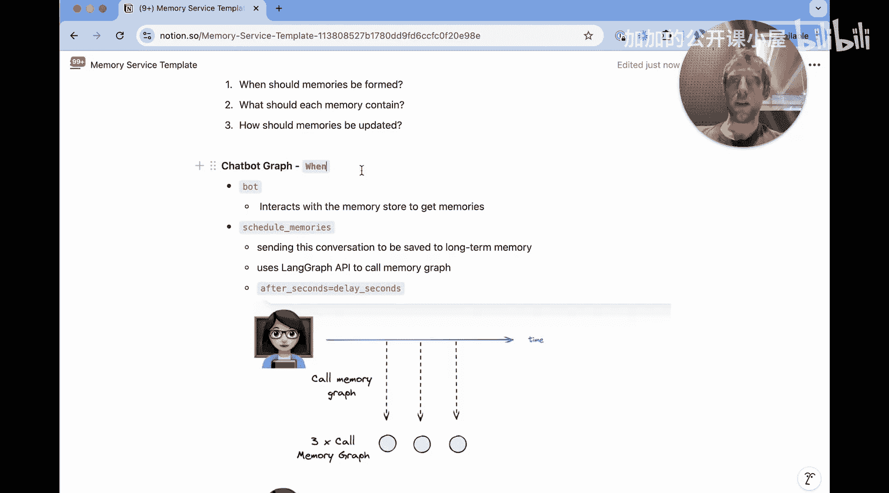
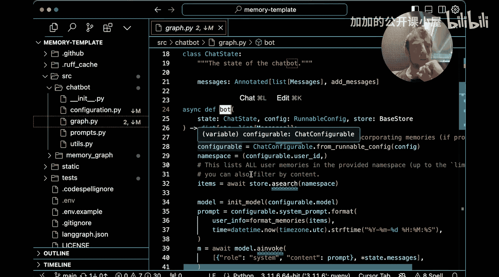
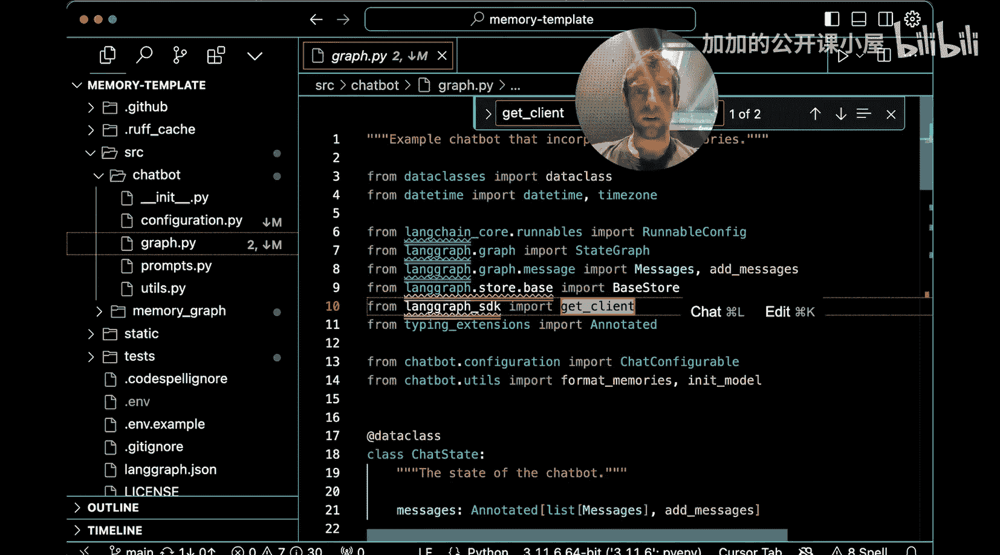
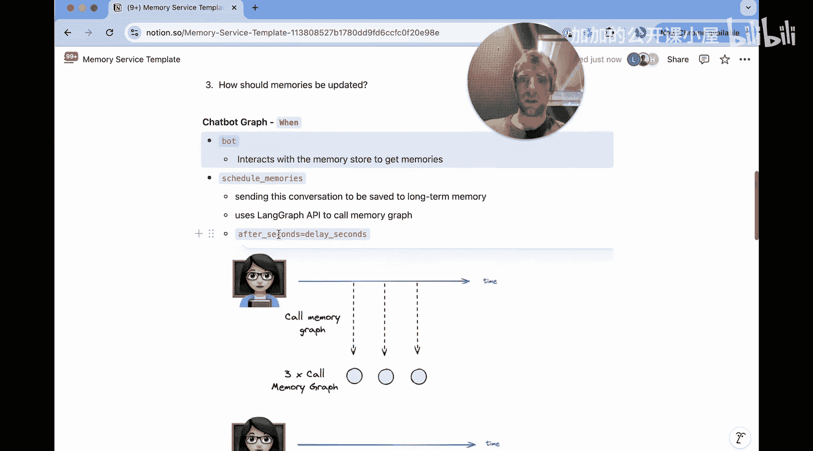
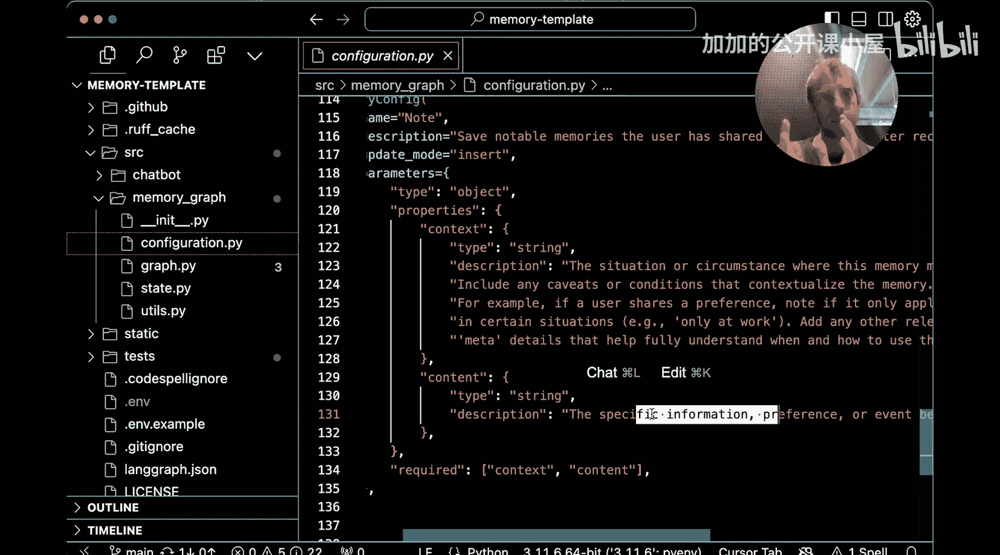
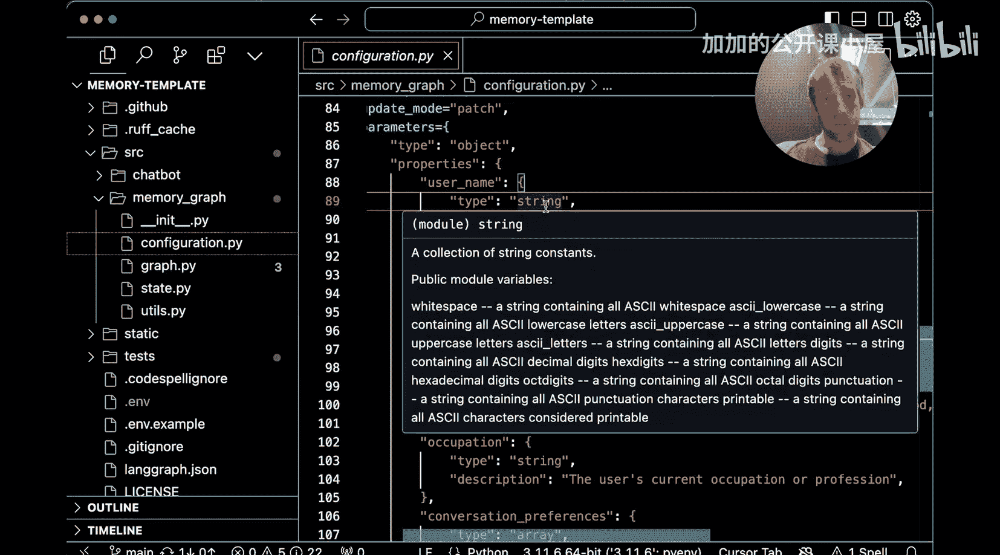
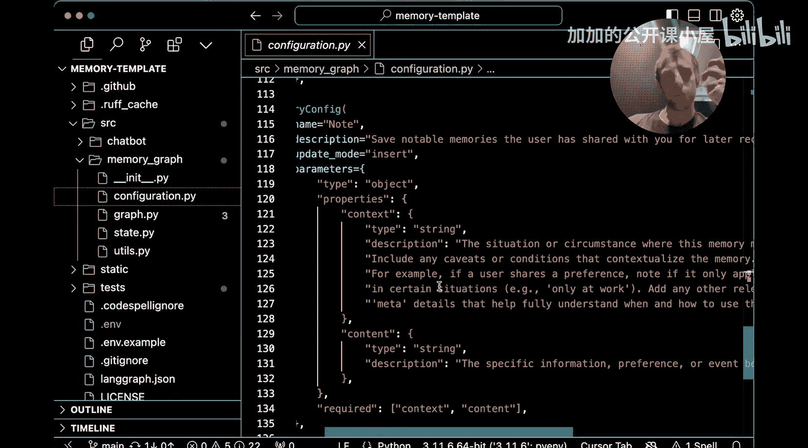
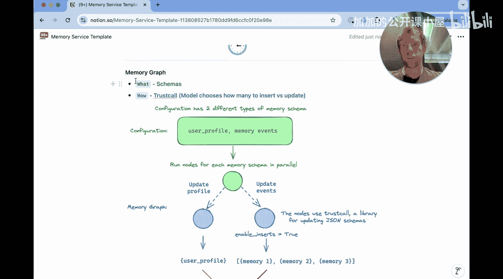

# LangChain【中英⚡LangChain 使用指南｜Build with LangChain】 p41 P43 Memory in the background -BV1xwfMYDE3n_p41-

Hey this is Lan Langcha， memory is one of the most interesting features in AI applications。

 gives applications the ability to remember things like details about a user or arbitrary information that the developer wants to remember for future sessions。

So we just released long term memory Lagra， and this template is a great way to get started。

I'm going to walk through this template and show you how to build a memory service from scratch。

So first， let's just see this memory reurface in action in a hands on way。

So I've cloned the repo and I've opened it up in Lagraph Studio， so here I'm in the studio。

 I'm in the chatbot graph here， let's interact with this chat bot。

So go ahead and chat with this bot and I have some personal information in there。

We can see the bot responds。Now we see this Sch Me node kick off。 I can keep interacting with it。

And as we can see， I'm interacting with a bot， ape response to me。

 And kind of in the background here， keeps calling this schedule memories node。

 And you'll see at the end here， we also see handle patch memory and handle insertion memory called。

 We'll talk about all that later。 But just to give you a hint。

 This is the memory service kind of working in the background behind the chat， saving memories。😊。

Now I'm going to up a new thread。So now that whole chat history is gone。

 let's ask a question that's a bit personal to me that it would ideally require memories to answer in a kind of personalized way。

So I ask for recommendations for bakeries after I go riding and it won't be able to answer this in any kind of personalized way unless as access to the memories from the prior thread。

So we get a pretty cool answer here that actually conditions the response based on my memories that knows I'm in San Francisco。

 I like to ride in the presidio。 I like to ride in the mornings。

 and it gives me some good bakeries that have actually very， very good croissants。

 so I can kind of vouch through these recommendations。

 So this is just showing the memory service and action。

 And now we're going to walk through some of the conceptual foundations and the code。😊。

Harrison has a conceptual video on memory that will be released several days ago。

 You should check that out for a full conceptual review。 But in short。

 there's at least two different ways to think about memory updates。

 So one is in the hot path of an application。 And we actually have a separate video on that and a separate template on that。

 In short， that means you're updating memory in the interaction of the app。

 The user sees that update， kind of in line with the application running。 Okay。

 so the nice thing about that is it's very visible to the user that hey memories are being kind of created or written based on what you've told it。

 But the problem with it is it does add latency and overhead to the user experience。

 So the alternative， which we actually show here the memory services。

 memory is actually being done in the background。 So you see I had that chat interaction with the bot。

😊，But in the background， it was making a decision to update memories independent from the user interaction。

Now， the pros of this are there's less overhead for the application itself。

 The application logic doesn't have to have some kind of memory tool。

 doesn't have to know anything about kind of memory creation or management。 and， of course。

 latency in UX， the user has kind of no awareness that this memory process is actually happening。

 The doesn't have to experience the latency delay from memory being written。Now。

 the cons are that you need to implement a separate memory service， which we'll talk about here。

 and this will simplify it。 and also memories may not be available in real time。

 So there may be some delay between kind of when the user interacts with your application and when memories are actually written to a service。

 there could be some latency there which could be developer defined。

 There's at least three questions think about when we consider a memory service。

 One is when memory should be formed。Two is what Member should contain。

3 is how members should be updated。 We'll talk about each one of these and we'll walk through the code to help kind of reinforce that。

So first is the question of when memories should actually be formed。

Let's go ahead and look at the chatbot code to see how that's working。

Swim in the template repo now， open up the source， open up chatbot。

 and we're going to go to Gra dot Pi。Now， if you remember from our application in studio。

 there were two nodes， one was boughtt， one was schedule Me。

 I'll show the bot node first and then I'll talk about schedule memories。

Now first， you'll see that in this bo node， we're passing this store。 Now。

 this is something that's new part of the Langgraft API。

 so it's available for free if you're using studio or using Langgraft Cloud。

And this is a very simple to use data store that every node in your graph has access to。

 You simplyimply pass it in， and we can access things in the store very simply by this search method。

 which you pass a namespace to。 This namespace is just a tuple。 And in this particular case。

 it's just the user I。 So all it's happening in here。

 we're actually pulling everything namespace to the user I from this store。

 which is eventually going to be see as you'll see all of our memories。

 We add that to our prompt and allow the model to respond。 That's why in our chat interaction。

 the model has access to any memories I created。 So that just shows you the chatbo node and its ability to access any saved items i。

e memories。😊，Now， schedule Me node is where the magic of when memories are written is done。

 So you're going to see something kind of interesting here。 This is calling get client。 Now。

 this you'll see here is using Langgraft SDK。 This allows us to connect to another graph。

 which notably is going to be our memory graph， which is in the same project。

 We'll talk about that code later。 But what's nice is we can basically connect to and call the memory graph directly from our chatbot。

 and you'll see this allows us to do a few things we can pass in a thread I。

 We can pass in most interestingly this after seconds with a configurable delay seconds。

 Now I want to talk about this in some detail。 But this is basically what's allowing us to schedule this call to the memory graph。

😊。

Now， here's the motivation for that particular parameter。

 it's probably the most important concept to understand。

So imagine we're having a chat interaction with our bot。And after everything the user says。

 we go ahead and go to that schedule Me node， and we make a call to that Me graph or a memory service。

This is a kind of toy diagram showcasing that to see in some period of time。

 imagine we're having a chat， and we keep making calls to the member graph as a chat kind of is incrementally updated。

Now this would have a few problems that'd be inefficient we'd be kind of writing effectively the same memory。

There may not be significantly different information conveyed between kind of very minor turns of our chat interaction。

So this is a problem that we try to solve with this delay after seconds parameter。

So here's kind of the motivation for it。When we make that first call。

 we wait some number of seconds that configurable parameter before it's actually executed to see if any new calls come in。

 okay。Now part of this is because we don't actually know when a chat ends right。

 So it's kind of like we see something from the user。

 we go ahead and make a call to create memory and we wait to see if anything else comes in。Now。

 if new information that's worthy of creating a memory comes in。

 then we cancel that initial request and we create this new request。We wait。And so forth。

 And so in turn， this kind of toy example would result in only a single call to the memory graph。

 you can think of this as the kind of principled signal processing of debouncing。

 So it is reducing redundant calls to， in our case。

 the memory service and basically condensing this entire chat interaction into a single call which allows for a more efficient processing and updating of memories。

 That's like the motivation for how we're doing scheduling。

 and that simple parameter after seconds in a La graph API allows us to do that。😊，Cool。

 so we talked about when memory should be formed and that's done in the chat boxt graph in that Sch Me node using La RF APIs。

After seconds parameter， now let's talk about what each member should contain。

So I'm back in the code， and I open up configuration do pi now in that memory graph folder。

 So remember， we were just in the chat box graph。 Were looking at graph do pi。

 Now I'm over in the memory graph。 I open up configuration do pi。

 I can go down here in your seeling pretty cool。😊，So if you scroll down。😊。

You're going to see default memory config。These are simply schemas that specify the structure of memories we want to save。

 Now， this is actually a very subtle and interesting point。

You can be very flexible with how you save memories。In this particular case。

 we save two types of memories。 One type of memory is kind of a user profile contains username， age。

 interests， home， occupation。 Now this is entirely arbitrary。

 You can modify the schema in any way you want。 This is just a default schema that we provide。

 So one of these is kind of a user profile okay。😊，The other type of memory is a more general。

 a simple kind type of memory that only contains context and content。 So this is， you know。

 we describe it in detail here， the situation or circumstances。 and this is some， you know。

 content or specific information that we want to save。 So this is a very flexible form of memory。

 which can capture anything。 whereas the prior form of memory is a user based schema。 So again。

 this is extremely flexible。 This can be configured in any way you want。

 And it's just a very interesting thing to think about when you're actually kind of creating a memory service。

 What's the structure of memory you want to save。 in this particular case。

 we have two different structures， this user based structure。😊。

And this general kind of memory event， which can take any kind of memory and capture it。

So we've seen the scheduling of memories in the chat bot。

 we've seen the configuration that sets the structure of each memory。Now。

 how should memories actually be updated， let's talk about that a little bit。

And I'll scroll down here and show you kind of a cartoon for everything where we've laid out here。

