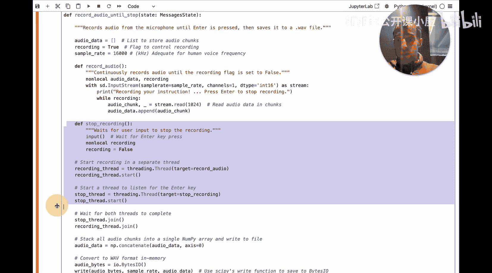
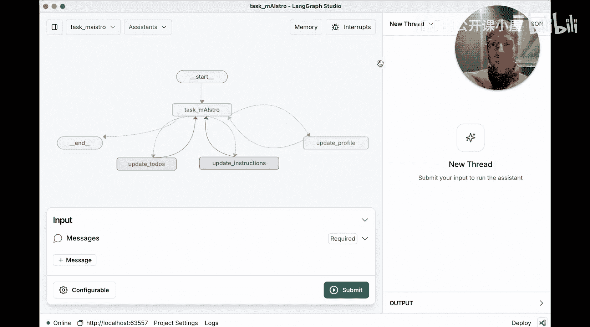
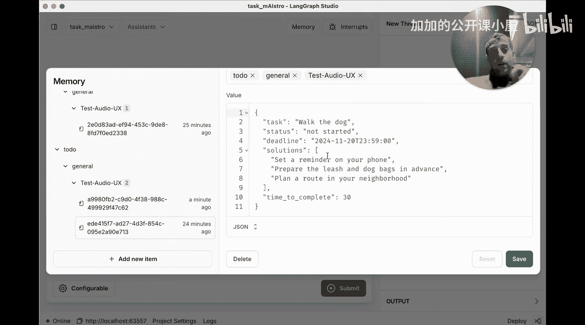
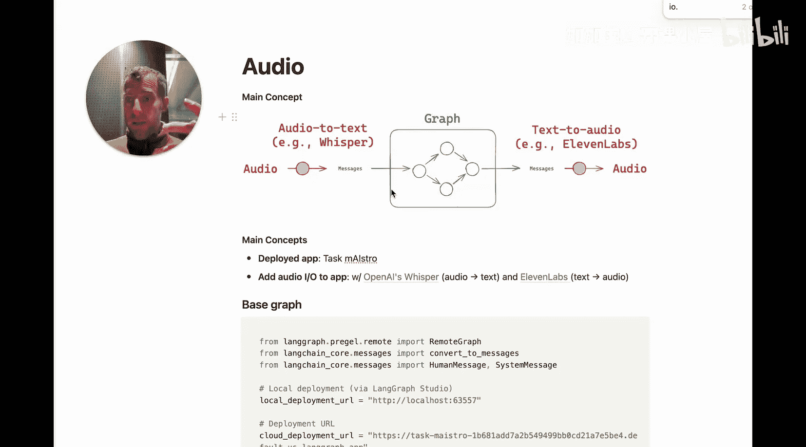

# LangChain【中英⚡LangChain 使用指南｜Build with LangChain】 p43 P45 Unlocking Voice Interaction with LangGraph Agents -BV1xwfMYDE3n_p43-

Hey， this is Laancesom Laangcha。 Audio is a really nice interaction pattern for certain agents。

And I want to show you an example of that right now。

 This is an agent I've been using to track my personal to dos。 It's called Task Mestro。

 And I wanted to add an audio input and an output to it。 Let's see it in action。First。

 I'm going to kick off the agent and give it some general instructions about myself。Hi。

 my name is Lance。 I live in San Francisco with my wife and one year old。Hello Lance。

 it's great to meet you If there's anything specific you need help with， feel free to let me know。

So this particular agent is designed to learn about me， my preferences， and track my deds over time。

 Let's give us some preferences。When you respond to me。

 I want you to be very enthusiastic in your responses and very supportive and happy。Got it Lance。

 I'm super excited to help you out with anything you need。

 Just let me know what you need assistance with and I'll be here cheering you on every step of the way。

Great， now let's give us some to dos。Add it to do to walk the dog to mor night and make sure I get it done by end of day tomorrow。

Awesome Lance， I've added walk the dog to your to do list for tomorrow night and it's set to be completed by the end of the day You're going to rock this。

Remember to set a reminder on your phone， prepare the leash and dog bags in advance。

So now that you've seen this in action， I want to walk through specifically how I built all this and how you can do the same very easily with any existing graph that takes in text。

So here's really the key idea。I have an existing graph。 That's my task。 My store graph。

 It had previously been working only with messages in and messages out。 So basically interacted with。

So basically， I interacted with it via chat。Now， I very simply added。Two new nodes to my graph。

 one on the input to convert my voice to text for that， I use open eyeWhis。

 and on the output text to audio， I use 11 Las。I I'm going to show you how easy this is to do。Now。

 there's really two main concepts here。 The first is this core task my stroke app。 Where is it。

 How do I deploy that， How am I interacting with it， That's  point1， I'll cover。 Then  point2 is。

 how can I take that deployed app and add audio to it really easily。 First。

 let's very briefly look at this app itself。So I'm in the repo right now。

You can scroll down and see what task Me is all about， so it's an app for managing tasks using chat。

Or as we just showed audio。It allows for natural conversation to update RA tasks。

And adaptively learns about you。Now to quick start。I mention here， just create new V file。

The easiest way to deploy this is just download the Landgra Studio desktop app。Here。

And you can create a deployment through that app just by loading this。Repo directly。

So here I'm in Lngraff studio， I've loaded。The repo directory。

And you'll see that the Tasme charap now， here， is visible。You can see these are the various nodes。

Now all we're going to need to add audio input and output is we just need a copy over this URL。

 This is a URL that allows us to connect with our local deployment。So now we've seen this 01。

We've shown how to use Landngraraft Studio to create a local deployment for our app。

 So that's this blue thing here。 That's the testmaster app。

 We have a local deployment running and it's accessible to us via the URL that we got from Laanggraraft Studio。

 which I'm addingtting right here。Now let's see how to actually connect with this and build the audio input and audio output。

So here I am in a fresh notebook。 All I've done is I've basically ensured that open AI API key is set for whisper。

 and I've also made sure that my 11 Las API key is set。 That's all I need。Initialize open AI client。

 initialize 11 Las client， that's it。Now， here's the thing that's nice and super simple。

 Remember that URL we just grabbed from studio。Just add it here。Add our graph name。Tas maestro。

And you can use this remote graph。 Now， this is an abstraction within La graph that allows you to connect to deploy graphs。

 In our case， our graph is deployed locally via Lagraft Studio， which makes it nice and easy to grab。

Now there's other deployment options for Laanggraft， including Laanggraft Cloud。

If you had a cloud deployment， you can add it just as easily by supplying that cloud URL。

 but I'm using local for now because local is free and very simple to get started。

So what I want to do next， I want to take this remote graph， and I want add two new notes to it。

 One is that audio to text， pass the text into my graph。Get the output for my graph。

 convert to audio， so let's do the first one。Here's a function。That will serve as the graph node。

 that's basically just going to record audio until I stop using return。So all that happens in here。

 it's super simple。Continueuous to record audio from my mic。And wait。

For the user to hit enter before stopping。Spin those up as two separate threads。

Waiay for both threads to complete。Stack the audio chunks into a nuy array。

Convert to an in memoryory file format。Pass it to whisper。That's really it。

So you're basically just listening to your mic。Converting that input to a file。

 passing that to whisper。 And then I print out the transcription that I get。And I add that， too。

My graph state。Now， on the other end， I'm going to want to node play audio。

 That's going to take the output of my graph， convert it back to audio using 11 labs。

 So in this case， I grabbed the graph state， get the final response from our agent。😊。

Clean it a little bit。 Pass it to 11 labs， and play。

Now let's go ahead and look at this all put together。So you can see here。

 what I've done is actually very straightforward。 I've added a node for that record audio till stop which we defined above。

 I add a node for play audio， which we just defined， as well。😊，Now， in the middle。

 what's this yellow thing。 So this is my locally deployed task ma， which we connected to。Above。

I can embed that all the subgraph， and I'm just passing in remote graph here。Now remember。

 let's go back and look at what is remote graph that was defined right here。

 you see that is where we connected to our local deployment。And what's really nice in Lagra？

I can embed that to a subgraph。 So don have to， I don't need to redefine all that。 In fact。

 this is just a local deployment， which is quite nice because when I create a deployment。

 I get things like long term memory。😊，And that's because each landgraft deployment。

Comes built in with Postgres for short term and long term memory storage。Now。

 just as I showed at the beginning， I can just run this graph and it's going to kick off that audio input first and it will kick off the audio output after the graph runs。

 which is why I'm able to speak to it。And get the output from the graph as audio。

Add another to do to take out the garbage by Friday。

I've added another task to take out the garbage by Friday， you're all set to tackle it with ease。

 let me know if there's anything else I can help with。

So we can clearly interact with our graph now via audio， which is really nice。

 and it's pretty simple。 we've just taken our local deployment and added these two nodes to basically make it audio compatible on the input and the output。

Now it's nice is we can go back to our local deployment and let's have a look at memories saved there。

So I'm back in studio， open up this memory tab。And we can see there's some general instructions added here。

 This is the user I've been using in the notebook。And there it is。

 it has some general information about me。My profile。My preferences。And it also has。

My to do is saved here。So we've successfully augmented this graph。

 which I use for my to dos very simply with audio input and audio output。

So just to recap， if I already have a graph that takes text， for example， chat as input and output。

 I can pretty easily augment it for audio， and as should just show here， I just simply in my case。

 create a local deployment。Create a new input node that goes from audio to text。

And a new output node， text to audio。 And I very simply then take。

The text I derive from the audio pass that in as a message。 Likewise。

 take the message out from the agent。 Con that to audio， present that to the user。

 very simply retrofit to my existing graph to make it an audio U X。

So all the code will be accessible in the description in the video below。 and also。

 if you want to learn more about the T Meestro app itself。

 we have a whole module in Lang chainin Academy just focused on long term memory and building that app in particular。

Now， also if you want to learn more about deployment， for example， locally or to cloud。

Module 6 of length。