# LangChain【中英⚡LangChain 使用指南｜Build with LangChain】 p44 P46 Report mAIstro： Multi-agent research and report writing -BV1xwfMYDE3n_p44-

Hey， this is Lance from Langchain。 We recently asked 1300 professionals in the eye industry what they think agents are best suited to solve。

 And the highest rank task was research and summarization。 as you can see here in this chart。

Now I've spent a lot of time working on different types of report writing and research agents。

 and today I want to build one from scratch and show a bunch of lessons I've learned along the way。

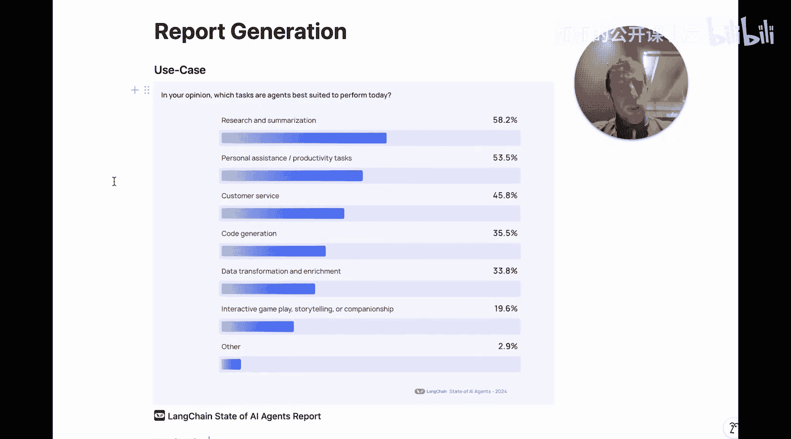

Now， before I get into all the code， I want to show you the output of the agent just to motivate this。

 So this is me just simply asking the agent， write me a report about different agent frameworks。

 Landgra crew AI， open eye swarm， Lo index workflows。 This is the report I get out。

 So the agent does all this format you can see it kind of partitions each framework into its own section gives nicely formatted bullets。

 This is all markdown file， by the way， provides sources for me。 Sam for crew sources， open AI swarm。

 Loin workflows。 At the end， Nice dissillation， clear table。 This is all done for me。

 takes less than a minute。 And all this web research and report generation and writing is automated by the agent。

😊。

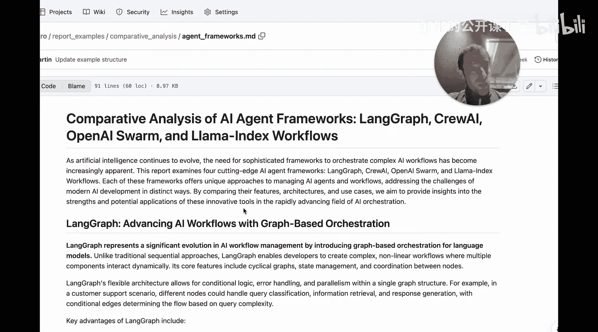

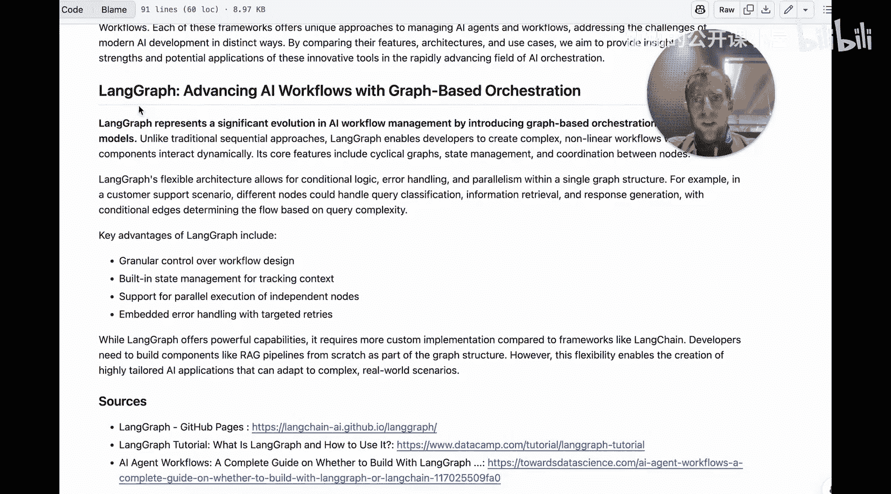

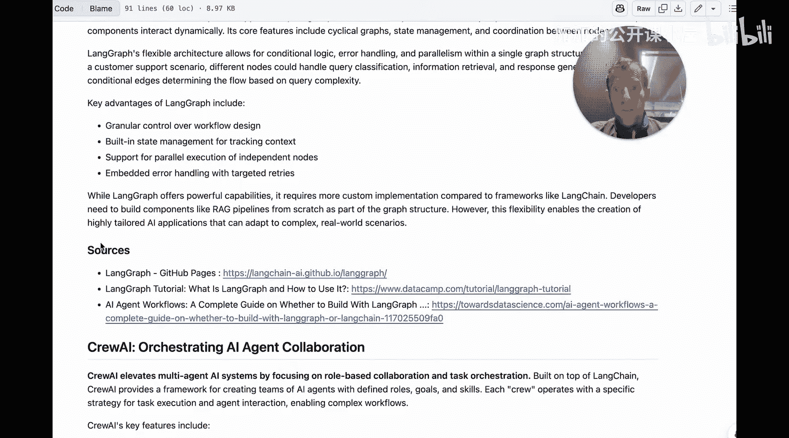

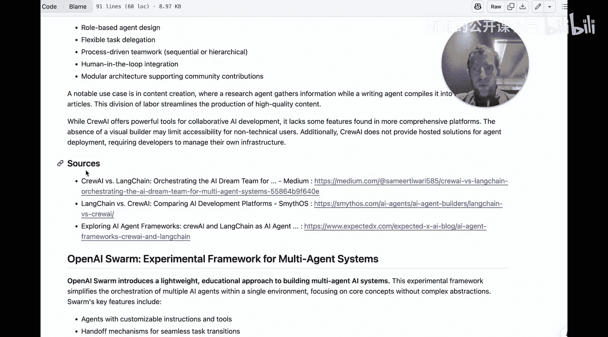

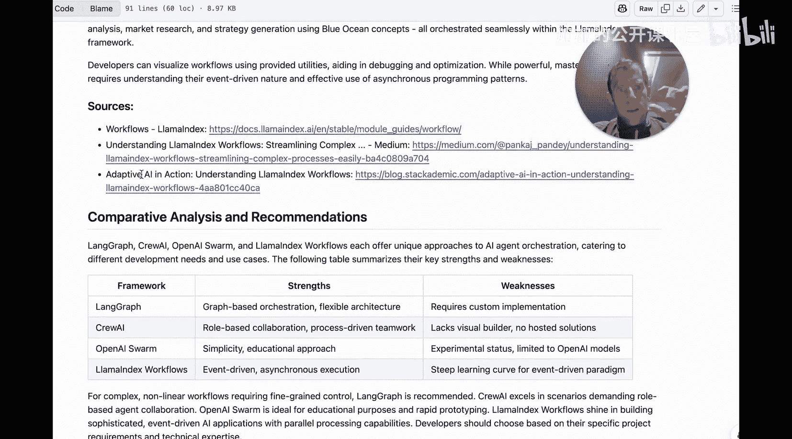

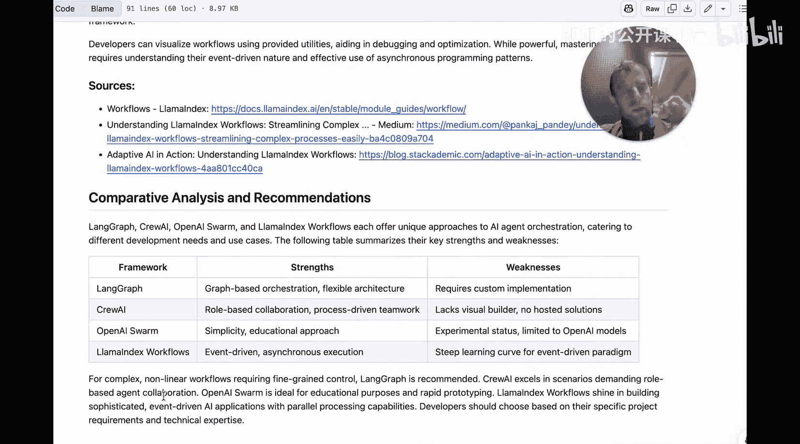

Here's some other report examples I asked about how did Repl recently use Laangsmith and Laanggraft to build their agents and all this research is done for me。

 it gives kind of a nicely broken down overview of what was done， the various sources。

 details of implementation。

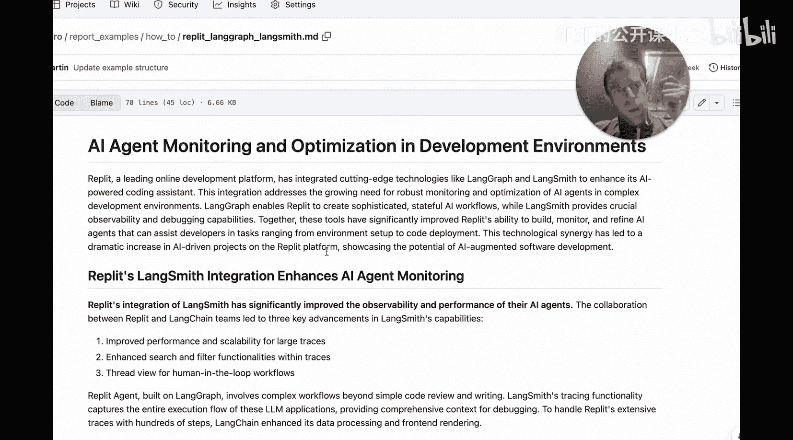

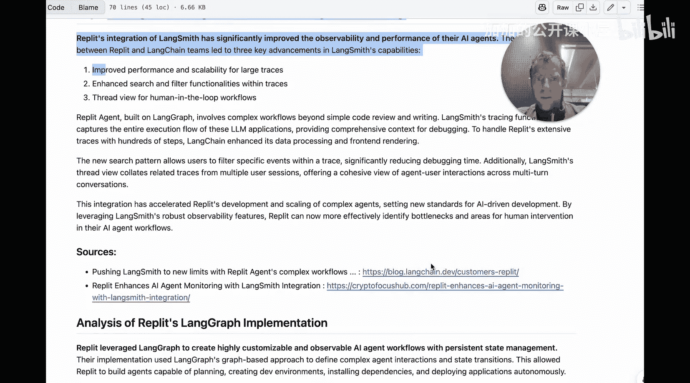

And again， kind of a nice summary section on key technical takeaways。

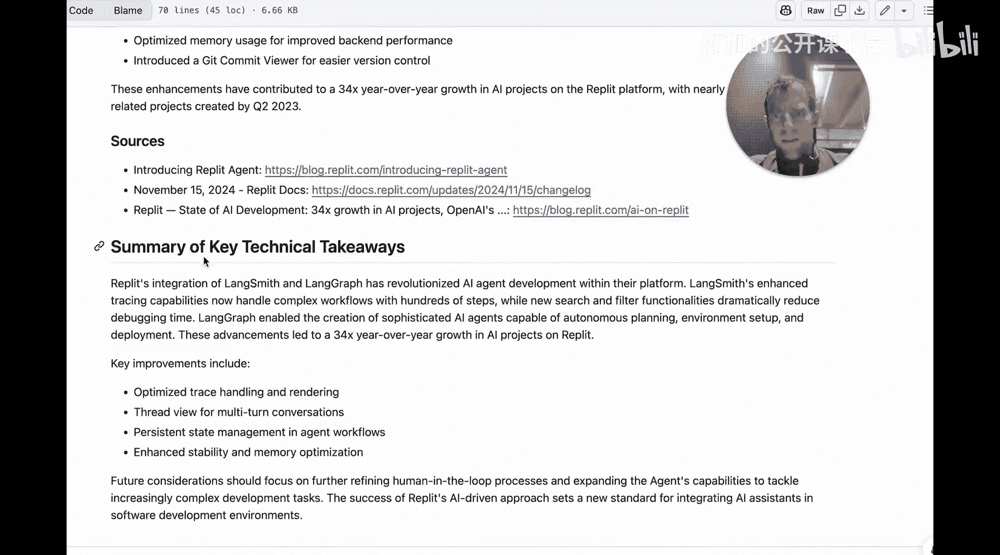

Here's another example where I asked for kind of news and recent events across various AI observability offerings。

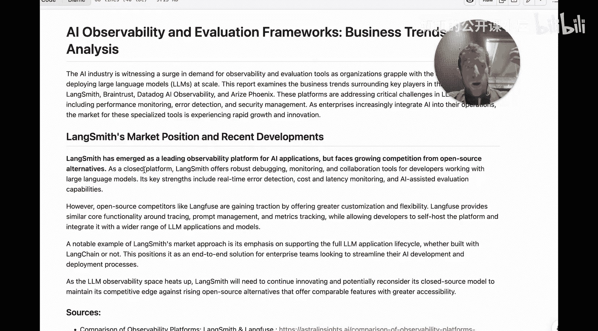

We can see we get， again some nice sources here， it goes into Langsmith， Brain trust， recent news。

 it talks about their series A， Datadog， it talks about kind of their work on A observability here and Arise Phoenix and some nice kind of summary comments here。

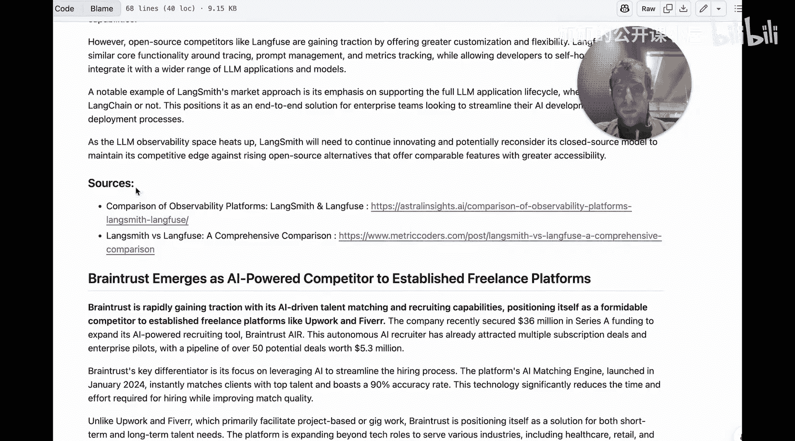

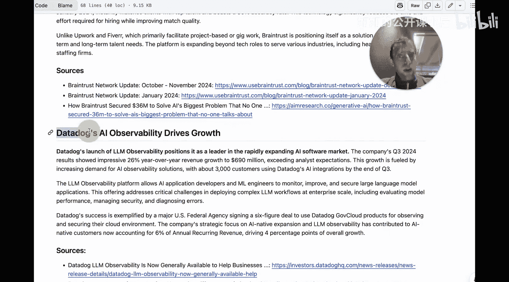

So you can see that what we're going to build here is a few advantages。

All need to is passing and input topic。It can produce reports of different types。

 you can see the structure of the reports varies a little bit in terms of the section number in terms of how the conclusion is formatted。

 whether it uses tables， we can all customize this。And it's very flexible。

 I can produce reports on many different types of topics in many different user defined formats。

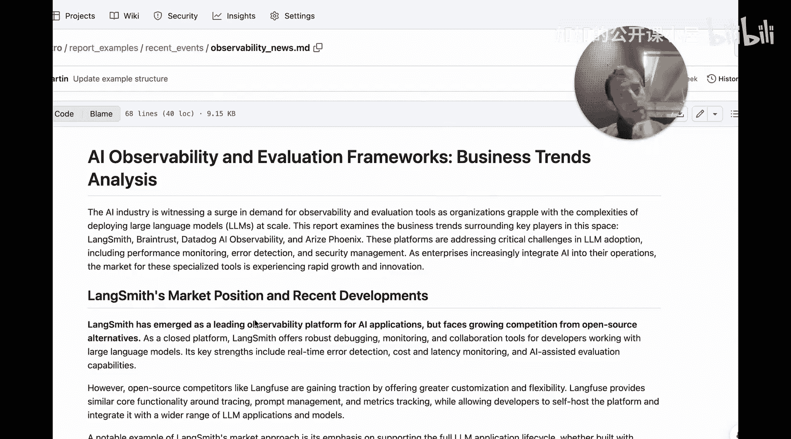

Now let me talk about one of the motivations for kind of agent report writing。

So there's been a lot of emphasis on rag systems， which are extremely useful and actually a lot of times can be kind of core components under the hood for report writing。

But the point is with RaG， you're really just saving time with finding answers， okay？Now。

 usually answers in service of a bigger goal， like an actual decision you're trying to make it as an organization or as an individual。

 reports kind of get you closer to decision making by presenting information in a structured。

 well thought out way。So the leverage you get from high quality reportss is oftentimes a lot greater than what you get just from a Q&A or RAG system。

 ragG system only gives you answers， reports kind of present information in such a way that actually you can accelerate a decision。

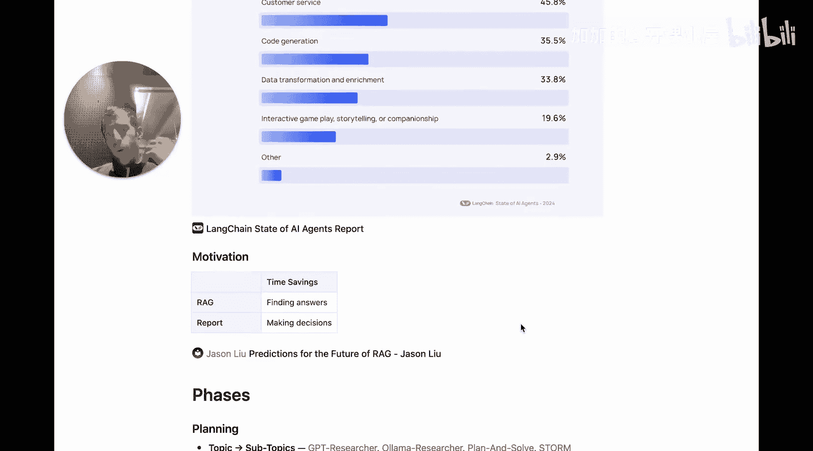

Now， I want to spend just a quick minute or two on kind of the state of the art。

How to think of report writing what's been done previously and what do we want to kind of build and extend？

So you can think about report writing in three phases。One is planning。

Theres been a lot of interesting works around report writing that first start with some kind of planning phase。

 in particular， GPT researcher， very nice work from the folks at Tviley。

Uses what you might think of as a plan and solve approach where it looks at the input topic。

 and it basically breaks that topic out into a set of subtopics which each can be individually researched。

 Okay， that's kind of idea 1。 Now idea2 is。The storm paper in particular starts with the topic and builds a skeletal outline of the final report up front。

 which has some advantage that we'll talk about a bit later。But this kind of。

Outline generation up front follows in that case， a Wikipedia style structure because storm is really meant to produce Wikipedia entries。

So it follows kind of a prescribed structure。But the point is the outline is actually generate up front。

 So the two big ideas in planning are one， take the input topic from the user。

 fan it out into subtopic， theyll independently be researched to kind of flesh out the overall theme that the user once researched。

 That's idea1 idea2 is kind of generating an outline up front of the O research report。Now phase two。

 once you have a set of subtopics and or an outline of your final report。

 then how do you actually conduct the research？Now there's at least three different strategies that I've seen for doing the research itself。

 So one is just very simply taking the subtopics。And creating search queries from each subtopic and then performing a query either on a web or a。

 Okay， so that's just kind of parallellyzed search and retrieval from some source， be it rag。

 be it the web。 Now another idea that takes it a bit。

 One step further is what we see in the Oama researcher work， which basically does retrieval。

 and then kind of is a grading on the retrieved in this case， its' web resources。

So it kind of looks at the retrieve web pages and determines does this contain information necessary to address the input question？

If not， rewrite the question， try again。So it kind of has this iterative search and evaluation process。

Now， the most sophisticated approach that we've seen here is Stor actually does a multiter interview between a like what they call an analyst persona and an expert。

 which is effectively your search engine， could be Ra， It could be Wikipedia。

 could be some other search service you're using。 But the point is。

 you basically have an AI persona asking questions。Receiving answers from the search service。

And continuing to ask questions till they're satisfied。 that's kind of the most of case。

 the simplest case is justqueerer retrieval。Like we see a GP researcher。

 there's also kind of it search， so you do a search， retrieve， evaluate， potentially search again。

 and the most sophisticated is an explicit multit interview between like an analyst and your sources。

Now finally writing， so you've done research using one of these approaches。

 how do you take on the writing task？A few different ideas here。

One of the more popular is just sequential section writing， so write each section individually。

 Stor paralyzes some of the sections。But uses kind of an iterative process where it has the outline generated at the beginning。

It will generate sections。All in parallel。Add them to the outline。

And then it'll do kind of a refinement to fill in， for example， introduction and conclusion。 Now。

 another protest worth noting here is you can also take all the research you've done and try to write a port in a single shot。

 Basically， have all these sources。And let El just write the entire report。All at once。

 So Lama index shows this in some interesting examples they've shared recently。

 So that's another way to think about this。 So one is kind of writing your report section sequentially。

 And the other is on the other kind of full extreme is kind of a single shot process of writing your entire report at once。

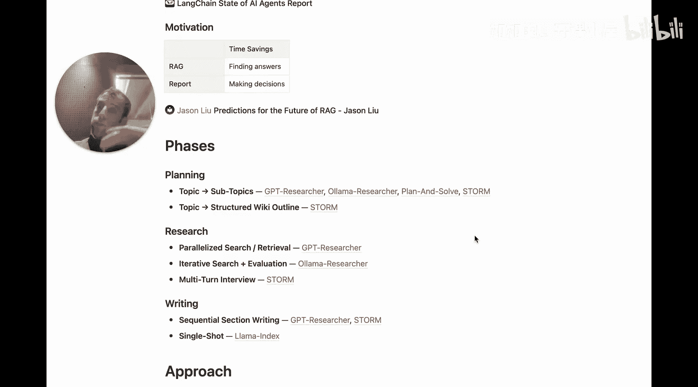

Now let me very briefly cover what we're going to do here。

 and I'm going to give some general lessons I've learned from working on a lot of different report writing agents over the last few months basically。

We're going to break up into three phases， planning， research， writing。

Now here's the first insight I've kind of learned。It's nice to do a pre planning phase to lay out the structure of your report ahead of time for a bunch of different reasons。

One is it makes it very flexible。You can produce many different styles of reports this way。

 so for example， let's say I want a report that always has five sections and intro in a conclusion。

 and I always want a summary table in the conclusion。😊。

This particular agent implementation allows you to do that。

 What if I want just a single section kind like a short form report， No introduction。

 You can also do that。So what's really nice is this planning phase allows you to take both a topic from a user。

And a description desired report structure， and it'll build the skeleton of the port for you up front。

 so it makes it very flexible。Two， it allows you to set up paralyzed research and writing across different report sections。

You can debug report planning in isolation so you can kind of look at the plan really before the research is done。

 if you don't like it， you can modify the prompts and it's very useful for debugging as I'll show in a little bit。

The other cool thing is you can actually decide what sections of your report actually need research up front。

 So let me give you an example。 Let's say a report that I want an introduction and a conclusion。

 Well those sections don't actually need research only the main body of the port actually needs research。

 And so in this planning phase I can kind of create all the sections of the port and also earmark these need research these don't。

 So it's a nice way that you can kind of do all your pre planningning upfront including in planning for what sections report actually need research。

😊，Now let's talk about research itself。So what I've found actually here is。Just simple。

 parallellyzed search and retrieval is a very nice way to go。 When I say paralyzze what I mean。

 I mean， in particular。

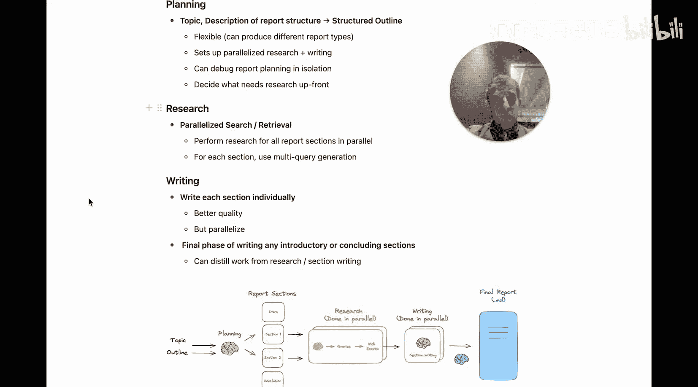