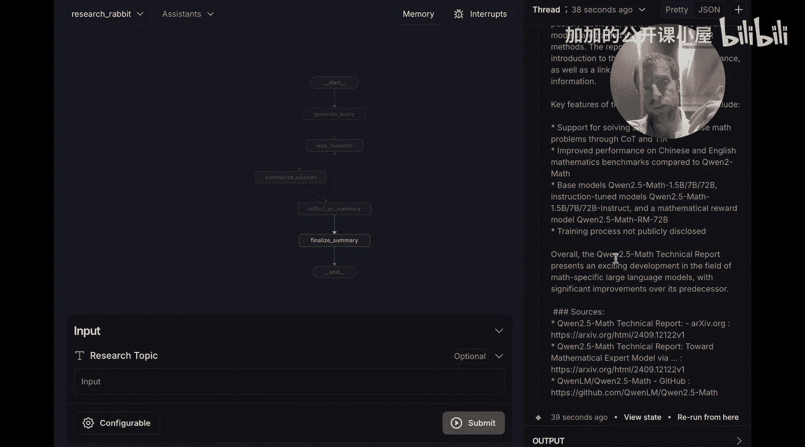
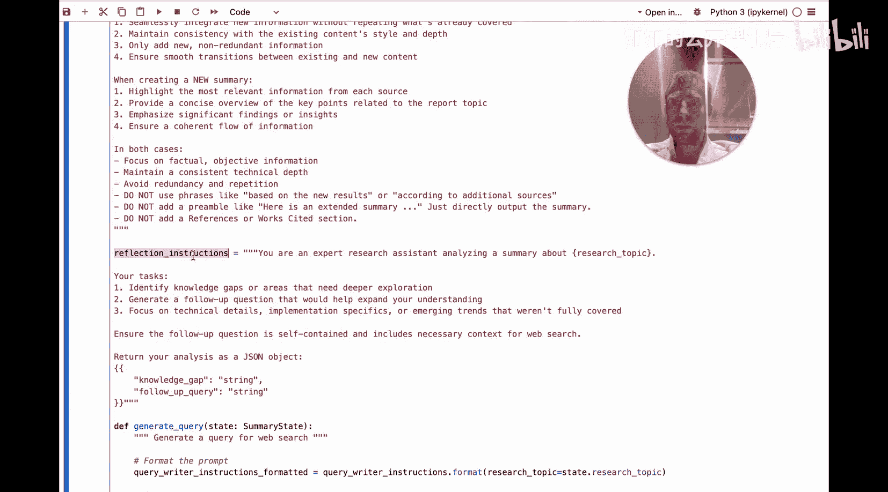

# LangChain【中英⚡LangChain 使用指南｜Build with LangChain】 p45 P47 Building a fully local research assistant from scratch with Ollama -BV1xwfMYDE3n_p45-

Hey， this is Lance Blancha。 We've seen that research and summarization is one of the most popular use cases for agents。

 So I want to show you an agent that I built that performs automated research and summarization for me using local LLMs。

 so all the L calls necessary to run this assistant are free to use。

Now I want to show you how it works first， and then I want to actually walk through the code and build it from scratch。

So right now I'm in Landgraft studio， this is our environment for testing and debugging and working with agents。

 If you follow the quick start， go spin this up in like three steps， very simple。

Go to the configuration， I any local O that you've already pulled using O Lama。 So in this case。

 I'm going to try quin2，14 B。 here you can set the number of research iterations that you want the agent to take。

 Now， I'll talk about this a lot in detail later。 But start， let's just set two iterations。

I can add a research topic。Let's say I want some quick notes about how Quenn 2。5 was trained。

 I just hit submitit。So it's going to run whatever local I might specify to generate a search query based upon the topic。

We'll run web research。 and then Quenn， in my case， is going to summarize the output of the research。

It'll then reflect on that summary and find any gaps， ask a follow up question。

 do more research on my follow up。Add the follow up notes to my summary。And it will reflect。

 and this will continue as many times like configured， I want it to repeat。

So this is performing the final summary in my case。And now it finished。

 I can scroll down looking at the final summary。 You can see kind a nicely formatted marked down document with a summary。

 a bunch of nice notes that obtained from Web research。

 nicely formatted list and a set of sources I can go dig into。 So this ran in about a minute。

 It was all free。😊，Because I ran it with Oama locally。

 and this is a really nice tool I use to automate web research and summarization really quickly and free。

Now I want to spend about a minute talking about the motivation for this now that we've seen it in action before I walk through all the code from scratch。

So first， we put out a survey about a month ago where we asked around 1。

300 professionals in the industry， top use for agents。

 and research summarization came out as number one。

 so it's a huge use case people are very interested in this。

And the approach here is inspired loosely by some interesting work that I've seen。

 This paper in particular， talking about inner D ragg is cool。 The main idea is this。

Itativeively retrieved documents， generate answers。

 and continue to generate new research focuses based upon what it discovers from prior loops。Now。

 why do I do this here with local models particularly？

I found that this is actually a really nice approach for local models， because。

Be given local resources on my machine。 I can't run， for example。

5 or6 calls and models simultaneously。 So I can't do a research approach where I like。

 take a topic and fan it out into 10 subtopics and run all those in parallel。

 That won't work given my system limitations。 So instead。

 I like this it of approach where I just very simply take the topic， generate a question。

 do web research based on the question。 Get something back。 Ref on it。Do it again。

 Run that for some number of cycles。 It update the summary。 I found that approach is really simple。

 and works really nicely。Now let's talk about local models very briefly。Now。

 for choosing models to run， I like to poke around localllma。 I like to poke on Twitter， of course。

 and I like this hugging face local L M leader board。 You can set the number parameters here。

 and you can look at models rated by the performance on a bunch of different challenges。😊。

I've been working mostly with Quen 2。5 and Lama 32。Now as noted in the read me。

 all you need to do is just run ama， pull whatever model you want， and it'll pull it down locally。

 Now， So now I'm in a fresh notebook， and let's build this from scratch。

 I'll show you how easy it is to put this together。 So first。

 specify whatever ama model you want to work with。 In this case， I'll use  Quen25，14 B。

 I've already pulled it。Now， second。We're going to use Landgraft to build this agent。

And so I want to show you how to define your state for this particular use case。

So Lagraft uses the notion of state to basically preserve anything you want to live over the course of lifetime of your agent。

 In this case， there's a few things you're going to want。

 One is we want the user to provide a research topic。 We saw that previously。

 So that's one state key。 asking me a string。Now， that is the only thing we want to expose to the user。

 and so I'm going to create a particular state called my input state for that key and you'll see why this is important later。

The only thing we want output is a summary。Again， that's just going to be a string。

 We only want the research to be exposed to the user and the input and the summary on the output。

 But my assistant itself needs a bunch of other things。 So we're going to attract。A web search query。

A collected set of web search results， which willll basically append to over the course of our agent。

A set of sources gathered。Again， we're going to pin two over the course of our agent。

 Only difference here is one is going to contain all the content ver search。

 the other is going to only contain the URLs。So now let's build and view the overall graph that our assistant is going to use。

So it's going to have a few different nodes。 First。

 it's going to start with that input from the user。It's going to generate a search query。

 It'll run Web search， summarize result of Web search， Ref on the summary。

 repeatat this process for some number of cycles and then finish Pre simple。

 Let's walk through each node in detail。So first， we're going to run generate query for this。

 we're really simply just going to use a query writer prompt。 that's up here。Query。

 write instructions。 So here I'm doing is I'm going to ask an L M。 In this case。

 my local L M generate target Web search query。 The query will gather information from Web search。

And the rationale for that query to really force the model to think about the generation of the query itself。

Now for this， I'm going to use the LM that I configured using Oama to use JSON mode。I invoke it。

Very simply with my four system prompt， which passes in the topic from the user。

And I instruct it generate a search query。I got the query back out。

And I extract the query key from the structured output。Now I'm going to perform web research。Now。

 in this particular case， I'm using Tvili search to do my web search。 Now， again。

 I mentioned I like Tvili， it's free to use up to 1 thousand0 requests。

 and it provides nice results with already scraped sources， so it saves a lot of work。

This particular node could be replaced with whatever search you want to use。 The key point is。

 it does a web search。 It returns the results from search to this sources gathered key in my state。

 That's all it happens。Now it's nice is this key in my state is going to accumulate a list of sources as the agent runs。

 and so all my search results are going to be saved to this key and I can go inspect all of them if I want。

You'll also notice I run this deduplicated format sources。 This is just a utility function。

 You can see it in the u folder of the repo， and it just does a deduplication of the sources and cleans them up a little bit turns them into a string。

Now， what's nice is you could just modify this new duplicate Clayton format sources if you want to change the search engine。

 So all you'd need to do is just modify this function to return a string that formats the search results。

From the raw output from whatever search engine you use。

 So this is like a nice adapter that goes from your raw search results to just a string that you're just going to go ahead and save to state。

 That's really it。Now， you will notice a few small things here。 One is I save sources gathered。

 So this is going to use that format sources function to actually just get the URLs。

The raw web research results will return basically the entire formatted output。

And we'll also go ahead and increment the number of research rules be done once after a research is finished。

So now we've run web research， we've saved all of our sources to state。

 let's go to summarize sources。Now here I get the latest results from Web search。

 remember these are all saved to a list， so I get the most recent addition to the list。

And if there's an existing summary that have already generated。

 I'm going to modify my prompt a little bit to basically say， hey， if there's an existing summary。

Extend it and add all the new stuff I've learned。Alternatively。

 if I don't have an existing summary of I'm just starting this research process。

 I'm just going to go ahead and generate a summary for these search results。 Super simple。

Then I run a local Lm with my formatted prompts。And I return that summary as a string。

 Sa it to state。So now I have a summary， let's go to reflect on summary。So here we go。

 Now I just tell the LLM。Identify knowledge gaps and generate follow up search query based upon our existing knowledge。

And I provide some additional instructions in this system prompt reflection instructions。

Which you can see right here。

