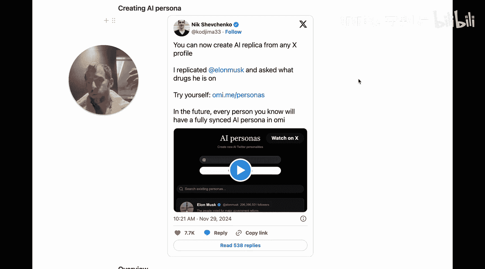
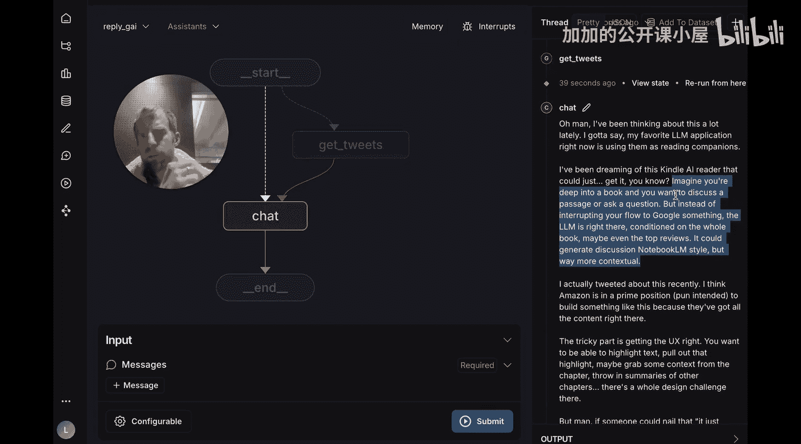
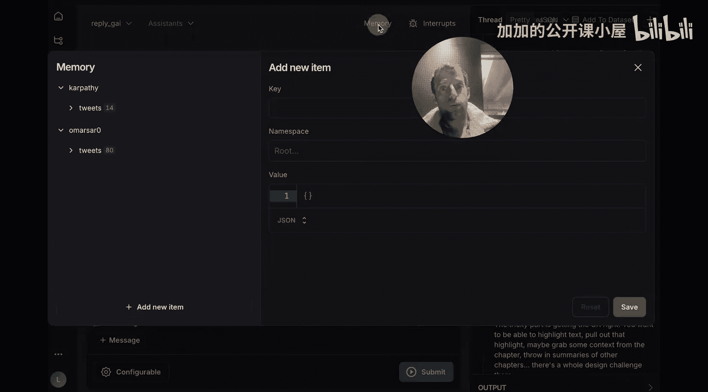
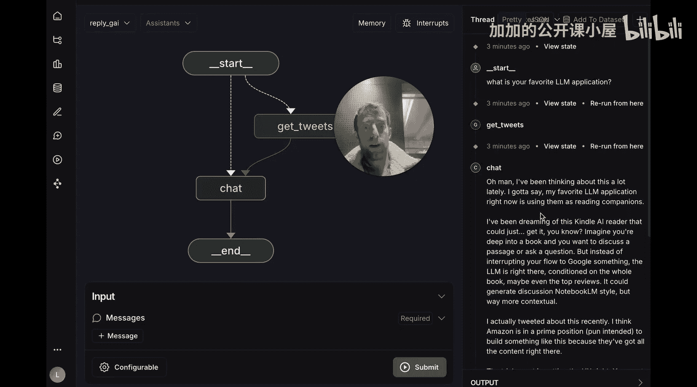
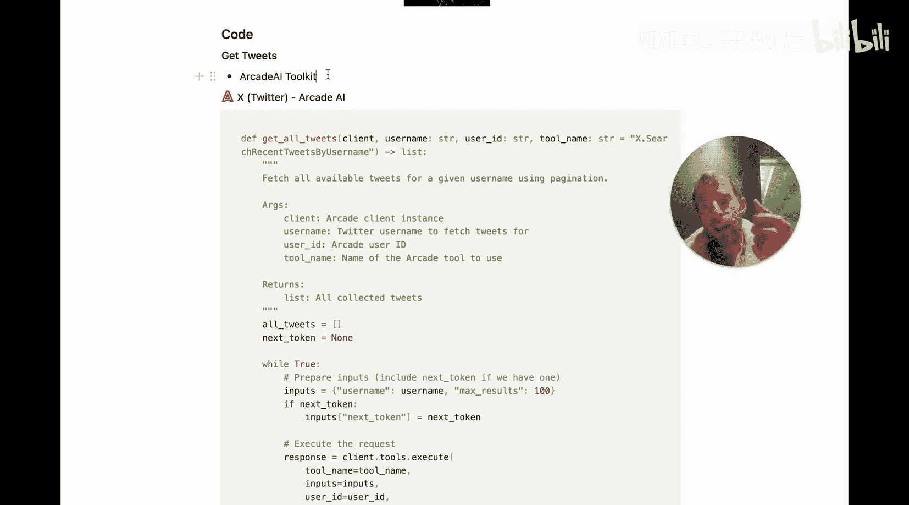
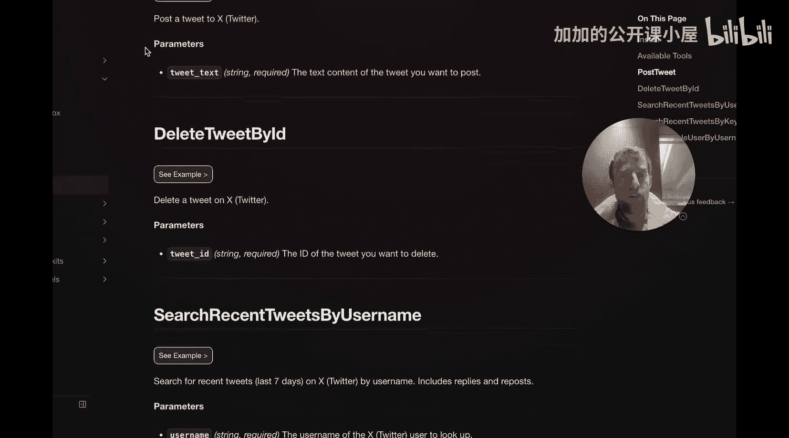
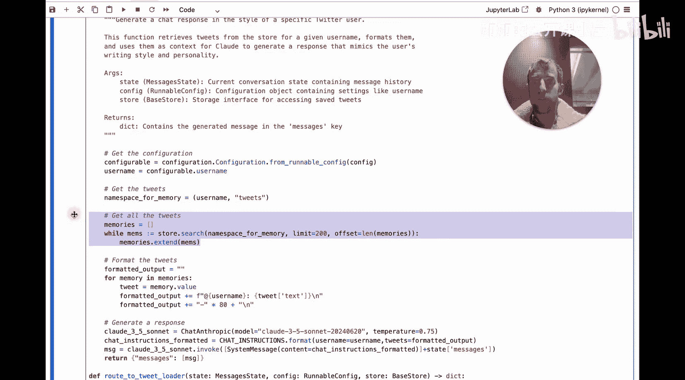

# LangChain【中英⚡LangChain 使用指南｜Build with LangChain】 p46 P48 Building an AI persona for any X⧸Twitter user from scratch -BV1xwfMYDE3n_p46-

Hey this is Lance from Langcha。 A recent idea I've seen on Twitter is this idea of creating AI personas。

 so this is a fun example where you can create an AI replica from any X or Twitter profile。Now。

 this involves some cool ideas。 One is idea of long term memory to store， for example。

 a user's tweets over time and incrementally update it。

And idea two is actually use that those store tweets to condition responses。

 which is basically a form of RA depending on how you do it。

Now I want to show how we can build this from scratch and employ these two ideas pretty effectively and easily。

So first I'm going to show our assistant working in action， and then we'll build it from scratch。

 So this is what you get if you follow the quick start in the repo provided。

You're going to see this window pop up in your browser。 This is Lgraft studio。

 It's a very nice UI for working with different Lngraft agents。 Now， this agent。

 I'm calling reply Gu， G AI。😊，And。It really involves only two nodes。 One is this get tweets node。

 The other is this chat node。 It's really simple。 All that's going to happen is I input put a question。

 It's going to conditionally decide to gather tweets。 We'll show how to do that。

 It's going to save those tweets to long term memory。

 because I want to keep a memory of this user's tweets that I can save over time。

 So that's kind of idea 1。 Then idea 2 is it's going to load from long term memory in this chat node。

😊，Gather tweets for the given user。 Use that to condition responses。 That's really it。So to start。

 I only you to do do two things， go to my configuration。

So this just determines how frequently I want to go and get new tweets using our access to the Twitter API。

So I'll set this to be really short，60 seconds。This is the username of a user that you want to chat with or create a persona for。

 in this case I'll put it in Carpathy。And I'll provide an input。什么。Gathers tweets。

Use them condition response。Here we go， we're getting our response back。

And the response is talking about a cool application is kind of using AI to help read books and have like an interactive reading experience。

Now， where's this coming from？

If I click on this memory tab。I actually can see tweets that my assistant has collected for different Twitter users。

 So this is what's stored in long term memory。 So you can see for carpath， it has 14 tweets。

 and I can even kind of go through and check them。 So this is pretty cool。 Here we go。😊。

And here we see a tweet related to kind of LLM applications and reading books。

 so that's kind of why the response to my question was conditioned as it was talking about this idea of AI assisted book reading。

So what's pretty cool here is that in my configuration， I can just simply put in any username。

I'll gather tweets for that user。 I can specify again here how frequently I want to gather new tweets。

Tweets are all stored in long term memory。 You can see for this particular user。

 I have a much larger set of tweets。

And the streets will be loaded from long term memory in order to condition responses to any questions that I have。

Now， if we want to build this from scratch， there's two big concepts that we need to nail， one is。

 how can I incrementally add information such as tweets from an API that access Twitter data？Two。

 long term memory。And two， how do I get tweets from long term memory and use effectively rag to get responses based on those tweets。

 So those are really the two things we need to nail。

 And then we can build this AI persona for any Twitter account。So first and foremost。

 we need a way to access tweets。 that's kind of the underpinning piece of this whole thing。

 So there's a bunch of different options for this， of course。

 it's a Twitter API Arrcade also provides a Twitter or X toolkit。

 Now it's kind of nice about this is it's free to sign up so I was just hacking around and was able to get an API key just by signing up here it's free to use for some usage limit but it allows you to very quickly get started。

Now， this toolkit allows you to gather tweets from any individual user。Over the past seven days。

 So that's only limitation。 So it's slightly。Constrained temporal。

 but if you save that long- term memory in your chatbot。

 you can kind of have a collection of tweets over time within that seven day rolling window and you can save it all to long term memory and your chatbot can access everything you saved over time to long term memory。

So here I'm in a fresh notebook and let's start building this out from scratch。

 first we'll start with Arrcade。So here's some code to grab tweets using the Arrcade API。Now。

 this is kind of boilerplate from the arcade documentation。 It's pretty simple。

 All I provide is I have my arcade API key set in my environment， and I also just grab my user I。

 This is just my email。 Okay， this is just what the arcade API needs for authentication。

 I authenticate。 I confirm I'm authenticated。Now here's where I pass in any user name。

 and I wrote this little utility function that takes in the client， the username。

 user I and the tool name。 Now this tool name is basically this search recent tweets by username tool in the arcade toolkit。

 Now here is just where we're going to hit the API again This is just going to gather all the tweets from the past seven days from the user。

 It's all going on here。 It's just pretty simple。 And I return all tweets。

 Let's go ahead and give this a shot。Cool， so I ran that very quick and nice， that's step one。Now。

 step 2 is， how can I take these tweaks and store them in long term memory so my agent can access it。

 Okay， now， long term memory is a very important concept with agents。

 and there's lots of different ways to do。 this's many different frameworks。

 I'm going to use landgraft to build this from scratch。Now。

 Langraff has this memory store that is built in the library， which is very convenient。

 It basically provides a key value store for long term memories。 I'll show you how this works。 In。

 for example， the deployment we just looked at using the Ui。

 but I can also work with this in a notebook setting。

 So here I'm just going import the in memoryory store right here。

 is is just a simple key value store that's in memory。😊，Now。

 all I need to do to save tweets to my memory store is just store dot put namespace。

 The namet is just a coupleple of username in this case。 tweetwes。

 memory ID is just some kind of viewUI for that particular memory。 and then the tweet text。

 the tweet URL Nata tweets back out for memory。 very simple。

 Just run in memory store search by the namespace。There we go， so you can get a bunch of objects out。

We can look at any one of them just by grabbing the value and there's our diict So really simple Landgraraft has this base or abstraction。

 it can be used as store long-ter memories， will'll show it how it actually works with our local deployment which we just saw in the UI in Laanggraft studio previously。

 but this is how can run it very simply in a notebook。

So now we've seen how to use Arrcade API to get tweets。

 and we've seen how this memory store and landgra can be used for long term memories。 Now。

 let's build our graph。 So if' added the code up here。 I've compiled it。

 And here we can visualize it。 So we saw this previously in studio。😊。

And this is just showing it in the notebook。 We're going to get tweets。

We're going to then go to chat。 We're going to end super simple。

 Let's first look at that get tweets node。So in La graph， each node just a function。

And you're going to see something very interesting。 We're passing in a few things。 One is the state。

That's fine。 That's just our graph state。 In this particular case。

 it's a very simple graph state called messages state。

 which isn't going to contain a list of messages。 that's going to basically be the interaction between the chatbot and the user。

 So that's all the state's going to contain。 But you're going to also see something that's important here。

 which is the store。 So when we compiled our graph， we actually passed in that store object。😊。

That we worked with up here。Right here， so we defined an imageory store， when we compile our graph。

 let's see it down here。We can just pass that store in。

 Then the store is accessible in every node of our graph。

 Now you're starting to see how we can actually save things， for example。

 in one node and retrieve them in another node。So we access a store in this particular node get tweets Here。

 we just hit the Arrcade API， just like we showed previously。Get all our of tweets。Now。

 this is actually exactly what we did before to find a namespace， which is the username。Tweets。

Extract information from each tweet， put it in the store， that's all that's happening in this node。

So you can see here we also pass in the configuration。

 and this is what allows us to get any configurable parameters in our graph。

 we saw that in studio that we can set those using that tab in the lower left hand corner from configuration we can。

 for example， get the username。Which we get from config right here。We pass this too。

Arcade API when we gather tweets for a given user。We also use that username when we write to long term memory。

So what's cool is we go from configuration where the username is supplied2。

The Arrcade API to get tweets for that user and then to our memory。

 where we save tweets for a given user。Now， I can see a lot of those same concepts apply here in the chat node。

 which is the second note of our graph。 Again， we pull in the configuration。 We pull in the store。

Now， what's cool here is we use the store a little bit differently like we saw above here。

 we're just pulling all the tweets。

