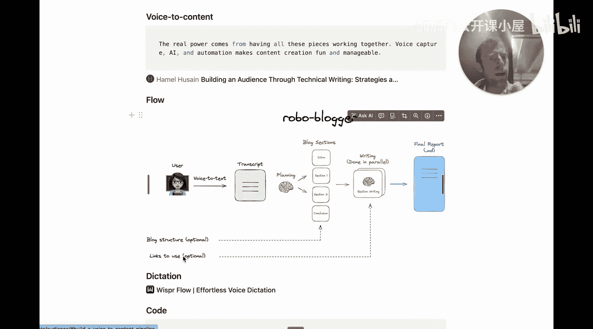
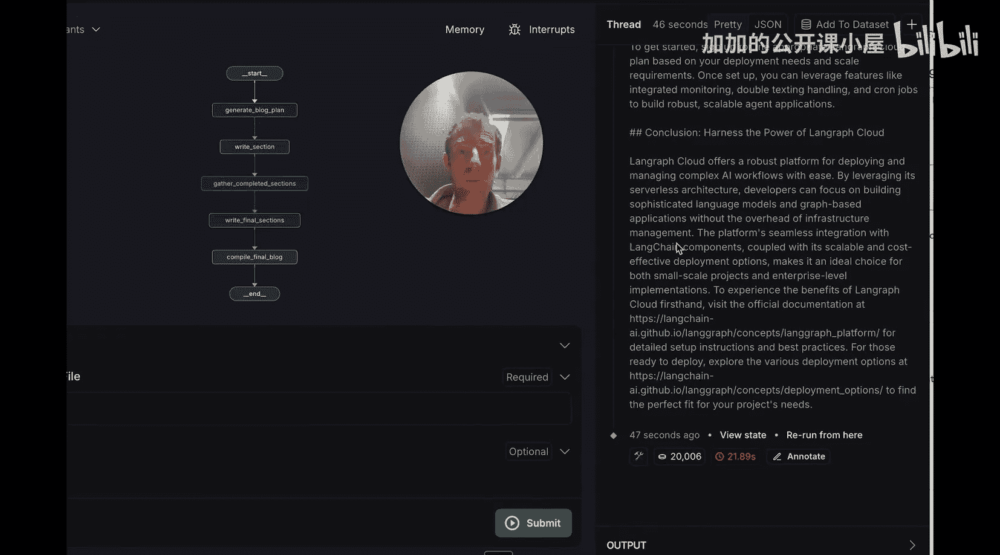
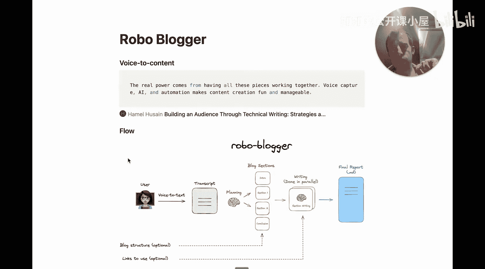
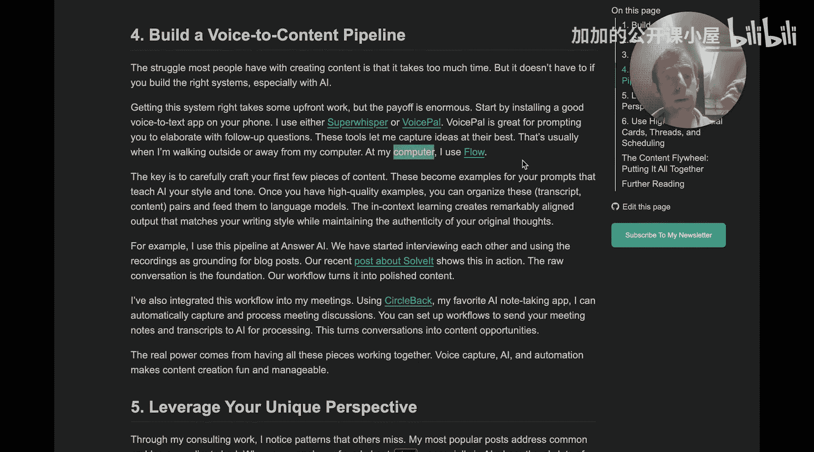
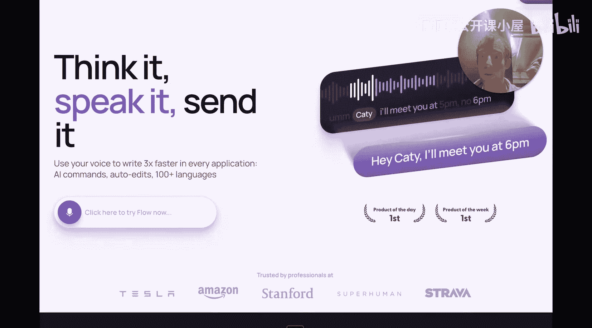
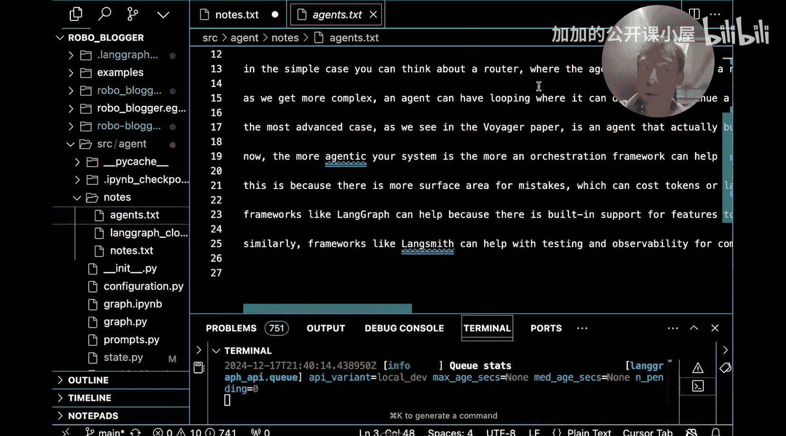
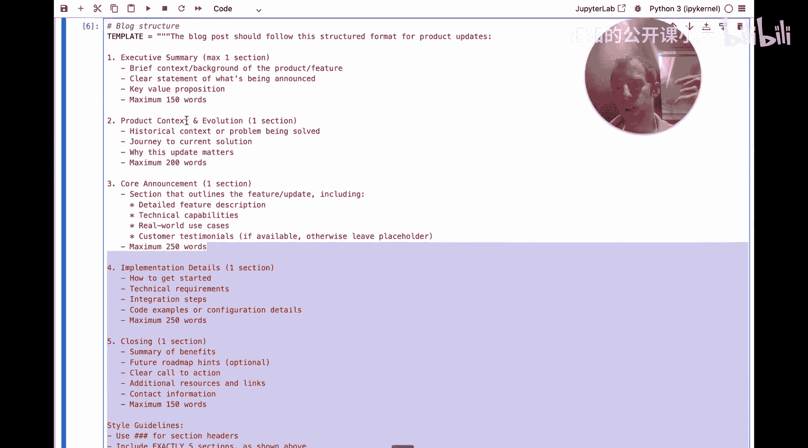

# LangChain【中英⚡LangChain 使用指南｜Build with LangChain】 p47 P49 Building an LLM-powered Voice -To-Content assistant -BV1xwfMYDE3n_p47-

Hey， this is Laances from Langcha Over the past few months。

 we've seen more and more AI applications that use voice as the input。

 So one great example for this is what Hamil Hussein laid out in his recent blog posts talking about voice to content pipelines。

 so how can I basically go from a voice recording of what I want to write to a final finished product。

I'm going to show you how to do that from scratch today。

 and I'm going to apply it to something that we do all the time at Land chain， which is blog writing。

Blog writing is challenging， the cold Start problem in particular is very tedious with blog writing。

 so how do I go from kind of some thoughts in my head to a first high quality working draft of the overall blog post。

So this pipeline put together called RobboBger is our first cut at doing this。

 using an integrated voice and kind of AI agent automation pipeline altogether。

 So the flow is basically going to be this as a user。

 I'm going to use a voice of text app to create a transcript of what I want to write a blog about。

 This is like a stream of consciousness。😊，Now， the assistant will take that transcript along with optionally a general structure blog want to write and optionally some links to use and it'll produce a high quality blog post。

We're going to build that all from scratch here very shortly。 But first。

 I'm going to show you how it's kind of all working end to end。

 So if you follow a quick start in the repo。

You'll see this open up in your browser。 This is Laanggra studio。

 This is a very nice and easy way to interact with our assistant here called Robboblogger。

 So all I need to provide is one input。 That input is just the name of the audio to text transcript that I created。

 Now， I'm going to show you how to create that here next。 But first。

 I want to show how once I have that file， I guess she can run this assistant。😊，I provide the name。

I also provide any URLs if I want to include those in the blog writing。 So for us。

 these URLs are typically documentation that's linked to whatever I'm writing a blog about。

 So usually to be like okay， here's a new feature。 Here's a stream of consciousness about what I want to write about。

 That's what's captured in this transcript。 Then it's here's a documentation。

 So here's like a few new page of documentation that we have。

And those are the inputs that I want to pass to my assistant。Now。

 if to open up this configuration tab right here， I can specify the structure of the blog posts I want。

 I'll talk about this a lot more in the future。 But the main intuition here is we tend to have different styles of blog posts。

 So I want to make it really easy to customize the overall flow of the blog like some blog post and more case studies that may have structure 1。

 Other blog posts are like new releases The might of structured2。

 So here's an example of a structure I want。 I want an executive summary， product context。

 This is more like a product update blog。 So it's going to have the announcement， De， closing。

 So first， my assistant generates a plan。😊，Then in parallel， writes the sections of the blog。

here's the final blog， it's markdown。And this is everything I want。

 I can copy this over just to a file in the repo。

So if we go the repo examples， this is a product update style blog post。 here's the markdown。

 you can see here it is。 so this is actually pretty nice right up。

On everything that I wanted talking about， in this case Lagraph cloud， it gives some product context。

 it lays out the core features pretty nicely， lays out some implementation details。

And a conclusion with relevant notes。 So not bad this will be a really nice V1 of my blog post from a really simple kind of audio read out of my thoughts。

 as well as a few URLls。 And boom。 There we go。Now let's walk through some of these components a little bit more detail。

 first is the dictation， so I didn't show anything about how I did that。

 but I want to talk about that right now。So if you go to Hemel's blog。

 he mention a few different tools that he uses for dictation， so some of these are for mobile。

 some are for， for example， laptop or your desktop， and this flow app is one that he mentioned。

 it's called Fa flowvoice。 AI， and I tried this and it works really nicely。

So let's show an example of using this dictation app。In cursor， so right now I'm in cursor。

 I'm in the repo。And I go to the sourceation directory， open up that notes subdirecty。

 and you can create a text file called Notop text， right？Now。If I've downloaded the app flow Voice。

 I can do two things， one is I just hit function。Or。

I can go and click this little button that's on my desktop。Enable dictation。 And I can just speak。

So right now I can dictate the blog post I want to write about。

So want to write a blog post about Landgraraft Cloud。

 LandGgraraft Cloud is a really nice way to deploy Landgra agents。

 it has a few different features that are advantageous， like double texting， support for streaming。

 long and short term memory。Start with a layout of what lagra is and its motivations。

 then talk a little bit about some challenges with productionization。 Co， So I finished that。

 I hit just hit stop。There we go， so let's transcribe everything I just said。

And I found this to be pretty good。 So you know you can test this yourself as you'd like and there's certainly other apps to use to capture dictations。

 but the point is it's pretty easy。Get an app that allows you to go voice the text。

And I have this notes directory in the repo， and you can just dump your audio transcriptions to different files。

 So here' are some other transcriptions that I did。 In some these cases。

 I've add some spaces to break it out so I can let you look at that inscription。

 I might modify it a little bit before I go to the writing phase。

 but you can see it's a really nice way to get started just kind of stream of consciousness dump of what you want to write about。

😊。

And just save that to a file。So now we've shown how to create this transcript right here。

 going from the user to a transcript， let's actually build this from scratch。

So I'm in a fresh notebook here。 Now let's actually start building this piece by piece。

 So we have our transcript。 We just created that。 Now I want to build this planning piece。

 and actually， this is the thing I found to be most important。If you build this planner correctly。

 the downstream writing is pretty straightforward。 So actually。

 there's at least two benefits to building this kind of separate planning step。

 One is it increases the quality。 and allows for parallelization。 For example。

 you can plan out the sections of your blog， write them all in parallel。 So that's good。 But also。

 you can debug it independently appendly。 So you can look at the planned sections of your blog and see whether or not they're correct。

 And if they're not， you can modify the prompts and you can do other things。

 So let's just build this first。😊，So we're going to build this assist thin La graph。

Line graph only needs simple functions to specify the different steps or nodes in the graph。

 So this is basically the first step in the assistant。 It is going to be generate blog plan。

 So that's basically this phase。 So what's really going on here is I'm going to make a call to an LM。

 In this case， I'm going use cloud 3，5。With a specified structured output。

 now the structured output is going to be this section schema。 So what is that？If you go up and look。

So I pulled all the schemas into this notebook so we can actually look at them really easily。

 So really all you're going to see is that I define schema。

 It's a panant model for one section of the blog。 It's going to have a name， a description， content。

 and whether or not it's a main body。 That's a boolean。 So true。

 false We'll see why it's useful later。😊，And this is just a list of sections。

So it's going to output my blog as a structured object of sections to start。

And I'm going to pass in my system prompt。 This is really the crux of it， because this。

 I'm going to pass two things。The user instructions from my transcription。And。

A customizable blog structure。So here's the prompt I'm going to use blog planner instructions。

 so I'm basically going to say， look， you're an expert technical writer helping to plan a blog post。

 your goal is to generate a concise outline。Carefully reflect on these notes from the user。

 This is my transcription。Next， structure these notes into a set of sections that follow this structure exactly。

 This is the key point。 so I have the kind of unstructured audio transcription from the user。

 and I have a blog structure outline that I provide。

And then this is just peling it to return a structured output that adheres to my schema。

So let's test out just this planning phase in isolation to see how it works。

So here I'm going to provide some blog structure that I want。

 we talked about this a little bit previously， this is just like kind of a general summary if I want the block to go。

Then I purchase provide the name of the transcript。

 so this is whatever file you created in this case。

 I have a transcript that talks about Land graph cloud in detail I pass that here。

I'll specify these URLs here， they won't be used quite yet in the planning phase。

 but I'll use them later if I want to have them enumerated right here as a potential input for later。

Run it。And we're just going to print out the output of each section。

 and we can see here's the sections of my blog， executive summary， brief context about Landgraff。

 introduce Landgraft cloud， blah， blah， blah。Historical context， problem it solves。

 why Langgraft Clouds a great update， Langorff Cloud features， how we actually get started with it。

 closing。 So this is perfect。 What's happening here。

 It's looking at my transcript file that's giving it all the meat of what I want to talk about Laanggraft cloud stuff。

 but it's structuring it in a way that follows this general format of a blog that I want to write summary。

😊。

