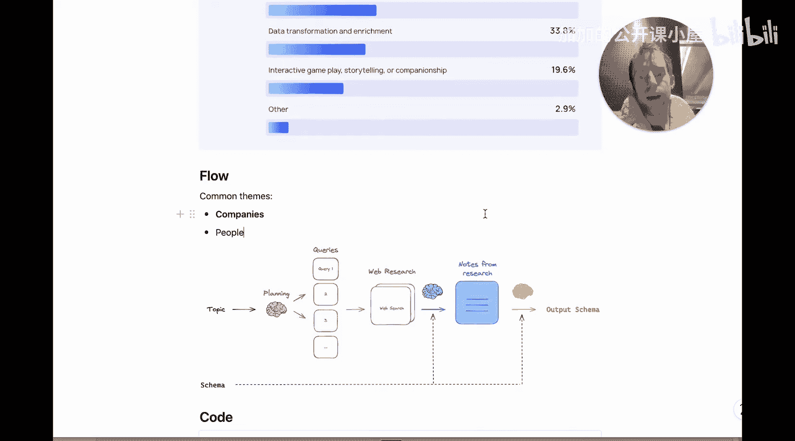
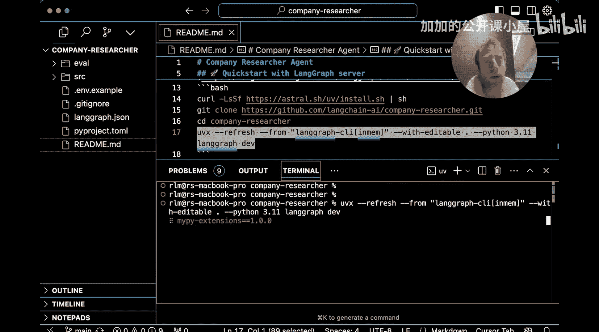
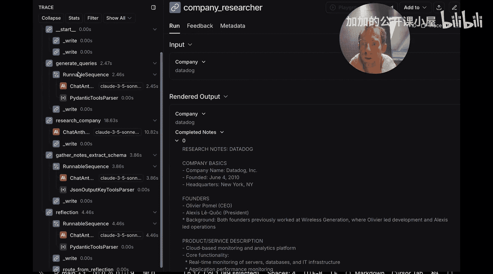
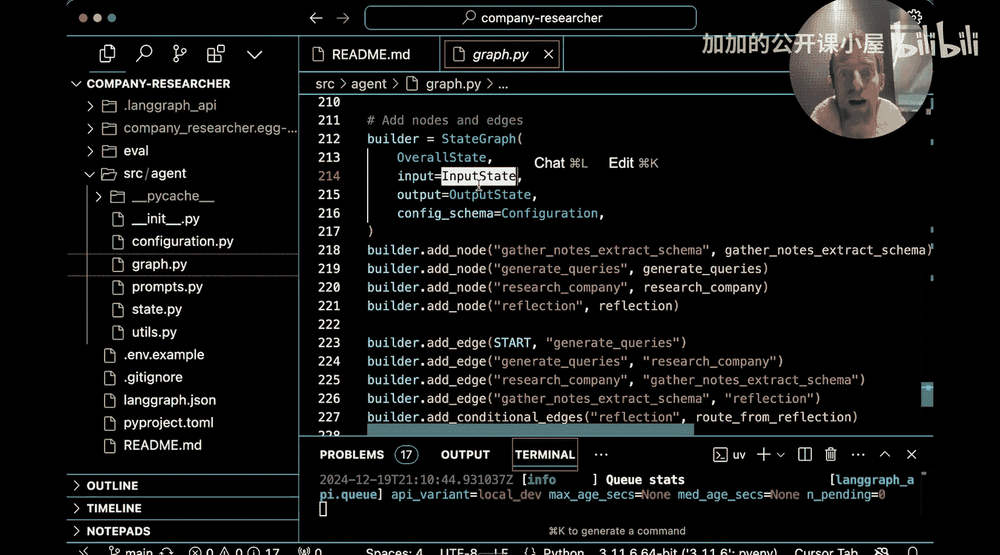
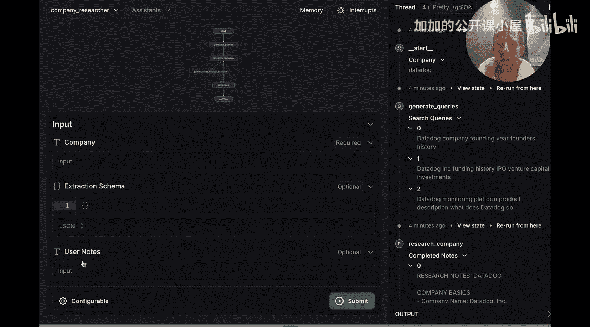
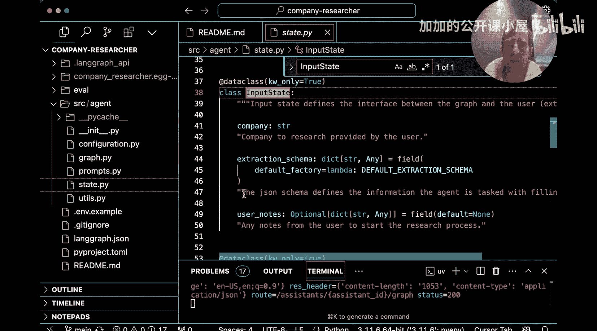
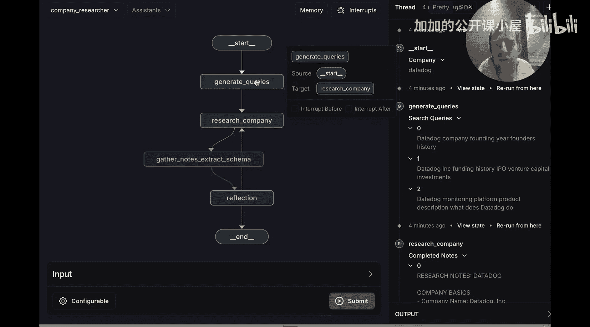
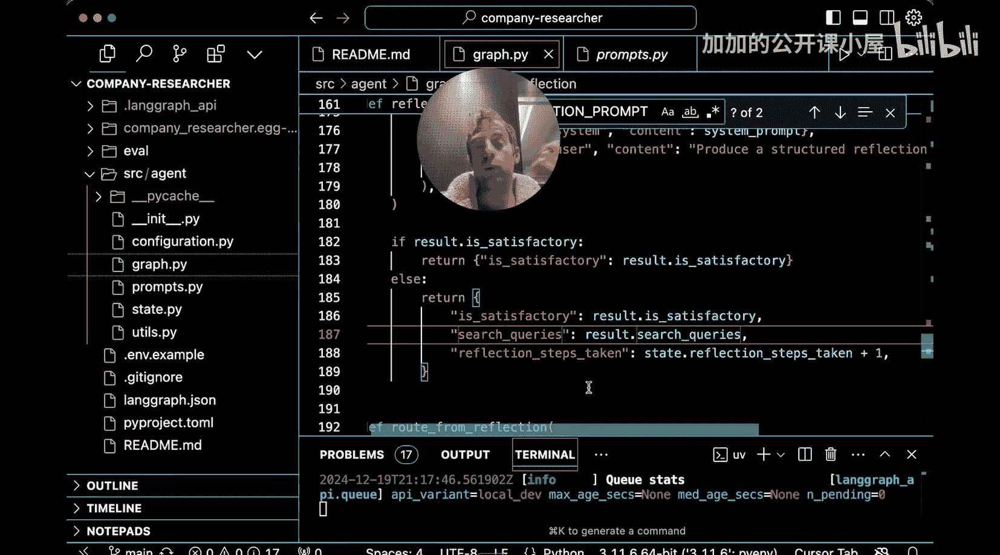

# LangChain【中英⚡LangChain 使用指南｜Build with LangChain】 p48 P50 Building a company research agent from scratch -BV1xwfMYDE3n_p48-

Hey， this is Lance from Lang Cha。We put out a state of AA agents report earlier this fall where we asked around 600 professionals in the AI industry。

 what are kind of top use cases for agents？Now， one that came out as quite popular is data transformation and Richmond。

I want to show a general example of this today and how it can be applied to， in this particular case。

 research on companies。So the general flow that I found to be really nice for enrichment style agents is something like this。

Let's say I have a topic。That I want to research。But at the end of the research process。

 I want to output some schema。That I can then use to populate a database， for example。

 that's a very common use case going from kind of like open ended research to a particular schema that can then be used downstream for some use。

 So it's kind of going from unstructured， open ended to a structured output。

So here's a general paradigm I found that works really well for this。

 So you pride a topic as the user， Let the LM then do some planning to basically fan out into some set of search queries。

Do web research across those queries Now here's a part that's kind of interesting。

Produce a consolidate set of notes based upon all the rep research。

Then take those notes and basically compress them or extract them into a final schema。

That's a general flow I found works really well for the process of going from kind of research to an output schema。

And I'm going to show a nice example of that right now called company researcher。

So getting started with this is pretty easy。 I'm in the repo now。 I just cloned it。 So first。

 just make sure you have the API key set for other model you want to use。

 It's default configured for anthropic。 So I set my anthropic API key and my Tvit API key。

 So those are set first。 Now what's Tvili。 So Tviis is a very nice search engine that can be used for web research。

 Now there's other engines you can use without question Tt found to be quite nice and as a generous free tier。

 So it's the one that I've typically use when I'm building agents。 but of course， you don't have to。

 So both the LLm choice here as well as the search engine choice。Could be modified， if you'd like。

Now to get started， all you do simply do is after cloing the repo， just run this command。

 this is going to spin up a local Landgraft server that runs our system。 Now。

 when you run that command， you'll see this open in your browser。

 So this is just Landgra studio that is running from our local deployment。

Now what's really nice here is I can open up this input tab。

 and this is where I can provide the name， for example， of a company I want to research。

 and I can optionally provide a schema and optional any other user notes about that company that I want to incorporate in my research。

 The only ones required a company name。 So let's just say Datadog as an example。😊。

And now let's say I just run this， hitum it。So as cool about doing is you can actually see the process of the agent running。

 so first it generate some search queries now it' performing research on the company。It's dreams。

 notes from the research process， pretty cool。Now again。

 this research is using web search with Tvili under the hoodod。And we're done。Pretty neat。 So again。

 what happened was I did my research。It basically compiled a bunch of notes from the research process。

Which you can see right here， here's all my notes。And then it actually attempts to extract notes into a schema。

This reflection reflects on the schema to see that all fields have been populated and， if so。

 deems it to be satisfactory and we end。Now， you might ask a question here。

 We didn't supply a schema。 So where' did it come from？ Well。

 the agent has a default schema that it'll use， and I'll show you that in the code here shortly。

 But the nice thing is to get started。 It'll just use a default schema。

 You don't have to go through the trouble supplying one if you don't want to。

 You can see that default schema populates company name， founding summary。

 product description and founders。 as well as founding here。 You can modify that any way you want。

 though。 It's just using the default。Now， in studio， if I click on this icon。

 I can open up the trace in Langsmith， and this allow me to look at everything that happened under the hood。

 So the initial query generation phase， the research phase。

The reflection phase。Now， if you want to understand what's happening under the hood。

 just go to the repo go to source agent G dot pi。 Now this is agent's built Lagra。

 And what I like to do typically when I'm starting looking at new Lagra code。

 go down to the bottom where the graph itself is actually compiled。 So you can see this builder。And。

What's passed in here is the state。 So the state basically contains everything the agent needs to operate。

It has an input state and an output state。 The input state is what the user sees。

 The output stage was provided to the user on output。

Now， when we were in studio， we saw basically the field specified in the input state。Right here。

 company extractionist schema user notess。

And if we go to state do pi， so there you go， that's where that state comes from。

Now， if we look back at Studio can see there's a number of different nodes in our graph。

 generate queries， research company， gather notes and extract schema and reflect。

All those nodes are。Coming from here。 So basically， when you specify your graph。

 you supply the state， you call this add node method and you just pass in your nodes。 Now。

 each node is just a simple function。We can go look at those right now， generate queries。

Is to find up above。So all that's happening here is you take in the state。 in this particular case。

 a state will have input from the user because I've starre my graph。

And you can see all we're really doing here is using structured outputs to produce。

 in this particular case， a set of search queries。We get those queries as list and we return them to state。

Now if you want to look at the prompts that are being used under the hood here。

 you can seequeer writer prompt is what's specified， you can go toPro stop Pi。And you can see。

 the prompt is right here。Very simple。 We just use string formatting to pass in。

Everything the prompt will need to generate some search queries In this particular case。

 you're saying you you're researching a company， generate some number of queries。

 Here's the schema that you eventually wanted to populate。

 Here are any provided user notes about those companies。 That's it。

So the next node is Research company， we can look at that。

This is actually just where you're going to take those queries。

 we got those from state and you're just going to kick off a web search using Tvily that's all's happening here。

You're getting the results from search。And then you're generating some notes based upon the search results。

 Now， this is the interesting point here。 This notes generation is not using structured outputs。

 It's just generating a set of notes。Given the schema。

 so you're basically supplying the schema to the model。

 So I'll basically show you this info prompt here。You're doing web users from a company。

This schema shows the information we're interested in， so you pass the schema tell it， hey。

 here's what we care about， that's totally fine。You scrape some websites， heres the websites。

 Here's anything else from the user， and just write me some notes。Don't try to format the output。

 yet。 we do that later。 Now， why do we do that， I found that you get better results if you first do kind of a note taking phase。

Compile a bunch of notes based upon the raw research。

 and then you do an extraction step afterwards instead of trying to do it all in one shot。

 minor point， but I found this to be a bit better in terms of producing high quality extraction results。

Then we have this gather notes and extract schema。This is where we run the extraction process。

 so you can see this extraction prompt， go to prompt stop high， you can see this。

This is actually where we provide， here's all the notes you've taken。

 here is the schema and actually produce a structured output that adheres to the schema。

 so this is the extraction step。And you can see we use a structured LM to do that that's basically taking cloud 35 in our case with structured output and we pass in the schema that's really it。

Then this info is the final structured output。That's all we do， pretty simple。

The final step here is reflection now this is actually kind of an interesting thing that you can incorporate in graphs。

So in this particular case， we pass this reflection prompt with the schema as well as the extracted object。

You can see we specify the prompt here。Go and look at the prompt。So this is basically saying， hey。

 you're research analyst reviewing the quality and completeness of extracted company information。

Here is the schema， here's what we extracted。Is it complete basically。

 and this returns a binary score of yes， no， basically。And that's really all there is to it。

 This is just simply a conditional edge。 So basically if the result is satisfactory based upon our reflection。

We return that。And importantly， we actually generate some new search queries during this reflection phase。

 So this is why what's kind of neat is， if it's not satisfactory。Actually。

 the agent here in this particular step will generate new queries to fill in missing information。

It allude back then。And reperform search。

Then you can see that routing is done in this final conditional edge。

 we go from a and you see this function right here route from reflection。

