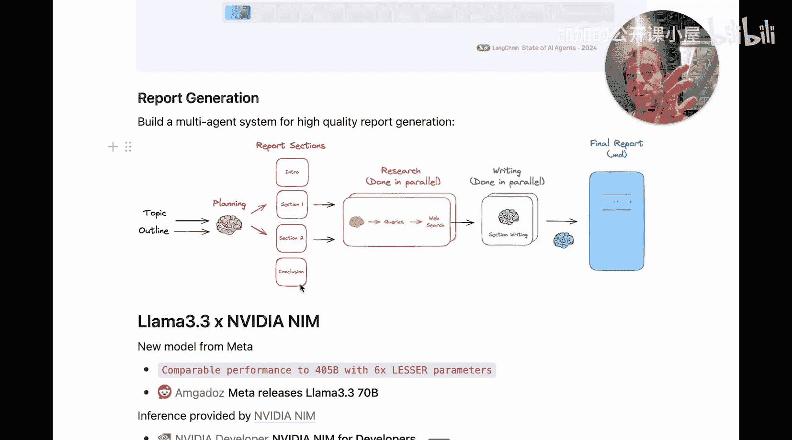
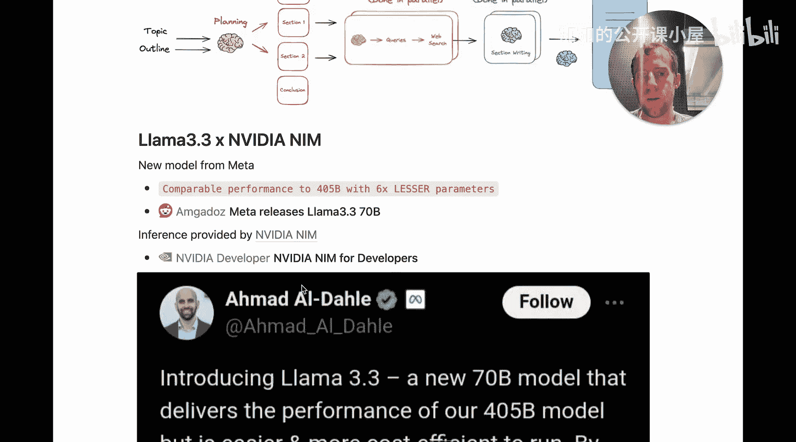
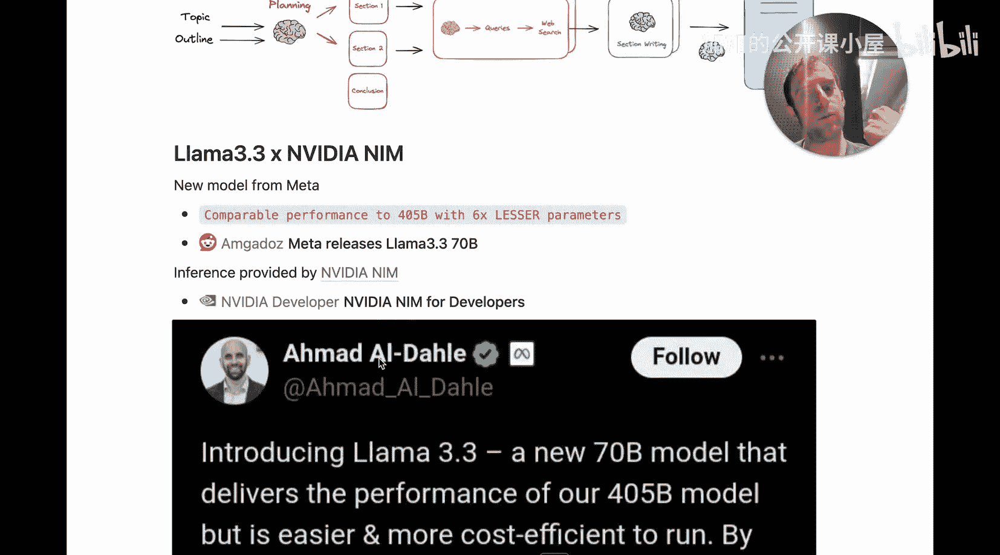
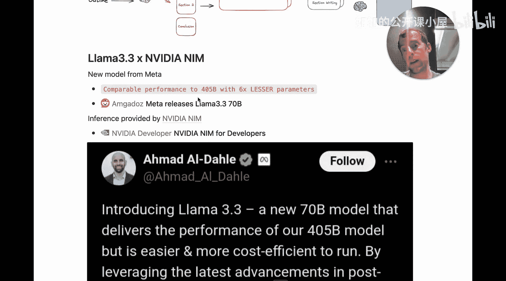
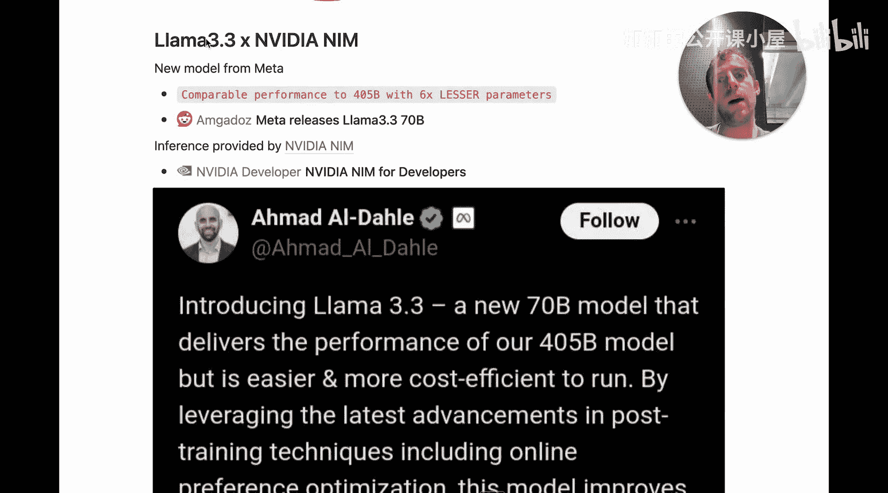
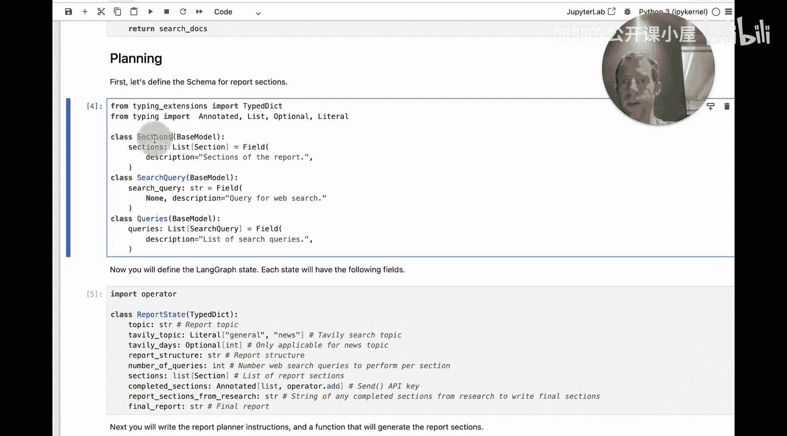

# LangChain【中英⚡LangChain 使用指南｜Build with LangChain】 p50 P52 Structured Report Generation Blueprint with NVIDIA AI (Llama 3.3) -BV1xwfMYDE3n_p50-

Hey， this is Lance Langcha Earl this fall we put out a state of AI agents report where we asked 1600 people in the AI industry。

 what are top use cases for agents？Now we noticed that the top reported use case is research and summarization。

 and this is something I've been doing quite a lot。

 so I want to talk about an architecture that I've been using for automated research and summarization and show how to build this using Lama 33。

Now I want to show the architecture that I've been using full report generation and research。

 and I consider to be a multi agent system。 and first it's worth reflecting on what even is an agent。

In simple terms， I think of an agent as an application where an LM directs the overall control flow。

 So like a rag app， for example， the control flow is always fixed。

 It does retrieval and then passes to an LM。 the LM produces an answer。 in an agent。

 the flow of the application is dictated by by the LM itself。 So in this case。

 what happens is I pass in a topic I pass in an outline。

 And an LM then creates some number of report sections。

 Now it's free to decide how however many sections it wants based on what I provide。

 So it could be one section， it could be 20 sections。

 So this is really what dictates the entire flow of the downstream application。

 How many report sections it chooses to produce。 Now I like to do this way because this allows me to one look at those sections。

 for example， in debugging and determine if I like the outline or not。

 And I use this to iterate on this planning prompt quite a bit when I was building this。

 So that's kind of  point1。is that when you have your agent produce these report sections up front。

 you can then parallelze the writing of many of those sections。

So it actually allows for an efficient overall writing process。Now what happens is。

I create some number of sections first。And everything that's considered a main body section that requires web research is determined by this planner。

 So the planner basically tags every section and says this is an intro。 This is a conclusion。

 They do not need research。 Everything that's considered main body does need research。

 If it needs research， it goes to this research phase or I have another LM you can think about us as like a subag basically spawn a bunch of different search queries。

And kick off Web search。And then based on the results of web search to do some more transformations on those results and write the section。

 So that section writing is paralyzed for all main body sections of the report。

Now this is another interestingching point， I found that quality is a lot better if you write sections individually rather than asking your assistant or agent to write the entire report in one shot。

 so that's another thing I do highlight here。And finally。

 we have another LLM reflect on all the main body sections that you wrote through research and then write any final sections like intro and conclusion。

 I do this because I found a sequential writing process produces overall better results。

 like if the introduction conclusion actually looks at everything you've done in the main bodies。

 there are a lot better than if you just produce everything in parallel and then your intro and conclusion maybe totally just joint it from what you actually wrote in the main body。

 So it's a subtle point， but I found it produces much better report quality。

Now， I want to show how to build this using Lama 33 and Nvidia Nim。

 Now what's really cool about this is Lama 33 is a new release from meta。

 I'm sure many people have heard about this。 The cool thing about it is that it packs in the performance of a much larger prior model。

 Lama 4 or 5B with 6 x fewer parameter， so it's faster to run， it's easier to serve。

Now， the catch here is that I was really excited to try this。

 but 70 billion parameters is too large to run locally on my laptop。 I have only a 32 gigs of Ram。

 So you do， at least for many people， need to find some inference provider。

 and this is where NviDdia Nim comes in。 It's a really nice way to run models and they're all hosted for you。

😊。

So that's kind how these two pieces come together。 I'm going to show you how to run Lama 3。

3 on Nvidianym as a really easy and nice option。 So before I dive into the code。

 I just want to mention two things quickly， the cookbook or all the code is gonna to be linked to this video。

 And also you're going to see in the cookbook itself。

 There is going to be a button for this Nvidia launchable。

 So this will actually allow you to deploy the notebook on a GPU with one click and environment is all preconfigured for you。

 So it's actually a very nice way to。😊。

Also， get started quickly if you want to， for example， actually deploy this with your own GPU。

So if I open up the notebook here。You'll see that this is a nice diagram of the overall multi Asianian architecture we're going to build。

So we're just going to set some API keys here， just make sure you have your NviIDdia API key set to access。

And for tracing， we'll use Langsmith。Now importantly you do need Tvily for web search。

 you know TviI is a very nice， convenient web search engine， it's free to use up to， I think。

1 thousand requests， and I like it a lot， so I'll use it with a lot of different agents。

 so go ahead and grab that。 and that's really all I need to get started。

Now here's where the fun begins。 so basically if you look at Lang chain's integration with chat In video。

 all you need to do is pass Me Lama 3370 be instruct as the model name。

 and you're going to load that Azure LLM。Now， once we've done that。

 we can go ahead and just invoke that using LN dot invoke， pass an input and。

You can see the model will run。So I want to show you one very useful trick that we're going to using throughout this agent。

So。Lang chain has this withstructured outputs method available with many different LMs。

InVdia included。And what's really nice is you can just pass a schema in this case。

 epiantic model to that with structured output。And then you can very simply invoke your LLM。

 In this case， we can supply system prompt human message to that structured LM that we created right here。

In this case， here's a toy example。 my system prompt says create a well out my search query。

And my schema has。Search query category as the two fields in my pantic model。I can run。

 and I can actually extract then each of those fields from the output object。

 which is a pedantic model。So there you go。So the ability to do structured output generation is very generally useful with LLMs。

 and you'll see that we use it quite a bit right here。

Now let's kind of walk through this architecture and kind of go through each piece in detail。

 So we're going to start here where the user， we provide a topic and a structure， okay。

And we're going to have our LM first generate a report plan。 So why do I do this。

 I've found that when I've done a lot of report generation。

 it's nice to start with a plan for the report。😊，For one， you can debug it independently。 and two。

 you can actually then parallelize writing all of these sections。

 So it actually makes the overall process faster rather than。

A sequential process of writing each section individually and often of higher quality than trying to do one shot report generation。

So let's talk about the two inputs we're going to provide to kick this off。

 So one is a report structure。 I can just lay this out in natural language。

 Here's the type of report I want to generate。 It should have an introduction。

 It should have conclusion， and it should have some main body sections。 So this is。

Really nice because it's entirely configurable by the user in natural language。 That's one。

 And two is the topic。 So give me an overview of these processing units GP versus CPU， okay。😊。

Now to kick this off， I'm going to call this Gen Report plan function here。

And you can see we define that right here。So one thing I want to call out is where I should use Lagraft to build this overall agent。

 But what's really nice about Lagraft is each node in Lagra when you build a Lagra agent is just a function。

 Okay so this is just this good old Python function and where you're taking in is state Now this state you can see we define up here is report state right here。

 This is just a type di with a bunch of different fields we're going to use throughout the lifetime of our agent。

 So it's cool about Lagraff is you're going to find this state。

 which is passed between all the nodes as your agent runs。

And these fields are just populated by the agent as it goes。

So here's really the main intuition in this initial general report plan node。

What we're doing here is。First， we're going to generate some search queries。Okay。

Then we're going to do a web search。Here。And finally。

 we're going to produce structured output that takes in。The provided topic from the user。

The results from Web search。And the desired report structure and produces a structured output of report sections。

 Okay， so this is like the planning phase。 we're going to generate the layout of the report first。

So first question is where do these sections come from， Well， you see right here。

 this Elm with structured output， we pass in sections if you go open the notebook。Right here。

 you see that we define a pedantic model for a report section。 Okay。

 so that's just basically has a name， a description。

 whether not research is necessary on that section and the content。

 So this is basically like the core unit of a report。 It's just a section。

 And we just define sections as a list of those section objects。 That's all it happens。

 So we basically just take this。

And we pass it to。Lawma 3。