# LangChain【中英⚡LangChain 使用指南｜Build with LangChain】 p51 P54 Adding Chat-LangChain To Slack -BV1xwfMYDE3n_p51-

Hey， this is Lance from Langcha。 Chat Laangcha is a free to use popular question answering assistant for Lang chain Land graph documentation。

 Now you find this in our documentation pages。 It takes you to this URL and you can just ask questions and it gives you answers from the Lang chain documentation。

And as you can see here， it produces kind of nicely structured answers based upon documents that it finds。

In the La chain documentation。

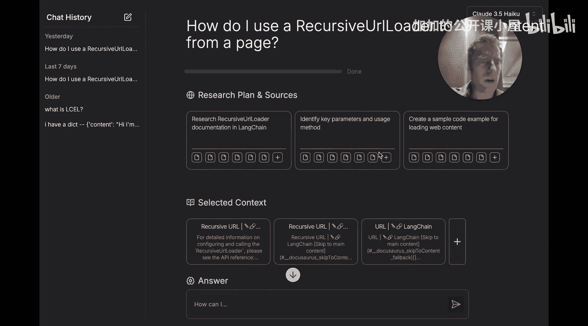

Now， one thing we found is that often， for example， we work in Slack。

And it's actually really useful to have assistance like chat line chain available natively in the slacklack environment。

 If， for example， I have a question that comes to mind while I'm discussing in a slacklack thread with someone。

 I can just ping chat line chain as an application and have an answer。

 So we actually have to set that up。 So we actually have chat line chain now enabled as a slackck app。

 and it's free to use。 So this video will show how to onboard chat line chain to your slacklack if you want。

 and you can hit it freely from your slacklack account。😊，Very easily。

So here's an example of it set up in a particular channel。

I can ask questions directly in Slack just by adding the bot。

And replies in a thread underneath my question and gives me a nice detailed answer。

 And what's cool is I can continue to follow up in this thread and retains the chat history。

As I do that。So in this video， I'll show you how to set up chat L chain as a slacklack application。

Very easily in a few quick steps。Now let me briefly explain a little bit more about how this is actually working。

There's two central components here。One is a Slack application。

 which we're going to configure in Slack itself。And the other is our Langra application deployment。

 which could be a chat bot， it could be an agent， right， so there's those two things。Now。

 raw events from Slack， like when I say at bot and ask some question。

 that's like a raw event that gets sent from Slack needs to be able to reach my chat bot or agent。

 whatever is in my deployment in a particular format that my assistant or agent chatbot is expecting。

This is where we need an intermediate step。 and that's actually what we're using modal for。 Now。

 let me walk you through this overall flow。So I start in slackla。 I say， hey， bot ask question。

I have a slacklack app。That。Will route events to particular endpoint in this case。

 it can be a modal server running。And we set up this events slack end point。 Okay， now。

 all that happens here。 It's very lightweight。 We just take those events and package them up in whatever format are。

Deployed app is expecting， in our case， just as a chat message， that's all it's going on。

 super simple。Now there's other ways you could do this， we're using Moal as one example。

 but there's many different ways you could kind of build this intermediate layer。Now， in my case。

 the chat bot responds with a new message， and we pass that back to the web Hook URL。

Hits this callback endpoint in our modelal server。And the model server then just does something very simple。

 It just grabs the last message in that messages list， which is the response from our chatbot。

 in this case， chat L chain， and then that is published back to Slack using the Slack SDK。

 That's all that's really going on。In this particular case。

A repo assumes that using the messageage state key。

But you'll see below that you can configure this to use any state key you want。

And you also need a modal account for this quick start。

 of course you can do this other ways if you want。Now let me walk you through a quick start very quickly here。

 Just go to this link。 This is already assuming you have a Slack account API is so you good here。

 that'll show you all the slack apps you have created already okay。So you can say create new app。

Now here's where if you want to kind get started quickly， when you create a new app。

 you can just say from a manifest。

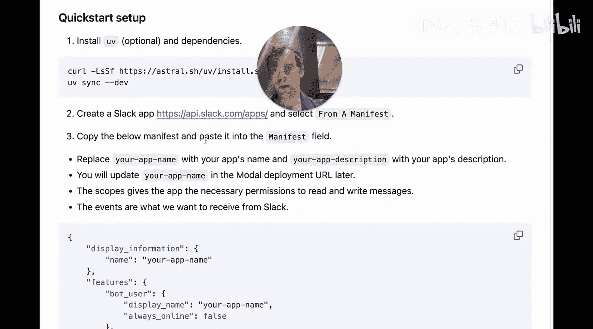

Select your workspace。 In this case， I'll connect it to the L chain Slack account。 Now。

 here is kind of a default manifest。 Go over to the repo。

 Copy this template manifest that we provide。 Now， what's going on here。

 This is basically setting up。

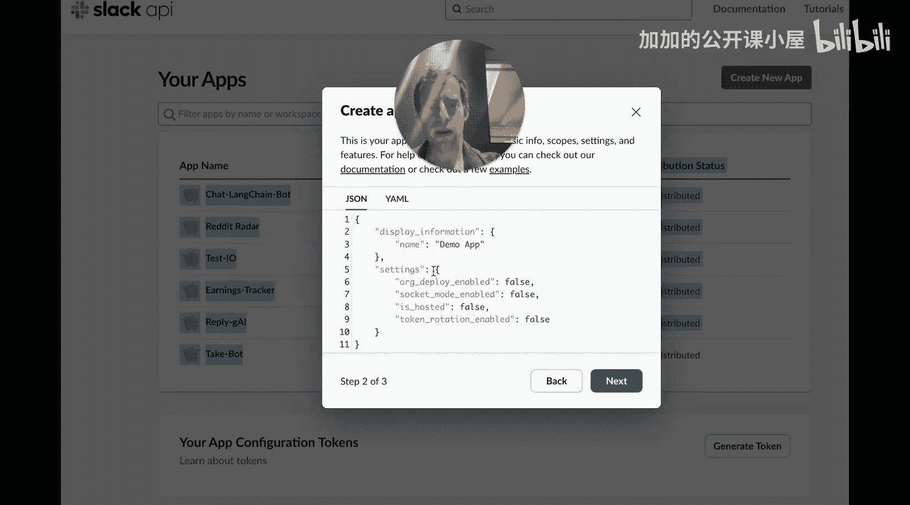

Scopes this gives your app necessary permissions to read andrite messages。

And it also sets up event subscriptions， so what the app is actually going to receive from Slack。

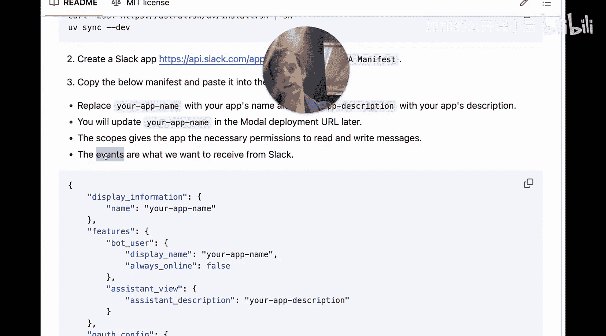

So just take this manifest。Paste it in。Now a few things you'll change。Change your app name。

 add an app description。And this thing you're going to set later。 Don't worry about it for now。

 This is the request URL。

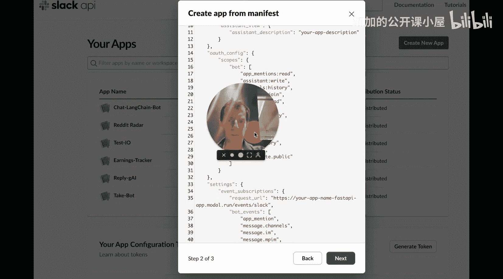

So you've done that， you're going to see this。Now go down to this oathan permissions。

You're going to click this install to your workspace This will install the app。And once you do that。

 you're going to see this bot token， okay， that's one。Now go to basic information。

Go to this sign in secret。And you can also copy this。So those two things。

 you're just going to copy to the E and V file in the repo。

So that SlackBt token is used to authenticate API calls from your bot to Slack。

And the Slack signing token can use the verify incoming request to your server from Slack。

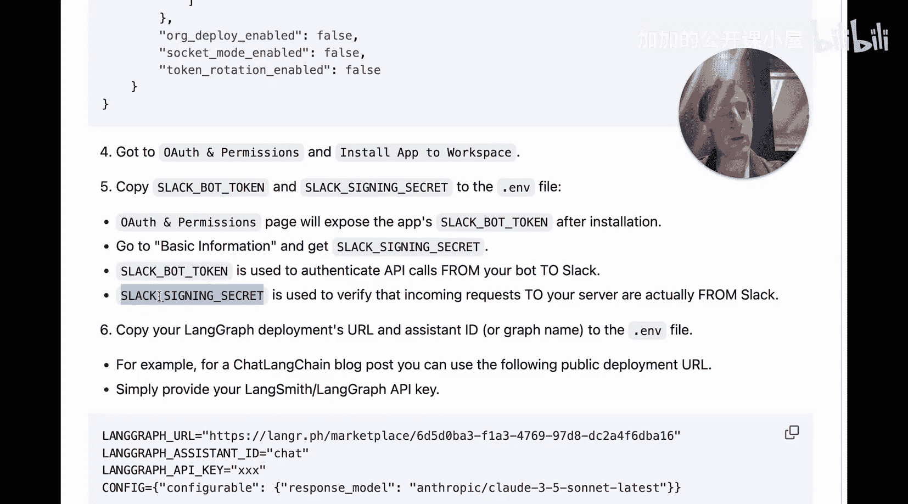

And just to make that concrete。 you'll hear I in the repo， see this E And V example file。

 Just copy that to an E N V file and add those to。Ks。You're signing secret， your slackpot token。

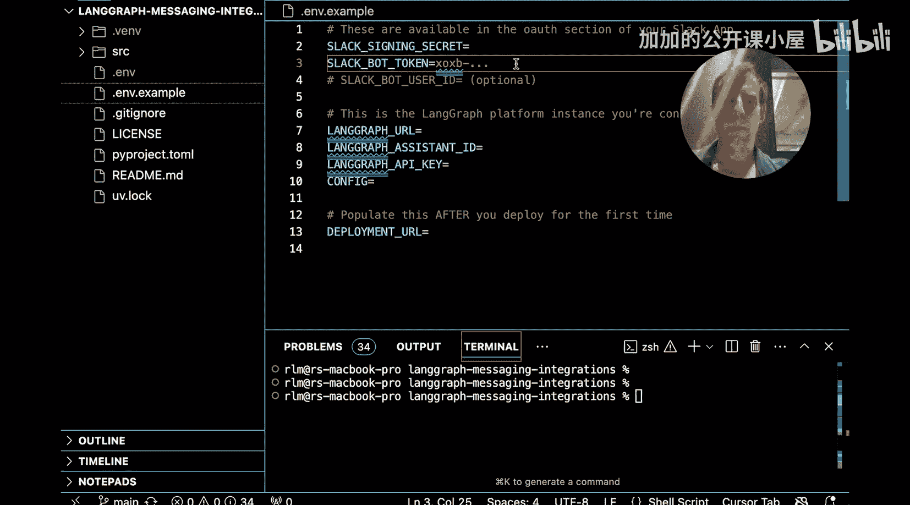

So if you look at our flow here， what we've done is we started the process setting up our Slack app and we've done a lot of it through this manifest。

Now we also have our La graph app， okay？And what you're going to do is。Add your Langra。

 deployment URL。Assistant I D， API key and optional and configurations。To the NV files。

 this will tell the application that we're building。

The deployment for land graph that we want to interact with。Now as a nice shortcut here。

 our rePA provides a public link to chat Lang chain。

 So I showed before chat Lang chain is an application that you can use to answer questions about Lang chain。

And this is free。 so you can just take this link。 It's already deployed for your。

 All you need is your own Lsmith or La graph API key， same thing。Provide it here。

 and this will allow you to interact with chat line chain just as we did in the intro。

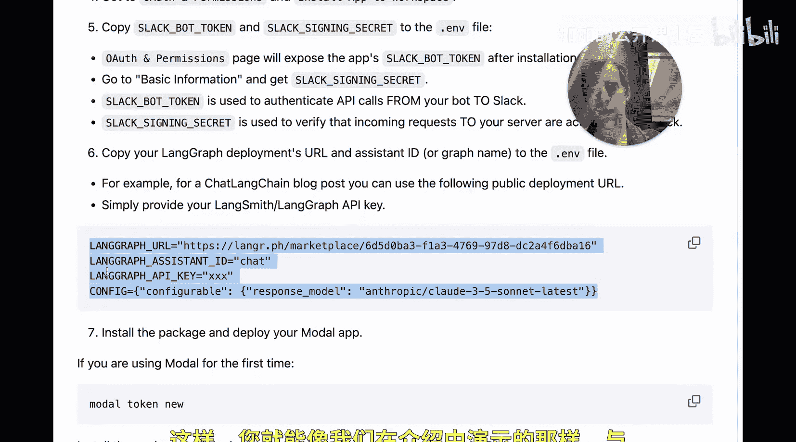

And again， looking at that N V file， you're going to supply all that right here。 So again。

 we've populated this。From Slack。We populate this from our Lagraft platform deployment。

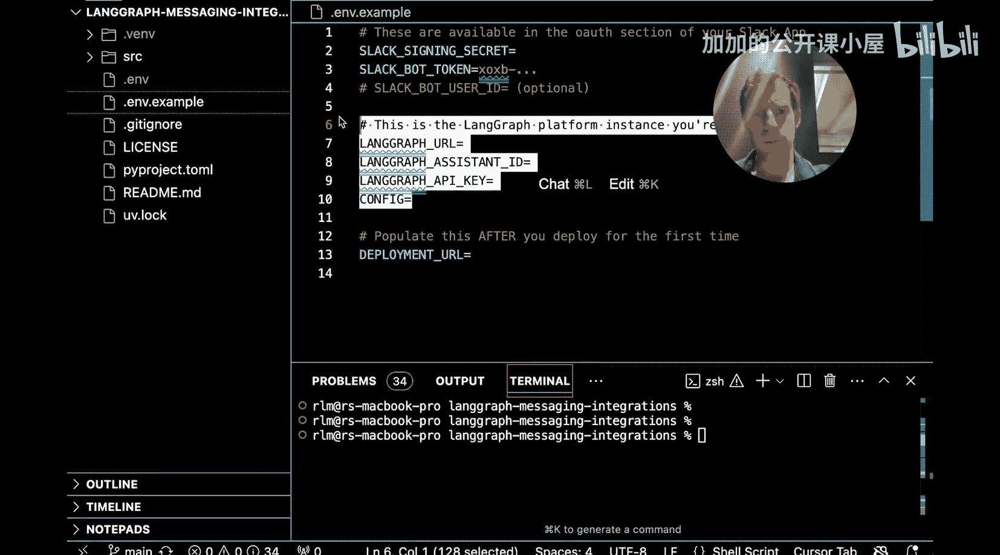

And now the final piece is just this modal server that's going to sit in between。

So if you're using Moal for the first time， Pip install Moal and then set Moal token new。

And in the reone， stall this package and then deploy。

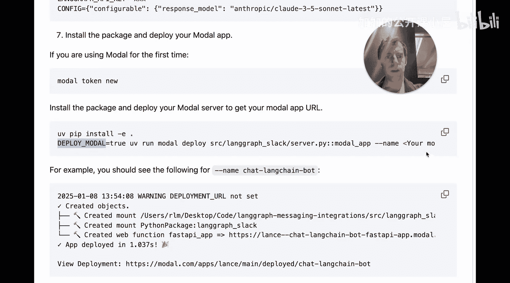

A modal app。My EV file is populated with these secrets， as well as the La graphft URL。

I've installed Moal。And I can just run this command to kick off。My Moal app。

 and I'll call it chat La chain bot。Ku。And if that works。

 you're going to see something just like this。Now， this is going to give you the URL for。

The modal server。And you're going to add that right here。

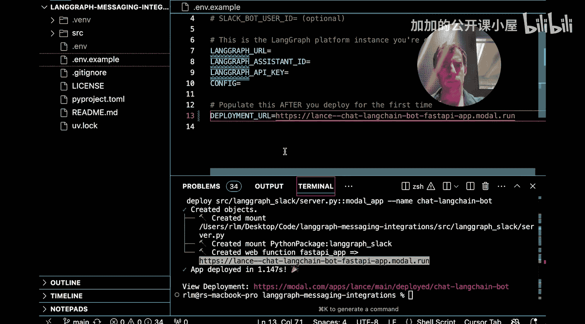

So if we go back and just recap what we did。First， we set up the slack app using the manifest。

 as I mentioned。Then we ensured that we had line of deployment running。

And we went and supplied the URL for that deployment。

As well as any configurations in the assistant name， as well as my Lng graph or Langsmith API key。

That's also applied in the inV file。 And then finally。

 we set up this modal server that's going sit in the middle。

 and I now have my modal deployment or model server URL。 So that's it。 It's all I've done。

And there's one final step。Go back to Slack and I need to supply that Mo deployment URL。

With the endpoint， then slack。To my Slack app to tell my Slack app where to send events。

 that's all I need to do。Back here。Go to event subscriptions。And you can see I've already applied。

 this is the URL for that modal server events do Slack。

And the manifest has already set the events for you。

 so you don't worry that you just have to supply the URL for your model deployment。

And here's my app name， chat La chainin bot。I go over to Slack and just like we saw， chat La Chabot。

 I can interact with it， you can see it is flagged as an app here。

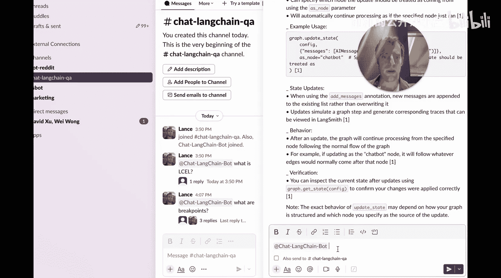

And。We previously show the functionality of。