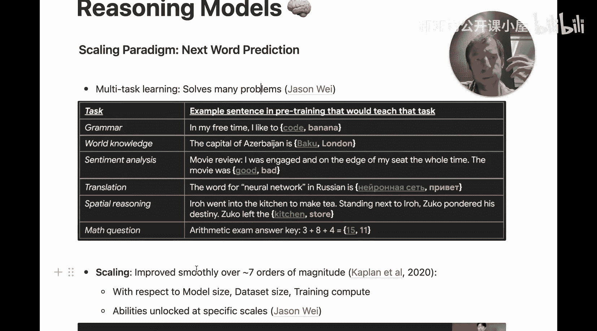
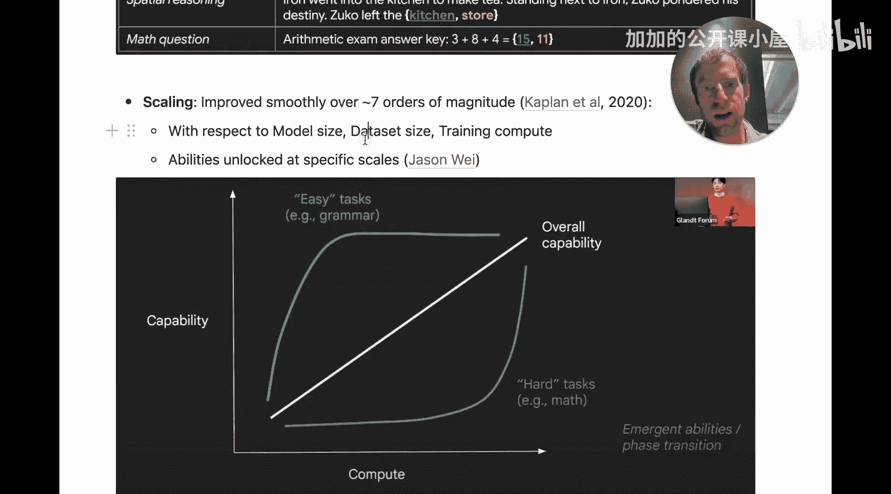
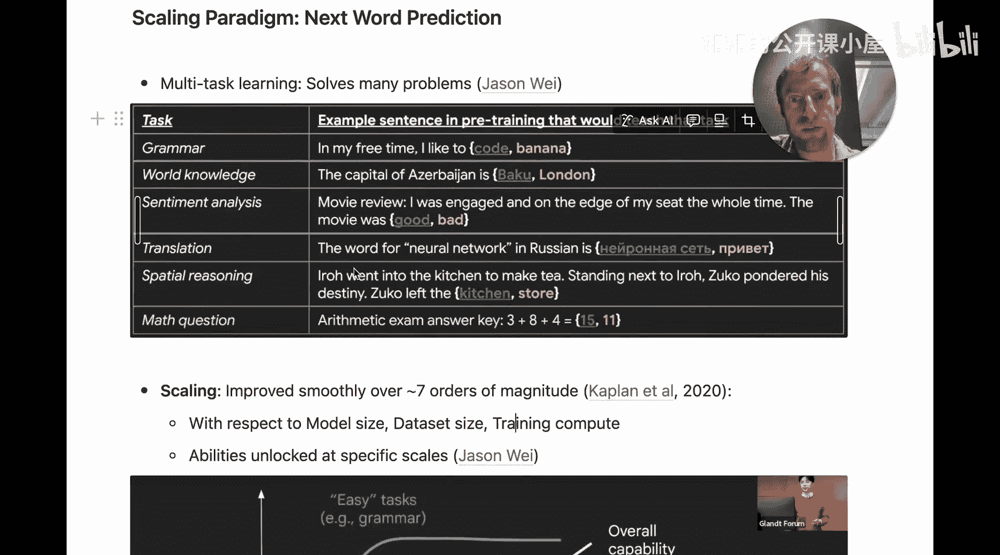
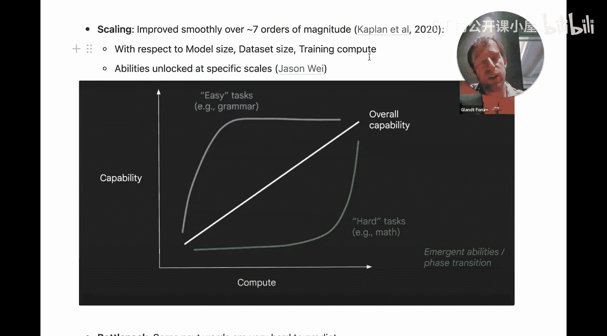
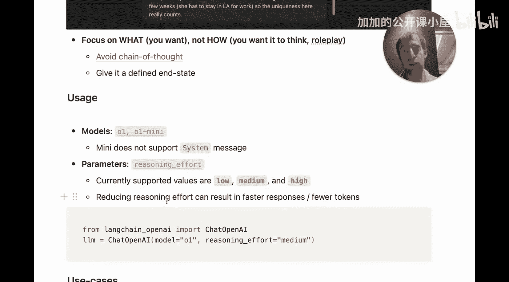
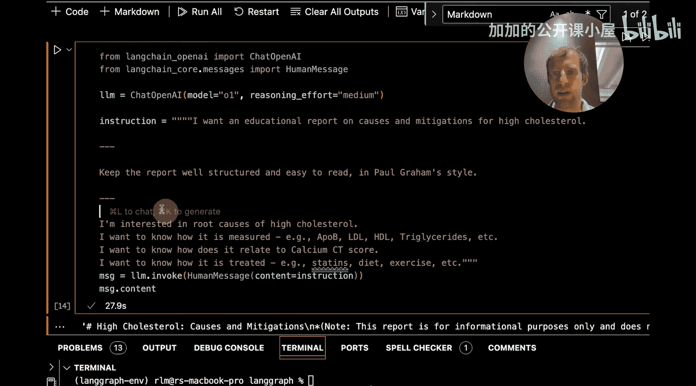
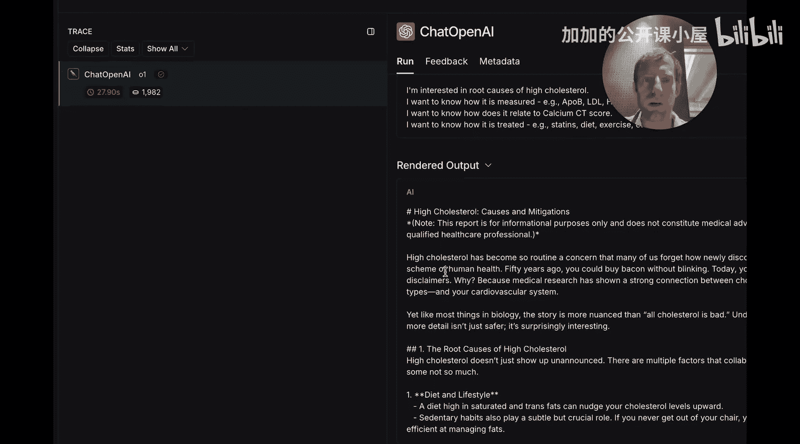
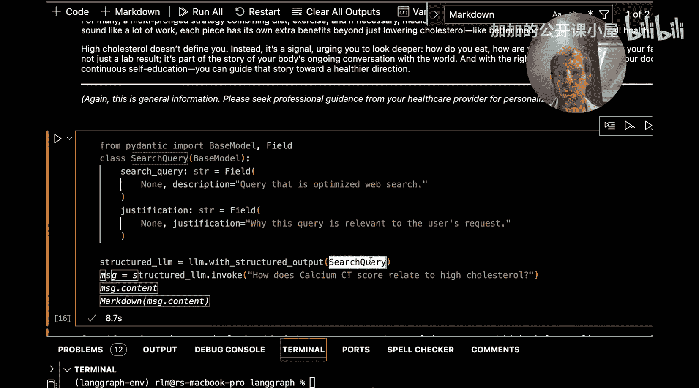
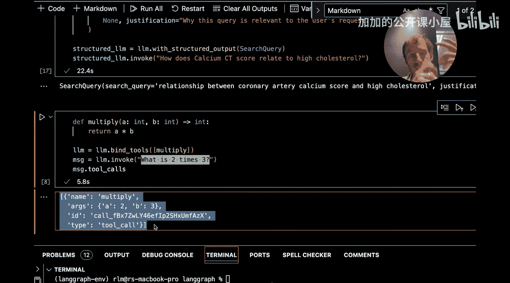
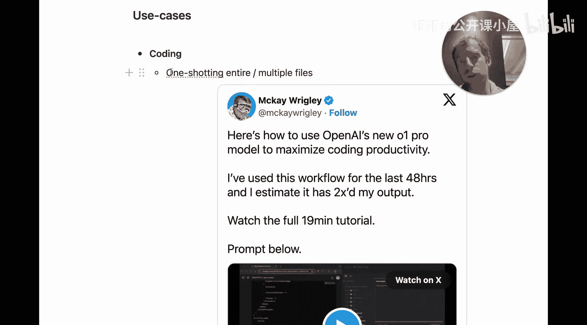

# LangChain【中英⚡LangChain 使用指南｜Build with LangChain】 p53 P56 Understanding and Effectively Using AI Reasoning Models -BV1xwfMYDE3n_p53-

Hey， this is Lance from Langcha。 you've probably heard a lot about the new reasoning models from Open AI such as 01 and 03。

 I want to talk about these by reviewing some of my favorite new videos and kind of blogs I've seen on this topic。

ButFirst， let's just start with the current scaling paradigm that we've been in for a number of years。

 which is next word prediction。 So Jason Way has a great talk on this。

 And he kind of frames nicely why has next word prediction work so well。

 And he basically explains it as next word prediction is a multitask learning problem。

 When you ask an L M to predict the next word or the next token in a sentence。

 It learns a lot of things at once。 It learns grammar， It learns world knowledge， sentiment。

 translation， spatial reasoning， math。 So this simple learning objective is extremely powerful。

 and there's lots of nice papers and talks on this。 But that just sets the stage。😊。

Now we've scaled this over roughly seven orders of magnitude。 Jason also touches on this。

 and this is well covered in the cap in at all paper from 2020。But with respect to model size。

 data set size and train compute， the overall capability of models trained just with this kind of simple objective has gotten better。

Now there's some interesting points here are related to the concept of emergence。

 certain capabilities appear to be unlocked at certain scales， like for example。

 GPT 2 and 3 report math for kind of unlocked greater math capability。But overall。

 you can kind of think about the capability increasing in a relatively predictable fashion with respect to size of model。

 data set and trained compute。 So that's kind of the paradigm we've been in。

Now here's kind of the catch and Jason kind of lazees out nicely。

Next word prediction is kind of like system1 thinking it's fast and intuitive。

But some next words are really hard to predict。So， for example， a challenging math problem。

 a challenging reasoning problem。The problem is these models use the same amount of compute to solve easy and hard problems。

 that's kind of the overall bottleneck with this paradigm。

Now a workaround that we're all probably familiar with at this point is this notion of chain of thought prompting this came out around 2022 and Jason Way has a nice paper on it。

 of course you prompted all them to think it up by step。But what's really happening here。

 So Nathan Lambert has a nice video on this。 And I thought it was really interesting。

 You're kind of trying to enforce system to thinking， which is conscious and neverful。

 So for example， if you do a math problem yourself， you perform a bunch of intermediate steps。

 And those are kind of storing intermediate variables for yourself。

 which then you utilize to generate the final solution。

 And chain of thoughts kind of forcing them all to produce those intermediate as tokens along its trajectory towards a solution。

 So it's like by telling to think step by step， you're actually having it produce work in the form of tokens and those tokens are kind of storing intermediate information that the model is using to form a final answer。

 So it's kind of like a hack。😊，To force the model from system1 thinking to system 2 thinking。

So I kind of like the way that Jason lays that out and Nathan explains what's happening when you actually do CFT。

Now， this new scaling paradigm， which you see with these reasoning models is basically scaling reinforcement learning on a chain of thought。

 So what's actually happening here， there's a nice blog post from open AI， a nice video from Nathan。

 but really the summary is that you have some training data。

 which contains explicitly correct answers。 and this is important。 coding problems。

 math problems that are verifiably correct。 Okay you have a model that can sometimes generate correct solutions。

And you have a grade that can verify whether or not a model output is correct or not。 Okay。

 And if it's correct， you give the model a reward。 Now。

 this is where the reinforcement learning thing comes in。

 You have some policy that will nudge weights。 that's more likely to produce high reward outputs。

 Now， what you do is when you train this on this data set that has many explicitly correct answers。

 for every problem， you basically have the model to produce a bunchage of trajectories。

 and you grade them all。 and you reward the correct ones。 And over time in training。

 you do lots of forward passes。 O。😊，But you kind of tune or nudge the model to favor chain of thought or trajectories that result in correct answers。

 That's the overall intuition。 And I think more will come out on this。

 but this is kind of my distillation from reading， of course a blog post and some nice work by Nathan Lambert to explain a little bit more detail。

 And here's a nice kind of schematic of what's going on。 You have your training data。

 you have a policy to nudge your weights。 You have some verifiable reward。

 and you're basically running your model over the training data。 You're doing lots of forward passes。

 You're rewarding the correct chain of chains of thoughts that get you to correct answers that are verifiable with your greater。

 That's the big idea。Now， why is this exciting？Will represents a new scaling law。

 so some really nice videos from Noam Brown， Jason W on this。

 if you look at the recent results from 01 and now 03 just drop right before the new year。

 they're obviously extremely strong Okay so this is exciting。Now。

 another way to think about this is I really like this slide from David Ra from Nuripps。

Benchmarks are getting saturated more and more quickly。

 This is a cool visualization showing how long it takes for a benchmark to get saturated。

 It used to be in 2012。 It would take like eight years， right， Now it takes like a year for GPQA。

 which is a new benchmark made by David Ra， which was Google proof Q A。

 So question answers that are not easily Googled and basically we're seeing new stay there reasoning models are basically saturating on benchmarks very quickly。

 So it's exciting。 We early in the scaling curve。 That's the big idea here。😊，Now。

 here's where things are really interesting。 There's actually been a lot of confusion about 01 malls with some people saying。

 oh， these actually are really bad。 Okay， now Ben Hyla and Sws put out a really nice post on latent Space。

And it really helps to clarify when you work with these reasoning models。

 you should not think about them as chat models。And you shouldn't prompt them as such。

 There's as nice visualization of the anatomy of no one prompt。

 where really what you're doing is you're giving it an explicit goal。 You don't tell it how to think。

 you tell it what you want。 You give it return format warnings and just dump all your work。

 Now a lot of people have shown that this style prompting works really well with01， right？

 So unlike chat models， chat models， you try， tell it how to think you're a researcher。

 your think step by step with these models， you don't do that。 You give it what you want。

 and you give it as much context as possible。 Okay。

 so that's really the context on how to prompt these。 again， focus on the what not the how。

 Don't tell to do a particular style of reasoning， just give it what you want。

 That's the big point here。Now let me show you usage very quickly。First。

 there's a few models available through the API 0101 Mini。

OneOne thing I'll note Min does not support system messages， that's just a small thing to note。

Now parameters， so with01， not with0 and mini you can provide these values of reasoning effort for low medium high。

 this just tunes the amount of reason the model will do basically faster or slower responses。

 fewer and more tokens accordingly。

So I'm in a notebook now， I've just p installed Lang chain open AI import。

Now I'm just using chatU and AI， Model 01， I'll set reason level to medium。Now。

 note how I prompt this。 I tell it what I want。 I want an educational report on cause mitigation for high cholesterol。

 So this just an example prompt。 Tell it how I wanted to produce the output and give it just a dump of stuff I'm interested in。

 run this。

Cool， so that ran。 We'll look at the trace in a minute， but I'll just show you here in markdown。

 Here' is kind of the outputs。 you get a really nice kind of well laid out report on the topic of interest。

 right， So this is really cool， and it's quite exhaustive。😊。

Pretty nice。Upen up the trace。 and I just want to show you， indeed a1 ran。 Now。

 here's where's interesting， right， The latency is going to be higher than you see with the chat model。

 It took 27 seconds。 Okay， fair enough。 And again， here was my prompt。 as you can see。

 we laid that out。 And here is the report。 output was quite exhaustive。Higher latency。

High quality， lots of reasoning goes into producing the report。

So the O1 models work with structured output， which is a very popular use case。

So let me just show you how to do that you basically define our LM previously called with structured outputs this very nice helper method。

 pass in a schema in this case I have a pedantic schema。That's pretty cool。

And I go ahead and run that。😊，And we get a structured object out， pretty cool。Now。

 people are going to be very interested in this as well。 Of course。

 tool callinging works with these models。 So again， I just can call L the bind tools。

 Let's see in this case， I pass in a multiplied tool， and I。Make request that's related to the tool。

 The reasoning model decides to call the tool。 and I get a tool call out。 There we go。

 So those are really the core things you're going to want。

 Very high quality reasoning and report generation， for example。Structured outputs。

 tool calling with those primitives， you can do a huge amount。 of course。 Now。

 let me talk a little bit about use cases。 So here's some examples that I've seen and they're actually covered pretty nicely in Swx's blog posts。

 I think are really interesting to think about for these models。 So coding is obvious。

 They're extremely strong at coding。 But what types of coding problems。

 So I think Mckay's done some really neat work on this。

 So what we've heard and seen quite a bit is these models are very strong at one shing entire files or sets of files。

 So again， Mckaay has some nice。

