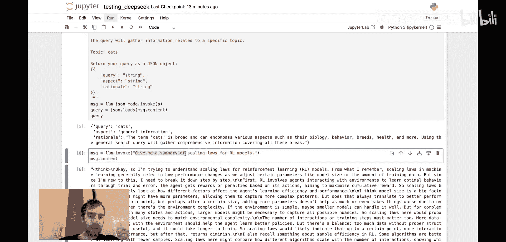
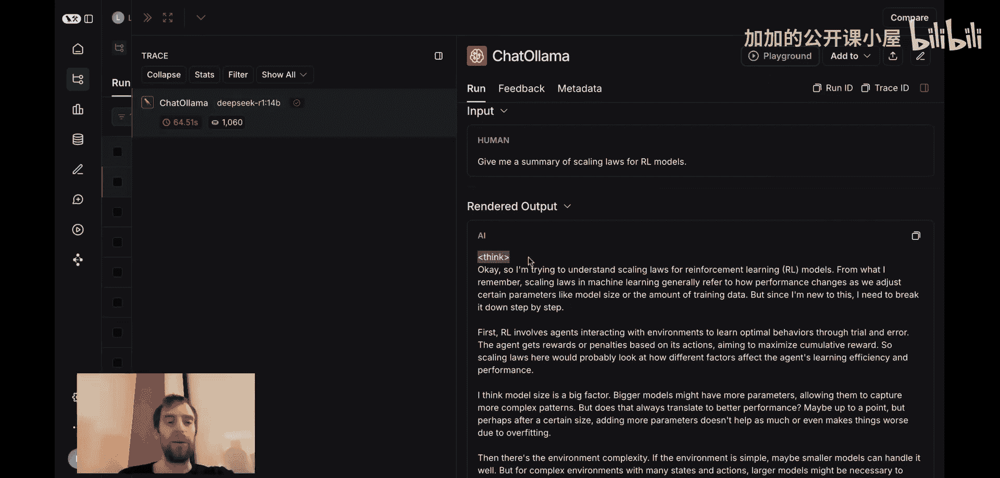
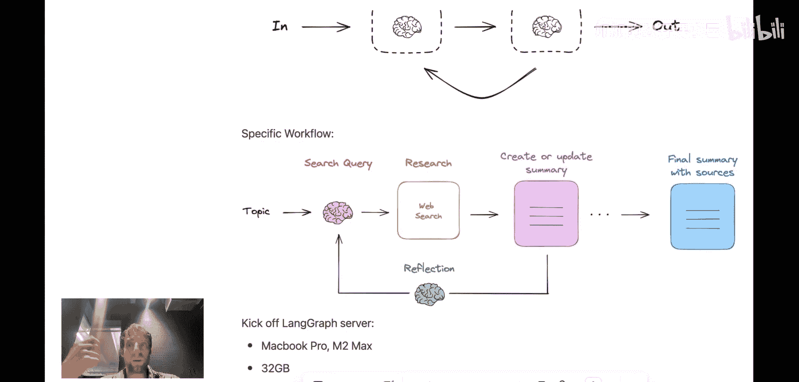

# LangChain【中英⚡LangChain 使用指南｜Build with LangChain】 p54 P57 Building a fully local ＂deep researcher＂ with DeepSeek-R1 -BV1xwfMYDE3n_p54-

This is La Bcha Deepse just released our one， which is a new fully open source reasoning model from the Deepse lab and it comes with a paper that describes their training strategy which is quite cool because reasoning models represent a new scaling paradigm for LLMs I have a separate video on this that's also coming out soon that you can check out so the scaling paradigm over the past few years has been next to a prediction we've seen many successful chat models trained with this Its system one type thinking it's fast intuitive we often tell the model how to think which tricks like how to think you think step by step and the interaction mode often in chat Now reasoning models are a bit different they're trained with a different paradigm Rl on chain of thoughts we'll talk about that a lot in a bit。

It's system  two reasoning。Often tell the model what you actually want， not how to think。

 and the interaction mode is a bit different， it's very good for research or planning in the background style tasks that are less interactive。

So the really interesting thing here is that we now know how a state of the art reasoning model is trained。

 so of course the current state of the art reasoning models from open AI。

 the O series models are closed source， we don't have detailed information about how training works。

 but this is a very clear illustration of how they built a state of the art reasoning model。

That is on par with01 and you'll see those results here shortly。

 But let me actually talk through the training strategies It's very interesting。

 So DCG1 uses a combination of fine tuning and reinforcement learning to produce this reasoning model。

And has a few different stages so the first stage is just fine tuning they take deepse V3。

 which is their very strong base chat model and they fine tune it on some number of thousands of chain of thought reasoning examples now they don't actually tell the specific number of examples from my reading for the paper But the point is they do a fine tuning phase to build a good starting point for RL Now the second stage here is reinforcement learning with this approach GRPO So what's going on there Well they have a separate paper on this and I do want to talk about that a little bit So this Rl stage one uses GRPO reinforcement learning it's from this deepse math paper。

Now here's what's going on for every trainee example。

Now I do want to a note how many training examples they use they have 14 1000 training examples of hard verifiable problems in math and coding for which you need some degree of reasoning like you need to produce a reasoning trace typically to solve them and there's some definitive solution that can be verified those are the two criteria that matter here。

So they have all these samples， now what they're doing is for every trainingee example。

 they actually produce 64 samples or 64 different attempts to solve the problem。😊。

And they sc each one of those with some rule based reward。

 like correct or incorrect for math or coding， right， that's pretty straightforward。

Now here's where it's kind of interesting， they basically compare every sample to the mean of all samples in this 64 sample batch。

 okay， so that's kind of what they do。For samples with high or low normalizer rewardd。

 relative to the groomme， they increase or drop the probability of the model generating all the tokens in that sequence。

So what happens is each token in that output gets a positive or negative gradient in update。

And here's the intuition。 It's basically saying， let's make all the choices that led to this correct or incorrect decision more or less likely。

 So that's actually what they're doing。 And so the punchline here is why do they do this。

 They're trying to discover good reasoning patterns。

And what happens is this makes the model very strong at reasoning。

 but it loses some general capacities。 For example。

 they mentioned it had potential language mixing issues。

 So this is where another inching trick comes into play。 If we look at our diagram here。

 We're right here。 So you've actually used reinforcement learning to get a very strong reasoning model。

 But it's actually a bit weaker in some other capabilities。

 So what they do is they take the resulting reasoning traces from that model and filter them to get only high quality ones。

 So the paper talks about this as rejection sampling。

 So they're basically filtering the outputs of that first reinforcement learning phase for a bunch of different things。

 It's not just correctness。 But the point is it results in 600000 reasoning traces that they can then train further on。

 So that's really inching insight here。 that you can utilize outputs from the first stage of Rl to subsequent stages of your model。

 And that's exactly what they do。 So they do a second stage of fine tuning on the results。😊。

That sampling plus 200000 additional nonreasoning samples in writing in factual QA to what they describe as restorestore the general model capabilities while baking in high quality reasoning。

 So if you look at the diagram here， what's happening is they are filtering the outputs of that first phase of R Okay so remember this models of very strong reasoner。

 but it's weak in some general capabilities。And they're combining some nonreing examples and therefore writing QA and they're fine tuning on all that。

 and then what they argue is or they present， they get a model that retains very strong reasoning。

 but also restores general capabilities Okay so that's the key point。Then after that。

 they have a final or second round of reinforcement learning with two different rewards。

 so previously we talked about they only used a rule-based reward for reasoning on math and codingd style problems now they include different rewards for helpfulness and harm as well as reasoning and they use a mix of data that includes both reasoning and general problems to really optimizing for both reasoning and general capabilities so that's really the second stage of RL Now a final note which actually is very exciting and we're going to be actually working with more directly here。

 they also take that data set that they get from that first phase of Rl of 600。

000 samples and they actually do knowledge they take much smaller open source models and fine tune them on those highqu reasoning traces and then what they get is a bunch of distilled smaller R1 models pretty cool in some of them you can actually run your laptop as we'll see right here。

So what are the results so they show a bunch of nice results here。

 deepeaR1 versus01 and some smaller models，0 and many。

 really the punchline is it's very close to R1 on a bunch of interesting challenges related to coding and math。

Now， one in particular payens to do Swbech verified。

 it's a very popular benchmark for general software engineering challenges。

 and it is doing indeed quite well， slightly better than01 apparentlypparently。

 they also have a bunch of distilled models。 So here's the thing that is really quite cool。

 If you look at their distilled Quen 14 B you look at the benchmark results and it is pretty close to01 mini can kind of go across and look and convince yourself of this but look it's pretty strong in 14 B can actually run on a lot of people's laptops for example。

 I have a 32 gig MacBook Pro and I can run 14 B as we'll see in a bit。

So now let's try playing with it， so I pulled deepse 14 Bad from Oama。

 so you can see they put a tweet out recently， they host all these models pretty cool you can try to run them on your own hardware。

And I'm in a notebook， so all I need to do is grab Lanch in llama， I'm going to initialize my model。

 and what's nice is I'm going to use JSON mode with Oama to also produce JSO outputlets and see how well structured outputs work with this model。

So first， let's try a simple question， was the capital of France？Cool CC capital France at Paris。

 we'll see something else is interesting these think tokens， okay。

 if you go around local Lama and you hunt around for this。

 there's a lot of people talking about these think tokens， they're hard to prompt away。

 I've tried a bunch。They've seen to be kind of an annoying thing。

 They are absolutely part of the training process。 You can look in the paper。

 You can see that these think tokens are actually included in the training。 Now， let's try Json mode。

 So what's interesting is when you use Json mode， the think tokens are not present。

 So there is some postpro happening on the allama side that strips them and you get a JON object out。

 So looks like JO mode release is working。 So that's a good thing。😊，I ask a more involved question。

 Give me a summary on scaling laws for R models。 and again you see wow。

 this is quite verbose and you can see this thing token emitmted first as like before。

 and now you get like a much more detailed breakdown of。

It's internal thought process。 So let's go right and look at Langsmith just to kind of get a better view of this output。

 So in my Langsmith project now， I'm going to open up this trace。 we can see it took 64 seconds。

 Okay， so that's actually pretty long。 But again， I'm really pushing the limits of my hardware running the 14 B model。

 So that's fine。 It's a little bit on me。 but I won to test 01 mini level performance running locally based on the benchmark。

 So I just want to kind of play with it。 Okay， so here's the output again， it's quite verbose。

 You can see the thing token here emitmted。 So does a lot of thinking。😊。

Prior to responding and seems to provide a sane response。 But again。

 this issue of a lot of prethinking being emitmted is evidently an issue with these models that may be a problem not depending on your application。

 You can also programly try to remove that。 That's another thing to think about。

 So let's vibe test a bit more。 This is a repo called Oama D researcher。

 And this is basically an evaluator optimize your workflow for report writing。

 So I'm going to do is I'm going to have an open source LM running locally。 via Oama。

Take an input topic from a user。And generate a search query for it。 performform web search。

 Get the results， produce a summary， but then reflect on the summary and regenerative question。

 go back。 So this loop is going to look kind of like this。 You can see queryer generation research。

 summer generation reflection， new query and so forth。

 This will continue for some set number of cycles that's configurable。 And in the end。

 I'll get a nice summary with sources。 And this can be run with any open source element。

 Now I have a separate video on this that talks about building it from scratch。

