# LangChain【中英⚡LangChain 使用指南｜Build with LangChain】 p57 P61 Hierarchical multi-agent systems with LangGraph -BV1xwfMYDE3n_p57-

Hey， this is Lance from Langcha。 Agents can autonomously perform tasks using tool calling and feedback from tools。

 often running in a loop， but in requests we get from users is how do I take multiple agents and combine them together into a multiag system or releasing a new library called Landanggraft supervisorvisor that allows you to do that pretty easily。

I'll show it to you in action right now so here's a really simple example of a multi agent system with a supervisor and two separate agents。

We have an app math expert that has tools for various mathematical operations。

 We have a research expert with a mock web search tool。

 So we ask a question that requires both agents。It needs to use search to get the headcount of Tang companies。

And。The math expert to sum them all together。 It's obviously a highly simple example。

 but shows the overall flow。 So what happens is the supervisor takes the request and routes it to one of the agents。

 initially， it routes it to the research expert to perform search。 The research expert does search。

 finds the result。 And you can see it hands back off to the supervisor。

 The supervisor then has a result from a research expert and then calls the math expert to compute the sum。

 There it is。 The math expert then hands off back to the supervisor which then responds directly to the user with the overall output of the combined headcount。

 So this is a very simple example， just showing the handoff between a supervisor and two different agents。

Each of which return their result back to the supervisor。

 and the supervisor then determines what to do next and when to just respond with the overall result to the user。

 So as mentioned。This library is using a supervisor pattern。

 and the idea here is just as we've shown， you have a supervisor that is connected to various agents。

And you you think about those agents basically as subgraphs of this overall system。

 and really what's happening is， as we showed in the example。

The supervisor receives some input from a user， decides which agent to call hands off。

Information to that agent， and I'll talk about that in detail below。But basically。

 the agent will receive everything it needs from the supervisor to perform its work。

 The agent then follows classic tool calling， action and feedback loop until it completes。

 And then we gave a second hand off back to the supervisor。 And again。

 I'll talk a lot about that information transfer back to the supervisor。

 which can then make decisions about what to do next。

 It might be call another agent or it might just be exit。 So before I get into the code。

 I do want to just explain the hand off mechanism。 But that's really the most important thing to understand。

Thiss a cartoon showing you the overall flow。 Let's us walk through it carefully。

 So you' have a person issues a request to the supervisor。

 The supervisor that makes a decision about which agent should handle that request。 Okay。

 that's this handoff idea。 Okay， so the supervisor basically engages a hand off to one of the agents based upon the nature of the request。

 that's really constant one to understand。 Now， concept2 is once this handoff is initiated。

The agent itself inherits the entire message history between the human and the supervisor。

 That's because each agent is a subgraph。 But this is important to understand that each agent just kind of gets that history by default。

 So information is naturally passed from supervisor to agent that way。

 All the messages between supervisor and human are just inherited。

 So the agent can use that history to determine what to do。 And when the agent completes。

 which is to say no more tools are called， we pass back。

 the result to the supervisor That's what this handoff is showing right here。 Now。

 a natural question ask is what information specifically is passed from the agent back to the supervisor。

 That's a very important point。 And you can configure that will show that in the code。

 but basically can use a particular flag called output mode to determine。

 do you want to just only pass that final。Agent AI message back。

 which is effectively the agent response。Or you can also pass back the entire internal agent message history。

 So that's up to you as to what you want to pass back to the supervisor In this toy cartoon example。

 I'm showing only passing back that final message indicating the agent output。 Then that supervisor。

 as you can see here， has that agent output， as well as the tool call indicating handoff back to supervisor。

 and it proceeds。 Now we've seen how the information flow works。

 Let's actually look at this in a little bit more detail。 So I'm in a notebook now， define myM。

 I'll pick a few tools in this case of an ad multiply in web search tool。

And I'm going to find two agents。 So I'm using our prebuilt createate react agent and again。

 I supply the model， the tools， the agent name and the system prompt。 Now， each of these again。

 are just simple react style tool calling agents。 They're going to follow a flow just like this。

 So what's going to happen is the LLM is going to make a decision to call a tool。

 The tool be called feedback or result from the tool call we pass back to LLM。

 This loop proceeds until no more tools called That is that final message or agent output。

 that will then be passed back to the supervisor， as you'll see in a minute。

 Now we create supervisor。And you can see in the system prompt。

 I'm just going explain the two agents I'm connecting to it。 and when to use each。

 So for current events use the research agent for math， use math agent。

 I pass those agents as subgraphs。 I pass those agents。 I supply my model。 Now。

 this is that output mode， this is what's determining what we pass back to the supervisor。

 So now we're going to use our library to create a supervisor。

 So let's walk through what's happening here。 First。

 a prompt to specify the two agents that we have and when to use them。 So for current events。

 we use our research agent for math use our math agent。

 We then supply our agents to create supervisor。 S our model。 We specify the output mode。

 which we talked about right here。 So output mode determines when you pass information back to the supervisor from any agent。

Do you only pass back that final message indicating the agent output or do you pass back the entire agent's message history。

 So you can you can control that if you want， and we supply a prompt。 Then we compile and run。

 So I'm in Langsmith。 And let's actually walk through the trace and kind of compare this to that they've got diagram to make sure we're very clear about what's happening。

 So first， we start with the supervisor。 We can look at that open AI model call。

 We can see the supervisor basically has two hand off tools transfer the research expert。

 transfer to the math expert。 Okay， we can see we receive a system prompt， which we specified。

 We have the human input。 And we have a tool call to transfer to the research expert。

 So that's step 1。

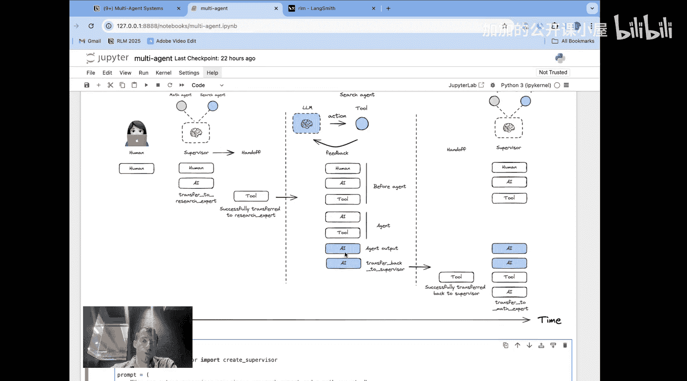

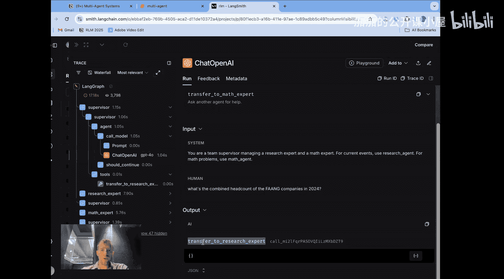

Now， that corresponds with what we see right here。 So human input and a tool call by our supervisor to hand off to one of our two agents。

 The tool is called。 We can see it outputs this。

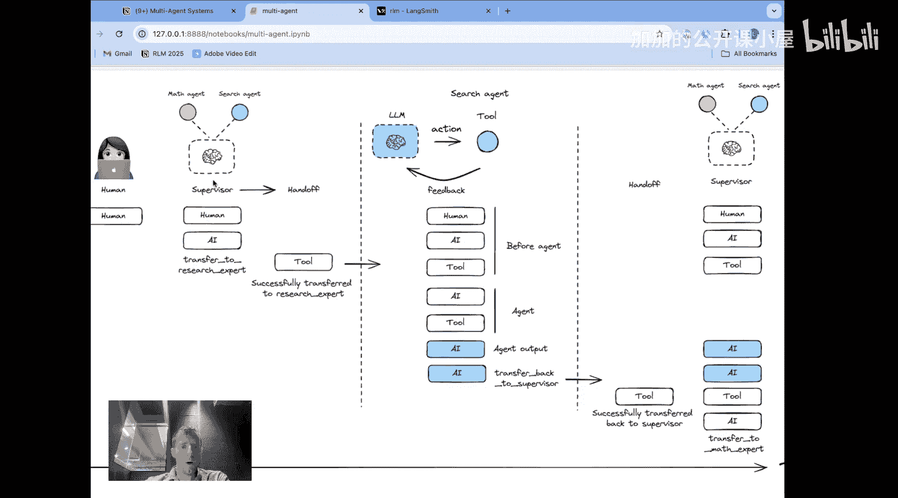

Handoff。Which tells it where to go。 and we go to the research expert。 Now we're inside our agent。

 and we can see that the model receives。 This was the original human input。

 This is that tool call from our supervisor to go to the research expert。

 This is the tool that actually executed the handoff。

And now the research expert makes a decision to call its search tool。

 And we can see it kicks off a few different queries for various fan companies。

 Then the tools are called。 Let's look at our diagram quickly。 So we're basically in here。

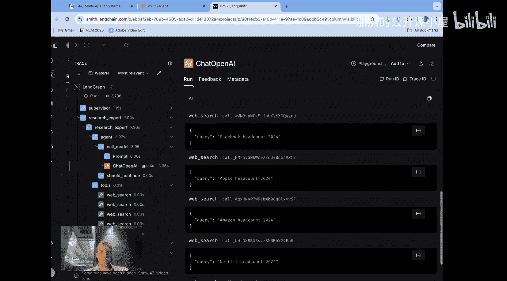

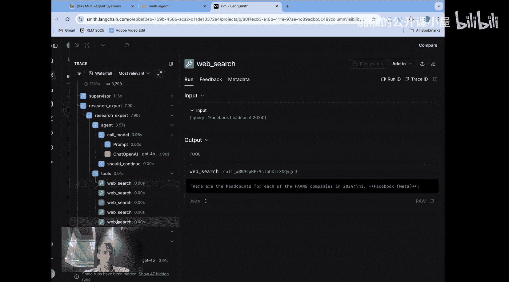

And again， as we saw， this all gets transferred over。 Our agent makes a decision to call tools。

 Those tools are called。 In this case， its search tools。

 The agent receives the output of those tool calls and provides a final answer。

 This is basically the final agent response。 No more tools are called because it's effectively answered the question。

 So now you can see one important thing。 When the agent is finished。

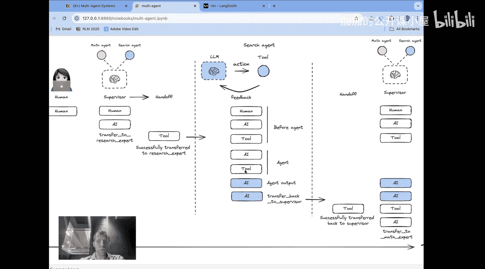

This additional tool call is executed。 That's says transfer back to supervisor。

 That's basically that hand off tool call。 and it's executed。

 The tool message is also appended to our message history。 So that is what's represented right here。

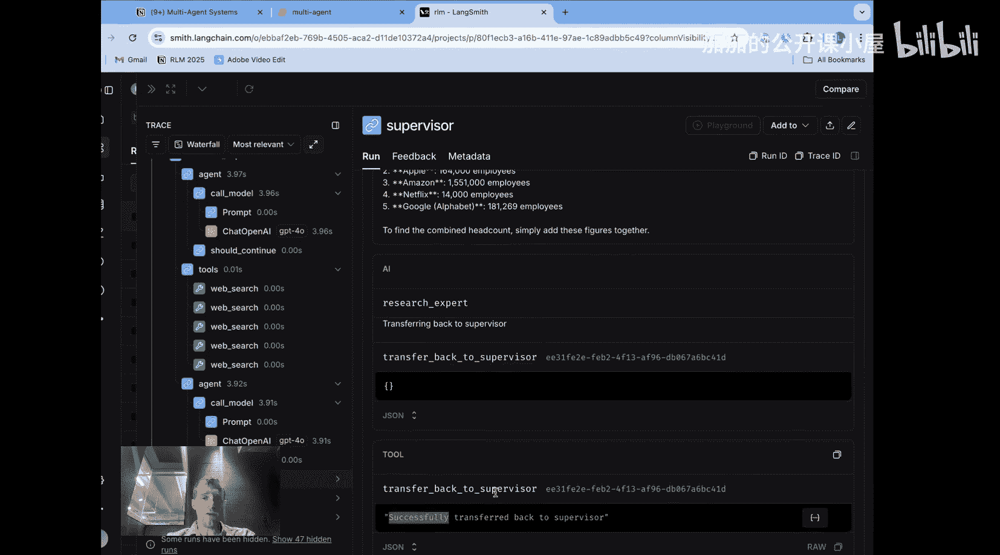

The agent says I'm done， hand off back。Now， we're back at our supervisor and confirm with the tool message saying we're successfully back。

 the supervisor can then decide what it wants to do next。 We can look at the L M call。

 and it makes decision。 hey， I should transfer to the math expert。

 The handoff is done just like before。 There we go。 Weve saw that previously。 Now。

 we're inside our math expert。 And it follows just like we saw before。 Now。

 we're just inside our agent。 Our agent goes has an executes therithmetic necessary。

 And once it completes， we go ahead and pass that back to the supervisor。

 which then finishes and provides the final answer to the user's question。

 So I don't show in this diagram that second iteration of going to the math agent。

 but it follows the exact same handoff flow。 That's the key point。

 We basically go first at that search agent。 search agent does a bunch of work。

 We bounced back out to the supervisor。 Super can then call the next agent to follow up on that work。

 And you can see this message history We just grow accordingly。😊。

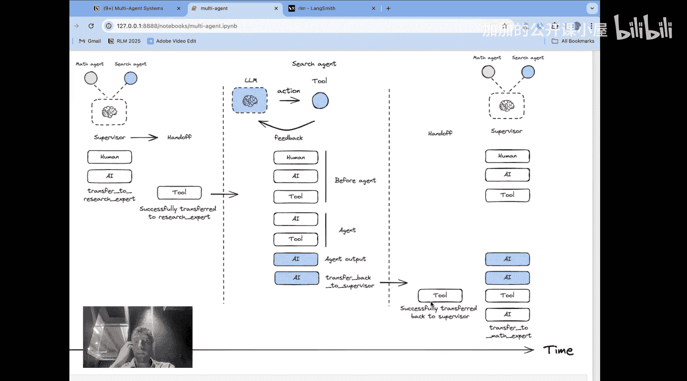

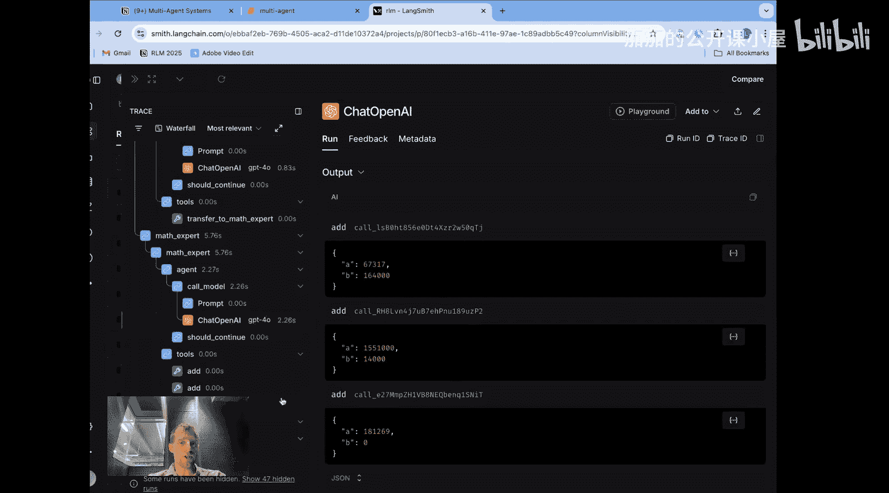

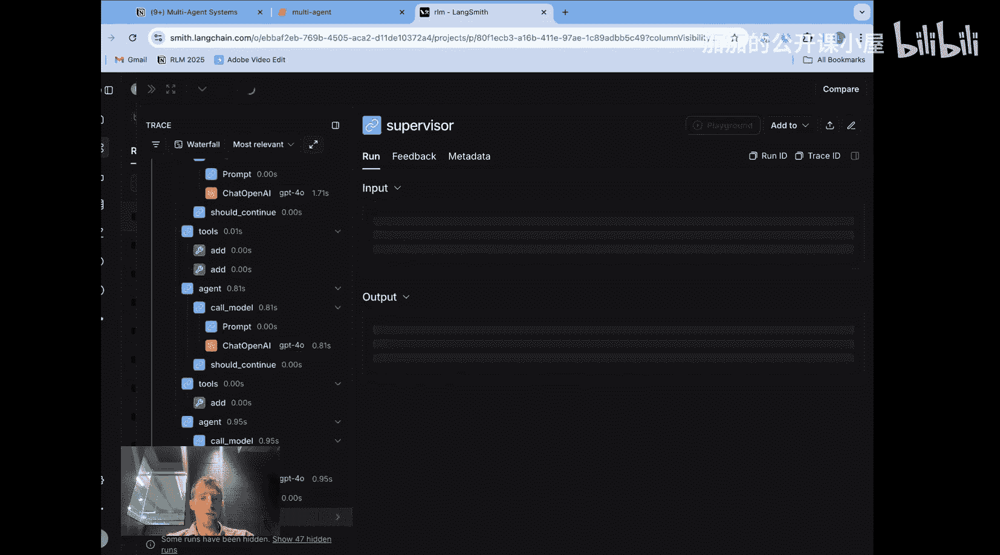

With the response from the math agent。 And that's exactly all it's happening。

 So We see in this basic flow， we can set up a single supervisor。

 can connect it to any number of agents， and it can run。Now。

 I do want to highlight briefly that this is also hierarchical so you can have supervisors that manage other supervisors who can kind of have an org chart in the way that a real organization would。

 You can have like a CEO， and then you can have supervisors that manage each of themselves。

 a small team of agents。 So I'll show an example of this briefly。

 So let's just define a few new tools， one for precipitation and weather。

 And I'm going to find two teams， one's a math team。

 These are two different agents that do math and a weather team。

 two different agents that do weather。 and I'm going to create a supervisor for each one。

 So there's gonna be supervisor over。

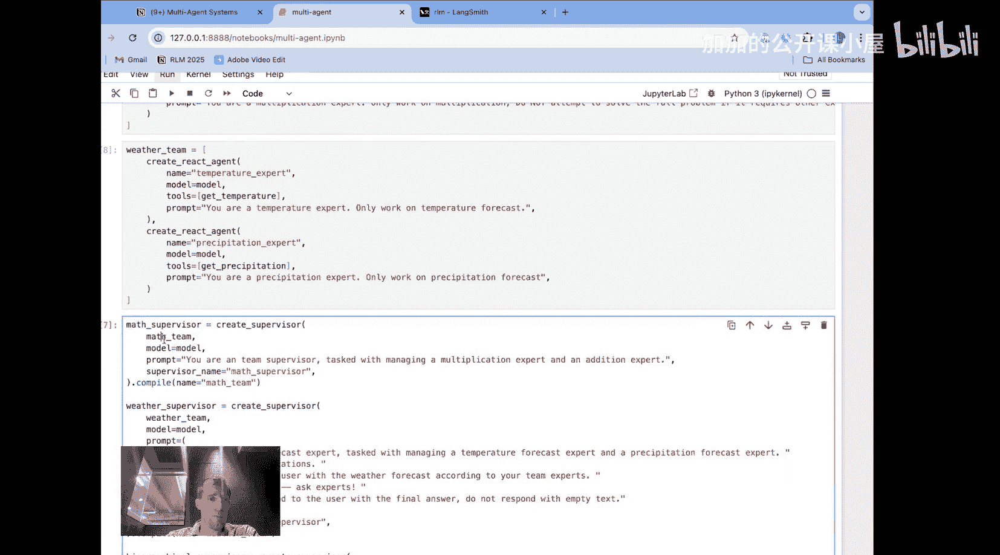