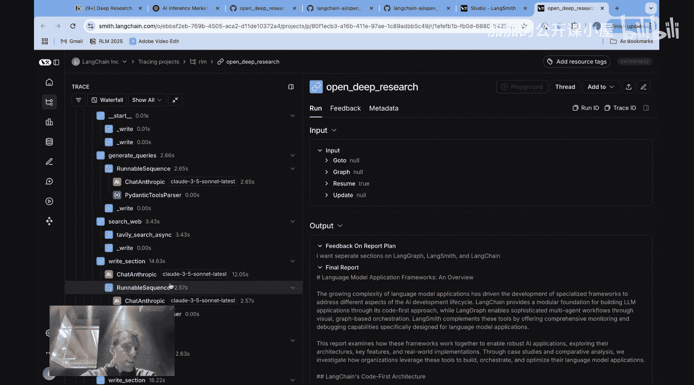
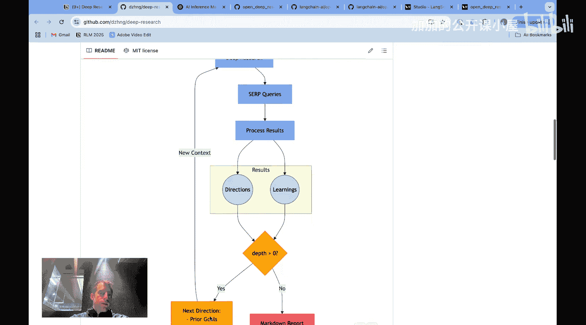
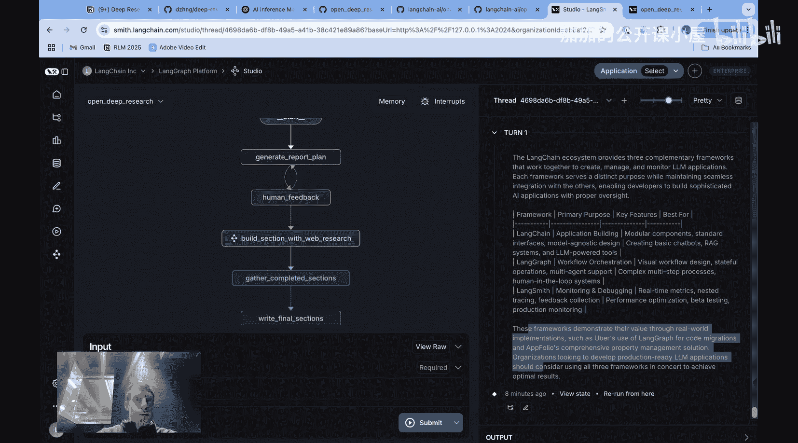
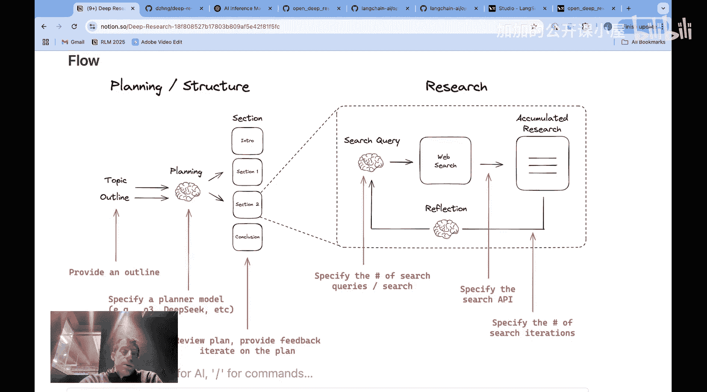
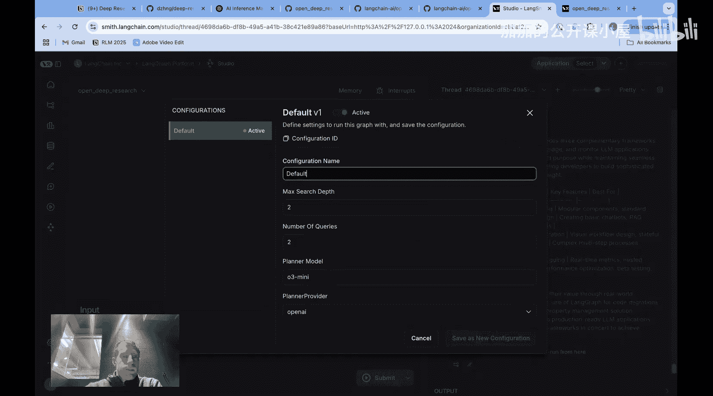

# LangChain【中英⚡LangChain 使用指南｜Build with LangChain】 p59 P64 Open Deep Research -BV1xwfMYDE3n_p59-

Hey， this is Lan Langcha。 You've probably heard about deep research from Gemini and Open AI。

 It's a really popular agent use case where you have an agent autonomously crawl the web。

 focus on some topic that you give it and produce a deeply researched report on that topic。 Now。

 there's been a number of open source implementations of this。 And I want to showcase ours here。

And walk through in detail。 But also talk about some of the other implementations。

 both open source and from Open eye and Gemini， talk about some of the trade offs。

So you have kind of a general overview of this use case and some various implementations that have been put out there。

 Open source enclo。 So first， this is our assistant called Opendeep research， fully open source。

 I'm in Landgraft studio right now。 If you follow the readme in the repo。

 you can easily spin this up in like one command。 And you're gonna to give a topic。

 let's pass a topic that I'm interested in researching。 I hit submit。

 and we're gonna to see is our assistant is going to generate report plan。

 It uses some search queries to help generate that plan。

 And it presents us with the sections of the report， which you can see right here。

 So we can actually see there's an introduction section。

 there's a section overing the three different frameworks comparative analysis。

 and actually tells you what the description or what's kind of scope of each section。

 And so really what's happening here is our assistant takes a topic。

 does a bit of research but just kind of a light phase of web research to help seed its plan generation。

 presents us with a plan。 Now we're asked then， doesn it meet our needs。

 And we can just hit continue。 and we can right here。

Any feedback we want let's say I want individual sections on each of these frameworks。

You can see we actually have combined section here。 I can pass that as feedback。 Co。

 so we can see we now have sections on Lng chain， Lng graph and Langsmith individually。

 So that's nice。 We can say we're happy。 We go continue。

 And we just pass true to say that the plan does indeed meet our needs。 So we simply run that。

 Now we're actually going to do the deep research phase。 So for each of those sections。

 You can see what's happening。 We don search queries， run web search， write the section。😊。

We do a reflection， as you see here on that section content relative to the section topic to see if there's any missing information。

 and we search again。 So you can see there's this iterative search process。

 which I'll show in a minute is highly configurable。

 So this is kind of that deep research phase where you can do iterative research in parallel across all the sections of your report。

 Now， after all the main body sections are written that require research。

 we write any final concluding or introductory sections。 and we get our full report here。

 which you can see is a nice markdown。 Each section laid out nicely。😊。

With sources and a nice comparative table in the final section。

 And can click this button open the run in Langsmith。 And here go， you can review the trace。

 So of course， it's all open source。 You can look at every single model call。

 every single search query。 So you have a lot of visibility into everything that happens under the hood。

 You can also see time and token usage。 So if I pop out and generalize a little bit。

 What are kind of the main themes in this overall deep research area。

 I kind of think about this in two different ways。 There is some kind of report planning phase or structuring。

 And then there is what you might consider the deep research， some kind of iterative research loop。

 Those are like the two big ideas that you see across a lot of these methods。 Now。

 the planning phase typically involve some human and loop。 And I'll talk about that in a little bit。

 There's different approaches there。 But there's some overall report structuring。

 with human feedback often。 And then following that or in some cases without that at all。

 There is this iterative research。 that can be done。

 So you don't actually need this planning and structuring phase， some approaches don't include。

But all approaches use some kind of iterative research。 That's a core component。

 And he can break it down like this。 So again， I just mentioned that some approaches have a planning with human loop。

 Others don't。 So they operate more autonomously without any kind of initial scoping with the user in the loop。

 And you can also think about the architecture。 So some use what you can consider a tool calling agent。

 Others use what I consider to be a workflow。 And I'll talk about that in a little bit。

 So if you look at this top quadrant here。 Both Gemini deep research and open AI deeper research involve some kind of human loop in the planning phase。

 They're a little bit different。 So Gemini produces a plan that you can then review and edit and approve。

Open AID research actually does question answering。So it asks you some kind of follow up questions。

 it doesn't quite explicitly lay out a plan for you。But it does ask clarifying questions。

 And so there is still a human loop phase as noted there。 Now， as you just saw。

 this is ours open deep researcher。 And as mentioned。

 it does produce a plan that you can then provide feedback on。

And that follows more closely with Gemini Deep research than open AI。

 which just asks clarifying questions。 And so there's different ways you can think about doing that kind of human loop。

Scoping or planning。And those are at least two。 One as you generate an explicit plan of all the sections of the report。

 The other is you ask some clarifying questions。 Now。

 there's a number of other approaches that just do that iterative deep research after a user passes a topic。

 so they don't do any kind of kind of upfront planning。 Now。

 let me talk about the architectures a little bit。 So hugging face released an open deep researcher。

That very nicely shows a tool calling agent。 In this case， they're using their small agent's library。

 They use hierarchical agent approach。 As you see here， they have a manager agent。

 and they have a tool calling agent。And they use a number of tools from a different paper from Microsoft。

 but it basically involves tools for searching the web， navigating， inspecting pages。

 and also some multimodal tools。For extracting images。

 So it's a really neat implementation that's worth having a look at。 Now， of course。

 we don't know precisely what Gemini or open Iid research do under the hood， But speculation is。

 of course， that they are using some kind of tool calling agent with open I research。

 We know it's a fine tuned version of 03 that has been refined for web search。

 But in all these cases， the architecture is likely what we consider a classic agent where you have an LM with a bunch of bound tools。

 those tools can be called in any particular order。So they're very flexible。 Now。

 that contrasts a little bit to what I consider to be workflows。

 If you look at some of these open source implementations， For example。

 we can pull one up here right here。 This is one popular deep research implementation。

 And you can see if you look at this。This is what I consider a classic workflow。 Now。

 some people call this an agentic workflow because it does have some steps for an L M reasons and decides what to do next。

 which is completely fine。But it still follows a pretty clear control flow that's stipulated by the user。

 So basically it does search， process the result in some way， kind of reflects on the learnings。

And iterates for some number of cycles。 and then produces a report at the end。 Now， as we saw。

 this is looking at ours， it also follows a particular control flow that we specify with opportunities for human feedback and iteration there and iteration autonomously within each section。

 So again， I consider this to be a workflow that we lay out ahead of time。 And， of course。

 we do allow Lms to reflect and refine their work。 but this is not like just an LM with a set of tools that is free to call those tools in any particular order。

 We set a constrained control flow。 And there's always a trade off between using an openended tool calling agent versus what I consider workflow here。

 Often， the benefit of workflow is that you provide more scaffolding for reliability and often lower token usage but it can lack some flexibility。

 So it's an interesting architectural tradeoff to think about with different approaches。

 But in any case， there are a number of these open。

Searchers that utilize workflows。 So it's obviously a pretty reasonable way to approach this particular problem of deep research。

 Now， I'll mention briefly that some of these deep research approaches have been evaluated。

 So Gaia is one particular evaluation from meta and hugging phase。

And you can see that open ID research scores quite well and Hugingbases approach is 55。Obviously。

 strong results that are close to open ID research on this particular evaluation。 Now。

 OpenaiI actually shared results on humanities's last exam。

 which is an evaluation from scale AI and involves 3000 questions across ST and humanities and you can see open I research outperforms03 alone by quite a large margin。

 which makes sense because you endow 03 with search tools and it is then much more capable at challenges like this。

 Now， I briefly showed how ours works at the beginning。 And you might ask the question， well。

 why use an open source deep research assistant if you can just use Geini or openaiI。

 So the argument I would make is it's about configurability。

And the nice thing about open source Re assistance is that theyre very， very configurable。

 And I highlight all the configuration options with our opende researcher here。

 So I'll talk about these a little bit below， but you can actually pass an outline to specify the report structure that you want。

 You can specify whatever plan model you want。 So I've used deepse。

 I use03 mini currently as the default。 but I like to use a reasoning model to do this initial thinking and then plan generation。

 I can customize how I want human and loop to work。 In this case。

 I basically do human and looper view of the sections of the report。

 And then in the deep research phase itself。 I can configure a number of things。

 Both the number of searches per iteration。 and the number of total iterations to do。

 So how many times you want to loop back and forth。 and very interestingly。

 I can also specify the search API so。😊，By default or configured for Tvioli。

 But I also have perplexity set up， which is a really interesting option。

 and other search services like obviously Serp API or fire crawl could be incorporated easily。

 So configurability is really the benefit you get from open source in addition to the fact that it can be quite a bit less expensive。

 So if I go back to studio， I'll just show you where those configurations can be set。

