# LangChain【中英⚡LangChain 使用指南｜Build with LangChain】 p62 P67 Multi-agent swarms with LangGraph -BV1xwfMYDE3n_p62-

Hey， this is Laancesom La chain， there's a lot of interest in multi agentent systems right now。

And want to show a popular architecture called multiagent swarm。 Now， with the swarm architecture。

 you can have any number of agents in principle In this particular example， though。

 I'm just showing a case of two to keep it simple。 This represents as customer support system with a flight assistant and a hotel assistant。

 So one agent that will do flight bookings one that does hotel bookings。

 And the central idea behind swarm。 I it gives you a mechanism for these agents to head off requests to one another。

 and also share state when they do that hand。 Let's see this in action quickly in Lgras studio here。

 So I pass a request related to booking a flight from Boston to New York。

 This is processed by the flight assistant， which responds to me。

 I can answer that I do want to book this flight。 The flight assistant then goes ahead and books it。

 Now， let's say I asked the flight assistant。 I'd like to book a hotel as well。 What's gonna happen。

 Well， this was a single agent system， a flight assistant wouldn't have any capability to book hotels。

 And so it would probably just return with a message telling you that it doesn't have the ability to do that。

 But this is a multiagent system with the ability to。

off information between the flight assistant and a hotel assistant。 So let's see what happens here。

 The flight assistant hands off to the hotel assistant。

 The hotel assistant then interacts directly with the user and follows up exactly on that request。

 We say yes， please。 we'd like to book that hotel。 The hotel assistant then goes Eds and books the request So we seamlessly transferred or hand it off between the flight assistant a hotel assistant based on the user' needs。

 This is one of the powers of a swarm style multiageian architecture。

 We're releasing a lightweight library called Langgra swarm。

 which helps you build these style of agent swarms。 And I'll walk through that right now。 First。

 I want to differentiate the different architecture from multiagent systems。

 So we talked a bit previously about supervisors。 This is a case where we can take some number of agents。

 and basically bind them to a supervisor。 Now， a key point here is that the user interacts only with a supervisor。

 And each agent only interacts with the supervisor。

 So what happens is a supervisor can handoff tasks to one particular agent。 The agent does some work。

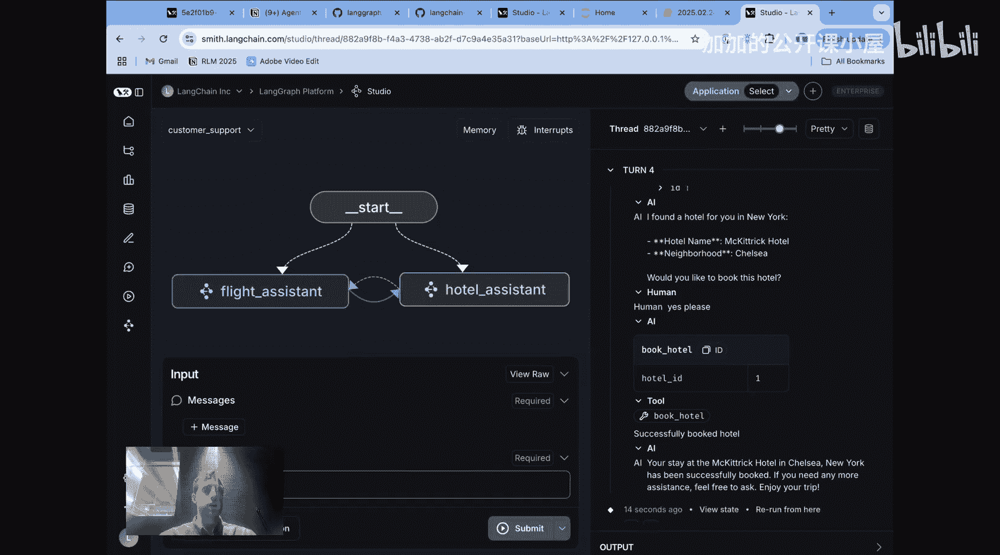

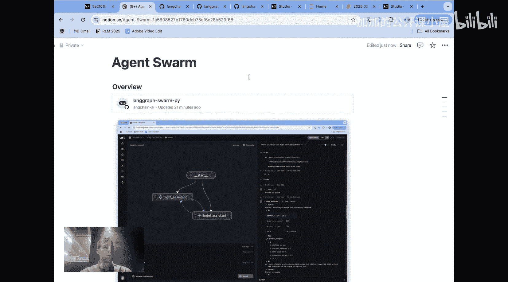

Back to the supervisor。 Then the supervisor decides what to do next。 The swarm is a bit different。

 where the swarm allows any individual agent to interact with the user directly。

And any agent to hand off to any other agent。 So you're kind of removing the supervisor from the loop in the case of a swarm。

 So again， where are the key differences with a supervisor。

 the starting point is always a supervisor with a swarm。

 you can set a default agent to be the starting point or in the case of multiter interaction like we'll see shortly。

 the last active agent will be the starting point。 Now， in terms of the flow between the agents。

 agents always interact with the supervisor in the case of the supervisor architecture。

 But with swarm， each agent can decide where to hand off information to any other agent terms of user interaction。

 the user always interact with the supervisor versus in the case of a swarm。

 the user can interact with any agent， Each one is self- sufficientuffic and can engage directly with the user。

 So swarms can be really good for systems that require many different agent interact directly with the user like customer support is a classy example。

 when you have different sub agents that are responsible for independent specializations。

 a supervisors better in cases where you have a bunch of agents。You want to do work。

 but you don't really want to expose that work to the user。

 you really only want a single supervisor to actually orchestrate the work that the subagents do kind of under the hood。

Unbeknownt to the user。 And so here's a diagram of a multiag swarm example。 First。

 the user asks book me a flight。 The flight agent is active， responds with a flight。

 And until the user asks， Bookme hotel will directly engage with the user。 When we see book a hotel。

 then that flight agent will call a hand off tool to hand off over to the hotel agent。

 which then engaged with the user directly。 This hand off is the central concept。

 That's very important to understand。 when thinking about these multiage swarm architectures。

 Now let's show that in code。😊，Here's a notebook that you can see in the repo first。

 I'll define a model now as you can set some mock data for different tools related to searching flights and booking flights and searching hotels and booking hotels。

 This is really the new thing。 We're going to find two handoff tools。You can see this is from。

The Landngraft swarm library， and it just agreeds a tool。That can transfer。

The user to a hotel booking assistant or a flight booking assistant。

 We define a helper function to generate prompts， and we create two different assistance。

 a flight assistant， a hotel assistant。 And here's the key point。

 We go ahead and bind those transfer tools to each of the agents。

 So the flight agent will have a hotel transfer tool。

 The hotel agent will have a flight transfer tool。 Now， finally。

 we just take both of those agents we defined。And we add them to our swarm， as you see here。

And we set a default agent， in this case， a flight assistant。 Remember。

 but this default agent doesn't particularly matter because if， for example。

 the first questions related to hotels， the flight assistant can just transfer to the hotel assistant。

 We go ahead and compile。You'll notice that we compile with this checkpointer。

 So checkpointer is a mechanism in landgra to save conversations to a thread which is persisted in this case。

 in memory， across things like interruptions， or importantly， in this particular case。

 across handoffs between the different agents。 So the main idea is。

The checkpoint allows you to save message history to this thread。

 which is then passed to each agent during the handoff procedure。

 And you'll see why that's interesting shortly。 We can go ahead and run。

 And this is exactly what we already saw in studio。

 So we're looking for a flight from Boston to New York。

 We can see our flight assistant is the default， which we set right here。

 And it calls the search flights tool。 And we respond。 Yes， please。 We call tool book to flight。😊。

That's all fine。 Now for the interesting part。We say， hey， let's book a hotel as well。 Now。

 this is where the flight assistant sees this request to book hotel and transfers to hotel assistant。

 which is a tool that has bound。 And though tell assistant seamlessly responds by searching hotels and responding directly to the user。

 I found a hotel for you in New York。😊，Would you like to book a room。

 This is a classic example of how we transfer or hand off between the flight and the hotel agents。

 We can respond with yes， please， And we continue to engage them with the hotel assistant who books our hotel。

 And we can say， I want to talk to the flight assistant now。 Again。

 the hotel assistant sees that request and calls the tool to transfer to flight assistant。😊。

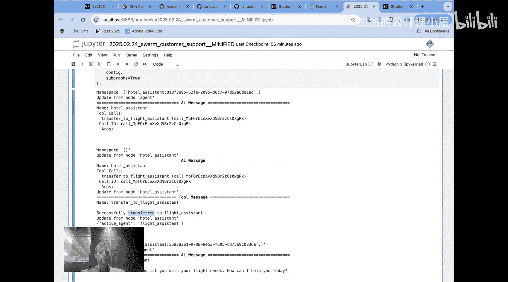

And that's done。 Now， we can see that follows exactly what we saw in studio。

 We went from the flight assistant。Search flights。 The human requested a book in that second turn。

 Then the human requested to book a hotel。 It's a flight assistant。Performs a tool call。

Transfer to hotel assistant。Which transfers over the hotel assistant。

 Hotel assistant then seamlessly answers their request， saying it found。

Hotel for us in New York right here。 So there's just kind of a nice visualization of that transfer as it occurs based upon the tool call that the flight assistant makes。

 Now， I want to show something else that's pretty ancient。 If you go to Langsmith。

 you can see all those runs are logged。 open one up。 Now'll go up here and click thread。 So remember。

 we're using a checkpointer here。 So all those independent interactions with the different agents。

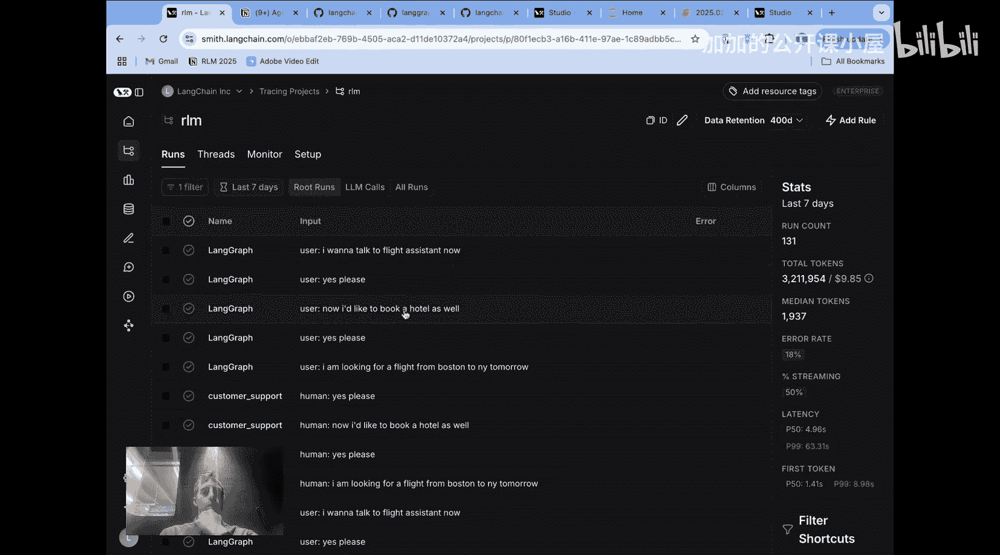

Resulting in handoffs are all saved to the same thread。 we can click that here。

 and we can see each of those turns。 So you can see our first turn was just we're looking for a flight。

 And again， the flight assistant called the search flight tools and responds with the results to the user We can see that right here。

 search flights and the response from the agent about the flight that it found。 And we want a book。

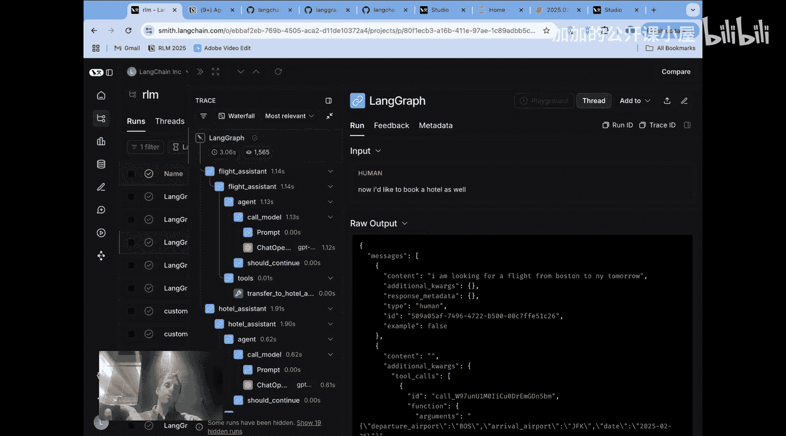

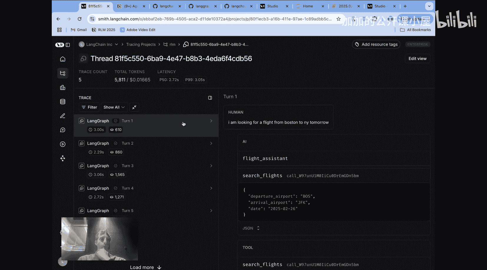

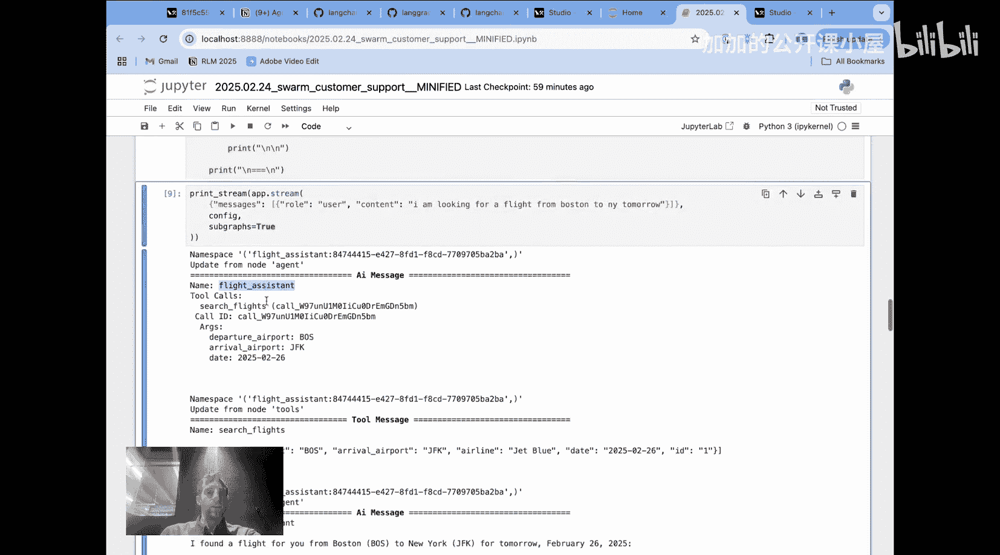

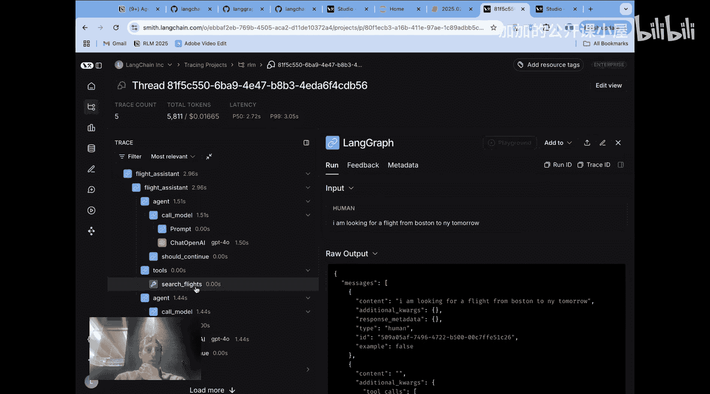

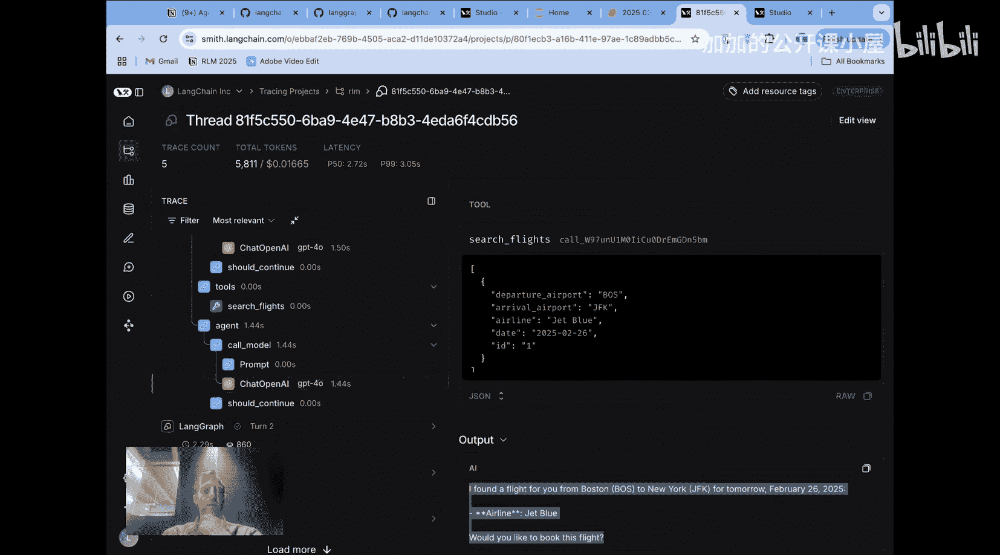

Turn 2 again， the notebook， we said yes， please。 So again， on that same thread。

 then we pick back up and our flight assistant goes Eds in books。

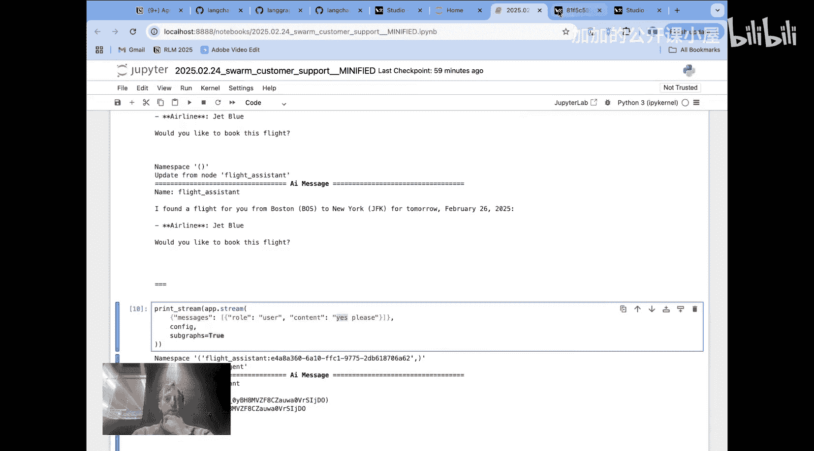

By calling the book flight tool， now turner 3 again on that same。

 we also said I'd like to book hotel。 This is where we called that tool to transfer of hotel assistant。

And the hotel assistant then processes our request。

 you can see the hotel assistant then calls a tool to search hotels。

That tool call is made and responds directly with some hotel options。 turns 4 and 5。

 follow exactly what we saw on the notebook where we continue to engage with our multiage system。

 And we finally end with a handoff back to the flight assistant based upon our request。 So again。

 you can see that you can fall along with this flow in studio really nicely or in lengths with you want to look at the underlying traces。

😊，Another thing I'll show you in Laangssmith that's pretty interesting is， for example。

 when we transfer the hotel assistant， let's look at that model call itself， the hotel assistant。

We search hotels， but it actually has access to the full history of messages that came before。

 For example， that whole interaction with the flight assistant。

 And this is one of the key properties of handoff。 like we said， when you perform a handoff。

 you actually transfer the full message history， which is all saved to our thread。 And so this agent。

 even though it's responsible strictly for searching hotels and booking them。

 It has access to the entire history has full context around what happened previously with the user。

 which can be very useful in certain cases。 I do also want to call out there could be different implementations for how you hand off messages between agents。

 In our case， we basically just passed the entire history。😊。

But you can imagine many different ways to do it。 You could pass some number of recent messages。

You could pass a summary of all prior messages。 So that handoff mechanism or the information specifically attended off could be modified。

 Hopefully that gives you an overview of the multiagent swarm architecture and this simple library that we have for it。

 And again， just showcasing some of the trade offs or differences supervisor kind of centralize control in a single supervisor。

 which can call subagent to do work， but always engages directly with the user via supervisor with a swarm。

 Every agent is autonomous and self sufficientuff。 Every agent can interact directly with the user and hand off to one another accordingly based on the user's requests。

 So those are two different ways of structure multiagent systems。

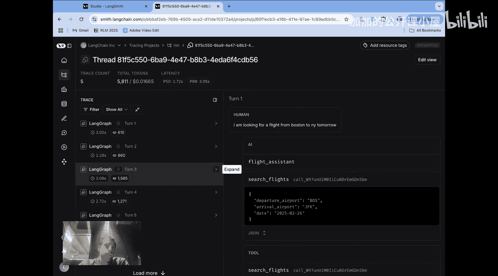

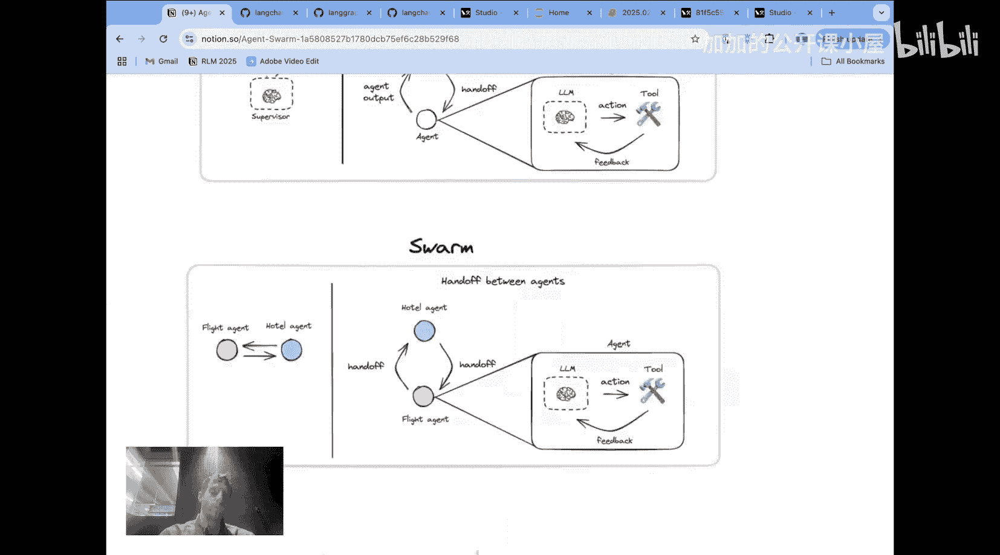