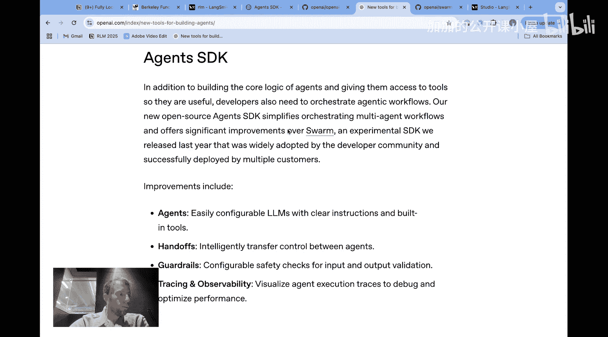
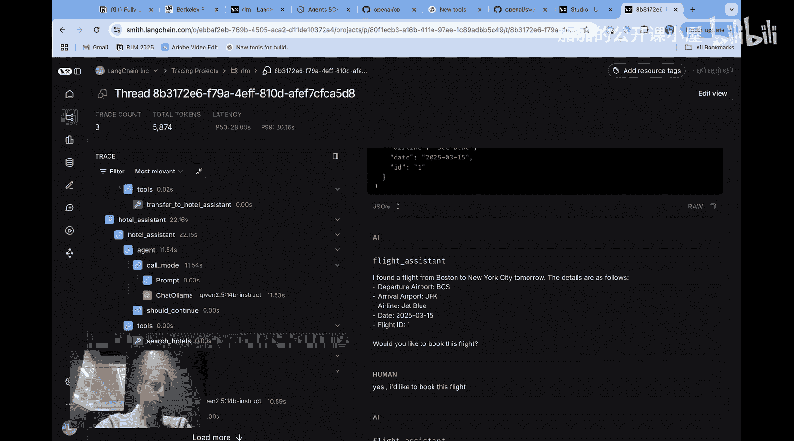
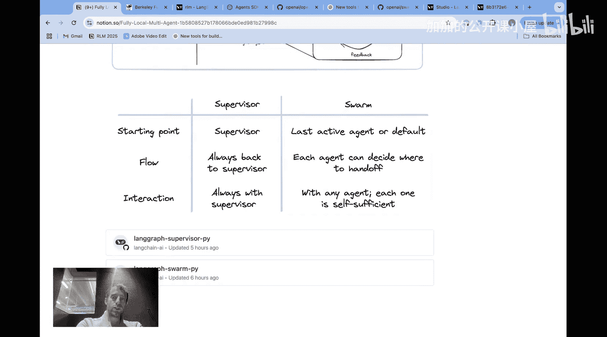
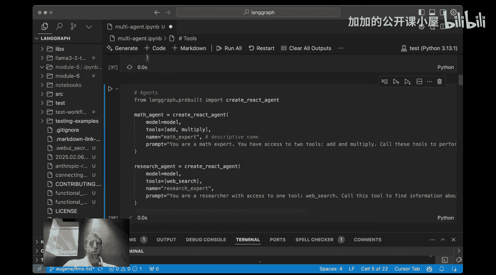
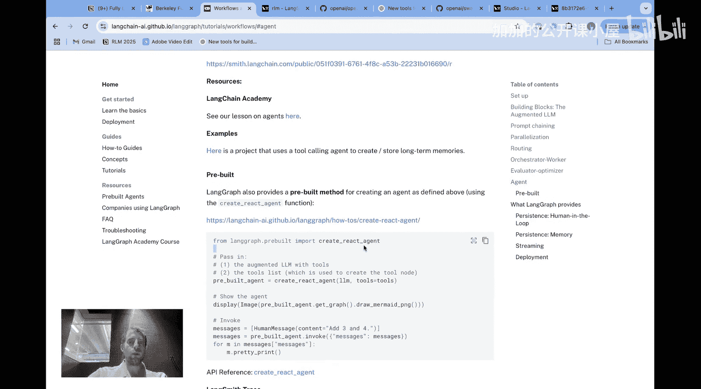

# LangChain【中英⚡LangChain 使用指南｜Build with LangChain】 p65 P70 Fully local multi-agent systems with LangGraph -BV1xwfMYDE3n_p65-

Hey， this is Lance Langcha。 Open I just released their agent' SD K。

 which builds on some prior work that they released called Swarm。

 So this was a library that allows you to build multi agent workflows。

 And the SDK extends it with a few different things。 notably improved handoffs， guardrails， tracing。

 Now I want to talk about building multi agent systems， using fully open source and local models。

I'll show using a swarm approach， as well as a supervisor approach。 So here I'm in Lagra studio。

I have a very simple multi agent system with a flight assistant agent and hotel assistant agent as a toy example。

 I can ask a question。 The flight assistant addresses the question。

 It calls this search flight tools based upon my input。 It finds a flight for me。

 I can tell I want to then book this flight， and it books my flight。 Now， I can tell it。

 I want to book a hotel as well。 This is a key idea behind many of these multi agent libraries。

 such as swarm。 There's a hand off mechanism allows you to hand off from one agent to another。

 So I say I want to book a hotel。 And we can see the flight assistant hands off to the hotel assistant。

 and the hotel S finds hotel for me。😊，Numb open upm the trace and show you something interesting。

 So I'm in lengths with now， and I can look at all the turns with my agent。 We can see turn 1。

 The flight assistant made a call to the search flight tools in response to our input。

 I want to draw attention to one important thing here。

 What's pretty cool is that I'm actually running this locally on my laptop。

 So I'm running chatd Alllama with Quen2 5，14 B instruct as my model of choice。😊。

And this model running locally my laptop， is able to orchestrate this multi agent workflow using Landgraft's swarm implementation。

 So first， it makes a tool call to search flights。 We can see the tool call made here。😊。

That goes back to our model， which then identifies the flight is found。 In that second turn。

 we said book it， It calls that book flight tool。 The flight is booked。 and that third turn。

This is the most interesting part。We said， let's book a hotel and we can see it can then call this transfer hotel assistant tool。

 which is the key idea in the swarm architecture。It allows for different agents interact with the user and transfer the conversation to one another。

 when they deem fit。 For example， the fly assistant sees that the next question when the user relates to hotels and it can transfer over to the hotel assistant。

 which then addresses the user' needs。 That's the key idea behind all these multi agent libraries。

 There's some hand off mechanism between the agents。

 And I want to pull back briefly and explain a bit more about what's happening here。 First。

 it's worth level setting what actually is an agent。

An agent is an LLM directing its own actions based upon environmental feedback from the action or tool call in simple terms。

 you can think about this as tool calling in a loop。We have a nice tutorial。

 and I do want to call out that agents are different than workflows。 Workflows are some kind of。

Direct a control flow in a predefined code path。 it can involve L M calls。

 The key point of an agent is it can freely make tool calls in a loop until no tool calls is made。

 in which case the agent typically finishes。 Okay， So that's an agent。 Now。

 one of the most interesting questions that I've been looking into for a long time。

 is how can actually run agents locally on my laptop。 to do that。

 I need small models that actually can perform tool calling effectively。 Now， I will call out。

 I've done a lot of work on local workflows。 Workflows don't necessarily need tool calling。

 You can build very simple routers with structured outputs。

 And this actually works really well for a lot of applications。 But as noted。

 the classic definition of an agent is tool calling and a loop。

 so we need the ability to call tools locally。 if we want to build locally running agents。😊，Now。

 I'll show you a nice resource here that I like to use。

 If you go to this Berkeley function calling leaderboard right here。

 you can scroll through models based upon their rank on this tool calling benchmark。

 Now you see the state of the art of the best performing are， of course。

 large and often close source models like G 40。0，1， Gemini。 but you'll see something interesting。

 Pretty high up is Quen 2，5， which is open source。 Now。

 this is a larger version 72 billion parameter model is difficult to run locally unless you have a GPU。

But if you scroll down， you'll see something interesting。 Quen2，5，14 B instruct is actually rank 30。

 which is quite strong for a 14 billion parameter model。 Now。

140 billion parameters is a model size that can often be run locally， depending on your machine。

 So I have a Mac M2 max 32 gig and I can run this locally with reasonable latency。

 It's not super fast， but it's acceptable。 If you scrolled it even further， you see at rank 52 Quen2。

5，7 B。 So basically， the Quen 25 models are quite strong at function calling， as we see here。

 and they can be run locally。 So these are the models that Ive chosen to work with in general。

 when I need to do local function calling or build local agents。 Now how to access thequin models。

 So they are on ma as an example， you can just pull them as shown here。

 and you can run them as I show right here。 And again， this is Quen2，5。

 and I can initialize it just like we see here。 Now， we've covered wooden agent is。

 We've identified that there are some models that。😊，Are small and open source。

That you can use to actually build locally running agents due to their performance at tool calling。

 Now， why do we care about multi agent systems。The main point here is that。

 particularly when running things locally， it can be useful to separate concerns。

 If you take an L M bind a very large number of tools， you can increase the likelihood of confusion。

 The model may call the wrong tool， given a request。However。

 if you you have a subset of agents that have specialized tasks， one for flight booking like we saw。

 one for hotel booking with independent tools， it can often result in better performance。

 especially if you're using smaller models。 So that's kind of the intuition behind multiage architectures。

 Now， an interesting point is there's different ways you can set up multiage architectures。

 So we have two separate videos on this talking about supervisor and swarm as two approaches。

 And we also have open source packages that implement both of these with lagra。

 Now I want to highlight the supervisor approach first。 This is pretty intuitive。

 They did here is simply you have a supervisor model。😊，That has access to sum number of okay。

 the supervisor interacts with the user。And farms out tasks or hands off to the subagents which do their work。

 and they always respond with their final output back to the supervisor。

 So those sub agentss never actually interact with the user you can think about them as subcontractors。

 The supervisor hands off task。 They do the task and the output is passed back to the supervisor。

 That's one approach。 pretty intuitive。 Now， another is what we saw previously， which is swarm。

 where there's different agents。 and they can both interact with the user and they can all freely hand off to one another。

 So we saw that with a case previously， that we looked at in studio。

 The hotel agent starts interact with the user when the flight agent starts interact with the user when the user asks for hotel booking。

 the flight agent transfers over to the hotel agent， which then executes。

 And some of the trade offs of supervisor supervisors always a starting point versus swarm。

 It's the last active agent or default agent in terms of the flow and interaction。

 The supervisor architecture always interacts with the user via the。😊，Where a swarm。

 each agent has the ability to hand off to any other agent and interact with the user。

So it kind of depends on your application if you have an application where you really want to centralize the interaction with the user with an overall supervisor and subcontract out tasks。

Supervisor is good architecture。 If you have a problem that benefits from multiple agents being able to engage with the user and just freely hand off between one another。

 then you may consider swarm。 We have two packages。 supervisor and La graphft swarm。

 which you can have a look at。And previously in studio， I was using Lnggrafts swarm。

 So you can see it works really nicely。 And what's pretty cool is these are simple enough that they can be run with open source models run locally on your machine as we just saw。

 Now， let's see how to build multiageent architectures in a notebook using these packages。

 So you can see I just have a few P installs and I grabbed Lngraft supervisor and I also grab Lnnggraftswarm。

 So we previously saw swarm working in studio。 So we have a sense for how that works。

 I'll go ahead and show supervisor here in the notebook just to give you a kind of concrete sense for how to set up these type of systems。

 So as mentioned， I'm going to use Lang chainin llama。

 And I'm going to go ahead and initialize two different models。 I'll use 14 B instruct。😊。

Which I previously used in studios we saw。 Now， here's where I'm going to find my agents。

 First I'm going set up some tools and add multiply a mock web search tool。

 And I'm going to go ahead and use this createate react agent pre build。

 So just to explain this a little bit more。

This workflows an agent's tutorial。 I will link in the video。 Go to the agent part。

 You see this is a simple diagram of an agent。And right here。

 we go ahead and show implementation of a simple agent。 we define some tools。Now。

 this is very precisely what happens under the hood here。 We define an LM node。

 which will go ahead and invoke the LM。 We'll define a tool node。

 which will basically just execute a tool and some conditional logic to continue until no tool calls are made。

 We construct the， and we test invoking it。 Now， this logic that you see right here is so commonly use that we do a prebuilt for it。

 And that's exactly what we just imported in our notebook as well。

 It's called the create react agent from Langraft prebuilt。 And it's literally just this stuff。

 So again， I want to be careful of abstraction。If you want to implement yourself from scratch。

 just follow it's in this tutorial， but sometimes they use this C reactact agent just as shorthand。

 where all you need to do is go ahead and pass the LLM and your tool list to this Cate react agent。

So' just talk about C React agent and we'll use it to create two different A。

