# LangChain【中英⚡LangChain 使用指南｜Build with LangChain】 p66 P71 Understanding MCP From Scratch -BV1xwfMYDE3n_p66-

Hey， this is Lach Langchang。 You've heard a lot about MCP lately。

 I want to carefully break down what it is。 I want to build an MCP server from scratch。

 I'm going to connect it to your favorite tools like Claude， cursor and Winsurf。 Here I'm in cursor。

 Open up a check like the agent。I'll ask a question about Landanggraft， I'm using Cloud 37 Sonet。

 you can see right here I have an MCP tool connected to cursor called Landanggraft query toolol。

I hit run。 Here is the query。 Here are the docs。 I get back from my tool。

 Use the docs to answer the question。 Here I'm in windsurf。 Open up cascade。

 but I can actually see my MCP server connected right here。What is Lagraff again。

 using cloud 37 there it is。 I can see my MCP tools called with this query and use the tree docs to answer the question here I'm in cloud desktop。

 You can see I have my Lagraft query tool as an MCp tool available。 We ask what is Lagra。

 We can see that Claude is now attempting to call our tool。

 We allow it formulates a query to our tool and it uses the tree docs from our tool to answer the question。

 we've seen MCp acting as a tool in three different popular applications。

 Cursor windsurf cloud desktop。 Now let me explain exactly what I did。

 let's build this all from scratch。 So first， what's the motivation here。

 Aing Lms with context or tools is a wellknow， popular and important practice。

 Amenting Lms with context is common in approaches like ragg Amenting Lms the tools is central for building agents。

 Now to make this concrete。 And before again into MCp。 I wonder to build a tool for you from scratch。

 and show how it works So incursor。 I'm in a completely empty directory here。 First。

 I'm gonna create a virtual environment。 and I'll do a few P installs。 Now I'm in a fresh notebook。

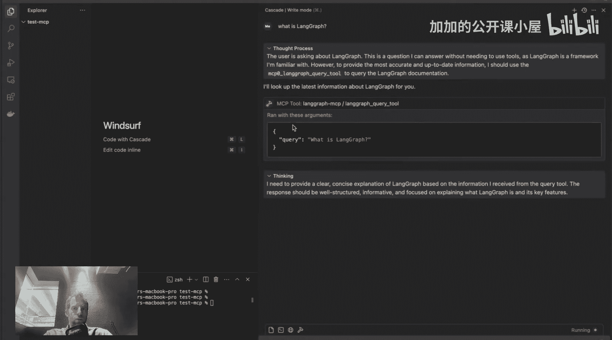

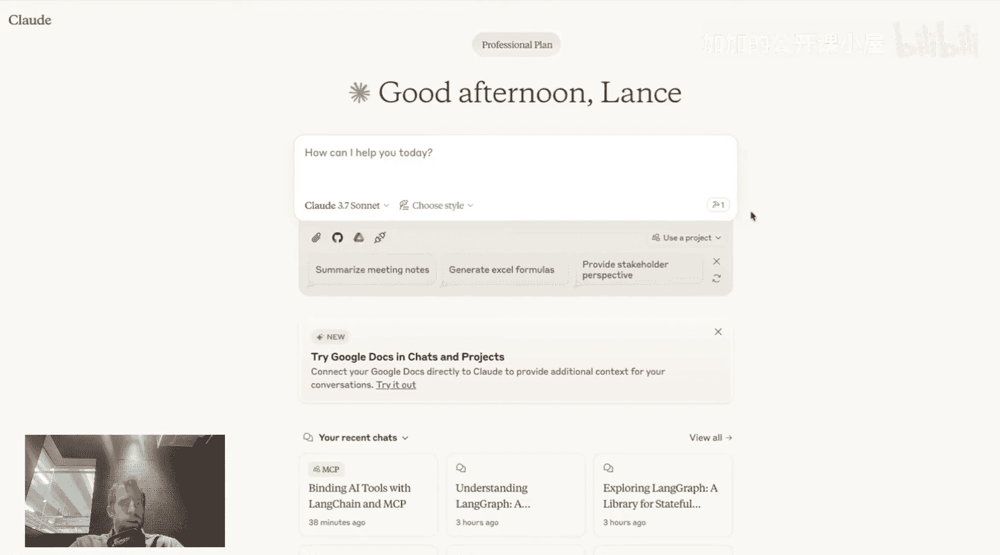

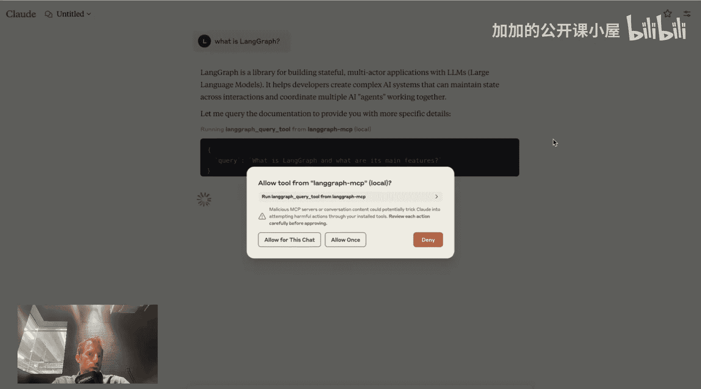

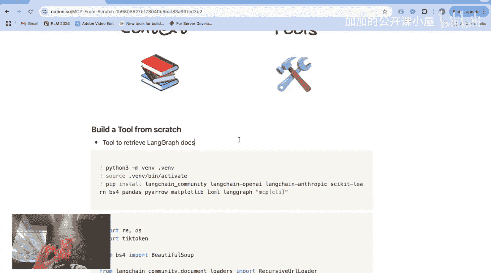

And we saw with cursor， Winsurf and Claude， this Lagraft query tool。

I'm going to go ahead and build it from scratch so you can see exactly what's going on here。

 So to build this tool。 I'm going to do a few things。 I'm gonna load Lagraft docs。

 Here's the URLs I want to load from。 I'm going use this URL loader and grab all child links for each URL up to depth 5。

 It'll apply a little extract to clean up the web pages will take everything we loaded will save it to a file called Lm's full dot text。

 willll split all those documents。 I'm going to use 8000 tokens as my split size because that's the context size of embedding model I'm going to use to embed all these documents。

 and I'm going create a vector store。 I'll use open A embeddings。

 and I'll save that vector store to this directory。 Great， so that all ran。

 we can see it loaded 122 documents。 Here's all the URLs around 300000 tokens。

 and it saves that all to a little vector store here locally in our directory。 Let's test it out。

 nice， I can ask a question with's Lagra。 I get back relevant documents based upon semantic similarity search。

 So this simple workflow to take a bunch of web pages and index them into a vector store is super common。

😊，It's the foundation for Ra， and it's a very nice foundation for creating a tool which retrieves documents given and input。

 Now if I'm just using Lang chain to do this。All I have to do is from Lanching Co Iport tool。

 add this little tool decorative function， which defines my tool， query in。

 returns a string of retrieve documents。Access is my vector store。

 which is saved and returns some documents。 Now， if I'm just using。

 I can use convenience methods like bind tools that we have in Lang chain。

 But many of the model decayKs have their own method to bind tools to the model。

 as long as it supports tool calling。 We can take this tool that we defined。

 We can bind it to our model， and we have an augmented L M。

 Let's set this out invoke my augmented LM with some messages。 This is the key point。

 I get a tool call back out。 We can look at Langsmith at the trace。 We can see here's our model。

 and here is our tool。 it was called。 and again， we see our language of query tool is called and forms this query。

 which can then be past the tool。 All right， that just set up the fundamentals。

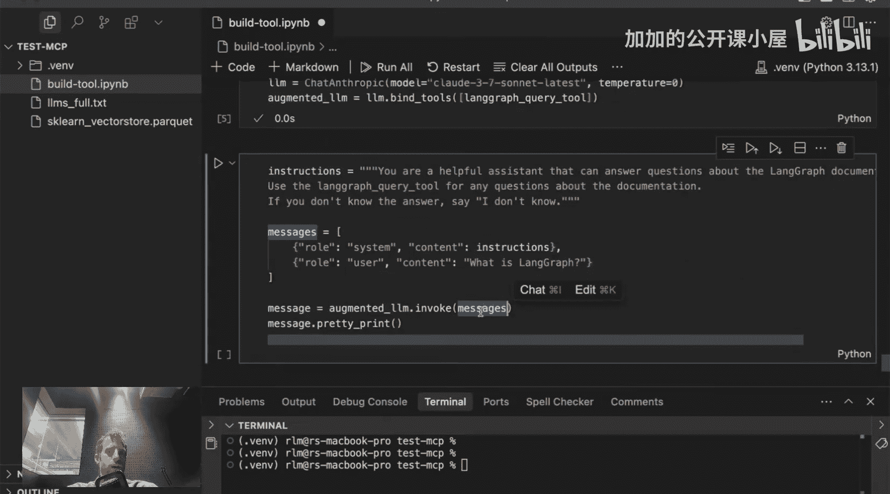

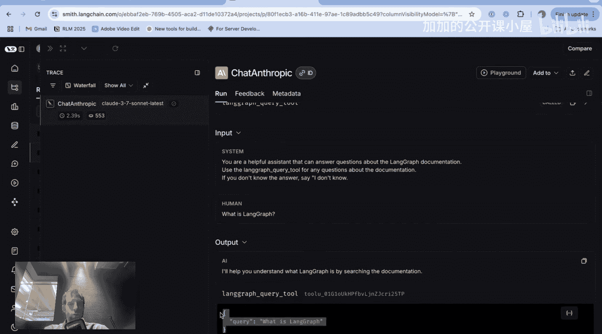

We have a tool called Landanggraft queryery tool。 We've connected it to our chat model。

 Heres the bridge to MCP。 What if I want to take this same tool and connect it to AI applications like cursor。

 cloud code， cloud desktop or windsurf。How do I do that， That is where MCP comes in。

 So it's kind of analogous。 L chain chat model is a convenient interface which exposes this bind tools method。

Which allows you to bind tools directly to a whole bunch of different models。

 MCP is a protocol that allows you to bind tools you to to many different AI apps。

 So it's kind of analogous。 B provide interfaces for a models to interact with external tools。

 both support the concept of exposing tools and models can invoke them。 That's really the key point。

 Now MCP is just the client server protocol where the host or the applications your client。

 and then the server exposes a number of river things。 It can expose tools。

 which is the most intuitive that we've just been talking about。 but it can also expose resources。

 which is basically just like documents。Or files。 And it can expose prompts。

 So just be aware that MCP servers can do more than just exposed tools。

 And there's different modes of communication between servers and hosts。

 including standard I O or servercent event。 Now we previously saw cursor， Winsurf and Cla desktop。

 all working with this lagra query tool。 So what was going on。

 I'm going to show you how to build a server in a minute， But at a high level。

 it's happening is this MCP server is connected to the hosts in some way。

 So the hosts have awareness that this tool exists。 that's the same as in bind tools， right， now。

 in practice what's happening in the servers using standard in and out。

 And the communication mode is Json。 And when I asks a question about langgraff in any of these hosts like cursor。

 Winsurfer Cloudt as you just saw， the host knows。😊，That this tool is available。

 and it can make a call to the tool using a standard method， and the tool output is returned。

To the host。 Now， here's the thing I found a little bit confusing when I started。

What is this server and where is it。So this server， in my case。

 is just running locally on my machine。 And what's also kind of interesting is this server is actually launched by the MCP host application。

 So it's actually launched by cursor， Windsurf and cloths。

 I don't have to worry about spinning up that server independently。

 And that kind of confused me in the beginning。 But really， what's happening is。

 as you're going to see shortly， We create this server。 And we just in configuration， connect it to。

Our various host， those host know， exists， and the host will spin up this server。

Automatically for us。 And it'll make requests to the server， like initialize at the start。

 list the tools available at the start， and then call the tools accordingly based upon the interaction with the user。

 That's all that's going on here。 All right， so now for the fun part， let's actually define a server。

 So this's just a script。 I'm going to call this Langra MCP dot pop。

 And what's happening here is a few really simple things。

 I'm using the model context protocol Python SDK。 and I'm importing fast MP。 I create my server here。

 And I go ahead and add a tool。

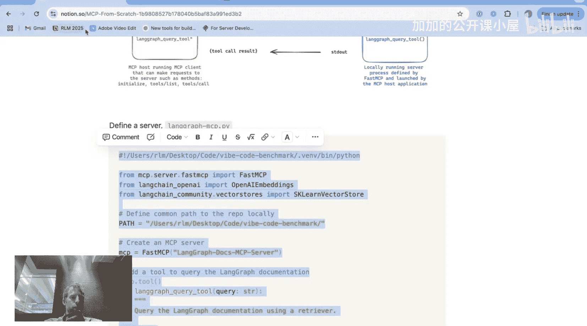

Called Langgraft queryry tool。 By the way， this is exactly the same function that I define here。

 Literally， it's the same here， I create a tool here。 I create a line chain tool。

 and I bind it to my chat model right here。 Now， I'm creating MCP tool。

 They'll be bound to cursor Windsurf cloud desktop。😊，Literally the same logic。 Now。

 this is another launching twist I want to add。 And this one's a little bit less supportive。

 but I'll show it anyway。 You can also define resources。 I mentioned that before。

 and this can actually be documents。 So when we ran our notebook。

 I should create this L M's fullt text。 This is like basically a dump of landgra docs。 Okay。

 and what's kind of neat is you can define a resource that will just grab that file， return it。

 I'll show where that can be kind of cool。 And the final thing is just this last part。 MP dot run。

 We're going to use standard I O。 That's literally it。 super simple little Python script。

 Now you can run what they call inspector。 M X model conduct called protocol inspector。

 This spins up。 You can see it spins up this little specify my transport type。

 Now this is where I just specify my directory。 And this is my Python virtual environment。

 hit connect。 and we can see。😊。

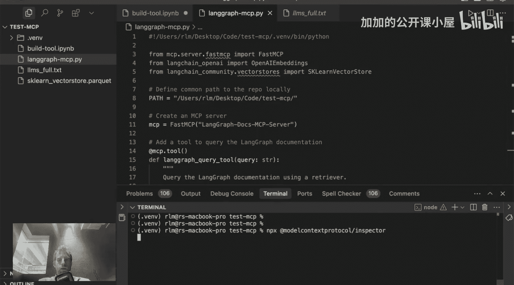

Look at resources， list resources。 We see that Docs Landgraft full resource。

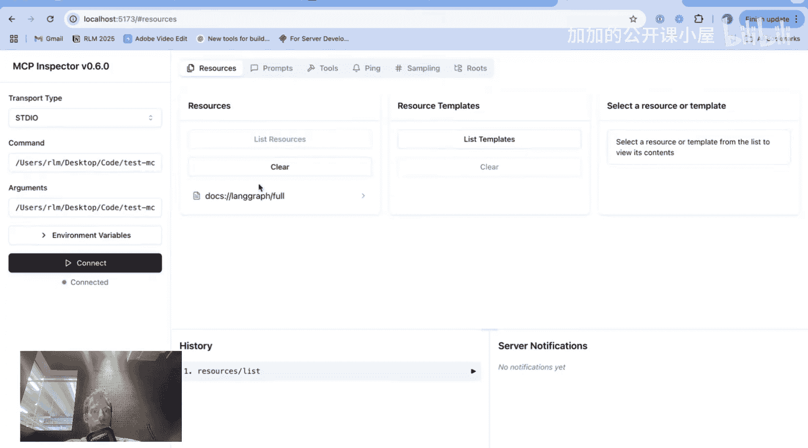

Again， that's what I defined right here， click on this， there's that full dock， pretty nice。

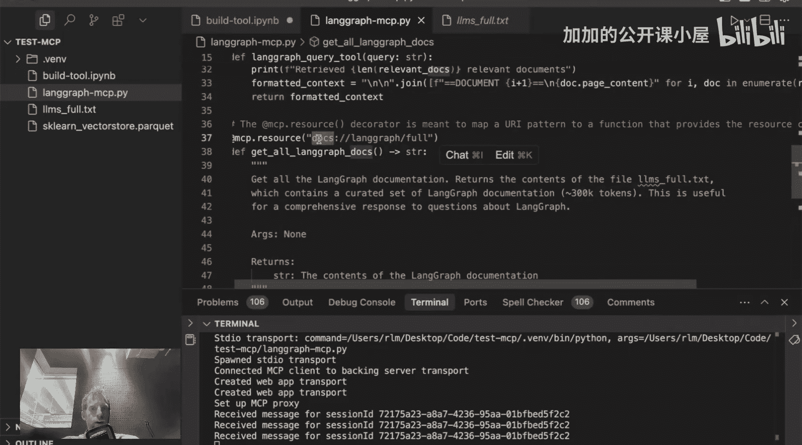

Check tools， list tools。 Here's that Landgraft query tool。

 We actually you can run the tool from here。 What is Landgra。Run the tool。

 and we can see here's some retrieve documents。 We can just test the server directly before we attempt to connect it to。

Any of our hosts。 All right。 So we're basically done here。 All you need now。

 this little configuration， MCP servers。 So， again， this is the command。

 This is the argument that we passed in the inspector to connect this server to our hosts。

You're going to add this little snippet to a few different configuration files。

It's that same command， same argument， as well as the open AI API key。

 And that's only needed because we use an embedding model in this particular tool to embed the incoming query。

 Now， right here， I show the configuration files that you modify with this snippet。

To connect this particular server to the different hosts。 And ass just as one example， you can see。

 just open that up for cursor。 And in this case， I actually don't have my open Iap key specified。

 of course， But you can just see path to Python path to my server definition。

 and just do the following for the other host you're interested in and closing loop。

 That's why when we asked what is Lagra with cursor agent， it was aware of the MCP tool。

 And it called it with this input receiving this output perfect。 That's exactly like we saw。

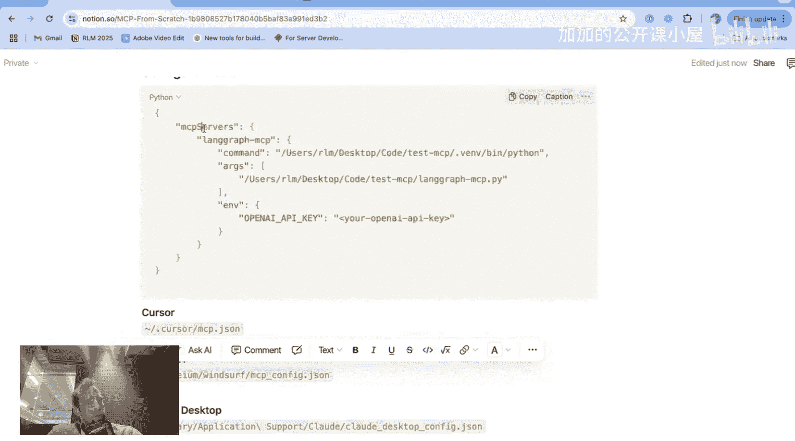

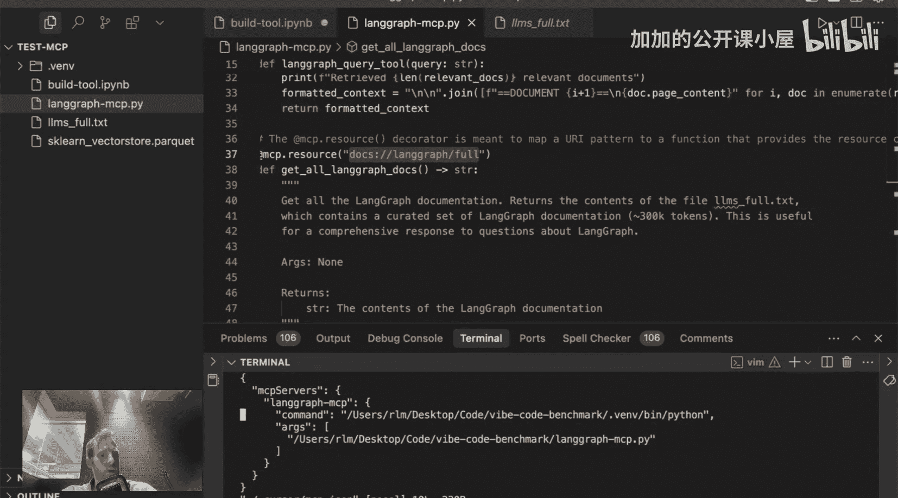

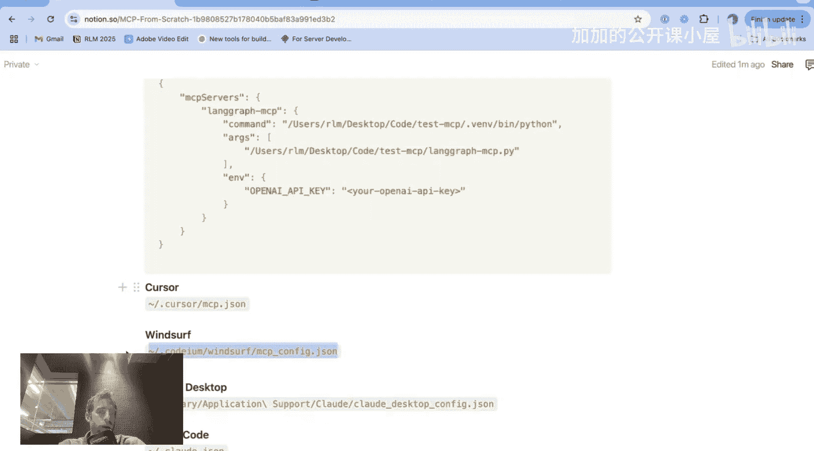

With our inspector。 and again， if you go to cursor settings up here。

 click MCP and you can clearly see our server is right here very nice and in Winsurf， again。

 open up our chat。 let's create a new chat。 What's pretty nice is it shows you directly any MCP servers。

 I'll zoom in a little bit。 We can see one available MCP server。There it is。To configure MCP。

 just click on this button and it takes you to that configuration file， cloud desktop。

 open Se go toDevelop or can。

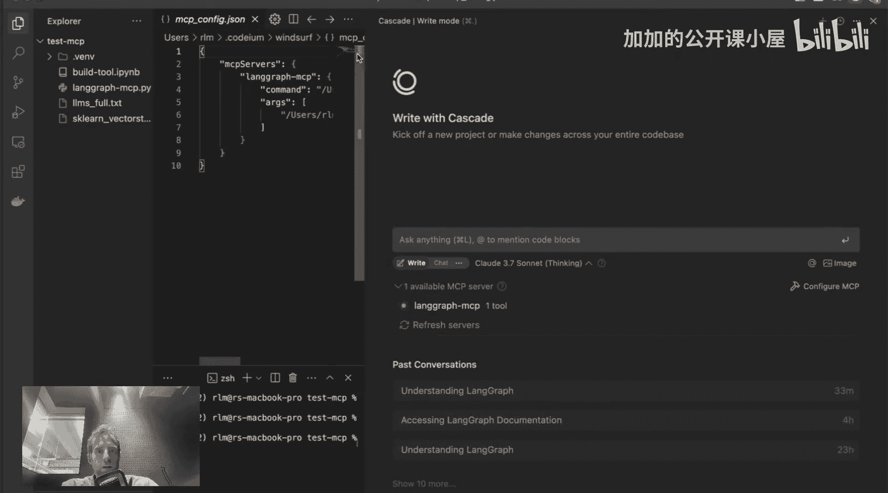

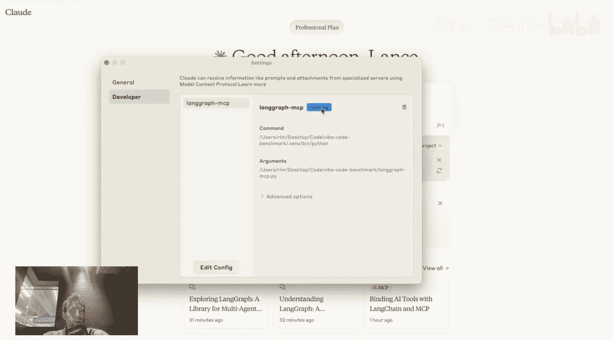