# LangChain【中英⚡LangChain 使用指南｜Build with LangChain】 p67 P72 ＂Vibe Coding＂ LangGraph apps with llms.txt  and MCP -BV1xwfMYDE3n_p67-

So you might have heard of LLMs。text， this is an emerging standard for providing guidance or links to LLM related to a website typically。

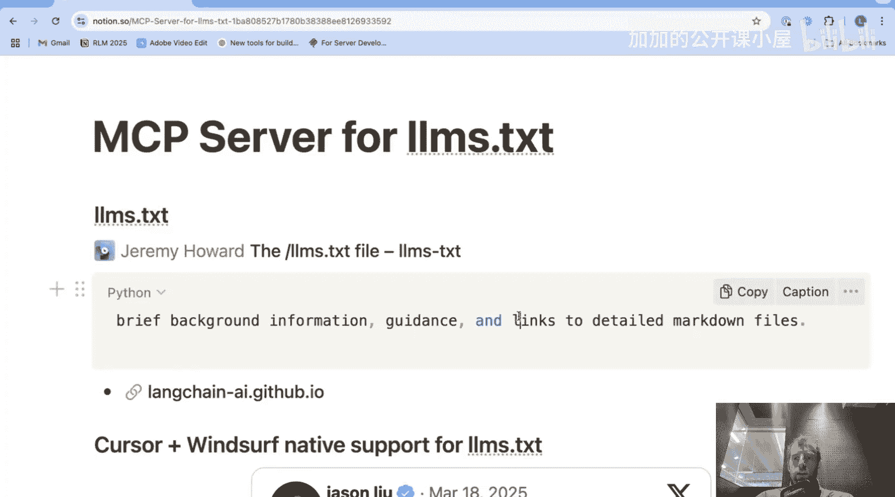

So open up Lm the text for Landgra docs。 You can see it has a number of sections。

 a simple markdown file。 And really what's doing is it's giving a bunch of links to our docs。

 along with descriptions。About what each link covers。

 you can see this covers our heart how two guides， conceptual docs and use cases。 Now。

 the question is， how can I take this dock and use it with applications like curor windsurf。

 So we put together a really simple way to do that。First， I'll show you this working in cursor。

 Cla desktop and Winsurf， and then we'll walk through exactly what's going on under the hood。

I'm in cursor right now。 open up a fresh chat， Select the agent。

 and I'll prompt you with a question about Landgra and some basic instructions。

 I'm using cloud 37 Sonet。 And you can see that it's going ask me to make some tool calls。

 First is going run this list doc sources tool。 This is going return the Lmt text file that I want the application to use it's going read that file。

 What's nice is when I set this up as a tool via MCP。

 I can actually see explicitly what is passed back to the Elmas context。

 So that full Lmt text files past。 Now it reflects this documentation。

 and and identifies the memory concept page as useful to answer my question。

 there it is we can see it then wants to fetch this particular page perfect。

 answers the question extremely well。 and I can see very precisely what it pulling back into context through these MCP tool I'm in Winsurf open up cascade。

 can see I have this MCP server connected。 Here's the tools available。 Go ahead and ask my question。

 and it successfully identifies the Lmt text that I。😊，It reflects on the contents of LMT text。

 and it goes and fetches a few individual web pages provided。In particular。

 this Con memory page and answers my question very nicely。

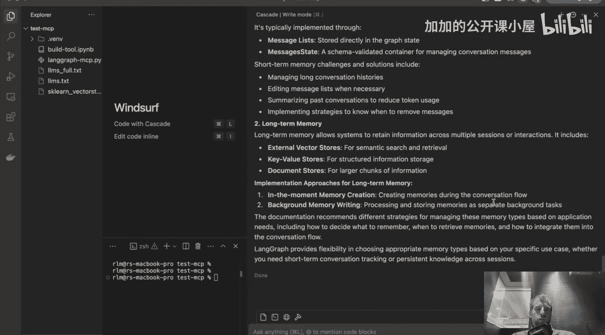

Bd desktop。 you can see those two tools。 the MiMCP server are present。 Ask the same question。 Again。

 I'm gonna allow Clade to make tool calls in this chat。 it fetches the Lm dot text。 It reads it。

 This is pretty cool。 Based on the documentation。 I can see there's a dedicated page related to memory。

 It reads that page perfect。 is's exactly what I want。 and look at this。

 It answers the question nicely based on the content of the memory documentation。

 Now I've shown this in action。 Let me pull back a little bit and Ex what's going on and why we did this。

 So one interesting point in confusion that I've seen quite a bit online I that it is true。

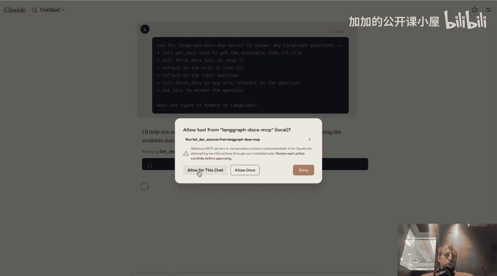

That Ids like cursor and Winsurf have support for loading documents。

 It works a bit differently in each case。 So cursor， when you use at docks。

 it will actually index docs for you。 Windsurf at docs will actually search over the specified domain。

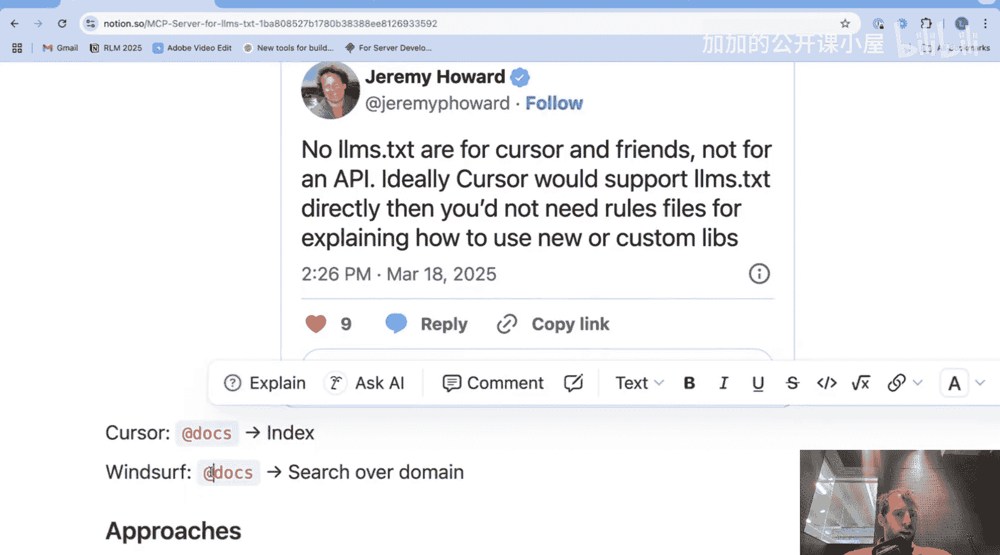

Let's just see this in cursor quickly。 Some in cursor settings。 You can see there's this docs option。

 Let's go ahead and add a new doc， and I'll go ahead and pass the URL to my Lm dot text。

 confirmfi now it's been added， and we can see it's been indexed。 Let's go to chat。

 open up a new chat agent at docs。 There's my doc。 and I'll go ahead and add some instructions。

 Reflect on the URLls in this doc provided directly read any URLs that are relevant into the question。

 Use to answer the question， and I provide my question here。 So you can see the thinking process。

 It identify a bunch of URLs in the doc。 That's great。 I want to load this directly。 Of course。😊，Now。

 this is what I found is kind of interesting in cursor。

 it'll actually do web search and I see no results found。 again， it searches the web again。

 And this is what's interesting in this final web search I've seen this before。

 it pulls a whole bunch of different URLs。 But I can actually see the context loaded from these URL。

 So it's kind of opaque to me as the user。 So if I generalize what's happening。 Basically。

 I'm offloading the tool definition and usage to cursor agent， which actually is fine a lot of cases。

 I like cursor a lot， I use it all the time。 But I don't have much visibility into what this builtin tool is。

 and the context is returning as well as a tool call it's making。 It's a little opaque to me。

 and this is kind of the motivation for building the MCP server that we did。

 Now before I talk about the server specifically， I do want to kind of mention a few different approaches generally for adding context to Lms。

 So the first and most simple way to think about this is just stuffing。 So taking。😊。

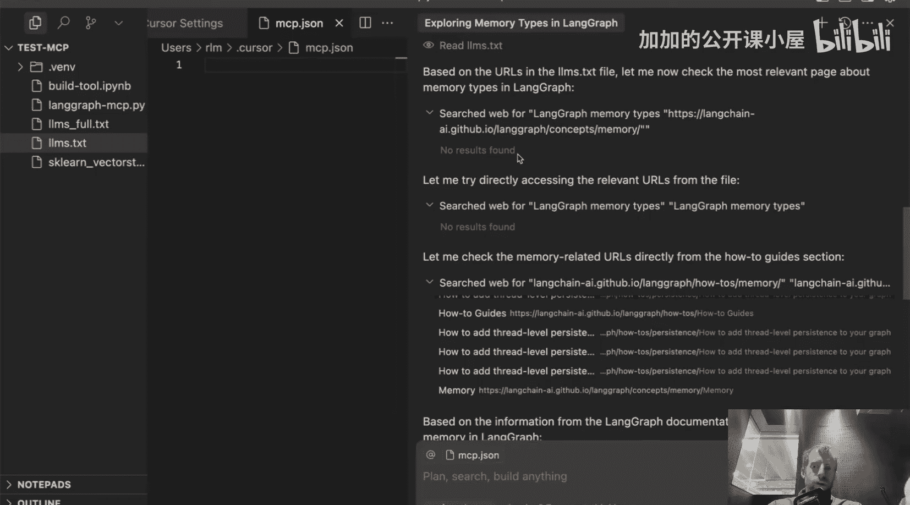

Documentations stuffing it directly into the context window of an LM。 It's simple。

 con is that it can be costly and less efficient， particularly for large docks。

 and there can be retrieval problems， depending on where the context of the dock lives。

 newer Lms are better at this， certain models are better than others。

 Contex stuffing is an appealing approach。 Certainly for smaller context。

 When we're talking about larger context like all the lagraft docks are around 300000 tokens。

 if you add lang chain docks you're into the millions of tokens。

 it becomes a bit infeasible to just stuff everything into context for every call to the model。 Now。

 on the other kind of extreme， the idea that's been around for quite a while is indexing in。

 for example， something like a vector store。 So you take all your docks。

 Let's say we're taking the landgraft docks of 300000 tokens， you split them。

 you embed each split and you store them in a vector store。

 and you use some kind of search like semantic similarity to retrieve docks are relevant to your question。

 Now， the pro here is that is cheap。 very scalable and very fast。Con is。

 and this has been talked about a lot online。 It can be tricky to configure this。

 What's the split size， How many docks for return， And there's also some upfront work to set up and host a vector store。

 So what I want to talk about here is this idea of using L M dot text。As a reference。

 plus simple tool calling to retrieve URLs based upon a task。So if you think about this。

 it's really simple and intuitive。 Lm dot text just gives an LLM a reference of all the URLs as well as descriptions。

 the LLM can look at a task and decide which ones to read just like a human would It's like a table of contents and really all I need to do is just pass the Lmt text to an LLM and give it some tool that can just directly read URLs。

 That's really it。 only cons is some upfront work to set up Lm dot text。

 but many different libraries are actually building them for you already。

 and it can be higher latency because you may make multiple tool calls to retrieve different URLs and reflect on them。

 So really all I want is the ability to define a super simple URL loader tool。

And apply that to URLs and Lm and any Lm do text I provide and somehow connect all that to my applications of choice like Cur or windsurf Cla。

 That's the motivation here。 So to solve the last problem， the connection bit。

 that's where MCP comes in。 So we have a separate video on MCP that came out earlier this week and I'll link in the description here。

 But it's a very nice and simple way to connect tools to common applications。

Like cursor windsurf clawd。And here's a schematic of all that's happening。

 The applications are going to have access to this Lmta text， and it can reflect on that。

 make tool calls to read specific URL， present Elonta text。

 and the tool just returnss the URL contents to your host application and it can iterate as long as it wants until it satisfies with the solution。

 So you have this repo everything's open source to help you set this up and we have instructions for setting it up。

With cursor， windsurf or clod， let's just set up right now。So in a fresh term。

 I'm just going run this to spin up my MCP server。 Now this is optional。

 and this is just to test that the server is actually working。 Now you'll see。

 I spin this up with a link to the Landgralms do text。

 And so now my MCP server is running in a separate terminal。

 I can just kick off model contact protocol inspector。 Open that， click on the provide link。

 My MCP server is running here， paste that in。 I'm using transport type S。

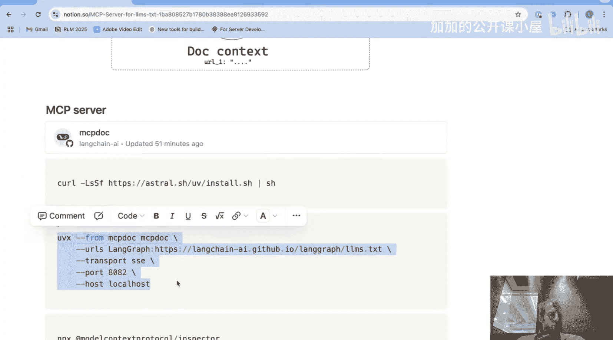

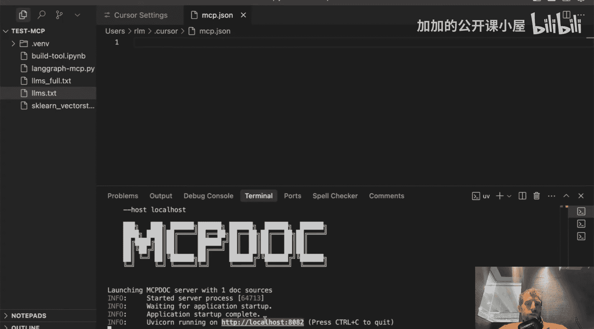

And connect。I'm connected to the server。 I can check what tools exist。 L them out。

 It has a list doc sources tool。 Let's run it。 And that provides the link I gave nice。

 and I can run the fetch docs tool， pass in a random URL to test， run it look at that。

 we get the doc very quickly。 So now we know that our server works。

 So now I need to connect the server to my various hosts。 So this is cursor as one host。

 go to settings， go to MCP， add new MCP server and just paste in this。

 This is provided in the readme。 And this is just run in the same command。 we just ran。

 But in this particular case。 the host application cursor is going run this for us。

 spin this up and connect to it。 So that's done。 go back to MCP。

 and you'll see it is indeed connected by this green icon， go to chat， select agent。

 And now our instructions here to make a bit more sense。

 Call that list doc sources tool to get the available El text files。😊。

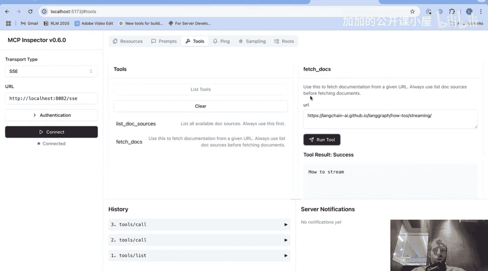

Call fetch docs to read it。 Call fetch dos in any relevant URLls to answer the question。 Now。

 all this， you could add to cursor rules as examples。 So you don't have to actually add it into chat。

 but I'm just putting it all here for most transparency。

 Ask a question and we can see it correctly says， okay。

 let's go ahead and called list docs tool to get any available El dot text files run the tool。

 It goes ahead and fetches the concept memory doc， It deems that to be most relevant to my question。

 which is exactly right。 We can see the return context here。

 It also decides to look for a bit more memory implementations。

 and we can see very nicely exactly the docs it retrieved。 What it pulled into context。

 And now it used that to answer the question in a lot of detail。 So in Winsurf。

 just click configure mp。 And that takes you to the configuration file。

 This exactly what we just did。 This is just the windsurf config and paste it in just like we saw before。

 and then prompted just as we did previously in Clade， go to settings。

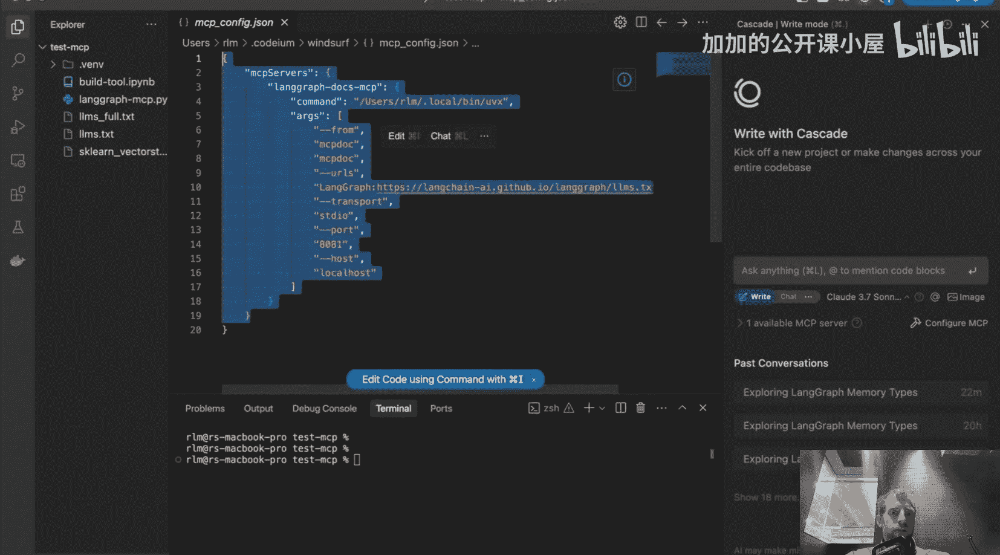

Go to developer， edit the configuration to add the server configuration as we did previously。

 And this also works with cloud code。 So all you actually need to do is if you follow the readme。

 just run this command as node in the readme In this case I've already added this particular MCP server Open cloud。

 it notifies that it finds one mP server。 and we can see La of docs is andcon。 We can approve the。

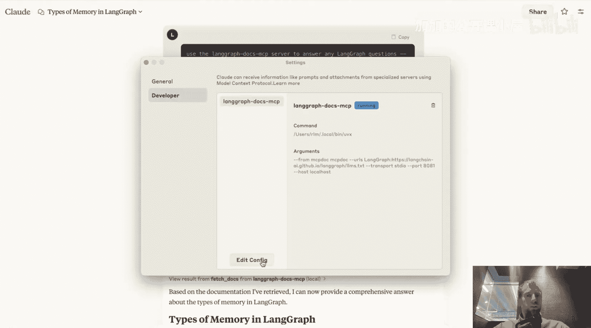

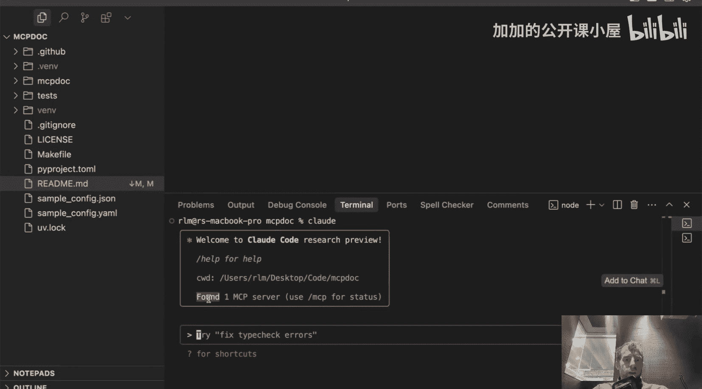