# LangChain【中英⚡LangChain 使用指南｜Build with LangChain】 p68 P73 LangGraph Studio： An IDE for visualizing and debugging agents -BV1xwfMYDE3n_p68-

In some recent videos in some of our repos or even on X， you might have seen this。

 and you might have asked， what is this thing， I want to give a quick overview of what this is。

 It's called Lagraft Studio。This is a specialized I for working with and debugging graph agents。

 So show working right now。 This is with a pretty popular project we have called Local Deep Researcher。

 And you'll see right here。Is a graph。 We'll talk about this a little bit later。

 You'll see right here is an input pane where I can add user input and I can hit submit。 Now。

 as this is running， you can see what's happening in the graph， we generate a query。

 And while this is happening you can follow along over here to see as your graph state is populated。

 Here is our query generation Here are the results of web search， for example， here is summarization。

 we can see it' streaming。 And this particular graph repeats with a process of reflection Serization for some defined number of cycles。

 And again， in studio， we can see everything happening As our graph is going through this process。

 Now， graph finish running。 You can see over here。We can actually scroll through everything that happened over the course of the graph's execution。

 And in particular， we can see at every single node in our graph。How the state was updated。

 so I want to take a little bit of time to build up an understanding of studio from the core components。

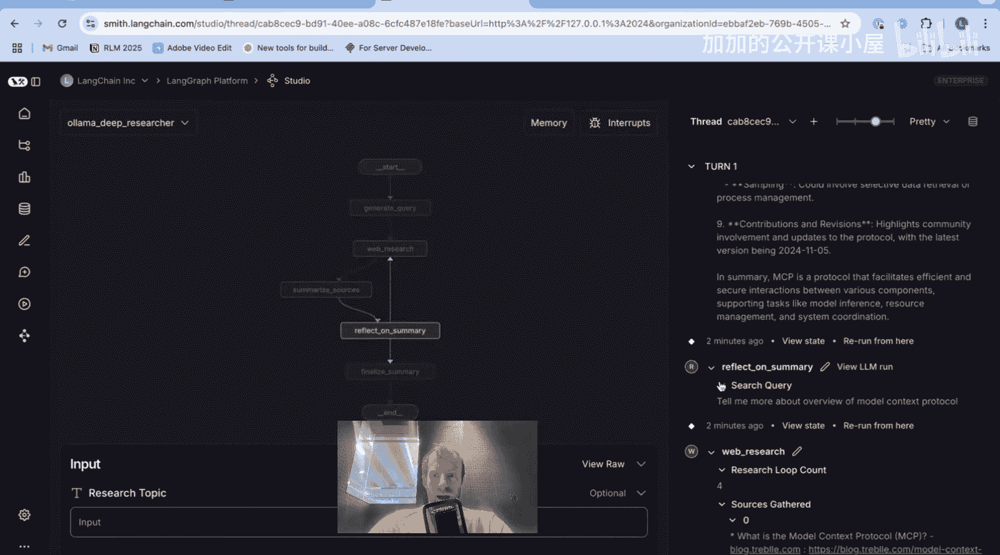

And really break down what's happening under the hood when we're actually using it。 So first。

 Langgraft Studio is part of what called broader Lnggraft platform。

 So Lngraft platform is a number of components that work together to support developing。

 deploying and debugging， monitoring Lang graphft applications。

 And you can kind of think about this in a few different ways。

 So there is typically your agent or application architecture that can involve a few different things。

 It can involve lang and integrations for models， vector stores or other things。

It can include Lagra for orchestration， and it can tools that agents you build can invoke that you can easily implement Lagraft applications in。

 for example， a Jupyter notebook， you can test them there that's not a problem。

 Lagraft platform is a way to actually deploy them and to connect them to a few different useful things one is memory。

 So Landngraft platform has built in short-term and long-term memory。

 shortterm memory is what we call thread memory， so that's memory that persist across given user interactions and long-term memory persist across many different threads or many different user interactions。

 So like memory about a user， for example， you may want to save that can be done in long-term memory and we deploy your agent or application with the Landgraft server。

 it connects the studio which we'll talk about in lot depth， but also as you'll see。

It connects to Langsmith， which gives you lots of useful observability features。 Really。

 the core piece of takeaway from this is Langgraft Studio is a part of this broader Lagraft platform。

 This platform gives you a very easy way to develop， deploy and debug applications built in Lgraft。

 And now this server can be run locally on your machine or hosted。

 we'll talk about that more in a little bit。 So as we saw before， Studio is a specialized I。

 It can connect to Lagraft server and enables visualization interaction debugging of the application。

 Now to use Langgraft platform and in turn。😊，Like our studio。

You do to structure your application a certain way。 but's pretty straightforward。

 The central piece is this configuration file， and I'll show you specifically in the local researcher re。

 And you can see it here。 The key things to note are definition of dependencies。

 this Langraff configuration file environment。And then this we'll talk about in a bit。

 But this is just your graph implementation。 So here's our repo local deep researcher。

 Here is at Lagraft do Json。 We can actually see what's going on here。

 So you can see this points to your graphs。 you can see that the compile graph is specified here。

 And that's exactly what we point to in Lagraft do Json。 you can see we point to the directory。

 the file name and the compile graph name。 So that's how this configuration file points to the specific compile graph that you want to load and run with Lagraft platform。

 And in addition， studio。 the application structure includes dependencies In this case。

 I use by project Automal。 Here it is。 And as shown the graph definition。

 And you'll notice in a lot of example， repos graph definition is often split up。

 So you have kind of a graph do pi oftentimes this has the final compile graph。😊。

But then you can take your state， your prompts and u。

 And those can be put in separate files that you just pull in。2， your graph top pi， Finally。

 the environment file， which will be loaded using Python dotian。 Now， if you're running locally。

 you don't actually need Ev files， it can read any environment variables just from your Python interpreter environment。

 But it's often good practice to include。 I want to show how to run Lagraft platform locally on your machine for development purposes。

 and all you need to do following these instructions are install the La graphft C a lot as noted here and run Lagraft dev。

 Now， you notice in a lot of repos。 I provide this shortcut。

And I want to explain what's happening here a little bit。

 So this uses a tool called UvX to create manage of virtual environment for your Landgra application and launch the local Landgra development server。

So UvS is an environment manager， creates an isolated environment for Python applications。

 We'll create a fresh environment when we run。 Now。

 this specifies that the environment should include what we just talked about the La graph CI package with in memory extras for running it locally in development mode。

 That's all that means。Then that with editable just installs the current directory or your application in editable mode。

 changes the code will be immediately reflected without need to reintall your package。

 specify Python version， and then run Langraft。 dev。 So this command will launch Laanggraft server。

In memory mode， locally on your machine。 So as an example， I'm in that local deep researcher project。

 and this is the command we just saw。 I can just run the end。

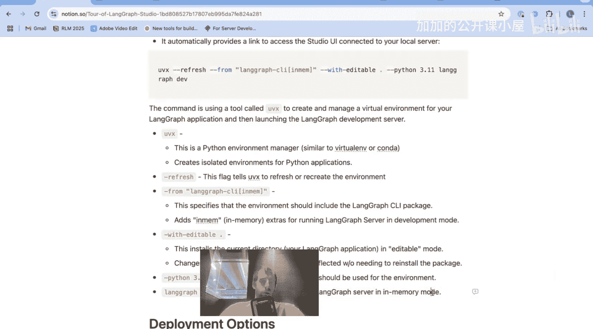

There you go。 You're going to see this Wecome to Landgra and you're going to see automatically server spins up in your browser。

 Now， if you go back， you also have some links to interesting things here。

 you direct link to the API you have a direct link to API docs。

 you can open this up and you can see the full API docs laid out for you。

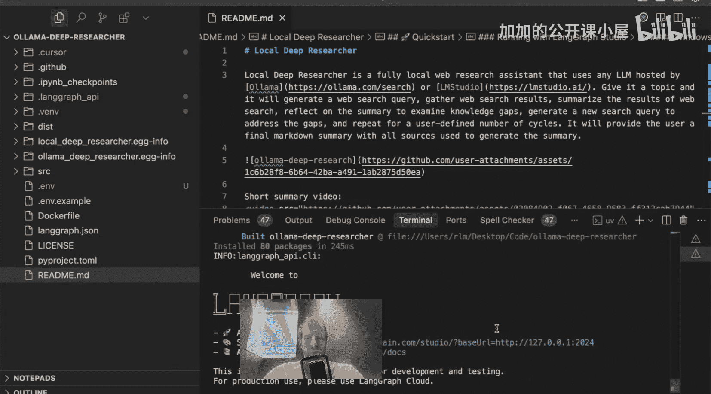

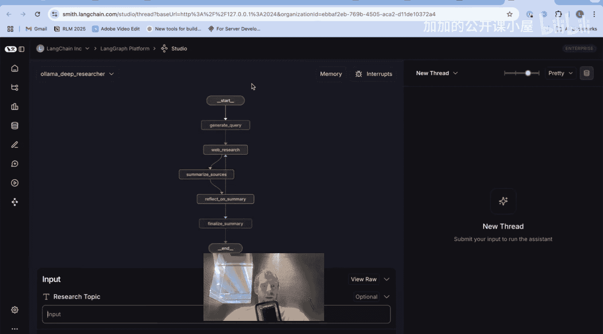

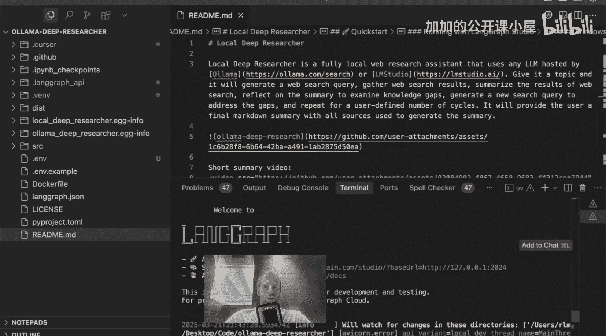

With all the different endpoints available on your locally running server。

 you can see it's organized by assistance threat and so forth。

 And now this link you can see is studio Ui。 So it automatically spun up。

 but you can also just click on it。 And that opens studio。 So in studio opens。

 you're going to notice a few different things。 So first is you can see like our platform studio identified here at the top。

😊。

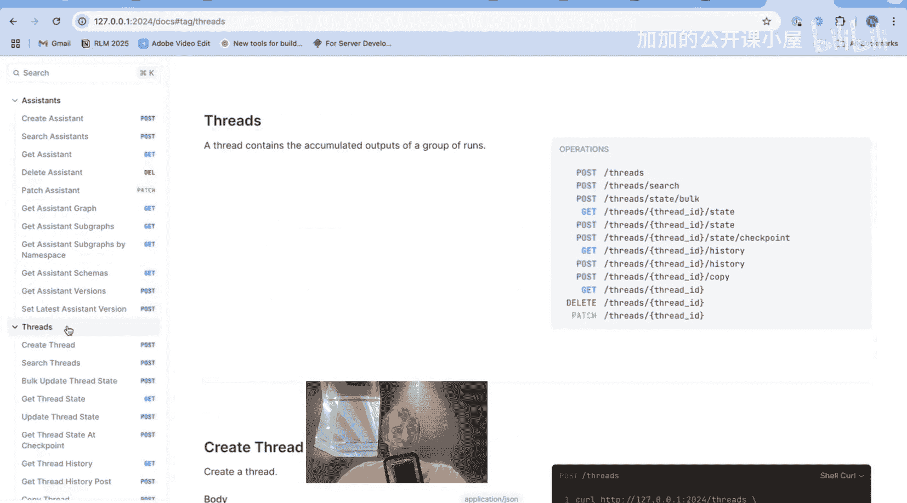

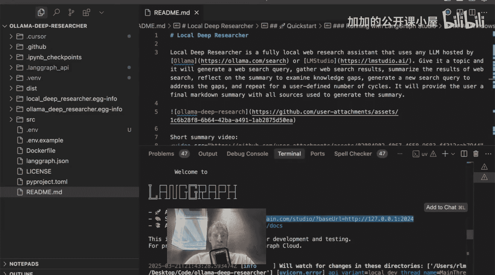

And there's this thing up here。 So what's this。 If you go back to your Laangraft Json。

 you can look in our directory here， open up the Lang graph Json。

 you see when you find your graphs here， you name the graph in this particular case。

 we named it lammaty researcher and it pointed to the compile graph as we saw in graph top pi。

 And this name is just reflected over in studio。 So that's basically name your graph。

 Now you can have multiple graphs specified in one Langraft Json file。

 and then you can actually just scroll through them in studio very easily。

 Now the second thing to highlight is you see your graph。😊。

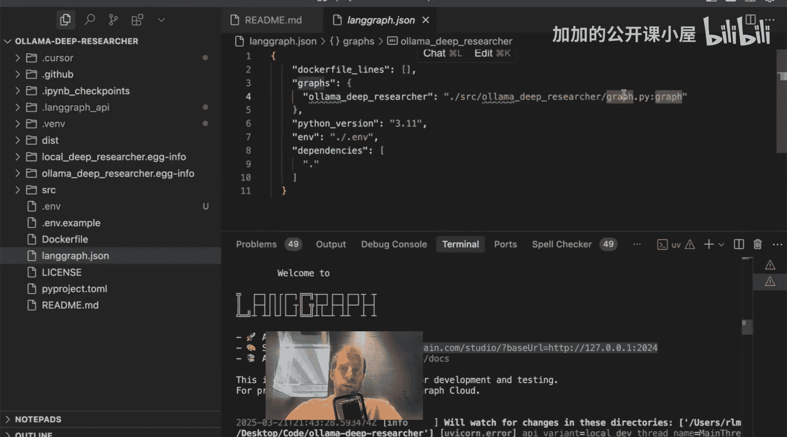

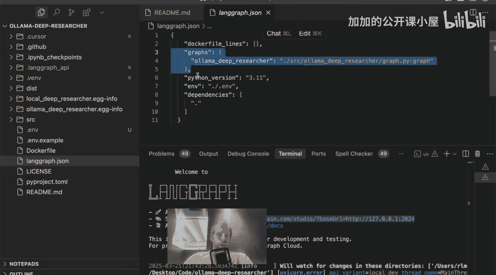

And each of these things in the graph reflected here in studio。

Corspond to nodes actually defined in your graphs。 we can go ahead and look at Laangroft dot。Jason。

 we can see this points to。Our graph itself。 we can go there and look。 And so here is graph dot pi。

 Here's our node definitions。 You can see there's a node for generate query。

 Thats all the logic in there。 a node for web research。 Now go back to studio。

 that node is reflected generate query。 then web research。

 So the flow of information through your graph as specified in graph dot pi through the node definitions in the connectivity between the nodes using edges are all represented here in your graph visualization。

 So this visualization maps one to one2， what's laid out in the corresponding in this case。

 graph do pi。 That's the second thing to recognize。 Now， this input， where is this coming from。

 If you go back to our code and go down to Sa graph builder。😊。

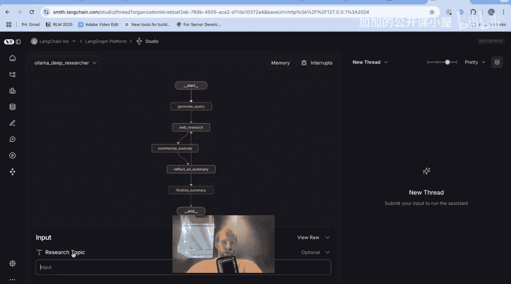

You can see when we lay this out， we actually supply the state to our graph with an overall graph state。

 as well as an input and output。 So what does this mean， Well。

 the input is just the actual input state feels we want the user to see。 Likewise。

 the output is just the output state that we want returned ultimately， when we run the graph Now。

 if you look at that summary state input， you can go to state dot pi。

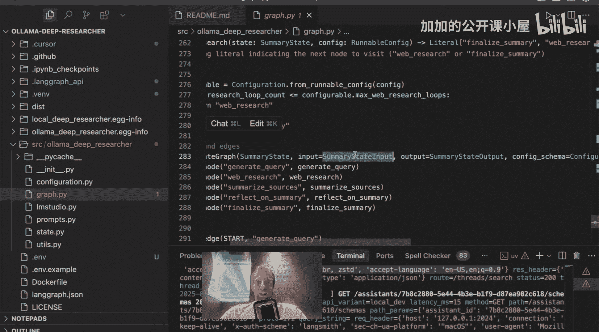

You can see it just contains a single field research topic。

 which is also duplicated in summary state with this represents the full state of our graph。

 but this input is only things we want the user to see。 if you go over to studio。

 you can see we only expose research topic to the user。

 which is often nice because we don't want to expose， for example。

 all the possible state variables that are present within our graph to the user。 Now。

 as we saw before， we can go ahead and supply an input。

 and we can see pass an input and our graph runs initially it's running， generate query。

 we can see its streams as it's going， Web search is done when Web search is done。

 we can actually can go and inspect all the results from Web search and as we saw before。

 we see state streaming。😊，Add the graph is running。 So in particular。

 this summary sources node is actually running， and we can see what is being returned。 Now。

 it's kind of interesting。When each node finishes， you can actually see the state key that's been updated and the value of the state key。

 So while it was running， we saw the output stream。 But then when it finishes。

 you can actually see the assignment to the corresponding state key。

 Let's look at the code briefly to understand what's happening here。

 So you can see this state key is running summary。 and heres。

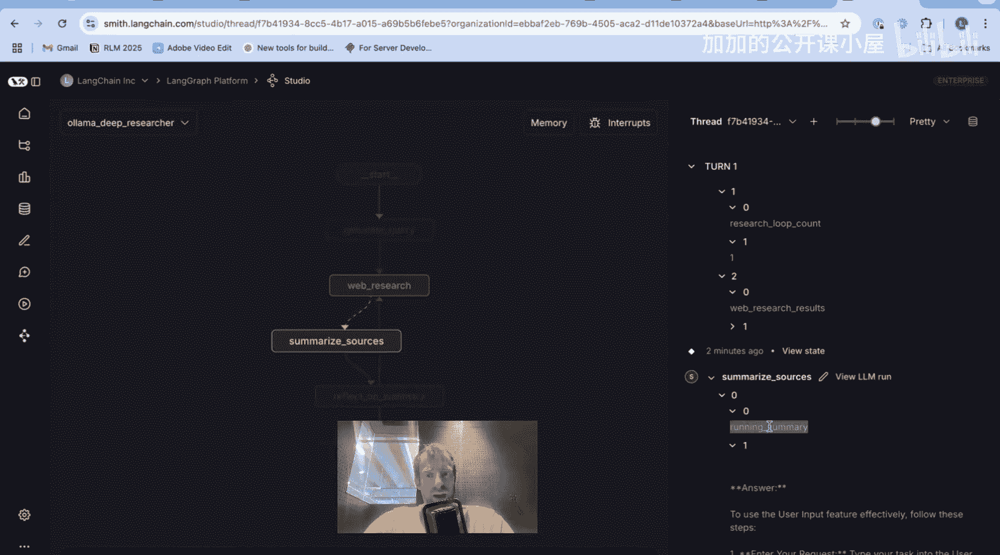

What we got， if we look at Grtop Pi， go that summarize sources node。

 we can see you do do a whole bunch of stuff in here。But ultimately， again。

 we update that running summary state key with our running summer。

