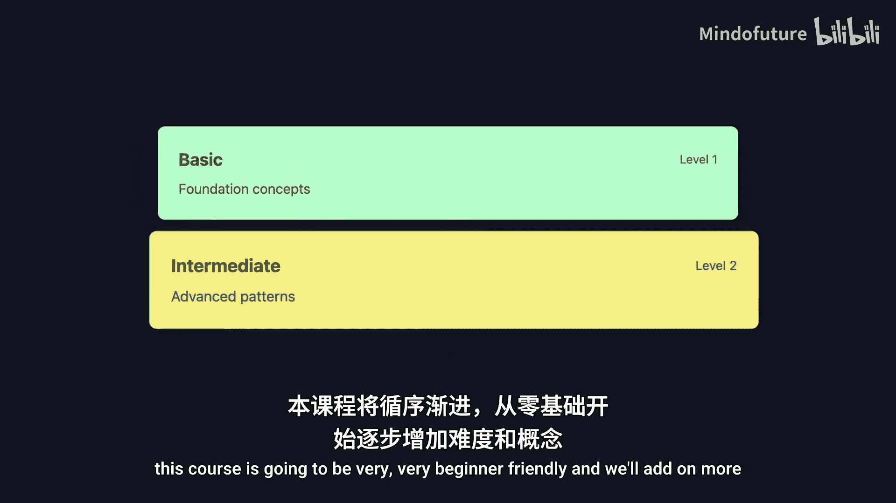
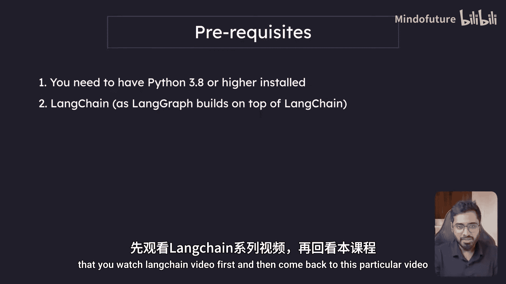

# Langgraph初学者入门2025 p01 P01_#1_引言 -BV1mgepzCEjf_p1-

Hello guys。 welcomelcome to a complete endto end Landcraft crash course for beginners。

 If you are looking to build powerful AI agents for your product， for your business。

 or even if you're looking to make your next big job switch than this course is for you By the end of this course。

 you will learn how to build powerful AI agents that can think for its own。

 it can make decisions for itself。 if there is a human approval needed。

 it can pass its work and compute you for approval。 And even this is the tip of the iceberg。

 And if this sounds too much for you， don't worry this course is going to be very。

 very beginner friendly and well add on more difficulty and more concepts one step at a time。

 So let's actually go ahead and look at the course overview。 So first。

 we will look at the different levels of autonomy in LLM applications。

 So autonomy meaning freedom So starting with code。

 which has very little freedom to think on its own right it does exactly what we tell it to And in the end。

 we have agents which have very high autonomy It can think on its own and that is。😊。

Exly where land graph is going to come into the picture。 But to get here。

 we will have to understand how we progressed here。😊，Okay。

 so now understanding agents and tools and this is where we will be deep diving not just on what agents are but actually look at how agents are built under the hood Okay so basically this would set out very strong foundation for us for the rest of our course So yes。

 we learn them how to build them from scratch Also we will also be learning how to build agents using predefined classes that Lacha provides out of the box and then we will understand the graph data structure the differences between dags and cyclical graphs So now that we've understood the prerequisites then we will move on to what is a land graph why is it required why not just stick with L right what are the limitations of Lcha So then with land graph we will be building different agentic architecture patterns like the reflection agent reflectionxion agent multiag workflows right so we will understand all of the key terminologies that come with learning La graph like what is a graph what is a state what is a node。

😊，Right what is visualization water break points etca etc okay so at that point we would have learned enough to start building our very own Land graph chatbot the chatbot will build will have the ability to answer questions by searching the web it will be able to route complex queries to humans for review it can go back in the chain and then explore alternative parts and this is where these agent patterns like human and lube react patterns come into the picture。

😊，Okay， so we will also build multi agent systems like very similar to what crew AI does。

 but I believe that Land graph is much more powerful because it's much more low level and that gives us a lot more flexibility on how we can actually build the flows。

 Alright， so multi agent systems， meaning we basically create multiple agents and those agents can sort of communicate with each other to get a particular task done。

😊，And then we will integrate rags into land graph so we will explore what C rags are or it basically called corrective rags。

 we will also see what a rags are basically it means adaptive rag and also self rags。😊。

And most importantly， we'll also be looking at how persistence works in Landgra。

 Also learn some of the other tools that Landgra provides to help build production grade agents right so like the Landgra studio is something that it provides it provides Landgra Cloud API etc etc。

 well also be looking at that。 And finally， we will look at agents in production。

 So basically explore enough real life use cases so that you get a complete absolute complete picture for what is to come in the future of technology。

 So if this excites you make sure to subscribe to the channel and hit the bell icon as well so that you'll be notified every time I release new videos。

 Now let's actually go ahead and look at the prerequisites for this course So first thing obvious Python because we will be working with Python And secondly。

 understanding of Lacha can be essential and I'll tell you why Land graph。

 which we are going to be looking at in this course uses Lachas classes under the hood。 For example。

 chat models prompt templates and these are。😊，That Langcha provides and learning that is going to be very important to continue with this course。

 So if you don't know Lcha already， I've already made a 2。

5 hour long tutorial that teaches you in depth the concepts like you know chat models prom templates right rags agents and tools right so these are things that are very important。

 These are prerequisites。 So if you're not familiar with these concepts I would highly recommend that you watch L chain video first and then come back to this particular video。

 So with that said， let's get started。😊。

