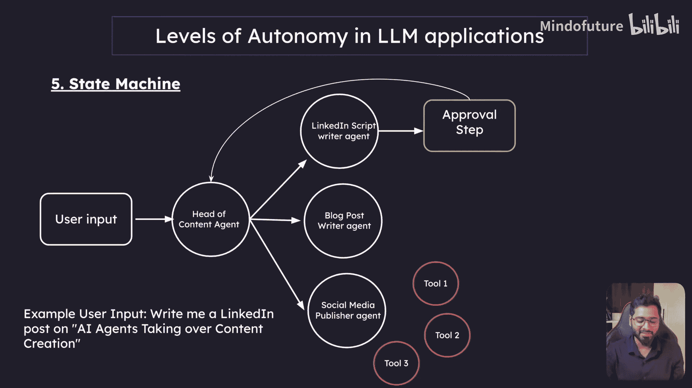
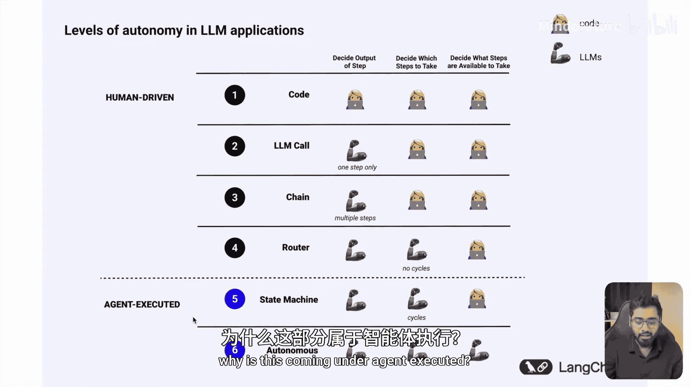
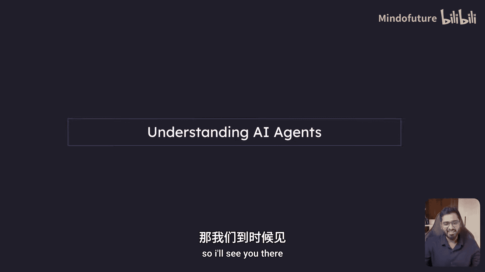

# Langgraph初学者入门2025 p02 P02_#2_LLM应用中的自治级别 -BV1mgepzCEjf_p2-

In this section， let us explore the levels of autonomy in LLM applications and this list is going to be starting from the least zero autonomy to maximum autonomy。

 so the first thing that we have is code。😊，Code has zero autonomy and is 100% deterministic。😊。

We all know that everything is hard coded， and it is not even really a cognitive architecture。😊。

What are the disadvantages， though。The problem is you would need to write rules for every possible scenario。

 making it impossible to handle real life complexity。😊，Let us know look at the next one。LL M call。

A single LLM call means your app basically does one main thing you give it an input。

 it processes it and it gives you back an output。😊。

Think of chatbos that just take your message and respond or apps that translate text。

This was a huge leap from hard coded rules even though it is still pretty simple and it is only in the second stage of autonomy。

😊，So here is a very simple diagram that Ive prepared so we have the user input right here the user is inputting an input to the LLM which is right in the middle and then it gives out an output。

😊，So an example user input could be something like you are an expert LinkedIn post writer write me a post on AI agents taking over content creation so the user is giving just one prompt one particular task to the LLM and then the LLM is pretty good at doing that one particular thing okay but there is one disadvantage as well so as you can see right here。

 trying to get everything done in one shot often leads to confused or mixed up responses just like how one single person cannot be an expert at everything。

😊，So you can imagine that if I ask it to you know write a Twitter post and a LinkedIn post and I don't know a blog post as well in all in one single pro。

 it is not going to do it really well。😊，If you are going to tell the LLM to do one particular thing。

 give it enough instructions and just give it one task， it is capable of doing it really well。

 but multiple things it cannot do really well。😊，And this brings us to the next level of autonomy called chains。

Think of chains as having multiple specialists instead of one generalist。😊。

Instead of asking one AI to do everything， we break it down into steps where each AI is really good at one thing。

Imagine a customer service chatbot。 The first AI reads your complaint and figures out exactly what product you are talking about。

😊，And the second AI finds the right solution from the company's help docs。

 and then the third AI turns that solution into a friendly response。Each step is simple。

 but together they create a much smarter system than a single LLM call。😊。

And this is where we first started seeing AI applications that could handle more complex tasks。

 not just by being smarter， but by breaking big problems into smaller， manageable pieces。😊。

But what are the disadvantages， The downside is that these fixed sequences are like a rigid assembly line。

😊，They always follow the same steps defined by the human。

So let us look at an example of chains so right here you have a user input okay so the user input is going to be just a title for a particular post So for example the user is saying。

😊，AI agents taking over content creation。That's it。

 The user wants to wants this particular application to go off and create a linknkIn post based on this particular topic as well as a Twitter post based on this particular topic as well as a blog post Okay。

 so what you see right here， this is a chain for linkIn。This is a chain for Twitter。

 This is a chain for blog post。So basically we are we are having these parallel chains and just by initiating this particular node all these chains start executing parallelly at the same time alright and what are the upsides of this what are the advantages of using this particular chain it is not a single LLM call these are three different LLM calls right so these are three different specialists doing you know one specialist is doing LinkedIn the second one is doing Twitter the third one is doing blog post so the advantage of using chains is that we have three specialists instead of one general list。

😊，But what are the downsides， What did we see right here。

 the downside is that these fixed sequences are like a rigid assembly line。

 right they always follow the same steps defined by the human。😊，So。

 basically what I am trying to say here is that the level of autonomy is very less。😊，Right。

 the level of autonomy is very less。 It is not making any intelligent decisions or anything right here。

 Okay， so let's now look at the next level of autonomy in LLM applications。 and we come to router。😊。

This is where it gets really interesting routers like smart traffic cops for your AI。😊。

Instead of having a fixed path like in chains， the AI itself decides what steps to take next。

Imagine a personal assistant bot。When you ask it something。

 it first figures out if you need help with scheduling research or calculations and then route your request to the right tool or chain for the job。

😊，Okay， so I know this looks a little bit complicated， but let's take it one step at a time。 Okay。

 so the example user input is going to be write me a LinkedIn post on AI agents taking over content creation。

 Okay， so the user is actually being very specific about Linkedin。 Alright。

 So let's see what happens。 This is the user input。 And then we have another LLM right here。😊，Okay。

 so we have an actual LLM where we would have written the prompt Okay so basically look at this particular user input and then figure out which social media channel that the user is asking this topic to be written on Alright So this router LLM what is it going to do it is just going to return you know is it linkededin or is it Twitter or is it X whatever I mean threads or whatever right So that keyword is being returned by this particular LLM node and that is being returned to a simple input classifier。

😊，So what is this classifier it could just be a simple python function。

 It just takes in an input a keyword， that keyword depending on whether it is LinkIn or you know a Twitter or a blog post or whatever。

 depending on that particular keyword it is then you know either it is directing。

It is either directing the control flow to the first chain or the second chain or the third chain。

Okay so if based on this particular input since the user is asking for LinkedIn it is then going to direct the control flow to this LinkedIn chain。

 Alright， so that is the only difference basically in the previous chains you saw that you know there is no real intelligence happening So whatever we decide it is just going to go you know there is no real you know decision making happening there if we basically chains are predefined we define okay this is the direction that it needs to go into but in a router this router LLm it is actually making a decision based on the user input it is looking at okay linkednkedIn is what we want So it is directing the control flow to that particular chain。

😊，Okay， but there is another disadvantage with a router as well。

So while it can choose different parts， it still cannot remember previous conversations or learn from mistakes。

😊，And and it is exactly to fix this particular disadvantage that we have the next level which is going to be called state machine or in other words agent and this is exactly where land graph is going to come into the picture let's dive into it。

😊，So this is combining the previous level router， but with loops。😊。

And then why do we call state machine as an agent， basically whenever the control flow is controlled by an LLM。

 it is then called an agent， very simple I just wanted to give you a reason why we are calling state machine as an agent。

And this involves features like the ability to have human in loop asked for approval before moving on。

😊，Multi agent systems。Advanced memory management。Going back in history and exploring better alternative path。

😊，Adaptive learning， meaning it gets better even if it makes mistakes so it won't make the same mistake again and many more。

 and this is where landgra comes into the picture。😊。

So let's actually look at what is possible with this particular type which is the state machine alright so so we have the user input right here and then this user only has to deal with the head of content agent okay so we are taking the same example which is the user input as like you know write me a linkednkedIn post on this particular topic write me a Twitter post write me this thing write me both at Twitter as well as a linkednkedIn post right the user can basically say anything to the head of agent I mean the head of content agent。

😊，So normally this is this is how you know it works in business right basically you would have one high level you know subordinate that you will give all your instructions to and that subordinate will have multiple subordinates under it and then you know that will take care of it right and that is exactly what is happening here the user is inputting this to the head of agent。

😊，And this head off agent you know looks at this particular prompt and you know decides okay。

 does it need to talk to the LinkedIn script writer agent。

 does it need to talk to the blog post writer agent。

 does it need to talk to the social media publisher agent。😊，Okay， so it looks at this thing。

 okay it sees the Linkedin thing， it sees the topic as well。

 so now it instructs the Linkedin scriptwriter agent to write this particular。😊，Po。Alright。

 and we can also you know add a human in loop here as well。

 Okay so we have time travel abilities when it comes to state machine basically Land graph So once the LinkedIn scriptwriter agent is done with writing the LinkedIn post we can also have an approval step right So basically an approval step is it sends the draft back to the head of agent I mean the head of content agent and then asks basically okay is this good do you want me to make any more corrections So this head of agent content agent is going to send it back to the user because we want this to be the point of content we don't want to deal with these agent right So this head of content agent is going to come back to the user say okay this is going to be the first draft do you want me to make any few any more suggestion I mean improvements So if the user says okay make it shorter make it more punch here add a better hook to the post or something like that all of that feedback is going to be again sent back to the LinkedIn scriptwriter agent this agent already has what it generated previously and then it。

😊，As the feedback as well So it has the full context right so and then once it is done it again does it So you can see that there is a sort of sort of a loop happening right it can go back in time and then you know it can sort of iteratively make a particular thing really good。

😊，Alright， that is where state machine really shines and this is exactly where land graph you know is used basically So what would happen once the human actually approves a particular draft okay so the control flow comes back to the head of content agent and then it looks for all the other support and it looks at the social media publisher agent so this agent actually can go ahead and post that particular LinkedIn post to LinkedIn so its coming right here it already has tools if if you know if you don't know what tools are theyre basically just functions Python functions the special Python functions and you know first tool could be having the Twitter endpoint to post a particular tweet and the second tool could have you know the endpoint to post to LinkedIn right so it is this agent has these tools and depending on what the instruction is coming from the head of content it can use the LinkedIn tool and then post as well。

😊，So you can actually imagine how disruptive this technology could be the user just has to speak to this one agent and the agent is going to speak to other agents under it like a hierarchical structure and then get a particular task done alright so let us move on So this is a diagram that is present in the La documentation as well the levels of autonomy in LLM applications and this is what we saw just now so we have the code right here we have to decide the output of each step we have to decide which steps to take we have to decide what steps are available to take Alright so in the LLM call the output is decided by the AI but the rest of the two things we have to say the chains are also very similar but in a routers case it can actually make decisions on its own right it can actually we still have to specify what are the available outputs like we still have to specify the Twitter chain and the LinkedIn chain and the block post chain but which chain it needs to go to can be decided by the。

😊。

ISo that is why we have the AI right here， but then we also saw that there was a drawback we saw that we had no cycles there was no way to come back and then refine a particular thing right so that is why it is no cycles right here。

😊，And the fifth one is what is called agent executed the AI takes care of you know it decides the output of the step the AI decides which steps to take as well all that we have to do is decide what steps are available to take okay and also it can actually loop through and sort of refine it and you know there are cycles available in state machine as well。

And then we have the sixth one which is completely autonomous agents all these three columns you can see that the AI is doing it and we are not really there yet。

 you know there's a lot of startups out there that are already trying to build this you know you can check out baby AG you know I think autoGPT is doing that as well so you can actually check it out but we are not really there yet the technology is not really there yet but there is one more thing that I want you to notice in this particular diagram here you can see that the first four points we have something called human driven whereas in five and6 it says agent executed so what actually is the difference between human driven why is this coming under agent executed so let's actually dive deeper into it。

😊。

So we will see what is the difference between chain or a router versus an agent。😊。

So a very simple definition， a chain or a router is just one directional， hence it is not an agent。

 that' is it very simple。😊，Whereas in a state machine， we can actually go back in the chain。

 half cycles and the flow is controlled by the1， hence it is called an agent。😊。

So in the previous few diagrams for router and chains。

 we saw that you know it starts from the left side and then it just keeps on going to the right side until the end node is reached right So there is no real intelligence happening and that is why chains and router are not considered as agents but when we talk about state machines。

 you can see that there is loops happening there is time travel happening there is human review happening there is a refinement of a particular the user can critic a particular post and then the post is again critic and generated again。

 and then it comes back and then the loop can go on several times。

 So there is actual intelligence happening。 very similar to how you would do things in a real world as well。

 let's say if you have a content writerr under you。 you know， the same thing happens。

 There are multiple iterations happening the same thing for Uu designers as well So that is why the state machine side is going to be called agent driven whereas chains and router is going to be sort of dumb even though there is an LLM involved。

😊，Consider to be dumb because the LLM is not actually deciding you know the control flow All right。

 so that is it for this section in the next section we will actually deep dive into water AI agents so as you there。

