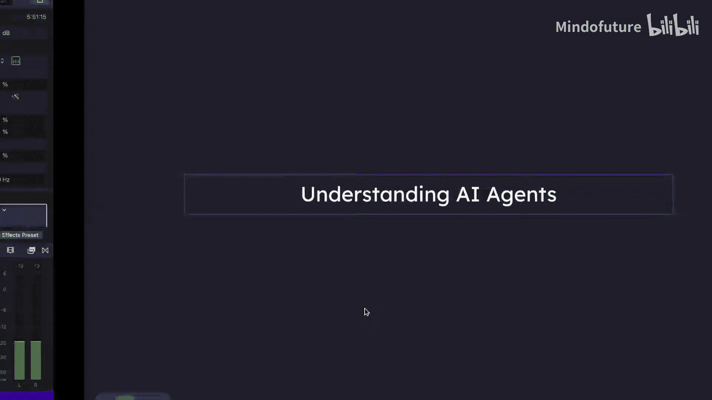
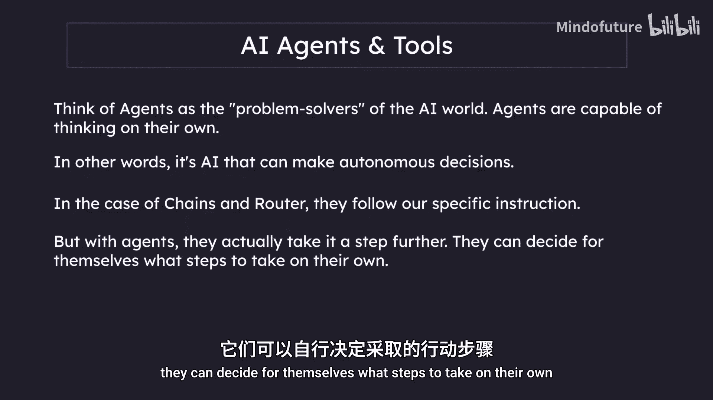
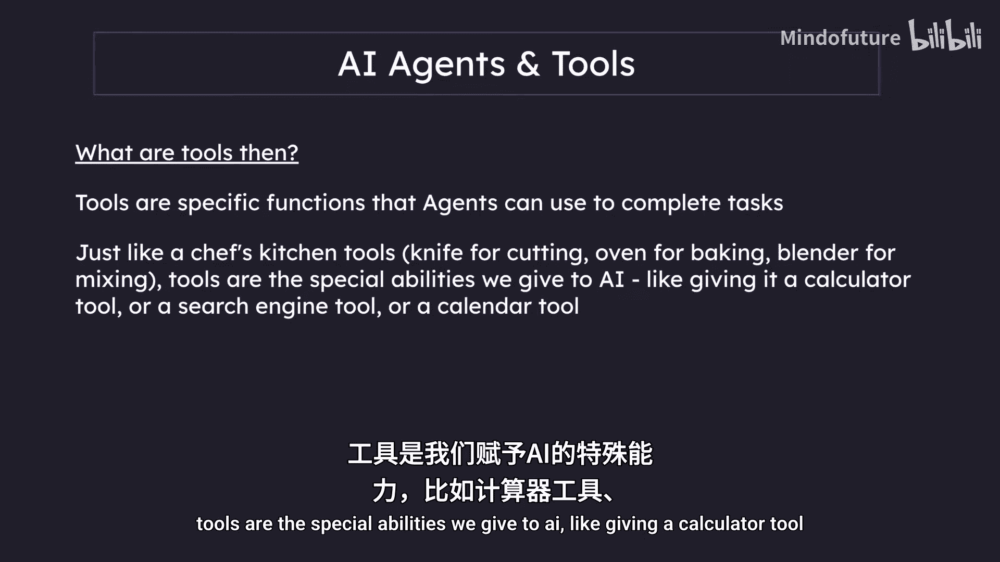
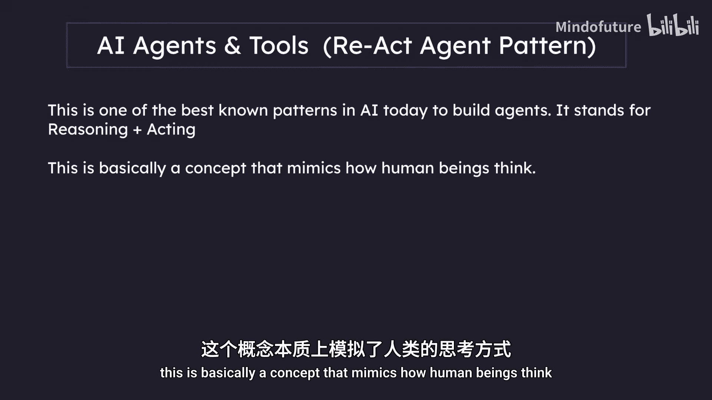
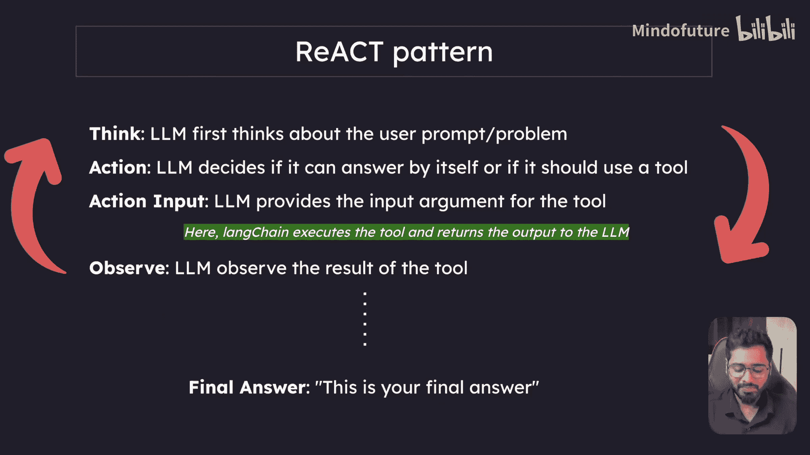
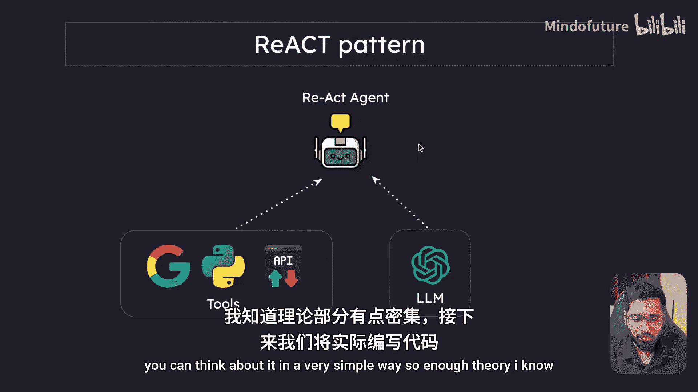
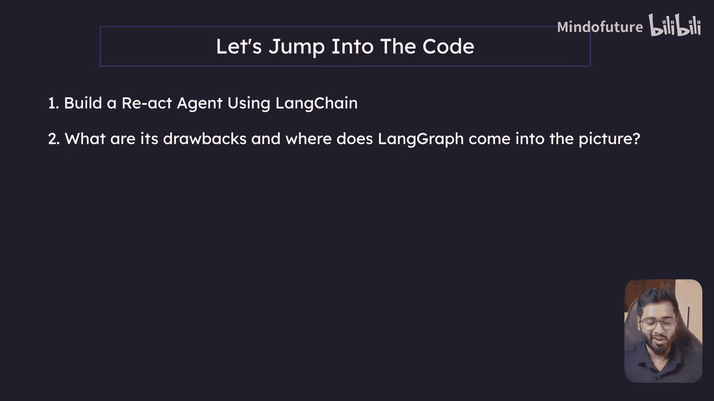

# Langgraph初学者入门2025 p03 P03_#3_代理与工具介绍 -BV1mgepzCEjf_p3-

Alright， So in this section， let us understand AI agents。

 So you can think of agents as the problem solvers of the AI world。😊。

Agents are capable of thinking on their own。So in other words。

 it's AI that can make autonomous decisions。In the case of chains and routers。

 they follow our specific instruction， but with agents。

 they actually take it a step further they can decide for themselves what steps to take on their own。

😊。

But what are tools then。Tools are specific functions that agents can use to complete tasks。

Just like a chef's kitchen tool， knife for cutting oven for baking blender for mixing tools are the special abilities we give to AI。

 like giving a calculator tool or a search engine tool or a calendar tool。😊。

So， how can we actually create an agent so lets actually look at you know a very popular pattern that we use to create AI agents and the pattern is called react agent pattern okay。

😊，So this is one of the best known patterns in AI today to build agents。

 It stands for reasoning plus acting。😊，This is basically a concept that mimics how human beings think。

So let us actually look at what this pattern is all about。

So you can see here that we first have a thing and then an action and then an action input and then we have something else and we have observed Okay so what is this all about let's get some clarity on what is this react pattern because this is very。

 very important to understanding a lot of things okay so it basically react pattern is sort of mimicking how human beings think okay so for example if we look at a particular problem first we think about the problem okay so how do we solve this okay what exactly is the problem okay so we identify this is the problem and then we then identify what is the action that we have to do to solve that particular problem right so first thinking happens and that is exactly why we have think right here and then we have to take action to solve that particular thing right so that is why we have action so what then happens we take some action and then we observe the result of that particular thing is it solving it is it giving some other answer you know we actually do that。

😊，Observation right so that is why we have the observe right here so we basically humans we observe the result of it and then we tweak it if basically if we get the answer that's it its over the cycle is over but if we don't get the answer we again you know think okay what happened right so that is why we have think action observation think action observation in loop until we get the final answer so let's actually take it step by step so first we have think the LLM first thinks about the users prompt or the problem Okay so next thing is action okay LLM decides if it can answer by itself or if it should use a particular tool。

😊，Okay， and then if there is a tool available to that particular agent to solve that particular problem。

 basically you can imagine it as a python function right any function requires some arguments。

Late some inputs。So that is going to be the action input。

 The LM provides the input arguments for that particular tool。😊，ok。

Now the LLM is just going to decide okay this is a proper argument that can be passed into the particular tool so now the control flow comes back to longcha to our system okay so here L chain executes the tool and then returns the output back to the LLM。

Okay， so once。So its basically like LLM is thinking it is executing the tool。

 but actually it is just suggesting the the input the control flow is coming back to our system。

 our system function is executing that particular tool with the arguments that the LLM suggested and then the output of that function execution is again sent back to the LLM。

😊，So the LLM has complete context of what happened before as well。 all the think action observation。

 think action observation， everything， all the context is available to the LLM。

 So it is actually looking at the output of this tool right so that is what this observe is LLM observes the output of the tool So if the output is like it's enough okay I have actually found out the answer to the particular problem if it is if it is found it out。

 then it is going to end it right here。 if there is some other additional information right if this is a complex problem。

 it is a multi step problem in that case you know there is going to be another cycle happening So this cycle is going to keep on repeating Okay so that is in a nutshell what react pattern is all about So here is another diagram that Ive prepared basically to help you visualize you know in a very simple way what makes an agent right So whenever there is an LLM。

😊。

Basically the reasoning ability of an Llum which is a brains。

 this is a brain right whenever you you know equip a brain with some tools right here right if you equip the brain with the ability to you know make API calls or Google make a Google search or run a python function combining both of it together gives rise to an agent okay so that is how you can think about it in a very simple way So enough theory I know it's been a little dense so in the next few sections we'll actually be coding it out and you know so you'll be able to better understand how things work。

😊。

All right， so first off， what we do is we will build a very， very basic react agent using L chain。

And then we will then look at what are the drawbacks of doing it that way。 and then we will then。

 you know， sort of segue into what does La graph do and how does it come into the picture。

 What does the problem that it solves。 Allright， so I'll see you there。😊。

