# Langgraph初学者入门2025 p04 P04_#4_代理与工具实现 -BV1mgepzCEjf_p4-

Hello guys， welcomee to the section In this section。

 we are going to be learning how to build a react agent using Lacha from scratch and this is particularly important because this will form the foundation for the rest of the course because later on we'll be building the same thing using La graph and you will be able to see the differences very easily。

 So let us go ahead and set up the development environment。

 So the first thing that I'm going to do is I'm just going to create a folder called La graph let's say and I'm going to open it in my visual studio code。

😊，Okay， let's make sure that it is all zoomed and properly。 All right。Okay， so to start off with。

 I'm going to create a virtual environment。 if you are used to doing it with poetry， you can do it。

 but I like to do it with a very simple virtual environment。 So I'm just going to say Python3。😊。

D dash M basically stands for module。 So we are using a particular virtual environment module inside of Python。

So we can say B E and V， and we can give the name of the folder that will be getting created here as well。

These are prerequisites。 a virtual environment is basically something where you can have all of your packages contained and you don't want to have it available globally。

 right。😊，Okay so now that the virtual environment is created right here。

 we have to go ahead and activate this virtual environment next。

 so basically we have to go inside of this bin and then activate this particular file so I'm just going to say source V E and V bin and then activate。

😊，Perfect。So now you can see that in the terminal you can see that we have this V E and V right here。

 So the next thing that I'm going to do is I'm going to create a folder。😊。

Called one underscore introduction。So let's create a file inside of this。

 and this could be a simple react。😊，Basic。React agent， basic。Okay。

 so let's talk about the dependencies that are required to run a react agent。

 so obviously the first one would be installing the long chain classes right so I'm just going to say with install。

Launching and the second thing since we are building a react agent。

 basically if you remember what agents are they are basically the reasoning ability of an LLm plus tools right so we might also have to install Laing community because community in the community package there are pre builtilt tools that we can easily use so we'll be using one of that and in this particular section we'll also be building our own custom tool as well So you're able to see the full extent of what is possible So let's actually go ahead and install La underscore community。

😊，And the next thing that I want to install is a chat model。

 and more specifically Google's chat model。 If you do not know what chat models are。

 they are classes that Lcha provides out of the box which lets you you know interface or rather communicate with LLMs very easily。

 So I'm going to be using the Google's chat model because it is free and I want to make it make this particular course accessible to as many people as possible。

 So you can just come to Google if you if you want to know what is exactly the package that you want to install。

 you can just say Lcha。😊。

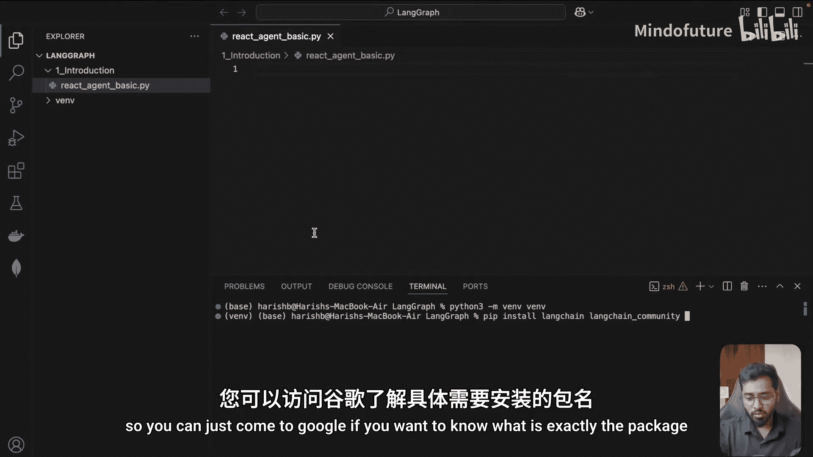

And Google chat model。 And that is going to give you the exact document right here。

 If you want to switch to， you know， open AI for some reason， you can just say open AI right here。

 and this is going to give you another chat model。 But right now we are interested in the。😊。

Google Generative AI chat model。 So let's click on the item。

And you can see that this is the package that we want to install so I'm going to add this here as well and let me think what else do we need So we might also you know for this particular chat model we might also have to have environment variables right because and then we have to make that environment variables available in our Python file and for that we might need the Python data sorry Python。

😊。

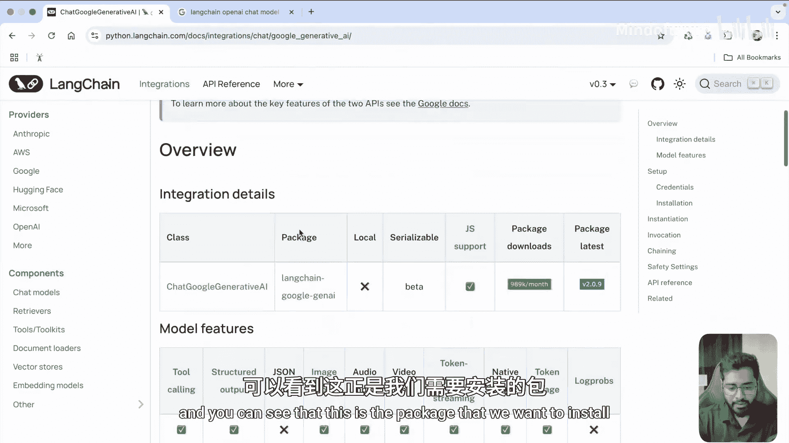

Hyhen dash dot E and B， alright。So since there's quite a lot of packages， it might take a while。

Alright， you can see that everything is installed right now。Great。

So let's actually go ahead and start importing our first chart model so I can just say from。

Lunangchain， Google， Gen AI。Import。Chat， Google generative AI， okay。

And I just want to test if everything is working fine。 So I just。

 I just want to make a simple L M call， you know， something very silly and make sure that everything is working fine。

 So I can just say L L M。 and I can just initialize this particular class。😊。

So we have the model right here and I can see invoke on it if you do not know what we are doing right now。

 I've made a separate again guys I've made a separate long crash course where I'm going in depth on chat models but we are not going to be deep diving into that So we have the model right here and we are going to be invoking on it and we can just say something like you know give me。

A fact about cats。 I don't know， right， Something very simple。

So we are going to be getting the result right here。We can just go ahead and print it。

And before I run it you can imagine that it's not going to work because we haven't really provided any API key right so let's actually go ahead and create a dot AV file right here and I'm not really sure you know what property to put here so I'm just going to go back to the documentation let's click on this and you can see that this is the key that the class requires。

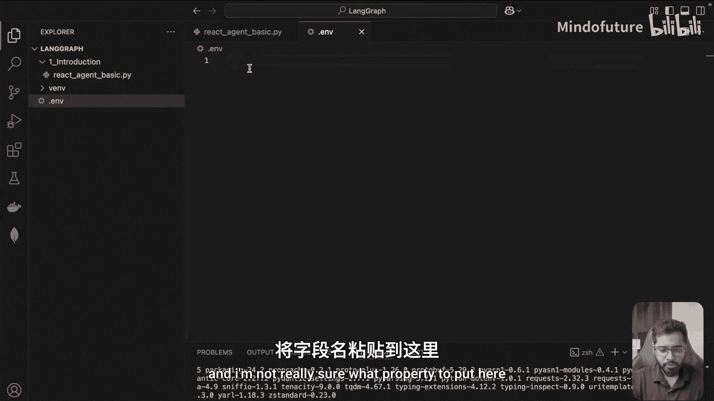

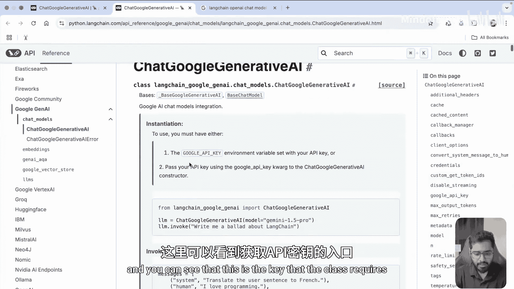

So I'm just going to put this here and as for the key itself， Im going to go to AItudio。 gogle。com。😊。

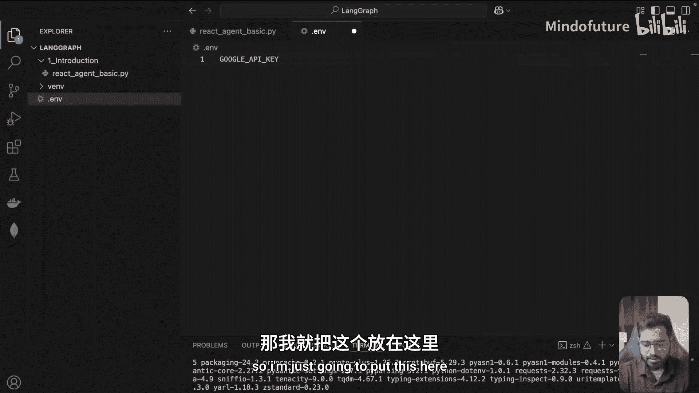

And basically just log in， and you can see that we have the APII key right here。

And I've already created a couple of these things。 I'm just going to create another one。😊。

So I'm going to choose this particular project。Couldreate API P I Q。

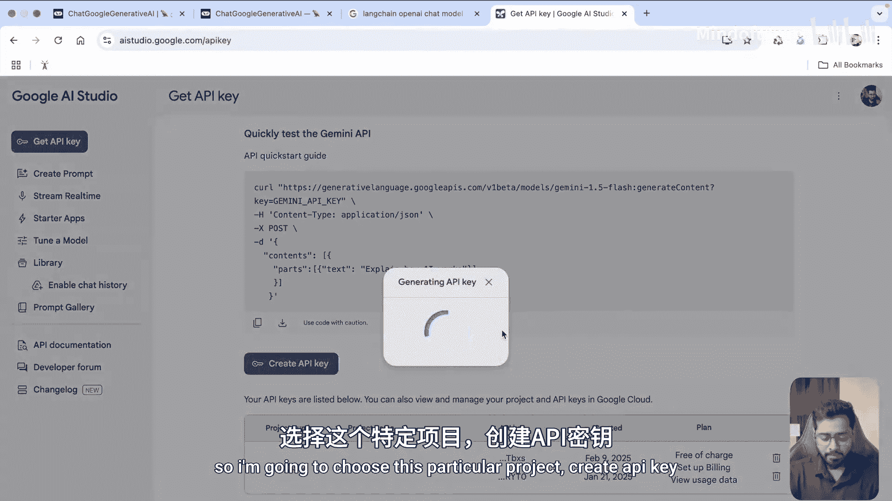

All right， so the key has been generated going to copy it， put it right on。

And now the second step is to actually have this environment variable be available inside of this particular file right we need to load the environment variables and for that we already installed a package so I'm going to say dot E and V and then I'm going to import the load dot EV。

😊，So， I have to。Cause this particular method right here and now basically everything that we have inside of here is going to be available in this file alright。

 so now everything should work fine so let me actually go ahead and run this file。😊，Okay。

 so the reason why this is not working is because we have to provide a model writer。 Okay。

 so I'm going to say Gemini dot。😊，Gmini dash 1。5 pro。 Okay， so this is the model that I want to use。

Alright， so let's go ahead and run this again。Perfect， you can see that it returns the content。

 which is cats can jump up to six times they hide。 All great。

 So now that we know that everything is working fine。

 Now I want to go ahead and give a slightly more complicated prompt that the LLM itself would not be able to answer。

 So， for example， we know that LL M is just the brains， right。

 It does not have any capability to access real world information like it cannot go and make a Google search。

 It cannot actually you know hit APIs or anything like that。

 right So I want to force the LLM to answer something that it cannot answer by itself。 So， you know。

 I'm gonna think something funny I'm going say。😊，呃。

Give me a tweet about today's weather in Bangalore。

You can imagine that the LLM couldn't possibly give an accurate answer because it cannot access today's information because it cannot access you know the Google search API or anything like that right so let's actually go ahead and let's see what happens。

😊，Alright， so you can see that it is Bangallow weather today Listen with a mix of sun and clouds。

 expect a high， you know， you can already see that it has placeholders right here and a low of might feel a bit humid。

 You can see that this is not really accurate。 what is essentially happening is the LLM is sort of hallucinating an answer an accurate answer。

 It is thinking that it is giving an accurate answer， but it is actually not。 Okay。

 so this is exactly why we need to provide tools to the LLM so that it can actually use those tools and then you know call those particular functions and get accurate answers。

 So let us see how we can actually go ahead and create an agent。😊。

So I'm going to comment both of these lines out and I'm going to use a method that Lcha providess out of the box which is called initialize agent。

 so I'm just going to say Lcha or agents I'm going to use the agents module and from that I'm going to use the initialized agent method。

And this is a very convenient method that La chain provides that lets you create an agent very quickly so I am going to say agent and then I'm going to use this initialized agent and this takes in a couple of properties So the first one is it takes in the list of tools we don't really have any tools right now but we will build it later on。

😊，And secondly， we have to provide in the LLM here as well， so we can say LLM equals LLM。😊。

And the next thing that Im going to provide is the agent type。

 So you can see that if I were to hover over this， we can see that we have to provide the agent type here。

 Okay， so I'm going to provide the zero shot。😊，React description。

So I know that we haven't actually looked at the exact prompt the react prompt yet。

 but we will look at it in a minute， but we already know that you know it follows the thought action observation。

 thought action observation loop right so we will look at the actual prompt later on it is big in inside of this particular method so if you are wondering also what is zero shot it basically means that you're prompting the agent the agent is doing something without any prior knowledge you're not actually giving it examples or anything it is doing it based on its own reasoning ability from scratch without any prior knowledge that we are giving it alright and finally I'm also going to provide vervose equals true so that you know every time some information something is happening inside of the agent well be able to see exactly what it is thinking what is observing everything in the console right here cool now let's actually go ahead and invoke the agent and now we can provide an our prompt right here。

😊，So I'm going to copy the same prompt that we put in earlier。And let's see what happens。

 We don't really have to return a particular result and then print it out because the verbo is true already。

 Okay， so let's actually go ahead and run this file。 Let's clear the terminal。And run this file。Okay。

 so it says that got no tools for a zero shot agent。 At least one tool must be provided。 Okay。

 so if you get this error， just make sure that there should be at least one tool provided in this particular list right here。

 So right now you must think about what is that tool or tools that we have to provide to this react agent in order for it to use it and then solve this particular problem of giving a tweet about today's weather in backload。

 So you can imagine that we need the Google search tool right So for this there is a prebu tool we are going to be using a prebuilt tool first and then well also see a case where we can write it by ourselves as well。

 So I'm just going to go ahead and say Lacha。😊，Community dot。Do this。And from this tools。

 I am going to use the Tli search。

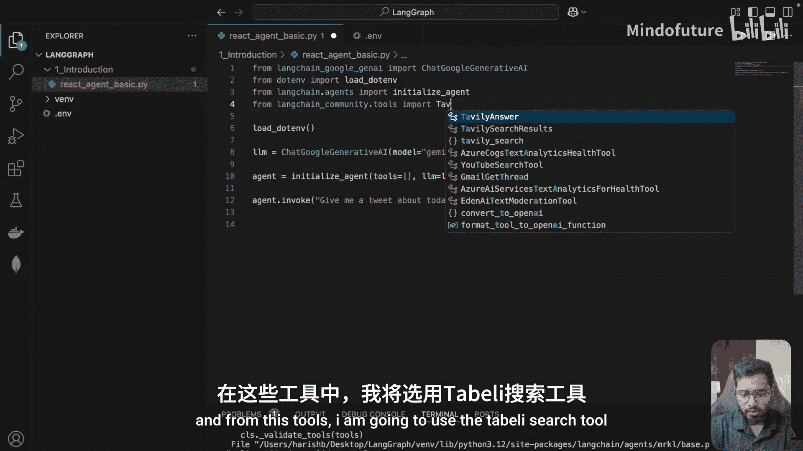

都。So if you are wondering what this W searches， it is basically a tool that is specifically written for you know what we are building which is the LLM applications and under the hood it basically makes a Google search okay so Im going to go ahead and say search tool okay let's say search tool and let's go ahead and initialize this particular class。

😊。

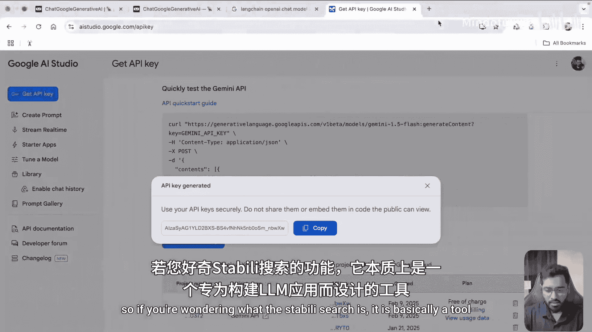

And also regarding the arguments that we have to send inside of this class。

 you can see that we already have plenty right here， we can leave most of it as default。

 but the one thing that I want to change is the search depth right here you can see that the search depth is set to advanced we don't really want advanced for this case advanced basically means that it is going to collect a lot more information a lot more data from the search results but we the query that we have right here is going to be a very simple query so we don't really you know need that much information so I'm going to set it to the search depth I'm going to set it to basic。

Alright， now。I can say tools right here。 I can basically just move this outside。

 and I can provide this。downown here。Alright。 So let's actually give this a whirl again。😊，Let's see。

 what happens。Okay， so you can see that it says the W API key is not provided because you can imagine that making a Google search is also something that。

 you know， costs somebody else' money。 So， I mean， but W， you know， it provides a free tire as well。

 So I'm just going to go ahead and say W API key。😊。

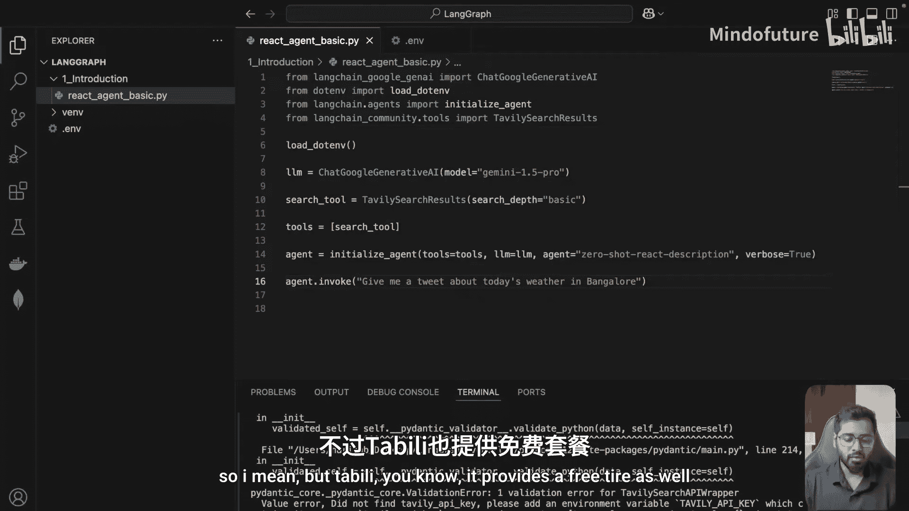

Let's go in here， and let's create an API key quickly。

So if you haven't logged in quickly go ahead and log in。Alright。

 you can see that I've already created one thing。 Let's create another one right here。

 So let's call it la graph crash course。😊，So you can see that this is also free。

 it is rate limited 200 requests per minute， so let's go ahead and create it。😊。

So Im just going to copy the key come down to the environment and what is the name that we have to provide you can see that it requires the Wli API key。

😊。

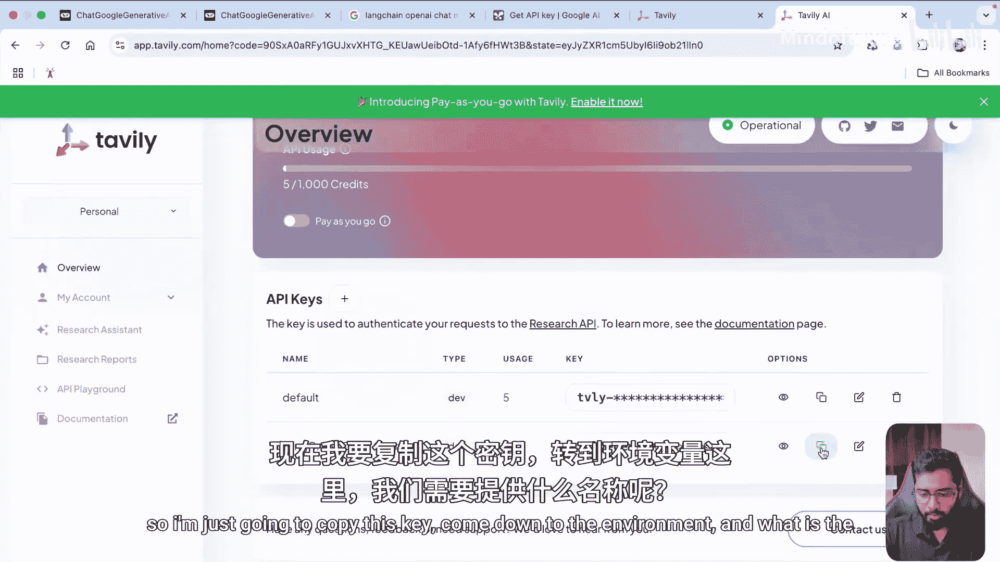

So let's put it before this。Let's save the file。And also， before I run it。

 let's make it a funny tweet。Alright， so let's go ahead and run this file。 Let's see what happens。😊。

Alright， you can see that it is entering the new agent Executor chain。

 this is a class that lives inside of this particular initialized agent class alright。

 so let's see what happens。😊，Remember what would happen first。

 it would think about the question and then action and then observation。 Think action observation。

 Allright， you can see that everything is done right now。

 Let's actually go through the steps that the LLM took in order to arrive at this final answer right here。

 So this is going to be very interesting。 Let's take it one step at a time。 Alright。

 So you remember that the react pattern is all about think observation。 I mean。

 think action observation。 Think action observation， right。

 So that is exactly what is happening right here as well。 So initially we have the question。

 This is the question that I give it。 This is the prompt that I give it。

 give me a funny tweet about today's weather in backlogla。 Now the LLM is thinking。

 what do I have to do first in order to solve this particular problem。😊。

So it is saying I need to find out what the weather is like in Bangalore today。

 Then I can try to write a funny tweet about it。 Okay。

 so this is the first problem that it identifies。 Also， the next thing is taking action right。

 So it is actually looking at all the tools that are available to it。😊。

If you are curious how the LLM has access to you know what are the tools that we provided here。

 so this initialized agent method is doing a lot of magic under the hood。

 it is providing the description of this particular tool as well as the you know the basically the contents of that particular function to the LLM so that is why the LLM is able to make a guess that this is the tool that I want to use Okay so it is saying I want to take action on this w search results chase on tool right here。

😊，So right after it identifies that you know， this is the tool that I want to use。

 it is suggesting an input to that particular tool。😊。

So basically tools select functions and functions require inputs right so it is actually suggesting this search term right here whether in Bangalore today。

 so as soon as the LLM suggests this particular thing and as soon as this observation basically streaming rate the LLM is streaming information as soon as this information keyword is encountered by this particular tool this this initialized agent method。

😊，The control flow is stopped。And the control flow basically comes back to our launch environment。

This is very， very important。 Okay， so up until this point。

 up until this point is where the LL M is in control。

 So right after this observation keyword is head。 this initialized agent is going to s the connection with the LLM。

 Okay， and it is going to come back。 And at the same time， this initialized agent also has access to。

 Okay， this is a tool that the LM suggested me to execute。 This is the input。

 So this particular tool is going to call this particular A search results tool。😊。

Okay I really hope that you understood this particular part this is very important if you don't understand it you can rewatch it Okay so our La it is going to execute this tool with the input that the LLM suggested and this is going to be the output of the tool and now as soon as the output of the tool is received by the La it is going to send the result again to the LLM。

😊，Okay so the LLM is thinking that okay this is the observation this is the output of the tool it is basically looking at the entire list thing so you can see that it is using the weather API you know the tool basically this is the output of the tool right so it's got a lot of information it's got a lot of information about today's weather in Balore and then the LLM is basically looking at all of the information and then it' is thinking to itself it seems the weather in Bangalore is sunny and bomb around 27 degrees Celsius that's good information for a tweet。

😊。

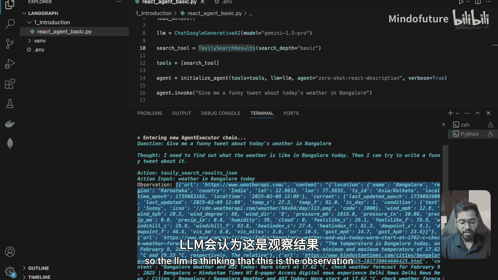

Okay， so it now has the answer to the problem。 It used a tool。 It function called and got the output。

 It is real world information， and now it has that information。 So the final thought is going to be。

 I can now write a funny tweet。 Okay， so right after the thought action observation is done。

 It is again thinking it is thinking to itself okay， now I have every information that I need。

 So the final answer is going to be Bangalore weather is so perfect today。

 I almost forgot I have responsibilities almost Bangalore weather， Sunny side up。

 So this tweet is actually very accurate and is grounded in reality。😊。

So this is a very simple example of an agent using tools and using the brain power of an LLM to achieve a particular output。

 So now you might have a small question， how exactly is this thought action observation thought action observation is happening so to do that is that is basically just a prompting technique react。

😊，Prompting technique is just a prompting technique。

 Let's actually take a look at you know what it is made of。 So to do that。

 Im just going to say the react。😊，Hub okay， so just go to this particular URL。

 This is where this is the particular prompt that。The initialized agent method is using inside under the hood。

Okay， so this is the prompt answer the following questions as best you can you have access to the following tools。

 So the list of all the tools are provided to the agent in a different format that it can understand。

 So we are also instructing the LLM use the following format question the input question you must answer the thought you should always think about what to do all of this we've already seen right。

Action， the action to take should be one of the two names。

 and that is exactly what we saw in the terminal as well。😊，And then action input。

 the input to the action， right the input to the tool。And then finally our observation。

 observing the result of the action， and then this thing goes on and on and on n times until all of the problems are solved in order to give the final answer。

😊，Okay， so finally we are saying thought I now know the final answer。

 and then finally we have the final answer， the final answer to the original input question。😊。

So this the question the actual user question is provided right here and this agent scratch padd is very important。

 So I told you in the past few sections where you know the LLM has complete context about everything that happened before thought action observation。

 thought action observation all of that history is maintained by that initialized agent method that I told you about and every time there is a new LLM call being made for the next iteration。

 all of that is provided in this particular placeholder。

 the context the history context is provided right here。😊。

I hope that makes sense if it does not make sense， rewatch it， try。

 you know reading some different blogs， attack it with different directions。

 and I promise it it will make sense。 So now that we have a react agent set up right now。

 I want to push it a little bit further。 I want to challenge the agent。

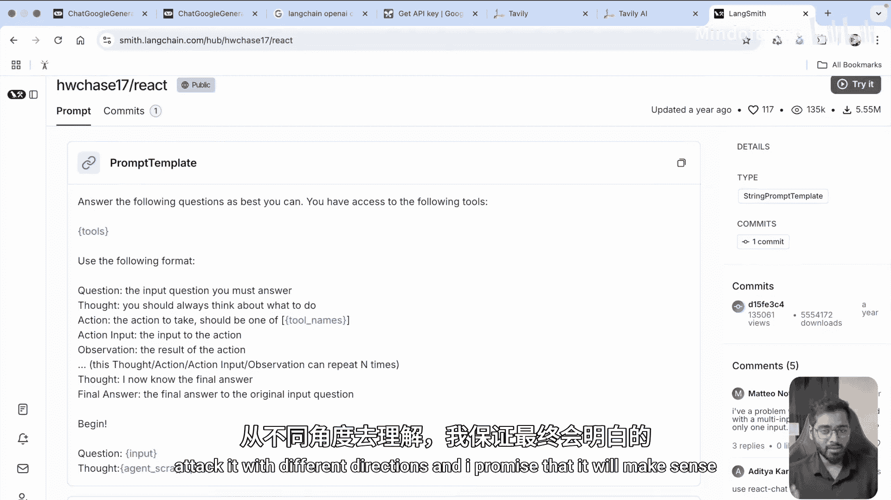

And I wanted to be able to use a few more tools in order to solve a particular problem So right now we know that weve provided it a Google search tool。

😊，So I want to think of a problem that would make it ask for another tool。 Okay。

 so let's say a couple of days ago， I， I noticed that Spaces launched a rocket。 Okay。

 so I'm going to， you know， say a tweet like。😊，Let's say， you know， when was。Space X last launch。

And how many。Das ago。Was that from。This instant。O。So basically what I'm trying to do here is that you know just knowing you know how many days ago or when the Spaces launch was that is not enough the agent also needs context about what is the current time of my particular system right here I'm currently in India right if somebody else to you know run the agent is going to show a different time So our agent not just needs the Google search facilities but at the same time it also requires the current system time which we have not provided as a tool just yet okay so we will be providing that later on。

 but for now I just want to run it and let's see what we actually get。😊，So I'm going to run this。

 Let's clear this out。Let's see what happens。 So again。

 you can see that entering new executor agent executor chain。

Okay so the question when was SpaceX's last launch this is what I provided and you can see that it is thinking I need to find the date of the most recent okay let's actually scroll up it is going to think for a while but let's actually make sure that you know we understand what is happening right here so it is thinking to itself I need to find the date of the most recent SpaceX launch and then calculate the difference between that date and today I can use the W search results tool to find this information Okay so this much you know it is first figuring out first part of the problem which is when did the SpaceX launch happen so it is actually providing the input to the tool which is SpaceX most recent launch date。

😊，And this is going to be the result of the tool。 It is again being sent back to the LLM and then fine let's see what happens next So it is thinking to itself。

 the search results indicate the most recent launch was a starlink mission on January 1 I think it's 18th 2025 now I need to calculate how many days ago was that okay Allright so you can see that this is the second problem that it needs to solve and now it is taking an action calculate input I mean calculate days since right so the action input is going to be this thing you can see that this is not even a valid tool right we haven't actually provided a tool like this it is actually starting to hallucinate a tool you know sort of trying to fit its own flow right but it is not going to work it is actually saying the observation calculate days since is not a valid tool Try one of these particular tools and it's saying that thought I can't calculate the days。

😊，Since the date using the available tools， I'll try searching for the number of days between this and this。

 I'll need today's date first。 And then it is doing another it's actually trying to figure it out using the one tool that it has guys。

 this is amazing So you can see what is what is today's date right And then it is making another API called today's date is February 7 or February 8 depending on the source in the time zone right right now。

 its it's actually neither right right now， it' neither Currently it's 9 where I am right now。

 but it is not accurate because we are not really providing the current system time。😊。

So you can see that there's another observation and then you know， it's not working。

This is a endless infinite loop problem， right If we don't provide the right tools。

 there is an infinite loop happening and we get problems like this， which is not going to work。 Okay。

 so which is why this actually brings us to another problem which we look at later this is one of the issues that we can run into when you know we try to work with react agents if we do not provide the right tools So let's deal with that later。

 but for now I'm going to provide a current system time tool so that the agent can actually make use of it get my current system time using a Python library datetime library and that should you know it should be able to solve it very easily So to do that I'm going to paste a tool that I've just written okay so this is a this uses the date time module I'm just going to quickly import the date time。

😊，Module right here。 Okay， so let's walk through what is exactly this particular function。 Okay。

 so this function basically just returns the current date and time in this particular specified format。

 Okay， so this just takes so this just makes use of the date time module and then it formats it based on this particular formatting right here。

 So if the LLM in the future were you know needs only the time or the minutes or the years or something it can actually modify this particular input argument But for now we are just having a default argument right here which we are providing and this is just going to return the current。

😊，System 9。So now lets actually make this tool available to the agent so to do that we we can just put it in this particular array and that is set。

But if you run it it is not going to work because there is one more thing that we have to do。

 which is we have to explicitly let La know that this function is a tool and to do that we can just go right here we can just use this tool this thing and then we can use this particular notation and this is going to make it apparent to Lain that this is going to be a tool so accordingly it is going to format it and send it to LLM。

😊，Right，All right， So now it should So now to to solve this particular problem。

The agent has all the tools required， so lets actually give it a whirl again。

And we should be able to get the final answer。 Let's try it。😊。

And also guys you can see that it says land graph， you know it is already suggesting that you know this is deprecated use land graph right because that is the direction that we are also going in this particular course。

 but for now let us actually learn how react agents work first。😊，Entering new agent Executor chain。

 Let's wait for a while。 Alright。 So the question， this is my question， thought I need to。

 let's scroll up。 So thought I need to find the date of there this thing this we've already seen the last time it's searching this thing。

 It's sending this particular keyword to the search tool。

The search tool is you know calling and it's outputting this particular result coming down。

 it is again thinking it seems the last confirmed launch is January 15。

 I need to get today's date to calculate the difference right So it is saying this and now it is properly going and looking at the tool that we've provided which is the get system time tool it is also providing the input that the LLM wants the tool to execute with okay so instead of instead of this hours minuteise secondscon it is only providing years months and date right it is actually making an intelligent decision right here and again the control comes back tocha and then this tool is this particular tool is executed by Lcha and then this is the observation which is again sent to the LLM and then thought today is February 92025 the last launch was around January 15 thats roughly 25 days ago So the last Spacex launch was around。

😊，Onary 15， which is approximately 25 dig ago。So this is an accurate answer that is grounded in reality and that the agent is actually making use of real world APIs。

 real world functions， real system time in order to calculate this thing and that is the power of react agents。

😊，But a couple of minutes ago we saw that we ran into the infinite you know reiteration problem right because if we do not pass on the right tools then you know the it can actually misbehave so that is one of the disadvantages but this also a few other disadvantages so I hope that this was clear in the next section we will actually look at what are the disadvantages when it comes to using react agents and how does la graph actually solve those problems so I'll do there。

😊。

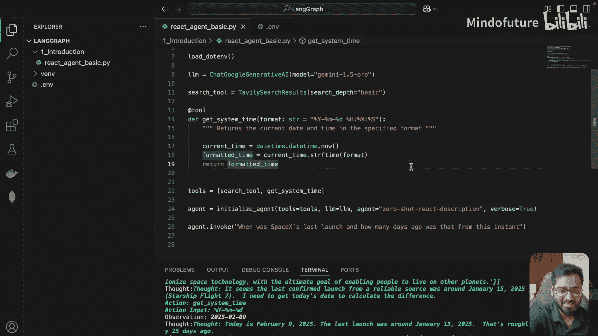