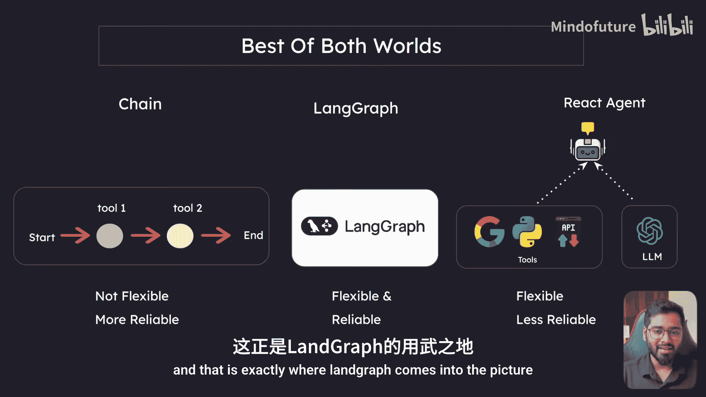
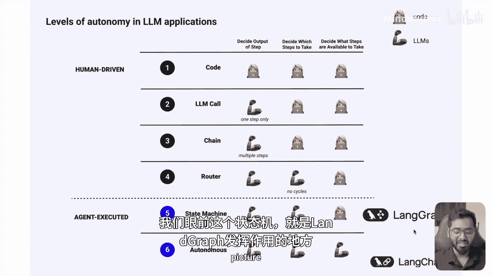
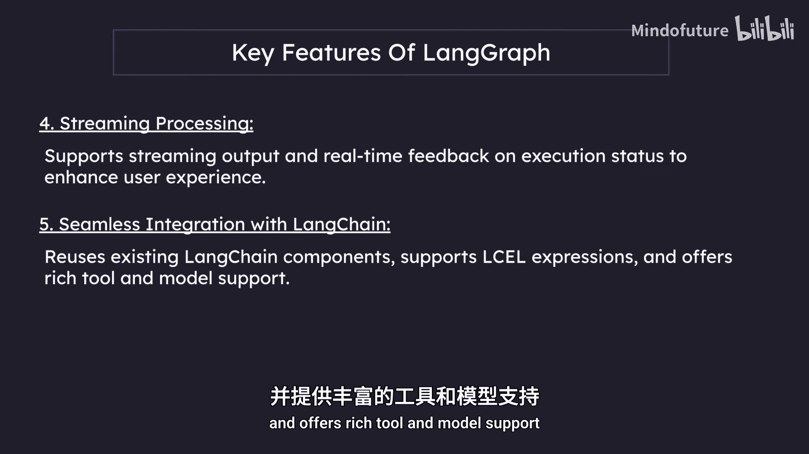
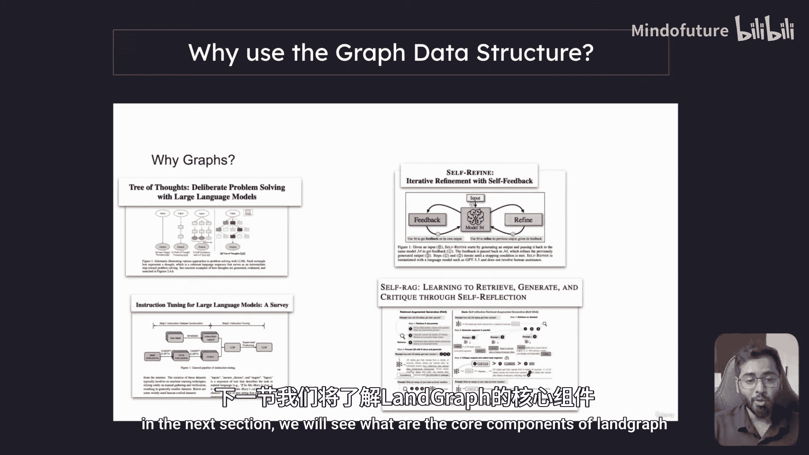
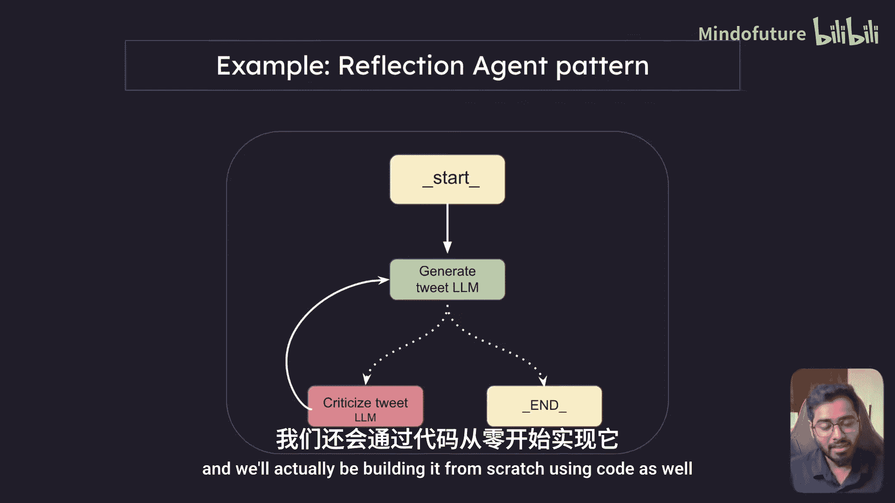

# Langgraph初学者入门2025 p05 P05_#5_React代理的缺点 -BV1mgepzCEjf_p5-

Hello guys。 So in the previous section we went ahead and built a react agent using Laing In this section。

 well actually go ahead and look at what are the drawbacks of using react agents using Laing and where does La graph actually come into the picture。

 So let's look at an advantage actually of react agents。

 So we saw that the react agents are flexible right any state is possible right here。

 Okay so what we mean by that is we start the execution and if we have the first tool。

 it executes the first tool and comes to an end if there is a tool。

 it executes a particular tool tool to figure out the problem and comes to an end and there is also situations where the tool one could be executed first and the tool two could be executed first and it could also be the opposite。

 Okay so we in the previous section we saw it executed two tools right first it used the w search tool to make a Google search and then figure out know when was the basics launch worse and then it figured out the current time it could have also done at the opposite。

😊，It could also figured out the current system time and then went ahead and did the W research as well。

 So that is what we are seeing right here。 Okay， so react agents are very， very， very flexible。😊。

But high flexibility can also mean less reliability。 Okay so this is an example that we saw as well。

 wherein you know， the tool one keeps on getting called again and again and again and it goes on till infinity。

 thankfully Google Gemini it stopped it right there。

 but you know infinite loops are a pretty big problem with react agents。

 That could be a couple of reasons why this happens。 We see that， you know。

 we did not define the tools correctly。 the LLM is not capable enough or the prompting doesn't define a clear end condition okay。

😊，No。So basically we have the chains on one hand。 we have the react agent on the other hand。

 So this is what we saw just now。 the react agent is very very flexible but it is less reliable because it is not really in our control completely alright and on the other hand。

 we have chains right here we we saw that chains are like a fixed assembly line right。

 it is not really flexible but it is more reliable。😊，Right。

 so we need something that has the best of both worlds。

 We need something that is going to be flexible， but at the same time reliable。

 and that is exactly where land graphs comes into the picture。 Okay。

 so it is going to be flexible as well as reliable。 So this state machine that we see right here。

 This is where land graph comes into the picture。 Alright， so let's what is land graph。

 let's look at the textbook definition of what is a land graph。

 it is a framework for building controllable persistent agent workflows with built in support for human interaction streaming and state management。

😊。

It uses graph data structure to achieve this thing。

 So this is a very simple preview of how the graph data structure looks like and how we can actually build agents So we have the start node right here and we have the agent right here there is an action that agent takes and then it can continue this particular thing and then once it is reached the end point it comes to an end okay so I don't want you to think too much about what this is but just know for now that this is how the structure looks like。

😊，So let's look at the some of the key features of land graph。

 So the first one is looping and branching abilities。

 We've already touched upon it in a few sections ago， but let's look at it again。😊。

It supports conditional statements and loop structures allowing dynamic execution parts based on state。

😊，State persistence。Automatic saves and manages state supporting pause and resume for long running conversations。

😊，Human machine interaction support。It allows for inserting human review during execution。

 supporting state editing and modification with flexible interaction control mechanisms。

Let's look at the fourth one， streaming processing。

Supports streaming output and real time feedback on execution status to enhance user experience。😊。

Seammless integration with lunch。Reus's existing Laangchain components supports the Lcha expression language and offers rich tool and model support。

😊。

And now you might have a question why do we use the graph data structure for building land graphs Why not use some other easier data structure to handle it So the answer is that you can see that a lot of the papers a lot of the research papers have been published to solve difficult problems they all use the graph data structure because it is flexible but at the same time it is controllable it gives you a lot of flexibility but at the same time it cannot actually have a lot of autonomy a lot of autonomous decision making baked in into those particular into those data structures and that is it for the section in the next section we will see what are the core components of land graph so as you there。

😊。

Hello guys in the section we will look at what are the core components of land graph。😊。

So you can see that the core components there are four core components we have nodes， edges。

 conditional edges and state， so I'll give you a very simple example to understand these different components and that example is the reflection agent pattern。

This is something that we will be looking at sort of deep dipping into the later part of the course。

 but for now Ill give you a very small overview of what this is capable of。😊。

So whenever we talk about a reflection agent pattern we are always going to have something that is going to generate something and we are always going to have something that is going to critique that particular thing basically you know this is not good。

 this is not right we have to make this better so this is the criticizing component and we have the generation component so as a whole what this is doing is one agent is going to generate a tweet。

😊，Okay， so this agent's only primary job is to generate a tweet and any time you know something else criticizes that particular you know tweet it is going to make the tweet better so this only focuses on generation。

And this this LLM's only job is to criticize a particular tweet。

 It is going to say okay to make this viral。 you have to make this shot。

 we have to make this punch here。 you have to you know add a call to action。

 Okay so that is what this does。 So basically whenever a graph is going to start we are always going to have the start node right here and then right after the start node is executed the control flow is coming to the generation tweet LLM right after the tweet is generated There is going to be two different options。

 Okay， so there's going to be two different options。

 It can either go to this particular criticized tweet LLm or it can end the process right here Okay。

 so it is let's say it is going to come to this particular node in in that case。

 this LLM is going to look at the tweet that this LLM generated and it is going to crique it。

 and that is why we have an arrow pointing right here。

 Okay so it this can look through several times to make the tweet really good to polish it。😊。

iteratively make it better and better and better and after a certain number of iterations that we specify as developers it can actually instead of going to this particular branch it can end this particular process and the reason why I wanted to rush through it is because we are just learning the core components of land graph right now so let's look at what are the core components so these things that you see right here this start block this generate tweet LLm block this end block so these are what is basically called nodes okay so if I come back here this nodes that you see right here these are the nodes。

😊，Okay， and let's look at the second one edges。 So what are these edges。

 So you see these straight these lines。 These are dotted。 These are not edges。

 These lines are the edges。 basically whatever connects to nodes or what is called edges Alright let's look at the third one conditional edges。

 What does this mean So I've actually made it very clear that this dotted line is what is going to be called the conditional edge because right after the execution of this node it can either go here or it can either go here based on a condition。

 Alright， so that is why we have a conditional edge right here。

 and finally we have state right here So state it should be pretty intuitive to understand state even in this particular simple example you can you can sort of imagine that this LLM is generating something and then this LLm this red LLM is going to give a feedback and then this green LLM is going to generate something for that again。

 so the entire context needs to be maintained right。😊。

So that is why the state is also going to be a core comparative La graph so I hope that makes sense in the next section we are going to be deep diving into what this reflection agent pattern is how to build this what are the why do we even have to build it what are the real world applications and we'll actually be building it from scratch using code as well so as you there。

😊。

